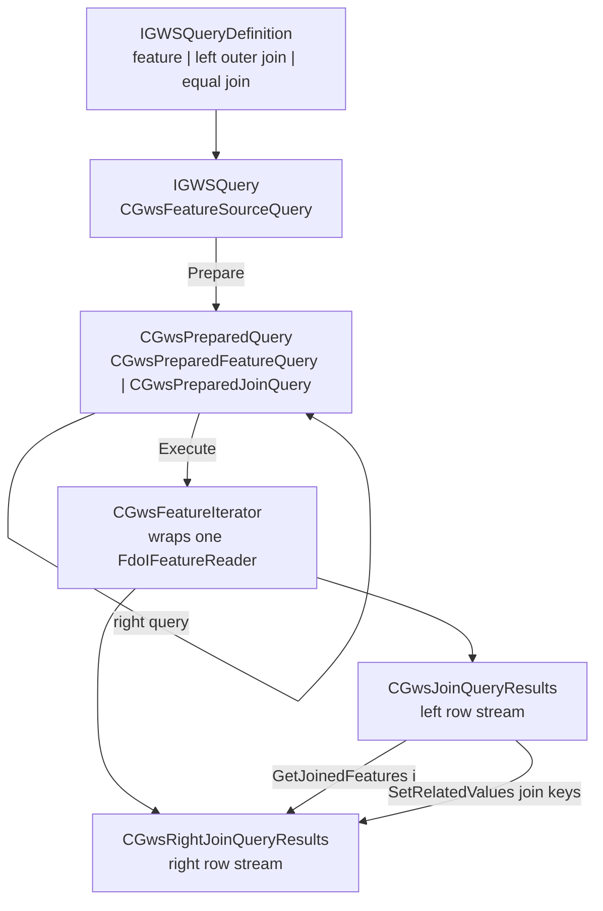
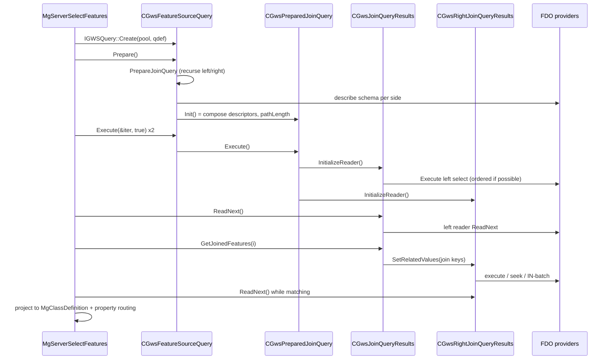

# MapGuide's GwsQueryEngine and the feature-join pipeline

**Question asked:** what is the `GwsQueryEngine` library for, beyond "in-memory feature joins over
FDO readers"? What are the other parts of it for — and, in particular, how does a **join
specification in a feature source** turn into a **composed feature reader that merges two FDO
feature readers**?

**Answer in one paragraph:** `MgGwsQueryEngine` is a small, self-contained **client-side query
engine**: it takes a *tree* of query definitions (a feature query, or a left-outer / equal join of
two query definitions), resolves each leaf into an ordinary FDO `Select` (or `FdoIExtendedSelect`)
on an FDO connection supplied by a caller-provided connection pool, and returns an
`IGWSFeatureIterator` that looks like one feature reader but is really a **pair of FDO readers
joined row-by-row in memory**. The join is executed by one of four nested-loop / sort-merge
variants chosen from what each side's provider can do (`ORDER BY` or not); only the **join key
values** cross from the left reader to the right reader, via `GetJoinedFeatures(i)` +
`SetRelatedValues(...)`. MapGuide uses it for exactly one thing: a **feature source `Extension`**
(a named "join class") composed of a primary feature class plus one or more `AttributeRelate`s.
`MgServerSelectFeatures::JoinFeatures()` translates those `AttributeRelate`s into
`IGWSJoinQueryDefinition`s, the engine joins them, and `MgServerGwsFeatureReader` projects the
nested result back into a single flat `MgReader` whose secondary properties are named
`<relationName><AttributeNameDelimiter><propertyName>`. Everything else in the library — the
binary feature serialiser, the mutable-feature type, the insert/update/delete/lock command
wrappers, the "flat" reader adapters, the multi-select iterator, the query-definition XML
writer — is either a supporting part of that pipeline or a **left-over of the Autodesk-era
feature-cache and editing product** that has no caller in this tree.

| Item | Revision / version |
|------|--------------------|
| `mapguide/MgDev` working copy | `branches/4.0/MgDev` r10218 |
| Code analysed | `Server/src/Gws/{GwsQueryEngine,GwsCommon,GwsResource,Include}/**`, `Server/src/Services/Feature/{ServerSelectFeatures.cpp,ServerGwsFeatureReader.*,JoinFeatureReader.*,GwsConnectionPool.cpp}`, `Portable/MgPortable/Services/Feature/**`, `Common/MdfModel/AttributeRelate.h`, `Common/Schema/FeatureSource-1.0.0.xsd` |
| API/ABI mode at time of writing | `freeze` — this is a read-only analysis; nothing here changes a shipped header |
| Runtime check | none performed: no MapGuide build container was running (only the `dbs/*` fixtures), so all findings are static. §11 says how to confirm them. |

---

## Contents

1. [What the library is](#1-what-the-library-is)
2. [Vocabulary](#2-vocabulary)
3. [Where a join specification lives](#3-where-a-join-specification-lives)
4. [The object model](#4-the-object-model)
5. [The join pipeline, end to end](#5-the-join-pipeline-end-to-end)
6. [The four join algorithms](#6-the-four-join-algorithms)
7. [Property addressing](#7-property-addressing)
8. [The rest of the library](#8-the-rest-of-the-library)
9. [Sharp edges and limitations](#9-sharp-edges-and-limitations)
10. [Where to change what](#10-where-to-change-what)
11. [How to observe what the engine chose](#11-how-to-observe-what-the-engine-chose)
- [Appendix A — public API surface](#appendix-a--public-api-surface)
- [Appendix B — file map](#appendix-b--file-map)

---

## 1. What the library is

### Three shared libraries

`Server/src/Gws/CMakeLists.txt` builds three libraries that are always linked together:

| Library | Source | Purpose |
|---------|--------|---------|
| `MgGwsQueryEngine` | `Server/src/Gws/GwsQueryEngine` | everything in this document: query definitions, prepared queries, join iterators, feature snapshots, command wrappers |
| `MgGwsCommon` | `Server/src/Gws/GwsCommon` | the engine's runtime: `IGWSObject` refcounting/locking, `IGWSException`/`EGwsStatus`, `GWSQualifiedName`, `GWSFeatureId`, FDO comparison/conversion helpers, XML SAX helpers |
| `MgGwsResource` | `Server/src/Gws/GwsResource` | the `IDS_STRING_eGws*` message strings `GwsCommonFdoUtils`/`GwsResourceUtil` resolve status codes to |

The public headers are `Server/src/Gws/Include/GwsQueryEngine.h` (the API) and
`Include/GwsCommon.h` (the shared types). Everything under `GwsQueryEngine/inc/` is private and only
included via `GwsQueryEngineImp.h`.

### Who uses it

Only two places in the tree call the public API:

| Caller | Files | Why |
|--------|-------|-----|
| MapGuide Server | `Server/src/Services/Feature/ServerSelectFeatures.cpp`, `ServerGwsFeatureReader.{h,cpp}`, `JoinFeatureReader.{h,cpp}`, `GwsConnectionPool.{h,cpp}` | feature joins for `SelectFeatures` / `SelectAggregate`, and the `MgReader` projection |
| MapGuide "Portable" | `Portable/MgPortable/Services/Feature/Commands/SelectFeatures.cpp`, `Services/Feature/GwsFeatureReader.h` | the same join code path, duplicated for the portable/serverless build (`MgPortable` links `MgGwsQueryEngine`) |

`Server/src/Core/CMakeLists.txt` and `Server/src/Services/Feature/CMakeLists.txt` link it; the
library is installed (`lib64/libMgGwsQueryEngine-4.0.0.so`, listed in
`Bindings/src/ApiDump/filelist.*.txt`) but **nothing in the Java/.NET/PHP bindings wraps it** — it is a
server-side implementation detail, not part of any binding API surface.

### What it is *not*

- It is not a SQL optimiser and not a query language. There is no parser for join syntax; the only
  "query language" is the `IGWSQueryDefinition` object tree the caller builds (or reads from XML).
- It does not push a join down to a provider. Each side is executed as its own `FdoISelect` on its
  own connection. (MapGuide has a *separate*, unrelated optimisation that pushes a join down through
  the FDO join API when the provider supports it — see §5.1.)
- It does not buffer whole result sets in the general case: the nested-loop and sort-merge iterators
  are streaming. Only the batch iterator keeps a bounded window (default 100 rows) in memory.
- It is single-threaded per query object and has no interlocked refcounting (`GWS_MULTHREADED_CLIENT`
  is never defined in this tree, so `GWSSingleThreadModel` is used). Query objects are
  request-local, which is fine, but do not share one across threads.

> The "Gws" prefix has no expansion anywhere in the tree. The code is
> `Copyright (C) 2004-2011 by Autodesk, Inc.` and came from the Autodesk MapGuide Enterprise
> lineage; the naming is simply the library's historical namespace.

---

## 2. Vocabulary

The code mixes the terms "left/right", "primary/secondary" and "feature/attribute class". They mean
the same two sides of one join:

| Term in the code | Meaning |
|------------------|---------|
| **primary**, **left**, **L** | the feature query that is also the base row of the result; the only one a `SetFilter` reaches |
| **secondary**, **right**, **R**, **attribute class** | the class joined *onto* the primary; yields zero, one or many rows per primary row |
| **join name / relation name** | `AttributeRelate/Name`; used as the property-name prefix in the flat view and as the connection-pool key for the secondary feature source |
| **join attributes** | the pair of property lists (`RelateProperty/FeatureClassProperty` ↔ `AttributeClassProperty`) compared for equality |
| **delimiter** | `AttributeRelate/AttributeNameDelimiter`; separates relation name from property name in the flat view (often empty) |
| **`ForceOneToOne`** | when true (the default), MapGuide produces one output row per primary row and reads only the first matching secondary row |
| **equal join / inner join** | `IGWSEqualJoinQueryDefinition`; primary rows with no match are dropped |
| **left outer join** | `IGWSLeftJoinQueryDefinition`; primary rows are kept, unmatched secondary properties read as null |
| **path length** | number of join levels from the root query down to a given node; a feature query has 0, a join has `left.pathLength + 1` |
| **extended feature description** | `IGWSExtendedFeatureDescription`: a class's property metadata *plus* an array of the joined class descriptions |
| **flat view** | what MapGuide exposes: one class whose secondary properties are renamed with the relation prefix |

---

## 3. Where a join specification lives

A join is **not** an operation in the MapGuide API. It is a *feature source resource* construct: an
`Extension` in the feature source XML declares a virtual class built by joining `FeatureClass` with one
or more `AttributeRelate`s. The schema is `Common/Schema/FeatureSource-1.0.0.xsd`; the model classes
are `Common/MdfModel/{Extension,AttributeRelate,RelateProperty}.*`.

```xml
<FeatureSource xmlns:xsi="http://www.w3.org/2001/XMLSchema-instance"
               xsi:noNamespaceSchemaLocation="FeatureSource-1.0.0.xsd">
  <Provider>OSGeo.SDF</Provider>
  <Extension>
    <AttributeRelate>
      <RelateProperty>
        <FeatureClassProperty>OWNER_ID</FeatureClassProperty>
        <AttributeClassProperty>ID</AttributeClassProperty>
      </RelateProperty>
      <AttributeClass>Default:Owners</AttributeClass>
      <ResourceId>Library://Joins/Owners.FeatureSource</ResourceId>
      <Name>Owner</Name>
      <AttributeNameDelimiter>.</AttributeNameDelimiter>
      <RelateType>LeftOuter</RelateType>
      <ForceOneToOne>true</ForceOneToOne>
    </AttributeRelate>
    <Name>ParcelsWithOwner</Name>
    <FeatureClass>Default:Parcels</FeatureClass>
  </Extension>
</FeatureSource>
```

| XML / model | Schema documentation (`FeatureSource-1.0.0.xsd`) | What the engine does with it |
|-------------|------------------------------------------------|------------------------------|
| `Extension/Name` | "Name of the extension" | the virtual class name; `MgServerGwsFeatureReader` renames the result class definition to it |
| `Extension/FeatureClass` | "the class whose attributes are used for joining other attribute classes" | becomes the **left** `IGWSFeatureQueryDefinition` |
| `AttributeRelate/Name` | "Name of the relationship that defines a join" | join name in the engine; connection-pool key; property prefix in the flat view |
| `AttributeRelate/ResourceId` | "the resource id of the attribute class" | which feature source the secondary connection is opened against |
| `AttributeRelate/AttributeClass` | "Name of class the feature class is joined to" | becomes the **right** `IGWSFeatureQueryDefinition` |
| `AttributeRelate/RelateProperty` pairs | "pairs of feature class properties (fields) and attribute class properties (fields) that define a join" | the two join-attribute lists |
| `AttributeRelate/RelateType` | "Type of the join" | `Inner` → equal join, everything else → left outer (see §9) |
| `AttributeRelate/ForceOneToOne` | "Force 1 : 1 in the case of 1 : many" | `IGWSJoinQueryDefinition::ForceOneToOne()`. `JoinFeatures()` keeps a running AND down the relate chain, so once one relate is one-to-many, that join node and every later one is one-to-many |
| `AttributeRelate/AttributeNameDelimiter` | "Delimiter symbol to be used by the UI to present an extended attribute" | used **only** by MapGuide's flat projection. The engine is always handed `"."` as its own `JoinDelimiter` (`JoinFeatures()`), and that value only reaches descriptor metadata |

A caller then asks for `SelectFeatures(featureSource, "Default:ParcelsWithOwner", options)` — the
extension name is the "class name". `MgServerSelectFeatures::FindFeatureJoinProperties()` looks the
name up in the extension list and only if it has `AttributeRelate`s is a join involved
(`ServerSelectFeatures.cpp`).

Two real examples ship as unit-test data:
`UnitTest/TestData/FeatureService/SDF/Sheboygan_Parcels.FeatureSource` (one relate, default
`LeftOuter`/`ForceOneToOne`, no delimiter, so the flat property is `Join1NAME`) and
`UnitTest/TestData/FeatureService/SDF/TESTChainedInner1ToManyJoin.FeatureSource` (two relates, the
second joined on `Join1.Autogenerated_SDF_ID` — a property of the *first* relate's class — with
delimiter `|`, so the flat property is `Join2|NAME`).

---

## 4. The object model



### 4.1 Query definitions — the *what*

Built by the caller, immutable afterwards, and mirror images of one another:

| Class | Public interface | Represents |
|-------|------------------|-----------|
| `GWSFeatureQueryDefinition` | `IGWSFeatureQueryDefinition` | `{select list, GWSQualifiedName, filter, order-by}` against one class |
| `GWSJoinQueryDefinition<T>` | `IGWSJoinQueryDefinition` | `{joinName, delimiter, forceOneToOne, left qd, right qd, left attrs, right attrs}` |
| `GWSLeftJoinQueryDefinition` | `IGWSLeftJoinQueryDefinition` | a `GWSJoinQueryDefinition` with `Type() == eGwsQueryLeftOuterJoin` |
| `GWSEqualJoinQueryDefinition` | `IGWSEqualJoinQueryDefinition` | a `GWSJoinQueryDefinition` with `Type() == eGwsQueryEqualJoin` |

`GWSQualifiedName(featureSource, schema, className)` is the triple that ties a query definition to a
connection: `FeatureSource()` is the string the connection pool is asked for, and
`GwsCommonFdoUtils::MakeFdoQualifiedName()` turns the other two into the `Schema:Class` the provider
expects.

Two properties of the tree matter downstream:

- `Filter()` on a join returns the **left-most** filter (`GWSJoinQueryDefinition::Filter()` delegates
  to `m_leftQd`), and `GetPrimaryQueryDefinition()` walks to the left-most feature query. A join
  definition has no place to put a per-side filter other than the leaf feature definitions.
- The tree is **left-deep**: joining a join to a third class produces `((A ⋈ B) ⋈ C)`. Nothing
  produces `A ⋈ (B ⋈ C)`.

The definitions also know how to serialise themselves to XML
(`GwsQueryDefinition::ToXmlWriter` / `IGWSQueryDefinition::FromXmlReader`, schema strings in
`GwsQueryXml.cpp`). **Nothing in the tree calls either.** It is a persistence facility left from the
feature-cache era (§8).

### 4.2 The query object — the *how*

`IGWSQuery::Create(pool, qdef, owner)` returns a `CGwsFeatureSourceQuery`. It stores the pool and the
definition, and on `Prepare()` builds a **parallel tree of prepared queries**:

| Prepared class | Holds |
|----------------|-------|
| `CGwsPreparedQuery` (abstract) | the result descriptor, the owning query, the path length, `Execute` overloads, `GetPrimaryQuery()`, `GetIdentityProperties()` |
| `CGwsPreparedFeatureQuery` | also a `CGwsFdoCommand` — one FDO select command on one connection for one class |
| `CGwsPreparedJoinQuery` | left/right prepared queries, the two join-attribute lists, the chosen `EGwsJoinMethod` |
| `CGwsPreparedLeftJoinQuery`, `CGwsPreparedEqualJoinQuery` | marker subclasses that only differ by `QueryType()` |

`CGwsPreparedQuery` also carries two leftovers of the cache design: `EGwsPreparedQueryType`
(`eGwsPreparedCacheQuery` has no implementation) and `m_pathlength`.

### 4.3 Iterators — the *result*

All iterators derive from `CGwsFeatureIterator`, which is a thin pass-through over one
`FdoIFeatureReader` (plus optional coordinate-system conversion and an `IGWSFeature` snapshot
factory). `CGwsJoinQueryResults` adds the left hand side of a join; `CGwsRightJoinQueryResults` (and
its sorted/batch subclasses) is the right hand side. `EGwsFeatureIteratorType` /
`CGwsPreparedQuery::CreateFeatureIterator()` is the factory that maps an algorithm to the pair of
iterator classes.

### 4.4 `IGWSExtendedFeatureDescription` — the composite metadata

This is the piece that makes the composed reader *look* like one class:

- `ClassName()`, `ClassDefinition()`, `PropertyNames()`, `FindPropertyDefinition()`,
  `GetCoordinateSystem()` describe **one** class — the object itself is the primary descriptor;
- `GetCount()` is the number of **joined** descriptors (not the number of classes), `GetItem(i)` returns
  the i-th joined descriptor, `GetItem(GWSQualifiedName)` searches recursively;
- `JoinName()`, `JoinDelimiter()`, `ForceOneToOneJoin()`, `LeftOuterJoin()` describe how that joined
  class relates to its parent.

`CGwsPreparedJoinQuery::Init()` builds it by copying the left descriptor and `Add()`ing the right one
(a deep copy; `CGwsQueryResultDescriptors` owns its children). One consequence is easy to get wrong:
because adding a join-on-a-join copies the left descriptor **including its own joined descriptors**,
the top-level object ends up with **one child per joined class in the whole tree**, in left-deep
order — `A ⋈ B ⋈ C` yields a descriptor whose `GetCount()` is 2 and whose children are `B` then `C`,
not a two-level tree. That flat order is exactly the index order `GetJoinedFeatures(i)` expects
(§5.6).

---

## 5. The join pipeline, end to end

### 5.1 Step 0 — is the GWS engine even used?

MapGuide prefers to let the provider do the join. `MgServerSelectFeatures::SupportsFdoJoin()` allows
the *FDO join optimisation* only when **all** of these hold (`ServerSelectFeatures.cpp`):

- `FeatureServiceProperties/UseFdoJoinOptimization` is `true` (default `true`);
- the provider's connection capabilities report `SupportsJoins()`;
- the relate type is `Inner`, `LeftOuter` or `RightOuter` **and** the provider's `GetJoinTypes()` mask
  includes it (`Association` is rejected outright);
- there is exactly **one** `AttributeRelate` ("chained/multiple FDO Joins not supported yet");
- every `AttributeRelate/ResourceId` equals the primary feature source ("does not join with another
  class from the same data store" otherwise);
- the query filter and any computed property functions mention only primary-class properties;
- in aggregate mode, the provider name contains `OSGeo.SQLite` (a hard-coded exception: SQL Server
  aggregate joins fall back to GWS).

If any check fails, `JoinFeatures()` is called and the GwsQueryEngine executes the join. The two
paths are intended to produce the same visible result; they differ in where the join happens.
(Everything below assumes the GWS path.)

### 5.2 Step 1 — `AttributeRelate` → `IGWSQueryDefinition` tree

`MgServerSelectFeatures::JoinFeatures()` (around line 1241 of `ServerSelectFeatures.cpp`):

1. Finds the `Extension` whose `Name` matches the requested class name.
2. Opens a `MgServerFeatureConnection` for the primary feature source and adds it to an
   `MgGwsConnectionPool` under a generated UUID; for each relate, opens the secondary connection and
   adds it under the **relate name**. `MgGwsConnectionPool::GetConnection(name)` is what the engine
   calls; an unknown name throws `eGwsDataSourceNotFound`.
3. Builds the primary `IGWSFeatureQueryDefinition`:
   `GWSQualifiedName(primaryConnectionName, primarySchema, primaryClass)`, filter `NULL`.
   The select list is `NULL` unless the extension has `CalculatedProperty`s, in which case it is a
   list of `FdoComputedIdentifier`s (with nested expressions expanded via
   `FdoExpressionEngineCopyFilter::Copy`) plus every property of the class and its base classes.
4. For each `AttributeRelate`, in order:
   - builds the secondary `IGWSFeatureQueryDefinition` with a `NULL` select list and `NULL`
     filter;
   - copies each `RelateProperty` pair into `lattrs` / `rattrs`;
   - creates an `IGWSEqualJoinQueryDefinition` for `RelateType == Inner`, otherwise an
     `IGWSLeftJoinQueryDefinition`, with `joinName = AttributeRelate/Name`, `joinDelimiter = "."`
     (hard-coded), and the accumulated `lqd` as the left side — this is what makes the tree
     left-deep;
   - `lqd = jqd`, so the next relate joins the previous join.
5. `IGWSQuery::Create(pool, qd, NULL)`, sets
   `CGwsBatchSortedBlockJoinQueryResults::sm_nBatchSize` from
   `FeatureServiceProperties/JoinQueryBatchSize` (default 100, clamped 1..10000), then `Prepare()`.
6. Applies the query filter **only if** the filter text does not mention any relation name — a
   filter over secondary properties is left for MapGuide to evaluate client-side (§5.7).
7. `Execute(&iter, true)` **twice**: one iterator is returned, the other is a throw-away used to
   discover the secondary class definitions for the flattened `MgClassDefinition`.

### 5.3 Step 2 — `Prepare()`: definition tree → prepared tree

`CGwsFeatureSourceQuery::Prepare(qdef, suffix)` switches on `Type()`:

- **feature** → `PrepareFeatureQuery()`:
  1. `pool->GetConnection(qd->ClassName().FeatureSource())`;
  2. `new CGwsPreparedFeatureQuery(conn, classname, this)` → `CGwsFdoCommand::Init()` describes the
     schema (unless a class definition was pre-supplied through
     `CGwsFeatureSourceQuery::SetClassDefinition()`, which nothing in this tree calls) and populates
     the property map;
  3. `Init(sellist, orderBy, orderingOption, filter)` creates the FDO command:
     `FdoIExtendedSelect` if the provider advertises `FdoCommandType_ExtendedSelect` (needed for a
     scrollable result), otherwise `FdoISelect`; sets the qualified class name; adds the order-by
     identifiers; stores the filter (expanding computed identifiers with
     `FdoExpressionEngineCopyFilter::Copy` when the filter references them);
  4. `Prepare()` → `PrepareInternal()` adds the class's **identity properties** (and the revision
     property, if the class is version-enabled) to the select list when a select list was given, so
     the engine can always build a `GWSFeatureId` and a revision number. `DISTINCT` queries skip this;
  5. the coordinate-system converter (if a `IGWSCoordinateSystemConverterFactory` was set) is attached
     to the command;
  6. the descriptor suffix (`"L"`, `"R"`, `"LL"`, `"LR"`, …) is set on the result descriptor.

- **join** → `PrepareJoinQuery()`:
  1. `supportOrdering(conn, singleJoinAttribute)` asks the provider whether it can deliver rows in
     join-attribute order: `SupportsSelectOrdering()`, or — for a **single** join attribute — the
     presence of `FdoCommandType_ExtendedSelect`;
  2. the left side is prepared with the join attributes as its **order-by** when it can order.
     If the left side is itself a join, ordering is only claimed when that join's own ordering is
     already the same property list (the ASCII-art comment in the source explains why a join
     iterator cannot be re-sorted);
  3. the right side is prepared the same way;
  4. **validation**: both join-property lists must have the same length
     (`eGwsJoinPropertiesCardinalityViolation`); each named property must exist in the corresponding
     primary query (`eGwsInvalidPropertyName`), must be a data property (`eGwsInvalidJoinAttributeType`),
     must not be BLOB/CLOB, and the two types must be comparable
     (`GWSFdoUtilities::IsComparableDataTypes`, else `eGwsJoinAttributesAreNotComparable`). Numeric
     types and string↔numeric are allowed; boolean is only comparable to boolean;
  5. the join method is chosen (§5.4) and `CreatePreparedJoinQuery()` builds the prepared join, whose
     `Init()` composes the descriptor (§4.4) and sets `m_pathlength = left.pathLength + 1`.

### 5.4 Step 3 — choose the algorithm

Straight from `CGwsFeatureSourceQuery::PrepareJoinQuery()`:

```text
if left can order:
    if right can order:        sort-merge
    else:                      nested-loop + sorted block
else:
    if right can order and the join has exactly one attribute:  batch sorted block
    else:                                                        nested loops
```

`eGwsHash` exists in `EGwsJoinMethod` but is never chosen and has no iterator implementation.

### 5.5 Step 4 — `Execute()`: create the two readers

`CGwsPreparedJoinQuery::Execute()` maps the method to a left iterator type, constructs it, and calls
`InitializeReader(query, this, bScrollable)`. Each concrete left iterator then:

1. calls `CGwsJoinQueryResults::InitializeReader(leftcols, query, leftquery, bScrollable)`, which
   **executes the left prepared query** and stores the resulting `IGWSFeatureIterator` in `m_reader`
   (so "reading the current left row" is just `m_reader->ReadNext()` / `m_reader->GetDataValue(...)`);
2. executes or prepares the right side and wraps it in the matching `CGwsRight*` iterator:
   - sort-merge → the right query is executed once and streamed (`CGwsRightSortedJoinQueryResults`);
   - nested loops → the right prepared query is *not* executed yet; it is executed per key
     (`CGwsRightNestedLoopJoinQueryResults`);
   - nested-loop sorted block → same as nested loops, plus a one-key feature pool;
   - batch sorted block → the right query is executed per batch of keys with an `IN (...)` filter.

Nothing about the left row is copied: the join iterator keeps the left reader and pulls only the join
column values from it (`GetDataValues(m_leftcols)` → a `GWSFeatureId`).

### 5.6 Step 5 — the per-row protocol

The join iterator's `ReadNext()` is:

```text
m_bLeftJoinValuesSet = false;
bool ok = CGwsFeatureIterator::ReadNext();   // advance the left reader
return SetupRightSide(ok);
```

and `SetupRightSide()` is where the join semantics live:

- **left outer join** — return the left row unconditionally. The right side is positioned lazily; if
  it has no match, the consumer sees a null right side.
- **equal join** — loop: ask the right side for the matching rows; if it has at least one, stop;
  otherwise advance the left reader and try again. A primary row with no match is therefore
  invisible, which is what "inner" means here.

The right side is reached through two methods on the join iterator:

```text
IGWSFeatureIterator* GetJoinedFeatures()          // position the right side for the current left row
IGWSFeatureIterator* GetJoinedFeatures(int iJoin) // i-th joined class, by descriptor index
```

`GetJoinedFeatures()` builds `m_leftJoinVals` (the join key values, fetched once per left row), calls
`m_right->SetRelatedValues(m_leftJoinVals)`, and returns the right iterator. That is the **only**
data that crosses the boundary. `GetJoinedFeatures(i)` is the multi-join case: for indexes below
`pathLength - 1` it delegates to the left join iterator, so a consumer can address any joined class
by its descriptor index.

How `SetRelatedValues` is implemented is what distinguishes the algorithms:

| Right iterator | `SetRelatedValues` | `ReadNext` |
|----------------|--------------------|-----------|
| `CGwsRightJoinQueryResults` (base) | remembers the keys | reads `m_reader` |
| `CGwsRightNestedLoopJoinQueryResults` | closes the previous reader, builds `col = val AND col2 = val2 ...` (with `LIKE` where a numeric/string mix needs it), `SetFilter` + `Execute` on the right prepared query | reads the freshly executed reader |
| `CGwsRightNestedLoopSortedBlockJoinQueryResults` | same, **unless** the key equals the previous key, in which case it re-uses the feature pool | streams, adding each row to the pool |
| `CGwsRightSortedJoinQueryResults` | only remembers the keys; optionally re-uses the pool for a repeated key | advances the sorted right reader until `GWSFeatureId::Compare` says equal, then yields matching rows |
| `CGwsRightBatchSortedBlockJoinQueryResults` | builds `"col" IN (v1,v2,...)`, executes once per batch | walks the batch result, comparing values, and synthesises a NULL row for an unmatched left-outer key |

Left-outer nulls are produced in two places: the batch iterator synthesises them itself
(`m_bNullEntry`, `m_bPrimaryKeyNull`), and MapGuide's own reader treats a secondary iterator with no
data as all-null (`GwsRightSideIterator::HasData`, ticket #1162).

### 5.7 Step 6 — MapGuide flattens the result

`MgServerGwsFeatureReader` turns the nested iterator into the flat `MgReader` the API promises:

1. **Class definition** (`GetMgClassDefinition`): take the primary class definition, then walk
   `m_primaryExtendedFeatureDescription->GetCount()` descriptors, obtain each secondary class
   definition via `GetJoinedFeatures(i)` on the copy iterator, and append its properties renamed to
   `relationName + attributeNameDelimiter + propertyName`. The result class is renamed to the
   extension name and serialised to XML. (This is why the query is executed twice in §5.2 — the class
   definition needs a live iterator.)
2. **Per row** (`ReadNext`): for each secondary descriptor, call `GetJoinedFeatures(i)`, `ReadNext()`
   on it, and stash the iterator in a `multimap` keyed by the delimiter, with a `HasData` flag.
   In the one-to-many case (`ForceOneToOne == false`) the reader advances the secondary iterators
   itself — draining each before advancing the primary, then re-reading the secondaries for the next
   primary row — instead of letting the engine decide when to stop.
3. **Property access**: `DeterminePropertyFeatureSource()` decides, for every incoming property name,
   which iterator serves it — primary if the name is one of the primary descriptor's property names,
   otherwise it splits the name at the delimiter (or at the secondary property name when no delimiter
   is configured) and matches the prefix against the secondary iterator's feature-source name. Then
   `MgJoinFeatureReader` (an `FdoIFeatureReader` facade) forwards the un-prefixed name to that
   iterator; a row with no secondary data returns null.
4. **Filters over secondary properties** are not sent to the engine: `MgServerGwsFeatureReader::SetFilter`
   creates an `FdoExpressionEngine` over `MgJoinFeatureReader` and validates the filter against the
   flattened class definition, so the predicate is evaluated row-by-row in the server process.

### 5.8 Sequence



### 5.9 Teardown and connections

The engine never closes the FDO connections: `MgGwsConnectionPool` owns the `MgServerFeatureConnection`
objects and releases them in its destructor. Because the reader outlives the pool reference passed to
`JoinFeatures()`, MapGuide calls `MgServerGwsFeatureReader::OwnsConnections()` after the reader is
built, transferring ownership of all connections the join used, and the reader's destructor
deliberately does **not** close the FDO reader (the web tier's proxy reader may still be consuming
it). If you add a code path that creates a temporary GWS reader (as the aggregate/custom-function
path does), close it explicitly or you leak the connection.

---

## 6. The four join algorithms

| Method | Left ordering | Right ordering | Memory | Right-side cost | Iterator pair |
|--------|---------------|----------------|--------|-----------------|---------------|
| `eGwsSortMerge` | required | required | one feature pool per key | one streaming scan | `CGwsSortMergeJoinQueryResults` + `CGwsRightSortedJoinQueryResults` |
| `eGwsNestedLoopSortedBlock` | required | not required | one feature pool per key | one query **per distinct key** | `CGwsNestedLoopSortedBlockJoinQueryResults` + `CGwsRightNestedLoopSortedBlockJoinQueryResults` |
| `eGwsBatchSortedBlock` | not required | required | `sm_nBatchSize` (default 100) left rows, sorted in memory | one `IN (...)` query per batch | `CGwsBatchSortedBlockJoinQueryResults` + `CGwsRightBatchSortedBlockJoinQueryResults` |
| `eGwsNestedLoops` | not required | not required | none | one query **per left row** | `CGwsNestedLoopsJoinQueryResults` + `CGwsRightNestedLoopJoinQueryResults` |

Notes that matter operationally:

- **Sort-merge** is the best case and the usual one for SQL-backed sources on both sides: both
  providers `ORDER BY` the join column and the merge is a single pass. The right reader has an
  internal cursor (`eBeforeFirstRow`, `eOnJoinRow`, `eAfterJoinRow`, `eAfterLastRow`) so a repeated
  left key can be answered from the pool without rewinding.
- **Nested-loop sorted block** exists because the right source is often a non-sortable file/table
  provider while the left is a database. Sorting the left guarantees equal keys arrive consecutively,
  so the right query runs once per *group* rather than once per row.
- **Batch sorted block** is the mirror image: left unsortable, right sortable. It reads up to
  `JoinQueryBatchSize` left rows into a pre-allocated cache, sorts that cache by the join key, and
  issues one `IN (...)` list query for the batch. Its getters read from the cache rather than from a
  live reader — which is also why it has its own copy of the property descriptors.
- **Nested loops** is the fallback and the pathological case: one right-side `Execute` per left row.
- The right side's key comparison uses `GWSFeatureId::Compare` →
  `GWSFdoUtilities::CompareDataValues`, which handles mixed numeric types and mixed numeric/string
  keys; see §9 for NULL handling.

---

## 7. Property addressing

Three different namespaces exist; confusing them is the usual source of "property not found":

| Layer | Primary property | Secondary property |
|-------|------------------|--------------------|
| Engine, per side | `PROP` | `PROP` (addressed on the *secondary iterator*, not the join iterator) |
| Engine, join iterator | `PROP` | `GetJoinedFeatures(i)` then `PROP`, or — for the one-level convenience in `CGwsJoinQueryResults::GetDataValues` — `<descriptor's JoinDelimiter>PROP` |
| MapGuide flat view | `PROP` | `<relationName><AttributeNameDelimiter>PROP` |
| `CGwsFlatFdoReader` (unused) | `PROP` | `<secondary className><joinDelimiter>PROP` |

`GWSQualifiedName::ToString()` produces `Schema:Class` (what `FdoISelect::SetFeatureClassName`
receives, via `GwsCommonFdoUtils::MakeFdoQualifiedName()`); `ToFullyQualifedString()` produces
`Schema:Class@FeatureSource` and is used only by the binary serialisation paths.

---

## 8. The rest of the library

The join pipeline above uses perhaps half of the source files. This is what the rest is, and whether
anything in this tree calls it.

| Component | Files | What it does | Status in this tree |
|-----------|-------|--------------|---------------------|
| Status/exception layer | `GwsCommon/{GwsException,IGwsException,GwsStatus,GwsResourceUtil}`, `GwsResource/*` | `EGwsStatus` → message string; `IGWSException` extends `FdoException` with a status + name/value diagnostics | **live** — every error path uses it; MapGuide re-throws as `MgException` |
| Object model | `GwsCommon/{GwsObject,GwsObjectImpl}`, `Include/GwsCommon.h` (`IGWSObject`) | `AddRef`/`Release`/`Dispose` with an owner pointer, an optional lock, and a cancel-able operation handler | **live** |
| Qualified names / feature IDs | `GwsCommon/{GwsQualifiedName,GwsFeatureId,GwsExtendedFeatureId,GwsFeatureIdSet}` | the `(featureSource, schema, class)` triple; the joined-key value vector and its `Compare` | **live** |
| FDO helpers | `GwsCommon/GwsCommonFdoUtils.cpp` | describe schema, identity/revision property discovery, spatial-context lookup, data-type comparability, data-value comparison, property cloning | **live** |
| XML SAX helpers | `GwsCommon/{GwsXmlUtils,GwsCommonUtils}`, `GwsQueryEngine/GwsQueryDefinition.cpp` | read/write a query definition tree | **no caller** — see below |
| Query definition XML | `GwsQueryEngine/GwsQueryXml.cpp`, `GwsQueryUtils::QueryDefinitionsEqual` | element names and structural equality for definitions | **no caller** (only each other) |
| Command wrappers | `GwsQueryEngine/GwsFdoCommand*.cpp`, `inc/GwsFdoCommand.h` | one class per FDO command: select (used by `CGwsPreparedFeatureQuery`), insert, update, delete, lock, unlock; plus `CGwsCSQueryProcessor` (rewrites spatial filter geometries between coordinate systems) and `BuildFilter`/`BuildInFilter` over identity values | **select + CS conversion live**; insert/update/delete/lock/unlock have **no caller** |
| Mutable feature | `GwsQueryEngine/GwsMutableFeature.cpp`, `GwsFeaturesPool.cpp`, `GwsPooledFeature.cpp` | an in-memory `IGWSFeature` snapshot with setters, cache status, revision, lock type; a pool of them for one-to-many right sides | **pool live** (sorted right iterators); `IGWSMutableFeature` itself has **no caller** |
| Binary serialisation | `GwsBinary{Reader,Writer}.cpp`, `GwsBinaryFeature{Reader,Writer}.cpp` | compact binary encoding of a feature's property values; `CGwsFeatureIterator::ToBuffer()` exposes it through `IGWSFeature` | **no caller** (`ToBuffer` is only reachable through the public interface) |
| Flat adapters | `GwsFlatFdoReader.cpp`, `GwsFlatGwsIterator.cpp` | present a nested join result as a single flat `FdoIFeatureReader`/`IGWSFeatureIterator` (secondary names become `<className><delimiter><prop>`), with `ReadAtIndex`/`IndexOf` implemented by walking the per-class iterators | **no caller** — exported helpers `GwsQueryHelpers::CreateFlatFdoReader` / `CreateFlatGwsIterator` / `BuildFlatDescription` are not used by MapGuide |
| Multi-select iterator | `GwsMultiSelectIterator.cpp` | wraps a prepared query and runs a list of filters in sequence, exposing the concatenation as one iterator (feature-ID batching) | **no caller** |
| UTF-8 helpers | `utf8_.cpp` | wide/UTF-8 conversion used by the binary writers | **live only inside the unused binary path** |

> The "no caller" entries are not necessarily dead code for the project as a whole: this is a
> maintenance branch of a library that shipped to third parties, and `MgGwsQueryEngine` is an
> installed shared library. What the observations do establish is that **MapGuide itself does not
> exercise these paths**, so they are not validated by the MapGuide test suites and are the last
> place to look when a MapGuide feature join misbehaves.

The `#ifdef IMPLEMENT_THIS_METHOD` block in `CGwsFdoCommand::PrepareObjectProperties()` is the clearest
fossil of the original design: it still refers to `AcMapFdoInsertCommand`, `Session()->FeatureSource()`
and `AcMapFdoFeatureSource` — the Autodesk feature-source cache/session API. The surviving
`EGwsStatus` enumeration tells the same story: `eGwsFailedToCacheFeatures`, `eGwsFeatureStorageDoesNotExist`,
`eGwsFailedToCreateLayerStorage`, `eGwsStorageNotLoaded`, `eGwsObjectsRemainInEditSet`,
`eGwsFailedToCommitCache`, `eGwsVersionNotFound`, "Cache feature source must support long
autoincrement identity". So the engine was also the execution layer for a **persistent, versioned
feature cache with an edit set**, where the same feature iterators were snapshotted into
`IGWSMutableFeature`, written through the insert/update/delete/lock commands and read back by
`GetCacheId`/`IsNew`/`IsModified`/`IsDeleted`, with `ToBuffer()` producing the wire format.
That layer is not in this tree: `eGwsPreparedCacheQuery` has no implementation and there is no
cache-backed `CGwsPreparedQuery`, so those statuses and interfaces are reachable only as stubs.

---

## 9. Sharp edges and limitations

These are behaviours visible in the code. Several are surprising enough to be worth knowing before
debugging a join result.

1. **Only the primary can be filtered in-engine.** `CGwsPreparedJoinQuery::SetFilter()` delegates to
   the left-most query, and both join-definition `Filter()` implementations return the left filter.
   A filter over a secondary property never reaches the engine: MapGuide evaluates it with
   `FdoExpressionEngine` over `MgJoinFeatureReader`, and the FDO-join path explicitly
   `TODO`s the same limitation (`SelectFdoJoin`).
2. **On the GWS path, `RelateType` is binary.** `JoinFeatures()` maps `Inner` to an equal join and
   *everything else* (`LeftOuter`, `RightOuter`, `Association`) to a left outer join.
   `RightOuter` and `Association` are marked "not supported yet" in `AttributeRelate::RelateType`, and
   are not rejected — they silently become left outer. (The FDO push-down path is stricter: it checks
   the provider's join-type mask and rejects `Association`.)
3. **NULL join keys never match.** `GWSFdoUtilities::CompareDataValues` treats NULL = NULL as equal
   (documented in the source as "assuming NULL's are equal, which is not really true"), so both the
   sort-merge reader and the batch reader add explicit guards: a NULL secondary key is not a match,
   and a NULL primary key yields a null right side.
4. **The batch algorithm is knowingly fragile.** Its file banner says every historical feature-join
   bug (#502, #791, #1396, #1790) came from this algorithm with an SDF/SHP left side, and that #1888
   (which made SDF/SHP "sortable") merely stopped the algorithm being chosen rather than fixing it.
   It also refuses to serve more than one joined descriptor (`GetJoinedFeatures(i)` throws
   `eGwsNotSupported`).
5. **`eGwsHash` is a dead enum value.** No selection path produces it and `CreateFeatureIterator()`
   has no case for it.
6. **The one-to-many path in the engine is inert.** `CGwsJoinQueryResults::CacheReadNext()` — the only
   user of `m_forceOneToOne` — is never called. One-to-many expansion is done by MapGuide's reader.
7. **Nested joins are left-deep and per-level validated.** The `PrepareJoinQuery` validation knows how
   to resolve a left join attribute that belongs to a previous join's right side (by splitting at the
   join delimiter and probing that join's primary query — the `Join1.Autogenerated_SDF_ID` attribute of
   `TESTChainedInner1ToManyJoin.FeatureSource` is the exercised case), but nothing else about a nested
   join is special-cased.
8. **The ordering probe is a heuristic.** `SupportsSelectOrdering()` is trusted per side; the
   extended-select fallback is only accepted for a **single** join attribute. For a multi-attribute
   join against a provider that does not report `SupportsSelectOrdering()`, both sides are treated as
   unsortable and the join degrades to nested loops.
9. **The primary select runs more than once.** Each `Execute()` creates a fresh join iterator that
   executes the left query; MapGuide calls `Execute()` twice (once for the returned reader, once for
   the class definition), and the batch algorithm executes the primary a second time internally for
   its cache. So a batch join can scan the primary four times before the first row is returned.
10. **Pooling with LOB/raster properties asserts.** `CGwsRightJoinQueryResults`' pooled getters for
    LOB, stream, and raster `assert(false)` and return NULL. The pool is only used by the sorted
    right-side iterators, and only once a key repeats — so a one-to-many (or duplicate-key) join onto
    a large-object secondary property is the trap, not a plain sort-merge.
11. **Repeated `ReadNext()` after `false` can resume.** MapGuide works around a join-engine defect by
    latching `m_bNoMoreData` in `MgServerGwsFeatureReader::ReadNext()`; do not remove that guard
    without re-testing end-of-result behaviour.
12. **Descriptor suffix is write-only.** `SetSuffix("L"/"R"/"LL"/…)` is called for every prepared
    **feature** query but nothing reads `GetSuffix()`; it was for cached class naming.
13. **No interlocked reference counting.** `GWS_MULTHREADED_CLIENT` is never defined, so
    `GWSObject::AddRef/Release` are plain increments. Query objects must stay request-local.

---

## 10. Where to change what

| Task | Files |
|------|-------|
| Change how an `AttributeRelate` maps to a query definition (relate types, delimiters, force-one-to-one, select lists) | `Server/src/Services/Feature/ServerSelectFeatures.cpp` (`JoinFeatures`, `FindFeatureJoinProperties`, `SupportsFdoJoin`) |
| Change how joined properties are named or routed on the MapGuide side | `Server/src/Services/Feature/ServerGwsFeatureReader.cpp` (`GetMgClassDefinition`, `ReadNext`, `DeterminePropertyFeatureSource`, `ParseSecondaryPropertyName`) |
| Change client-side filter evaluation over joined rows | `Server/src/Services/Feature/ServerGwsFeatureReader.cpp` (`SetFilter`), `JoinFeatureReader.cpp` |
| Change the join algorithms or their selection | `Server/src/Gws/GwsQueryEngine/GwsFeatureSourceQuery.cpp` (`PrepareJoinQuery`), `GwsPreparedJoinQuery.cpp`, `Gws*JoinQueryResults.cpp` |
| Change per-side command construction (select list, ordering, distinct, identity props, filter expansion) | `Server/src/Gws/GwsQueryEngine/GwsPreparedFeatureQuery.cpp`, `GwsFdoCommand.cpp` |
| Change the composite metadata model | `Server/src/Gws/GwsQueryEngine/GwsExtendedFeatureDescription.cpp`, `GwsQuery.h` (`CGwsQueryResultDescriptors`) |
| Change how connection names resolve to FDO connections | `Server/src/Services/Feature/GwsConnectionPool.cpp` |
| Change the public contract | `Server/src/Gws/Include/GwsQueryEngine.h` — **check the API/ABI mode first** (see `AGENTS.md`); this header is installed and the library is shipped |

The Portable copy (`Portable/MgPortable/Services/Feature/Commands/SelectFeatures.cpp`,
`Portable/MgPortable/Services/Feature/GwsFeatureReader.h`) is a fork of the same two files. A fix made
in the Server path generally has to be mirrored there; nothing keeps them in sync automatically.

---

## 11. How to observe what the engine chose

Four compile-time switches, all commented out by default:

| Define | File | Output |
|--------|------|--------|
| `DEBUG_FEATURE_JOIN` | `GwsFeatureSourceQuery.cpp` | one line naming the chosen join method |
| `TRACE_GWS_QUERY` | `GwsPreparedFeatureQuery.cpp` | `[Query]` per executed FDO select |
| `_DEBUG_BATCHSORT_JOIN` | `GwsQueryEngineImp.h` (enables the `printf`s in `GwsBatchSortedBlockJoinQueryResults.cpp` and `GwsRightBatchSortedBlockJoinQueryResults.cpp`) | batch contents, sort results, `IN (...)` text and timing |
| `DEBUG_FDO_JOIN` | `ServerSelectFeatures.cpp` | which path was taken (FDO push-down vs GWS) and why push-down was rejected |

Runtime knobs (server `serverconfig.ini`, section `FeatureServiceProperties`):

| Key | Default | Effect |
|-----|---------|--------|
| `UseFdoJoinOptimization` | `true` | master switch for the provider-side join; `false` forces every join through GwsQueryEngine |
| `JoinQueryBatchSize` | `100` (1..10000) | `CGwsBatchSortedBlockJoinQueryResults::sm_nBatchSize`, the left-row window of the batch algorithm |

There is no unit-test project for `MgGwsQueryEngine` itself, but the server's Catch2 suite drives the
whole pipeline: `Server/src/UnitTesting/TestFeatureService.cpp` contains `JoinFeatures` (a left outer
join read as `NAME` + `Join1NAME`), `JoinFeaturesChainedInner1ToMany` (a chained inner join read as
`NAME`, `Join1NAME`, `Join2|NAME` — note the empty delimiter for one relation and `|` for the other)
and `JoinFdoFeatures` (the provider push-down path). The `httpyac` suite
`test/feature_service_api.http` also exercises `SELECTFEATURES` against a live server. These are the
tests to run after touching any of the files in §10.

To verify a claim in this document at runtime, the cheapest experiment is a feature source with one
`LeftOuter` relate to a second feature source, then:

1. set `UseFdoJoinOptimization=false` and enable `DEBUG_FEATURE_JOIN` in a Debug container;
2. run `SELECTFEATURES` with `PROPERTYNAME=<relation><delimiter><property>` and a filter that mentions
   a secondary property (that is the expression-engine path) and one that does not (the pushed-down
   path);
3. compare the reported join method against the provider ordering capabilities of each side.

---

## Appendix A — public API surface

`Server/src/Gws/Include/GwsQueryEngine.h`:

| Interface | Notes |
|-----------|-------|
| `IGWSObject` | extends `IGWSDisposable`: `AddRef`, `Release`, `Dispose`, and a public `GetOwner()` with a protected `SetOwner()` |
| `IGWSConnectionPool` | `FdoIConnection* GetConnection(FdoString* name)`; must throw on failure |
| `IGWSQueryDefinition` | `Type`, `SelectList`, `QualifiedNames`, `FeatureSourceNames`, `Filter`, `GetPrimaryQueryDefinition`, order-by, `ToXmlWriter`, static `FromXmlReader`/`FromXmlAttributes` |
| `IGWSFeatureQueryDefinition` | `Create(selList, GWSQualifiedName, filter)`, `ClassName` |
| `IGWSJoinQueryDefinition` | `LeftQueryDefinition`, `RightQueryDefinition`, `LeftJoinAttributes`, `RightJoinAttributes`, `JoinName`, `JoinDelimiter`, `ForceOneToOne` |
| `IGWSLeftJoinQueryDefinition` / `IGWSEqualJoinQueryDefinition` | `Create(joinName, delimiter, forceOneToOne, left, right, leftAttrs, rightAttrs)` |
| `IGWSExtendedFeatureDescription` | composite metadata (§4.4) |
| `IGWSQuery` | `Create(pool, qdef, owner)`, `Prepare`, `DescribeResults`, `SetFilter`, `SetDestinationCS`/`SetSourceCS`/`SetCSFactory`, `Execute(&iterator, scrollable)` |
| `IGWSFeature` | per-row accessor contract; explicitly documented as valid only until the next `NextFeature()` |
| `IGWSFeatureIterator` | `IGWSFeature` + `NextFeature`, `ReadNext`, `Close`, `GetJoinedFeatures(i)`, scrollable `Count/ReadFirst/ReadLast/ReadPrevious/ReadAt/ReadAtIndex/IndexOf` |
| `IGWSMutableFeature` | snapshot + setters (no in-tree caller) |

`Include/GwsCommon.h` adds `IGWSObject`, `IGWSException`, `GWSQualifiedName`, `GWSFeatureId`,
`GWSCoordinateSystem`, `IGWSCoordinateSystemConverter(Factory)`, `IGWSQualifiedNames`, and the
`EGwsStatus` enumeration.

---

## Appendix B — file map

`Server/src/Gws/GwsQueryEngine/`:

| File | Role |
|------|------|
| `GwsFeatureQueryDefinition.cpp`, `GwsJoinQueryDefinition.cpp`, `GwsQueryDefinition.cpp`, `GwsQueryXml.cpp` | definition objects + XML persistence |
| `GwsQueryFactories.cpp` | the `Create` static methods declared in `Include/GwsQueryEngine.h` |
| `GwsFeatureSourceQuery.cpp` | `IGWSQuery`; prepare recursion; ordering probe; algorithm selection |
| `GwsPreparedFeatureQuery.cpp` | prepared feature query, descriptor construction, `Execute` |
| `GwsPreparedJoinQuery.cpp` | prepared join query, descriptor composition, iterator selection |
| `GwsFeatureQueryResults.cpp` | `CGwsFeatureIterator` (one FDO reader) |
| `GwsJoinQueryResults.cpp` | left side of a join; per-row protocol |
| `GwsRightJoinQueryResults.cpp` | right side base class (pool-aware getters) |
| `GwsSortMergeJoinQueryResults.cpp` | left side, sort-merge |
| `GwsRightSortedJoinQueryResults.cpp` | right side, streaming sorted merge |
| `GwsNestedLoopsJoinQueryResults.cpp` / `GwsRightNestedLoopJoinQueryResults.cpp` | left/right, key-per-row |
| `GwsNestedLoopSortedBlockJoinQueryResults.cpp` / `GwsRightNestedLoopSortedBlockJoinQueryResults.cpp` | left/right, ordered left + right pool |
| `GwsBatchSortedBlockJoinQueryResults.cpp` / `GwsRightBatchSortedBlockJoinQueryResults.cpp` | left/right, in-memory batch + `IN (...)` |
| `GwsExtendedFeatureDescription.cpp`, `GwsPropertyDesc.cpp` | composite metadata and property descriptors |
| `GwsFdoCommand*.cpp` | FDO command wrappers (select live, the rest uncalled), CS filter processor |
| `GwsMutableFeature.cpp`, `GwsFeaturesPool.cpp`, `GwsPooledFeature.cpp` | in-memory feature snapshots and the right-side pool |
| `GwsFlatFdoReader.cpp`, `GwsFlatGwsIterator.cpp` | flat adapters (uncalled) |
| `GwsBinary*.cpp`, `utf8_.cpp` | binary feature encoding (uncalled) |
| `GwsMultiSelectIterator.cpp` | filter-list iterator (uncalled) |
| `GwsQueryUtils.cpp` | conversions, property cloning, filter/query comparison helpers |
