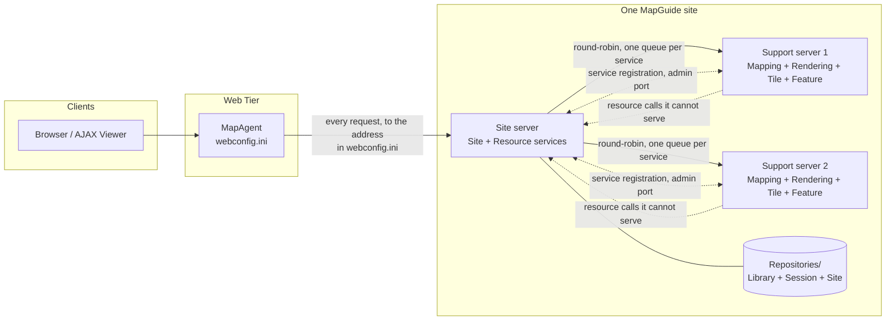
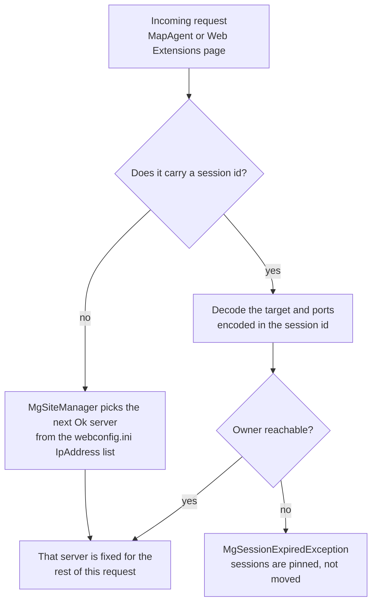
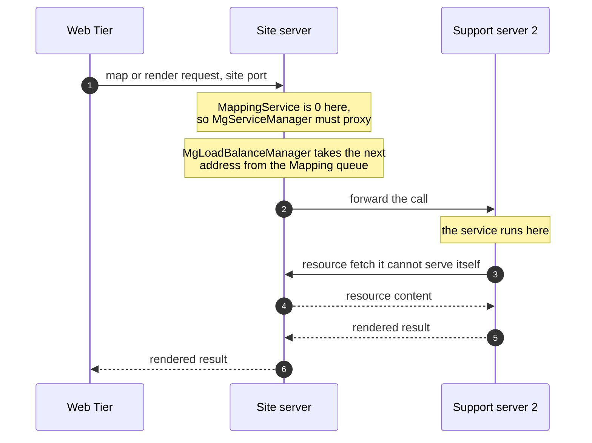
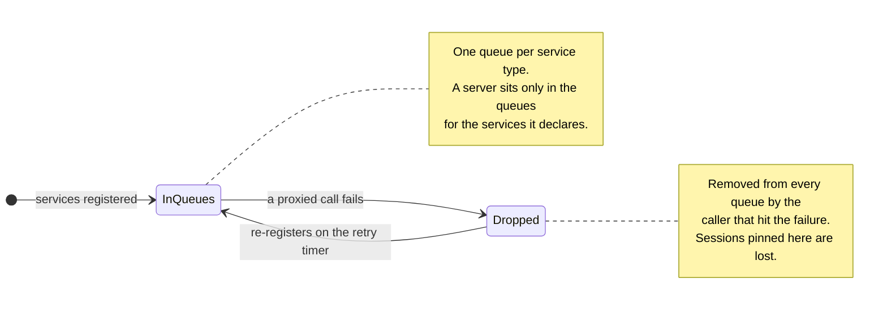
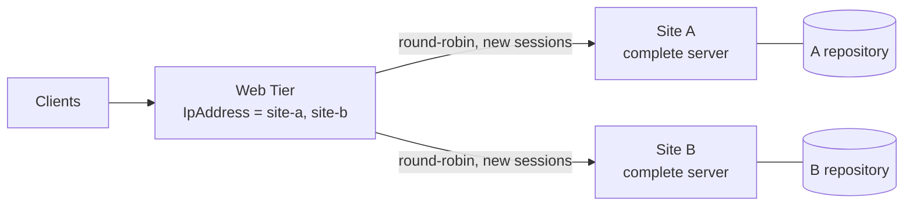
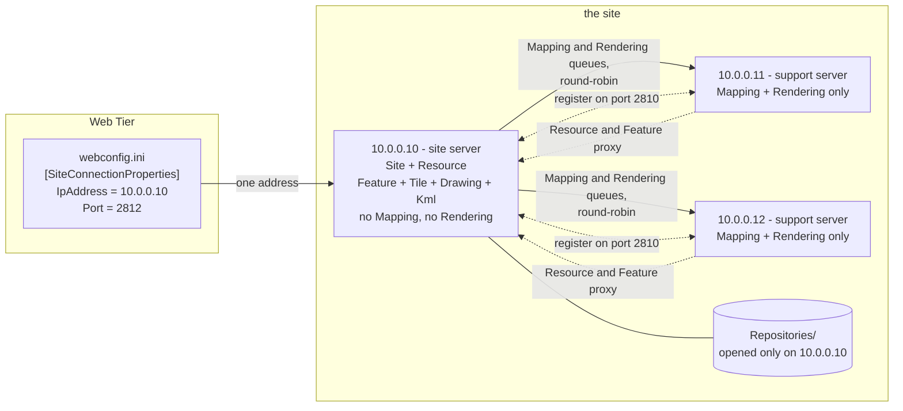
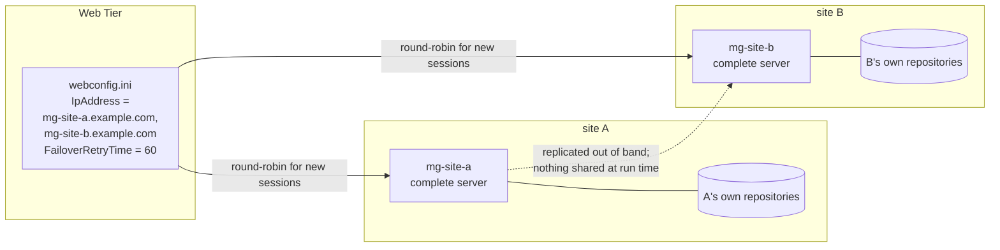
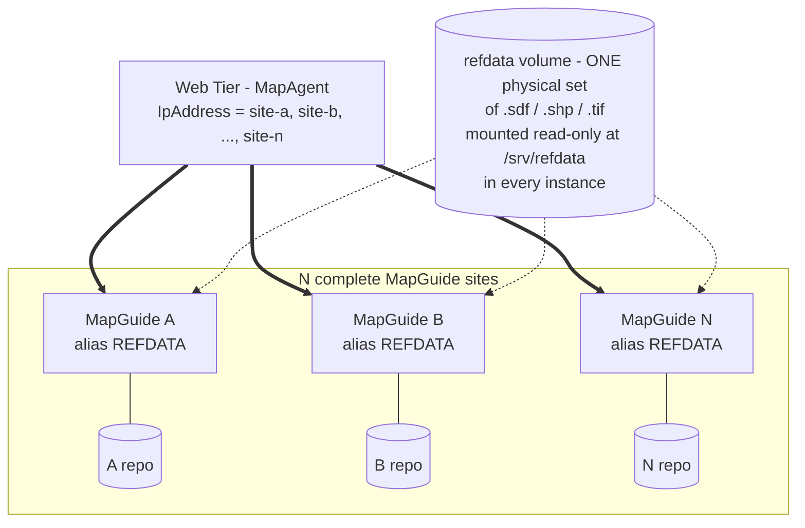
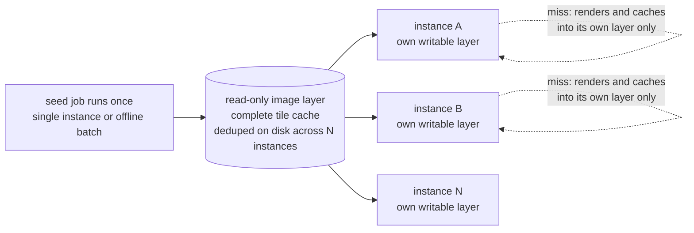

# MapGuide load balancing and horizontal scaling: what is actually implemented

**Question asked:** what load-balancing capability, if any, does MapGuide currently have that
would let a deployment be scaled horizontally by adding more MapGuide server instances?

**Answer:** **There is one usable axis, and it is narrower than "add servers to the site".** MapGuide
has a *site* model in which several MapGuide server processes are meant to cooperate — a site server
owning the repository, and *support servers* holding the processor-intensive services — and the code
for it (`MgLoadBalanceManager`, service registration, per-service round-robin queues, failover) is all
present, shipped, and wired end to end. **But that arrangement cannot serve a request** (§9.1.1): a
server that is not the site server cannot open a repository, cannot satisfy the permission check that
every resource-reading service performs, and cannot be replaced by a second site server either. The
machinery works; the deployment does not.

What *does* work is the axis the shipped documentation never mentions: the Web Tier honours a
**comma-separated list of MapGuide servers** in `webconfig.ini`, round-robining new sessions across
them with sticky routing (§4.1). Each entry must be a **complete site** with its own repository, so
this is replication of a site, not scaling of one — which makes repository content effectively
immutable in that topology (§9.2).

So the honest summary is:

- **Scaling compute across servers without replicating data: not available in 4.0.** The design exists
  in the code and the shipped help text describes it, but four independent barriers (§9.1.1) stop it.
- **Running N complete sites behind one Web Tier: available and shipped**, at the cost of keeping N
  repositories in step out of band and treating content as a deployment artifact.
- Underneath both: the repository is a **Berkeley DB XML environment** opened by exactly one server
  (§6.1), and no component of either balancer is load-aware (§6.5).
- The mechanism the code calls *"deprecated support servers"* is a **client-side** vectoring path
  retired in 2008 (r3288, ticket #669) — *"All load balanced servers should support all services"*.
  That message was the marker: after it, the intended load-balanced deployment was N complete
  servers, and the server-side split that the help text still recommends was left behind.

Two caveats on the above, both deliberate. The §9.1.1 finding is static analysis and contradicts the
product's own documentation, so it is the one claim here that most wants the runtime check in §11 —
and §9.1.1 names exactly which experiment decides it. And nothing here was exercised at runtime at
all: this is an analysis of the trees at the revisions below, with a concrete verification plan.
**No source change is proposed or required**, so the API/ABI mode is not engaged.

| Item | Revision / version |
|------|--------------------|
| `mapguide/MgDev` working copy | `branches/4.0/MgDev` r10218 (clean, no local mods) |
| `fdo` working copy | `branches/4.2` r8410 |
| API/ABI mode at time of writing | `freeze` (see [AGENTS.md](../AGENTS.md#current-cycle)) — nothing here touches the shipped surface |
| Resource repository engine | vendored `Oem/dbxml` (Berkeley DB 4.8.26 + Berkeley DB XML); see the [README](../README.md) MapGuide thirdparty matrix |

---

## 1. The 10,000 ft view

### 1.1 The shape of a deployment: one repository, many workers



The essential asymmetry: **the whole site has one repository, one Site service and one Resource
service, and the design adds as many compute servers as you care to add.** The Web Tier's job is
trivial (it talks to the site server); all the interesting routing happens inside the server tier.

> One thing this diagram does not show, and cannot: the workers are unreachable in practice. The shape
> is what the code and the shipped help describe, and a worker will accept a mapping or rendering call
> and execute it once — but it cannot pass a permission check, because that requires the repository it
> does not have. See [§9.1.1](#911-why-the-split-does-not-work).

### 1.2 Two round-robins, one table

There are **two independent balancers**, at different layers, that do not know about each other.

| | Client side — `MgSiteManager` | Server side — `MgLoadBalanceManager` |
|---|---|---|
| Lives in | `MgInitializeWebTier` / any client process (`Common/MapGuideCommon/Services/SiteManager.cpp`) | the MapGuide server process (`Server/src/Common/Manager/LoadBalanceManager.cpp`) |
| Balances | **whole requests** — which MapGuide server a Web Tier connects to | **service calls** — which server executes a service the caller does not host |
| Granularity | per new session / per unauthenticated-then-authenticated request | per service *type*, one queue each |
| Configured by | `[SiteConnectionProperties] IpAddress` in **webconfig.ini**, comma-separated | `[SupportServers]` + `[SupportServer_<id>]` in **serverconfig.ini** on the site server |
| Managed at runtime by | nothing (config file only) | `MgSite::AddServer / UpdateServer / RemoveServer / EnumerateServers` (the Site Administrator UI can only delete, hence §5.3) |
| Selection | round-robin over "Ok" sites, **sticky per session id** | round-robin (`pop_front`/`push_back`) over the per-service queue |
| Failover | `MgCommand` marks a server `UnableToConnect`; a background thread re-probes it | the caller removes the failed server from every service queue |
| Observability | MapAgent `GETSITEINFO`, `GETSITESTATUS` | MapAgent `GETSITEINFO`, Site Administrator "Manage Servers" |

### 1.3 How one request picks its server (client side)



### 1.4 Where a service call actually executes (server side)



The return trip is the part people miss: the site server is on the critical path for **every** call,
because the support servers' Resource traffic converges back on it. A new worker adds compute; it
does not remove load from the site server.

### 1.5 When a worker goes away



### 1.6 The other, undocumented axis: a list of complete sites



Nothing is shared here — each entry is a whole site with its own repository, and a session stays on
the site that created it. This buys capacity and request-level failover for *new* sessions; it is
replication, not scaling of one site.

Everything below is evidence for these diagrams and that table.

---

## 2. The site: one authority, N workers

### 2.1 What a "site" is, in the shipped documentation

The authoritative description is shipped *inside* the product, in the Site Administrator help pages
(`mapguide/MgDev/Web/src/mapadmin/HelpDocs/`):

> "the collection of servers that processes requests from the client applications is called a
> **site**. You can divide the processing load between two or more servers within the site. Each
> site shares a single resource repository among its servers. The resource repository stores the
> resources that map authors use to create maps … **The site server contains the resource
> repository.**"
> — `about_sites_and_servers.htm`

> "There are seven services: Site, Resource, Drawing, Feature, Mapping, Rendering, and Tile. If you
> are using a single server, that server performs all of these services. In any case, **the site
> server always handles the first two services** [Site and Resource], because they handle data
> access and manage the resources for the site. However, if you have two or more servers, you can
> **split off the other services and allocate them to another server or servers**. For example, the
> **Mapping and Rendering services are the most processor-intensive** operations and can benefit
> from having a dedicated server to handle them."
> — `about_services.htm`

> "**The first time you view this page, the table of servers will contain only the site server name
> and IP address** specified during installation of the software. The workflow to set up your
> servers is as follows: 1. **Add all the servers to the list.** 2. Add users and groups … 3. Set up
> the log files."
> — `managing_servers.htm`

So the feature is not merely latent in the code: it is a documented, administrator-facing workflow.
What follows is how that workflow is implemented.

One caveat on reading that workflow: the *shipped* Site Administrator can delete a server and take
one online or offline, but it can **neither add a server nor change a server's service assignment**
— both writes were removed from the web application (§5.3). Treat "add all the servers to the list"
as describing the *model* to build; realising it is done through the `MgSite` API or
`serverconfig.ini`.

### 2.2 The service set is per server, and enumerated identically everywhere

A server declares which services it hosts in `[HostProperties]` of `serverconfig.ini`
([serverconfig.ini:198](../mapguide/MgDev/Server/src/Core/serverconfig.ini#L198)):

```
DrawingService                     = 1
FeatureService                     = 1
KmlService                         = 1
MappingService                     = 1
RenderingService                   = 1
ResourceService                    = 1
SiteService                        = 1
TileService                        = 1
```

Those names are matched, one for one, against a table that also fixes the *queue index* used by the
balancer. `MgServerInformation::sm_serviceInfoMap` lists all 11 entries
([ServerInformation.cpp:34](../mapguide/MgDev/Common/MapGuideCommon/Services/ServerInformation.cpp#L34))
and `sm_knMaxNumberServices = 11`
([ServerInformation.h:409](../mapguide/MgDev/Common/MapGuideCommon/Services/ServerInformation.h#L409)):

| idx | service | idx | service |
|-----|---------|-----|---------|
| 0 | `ResourceService` | 6 | `KmlService` |
| 1 | `DrawingService` | 7 | `ServerAdminService` |
| 2 | `FeatureService` | 8 | `SiteService` |
| 3 | `MappingService` | 9 | `PrintLayoutService` |
| 4 | `RenderingService` | 10 | `ProfilingService` |
| 5 | `TileService` | | |

Two consequences worth knowing before reading the rest:

- `KmlService`, `PrintLayoutService` and `ProfilingService` are in the model but are **not** offered
  by the Site Administrator service matrix (see §5.3), so KML is not routinely distributed.
- `ServerAdminService` is deliberately **excluded from the queues** — "Every server must host the
  Server Admin service internally, so exclude it from the server queue"
  ([LoadBalanceManager.cpp:509](../mapguide/MgDev/Server/src/Common/Manager/LoadBalanceManager.cpp#L509)).
  Admin operations are therefore never round-robined away; they always run against the server you
  addressed.

### 2.3 Site server vs. support server is decided by one property

`MgServerManager::Initialize` reads the Site service property straight out of `[HostProperties]`:

```c++
pConfiguration->GetBoolValue(
    MgConfigProperties::HostPropertiesSection,
    MgConfigProperties::HostPropertySiteService,
    m_isSiteServer,
    MgConfigProperties::DefaultHostPropertySiteService);
```
— [ServerManager.cpp:149](../mapguide/MgDev/Server/src/Common/Manager/ServerManager.cpp#L149)

and `MgServerInformation::IsSiteServer()` is the same bit, expressed as a service flag:

```c++
bool MgServerInformation::IsSiteServer() const
{
    return IsServiceEnabled(MgServiceType::SiteService);
}
```
— [ServerInformation.cpp:597](../mapguide/MgDev/Common/MapGuideCommon/Services/ServerInformation.cpp#L597)

`MgLoadBalanceManager::Initialize` asserts the two agree and throws `MgLogicException` if they do
not ([LoadBalanceManager.cpp:145](../mapguide/MgDev/Server/src/Common/Manager/LoadBalanceManager.cpp#L145)).
So **`[HostProperties] SiteService = 0` is the whole of "this is a support server"**.

Three configuration traps follow from this, all silent:

1. `DefaultHostPropertySiteService` is **`false`**
   ([ConfigProperties.cpp:239](../mapguide/MgDev/Common/MapGuideCommon/System/ConfigProperties.cpp#L239)).
   If `[HostProperties]` (or the whole file section) is missing, the server becomes a *support*
   server, not a site server.
2. A **support** server must have `[SiteConnectionProperties] IpAddress` set to the site server and
   **must not** be a loopback or its own `MachineIp`; a **site** server's `IpAddress` must equal its
   own `MachineIp`. Both are enforced at startup with dedicated messages
   ([ServerManager.cpp:185](../mapguide/MgDev/Server/src/Common/Manager/ServerManager.cpp#L185),
   [ServerManager.cpp:210](../mapguide/MgDev/Server/src/Common/Manager/ServerManager.cpp#L210)).
3. There can be **exactly one** site server per site. A second server claiming the Site service is
   rejected outright: *"There are more than one Site servers within a site?"*
   ([LoadBalanceManager.cpp:839](../mapguide/MgDev/Server/src/Common/Manager/LoadBalanceManager.cpp#L839)).

### 2.4 Only the site server opens the repositories

```c++
// Open the repositories on the Site server.
if (m_serverManager->IsSiteServer())
{
    ...
    m_resourceService = dynamic_cast<MgServerResourceService*>(
        RequestLocalService(MgServiceType::ResourceService));
    m_resourceService->OpenRepositories();
    ...
}
```
— [ServiceManager.cpp:128](../mapguide/MgDev/Server/src/Common/Manager/ServiceManager.cpp#L128)

This is the single most important fact in this document. A support server never calls
`OpenRepositories()`; it gets resource content by **proxying** Resource service calls to whoever
does host them (§3.3). Everything in §2 and §3 therefore establishes that the "shares a single
resource repository" wording above means *"reaches it through the site server"*, not *"mounts it"*,
and §6.1 is the mechanical reason that has to be so.

---

## 3. Server-side load balancing (`MgLoadBalanceManager`)

### 3.1 One queue per service

`MgLoadBalanceManager` owns one deque per service type and one map of known servers
([LoadBalanceManager.h:136](../mapguide/MgDev/Server/src/Common/Manager/LoadBalanceManager.h#L136)):

```c++
MgServerMap   m_supportServerMap;  // Support servers within this site.
MgServerMap   m_externalServerMap; // Other servers at different sites.
MgServerQueue m_serverQueues[MgServerInformation::sm_knMaxNumberServices];
```

Adding a server to a queue is idempotent; removing one splices it out of a specific service's queue
([LoadBalanceManager.cpp:503](../mapguide/MgDev/Server/src/Common/Manager/LoadBalanceManager.cpp#L503),
[LoadBalanceManager.cpp:560](../mapguide/MgDev/Server/src/Common/Manager/LoadBalanceManager.cpp#L560)).
`UpdateServerQueues` re-derives all 11 queues from a server's current service flags — so flipping a
service on or off is a queue-membership change, not a restart
([LoadBalanceManager.cpp:586](../mapguide/MgDev/Server/src/Common/Manager/LoadBalanceManager.cpp#L586)).

### 3.2 Selection is plain round-robin, and it has no feedback signal

```c++
MgServerQueue& serverQueue = m_serverQueues[serviceType];
size_t numServers = serverQueue.size();

if (numServers == 1)      { return serverQueue[0]; }
else if (numServers == 0) { throw ...MgServiceNotAvailableException...; }

serverAddress = serverQueue[0];
serverQueue.pop_front();
serverQueue.push_back(serverAddress);
```
— [LoadBalanceManager.cpp:989](../mapguide/MgDev/Server/src/Common/Manager/LoadBalanceManager.cpp#L989)

There is no weighting, no least-connections, no CPU term. `MgServerManager::GetInformationProperties`
*does* compute `CpuUtilization`, the three operation-queue depths, uptime, memory and operation-time
statistics ([ServerManager.cpp:406](../mapguide/MgDev/Server/src/Common/Manager/ServerManager.cpp#L406))
and surfaces them through `GETSITEINFO`, but **nothing in the balancer reads them**. They are
monitoring data.

### 3.3 A service the local server does not host is proxied to a peer

`MgServiceManager` is the only consumer of `RequestServer`:

```c++
MgService* MgServiceManager::RequestService(INT32 serviceType)
{
    ...
    if (m_loadBalanceManager->m_localServerInfo->IsServiceEnabled(serviceType))
    {
        service = RequestLocalService(serviceType);
    }
    else
    {
        do { service = RequestProxyService(serviceType); }
        while (NULL == service); // or until an exception is thrown
    }
}
```
— [ServiceManager.cpp:358](../mapguide/MgDev/Server/src/Common/Manager/ServiceManager.cpp#L358)

`RequestProxyService` asks the balancer for an address and opens a site-port connection to it:

```c++
serverAddress = m_loadBalanceManager->RequestServer(serviceType);

// Use the site port for Site/Support Server communications.
Ptr<MgConnectionProperties> connProp = new MgConnectionProperties(
    currUserInfo, serverAddress, m_serverManager->GetSitePort());

proxyService = MgSiteConnection::CreateService(serviceType, connProp);
```
— [ServiceManager.cpp:180](../mapguide/MgDev/Server/src/Common/Manager/ServiceManager.cpp#L180)

This governs **inbound** traffic as well as internal calls: every service's operation handler
acquires its service through the same call, so a request that arrives at a server which does not
host that service is proxied before it is executed —
[MappingOperation.cpp:61](../mapguide/MgDev/Server/src/Services/Mapping/MappingOperation.cpp#L61),
[RenderingOperation.cpp:63](../mapguide/MgDev/Server/src/Services/Rendering/RenderingOperation.cpp#L63),
[ResourceOperation.cpp:63](../mapguide/MgDev/Server/src/Services/Resource/ResourceOperation.cpp#L63),
[SiteOperation.cpp:61](../mapguide/MgDev/Server/src/Services/Site/SiteOperation.cpp#L61). That is
what makes the Web Tier's "bind all service requests to the machine initially connected to"
behaviour in §4.4 work at all — the server it landed on silently forwards what it cannot run.
It also means a Site op (a session creation, say) sent to a support server executes on the site
server, so the session is stamped with the site server regardless of which server the Web Tier
picked; see §4.3.

This is why a support server with `ResourceService = 0` *appears* to work: every
`RequestService(MgServiceType::ResourceService)` across the codebase — `MgCacheManager`,
`MgPackageManager`, `MgFdoConnectionManager`, `MgServiceOperation`, `LoadPackageCommand`,
`Server.cpp` — transparently becomes a proxy call to the site server. A support server's own
per-process caches are still its own, which is what §3.6 is about.

> The appearance is where it ends. `MgCacheManager` is one of those callers, and it does not use the
> proxied interface — it requires the concrete server class. Every service that reads a resource is
> therefore unable to run on a support server; see [§9.1.1](#911-why-the-split-does-not-work). The
> proxy machinery in this section is real, but the only caller that gets to rely on it end to end is
> the site server itself, which hosts the service locally anyway.

### 3.4 Registration is asymmetric — the site server's list is authoritative

The protocol is: every server registers its own service set *with* a peer, using the peer's
**Server Admin** port and system credentials
([LoadBalanceManager.cpp:772](../mapguide/MgDev/Server/src/Common/Manager/LoadBalanceManager.cpp#L772)):

```c++
MgServerAdmin serverAdmin;
serverAdmin.Open(ipAddress, userInformation);
feedbackList = serverAdmin.RegisterServicesOnServers(serverInfoList);
```

The receiving side then merges that list into its own view
([LoadBalanceManager.cpp:822](../mapguide/MgDev/Server/src/Common/Manager/LoadBalanceManager.cpp#L822)).
The branch taken depends on *who is receiving*:

```c++
bool sourceFromSiteServer = !m_serverManager->IsSiteServer();
...
else if (sourceFromSiteServer && !strict)
{
    // The server does not exist, add it to the server map and update
    // the server queue.
    ...
}
else
{
    // The Support server has not been added to the site?
    ... throw MgServerNotFoundException ...
}
```
— [LoadBalanceManager.cpp:829](../mapguide/MgDev/Server/src/Common/Manager/LoadBalanceManager.cpp#L829),
[LoadBalanceManager.cpp:883](../mapguide/MgDev/Server/src/Common/Manager/LoadBalanceManager.cpp#L883)

Read that as:

- **On the site server** (`sourceFromSiteServer == false`) an *unknown* server is **rejected**:
  `MgServerNotFoundException`. The site server will only accept a registration from a support
  server it already knows about (added via the admin API/UI, or present in `[SupportServers]`).
- **On a support server** (`sourceFromSiteServer == true`) the feedback list it gets back *is* the
  site server's full server list, so it **auto-learns that list** and populates its own queues.

So support servers **cannot self-enrol**. If you point a new support server at a site server and
never add it to the site, its registration attempt fails every retry interval and it stays inert —
it will not receive a single proxied call.

### 3.5 Startup, retry and failover

- A **site server** registers synchronously at startup and then terminates the registration timer:
  *"On startup, perform the service registration for the Site server. Note that this event will be
  performed by a timer for the Support server."*
  ([Server.cpp:944](../mapguide/MgDev/Server/src/Core/Server.cpp#L944))
- A **support server** instead arms `MgServiceRegistrationEventHandler`, which re-attempts
  registration every `[GeneralProperties] ServiceRegistrationTimerInterval` (default **60 s**) and
  cancels itself once it succeeds
  ([ServiceRegistrationEventHandler.cpp:58](../mapguide/MgDev/Server/src/Core/ServiceRegistrationEventHandler.cpp#L58),
  default at [ConfigProperties.cpp:162](../mapguide/MgDev/Common/MapGuideCommon/System/ConfigProperties.cpp#L162)).
  That interval is the worst-case time for a restarted support server to be usable again.
- Failover on the *proxy* path is immediate and blunt: if the proxied connection throws
  `MgConnectionFailedException`/`MgConnectionNotOpenException`, the caller removes that server from
  **every** service queue, so subsequent calls go elsewhere:

  ```c++
  // Remove the server from the queues. Server is down?
  for (INT32 i = 0; i < MgServerInformation::sm_knMaxNumberServices; ++i)
  {
      m_loadBalanceManager->RemoveServerFromQueue(i, serverAddress);
  }
  ```
  — [ServiceManager.cpp:200](../mapguide/MgDev/Server/src/Common/Manager/ServiceManager.cpp#L200)

  Note the asymmetry with the retry timer: removal is *per callback*, re-admission is *polled*. A
  server is re-admitted when it next registers (or when `EnableServices`/`BringOnline` runs), not
  as soon as it is healthy again.
- `MgServerManager::TakeOffline()` unregisters the server's services and clears its caches;
  `BringOnline()` re-registers
  ([ServerManager.cpp:804](../mapguide/MgDev/Server/src/Common/Manager/ServerManager.cpp#L804)).
  This is what the Site Administrator's **Online/Offline** toggle drives, and it is the supported
  way to drain a server for maintenance.

### 3.6 Resource-change notification: cache invalidation across servers

Because each server caches parsed feature sources and pooled FDO connections locally, a change on the
site server has to be pushed out. A timer (`[ResourceServiceProperties]
ResourceChangeTimerInterval`, default 5 s) calls
[`MgServiceManager::DispatchResourceChangeNotifications`](../mapguide/MgDev/Server/src/Common/Manager/ServiceManager.cpp#L470),
which:

- only does work `if (m_serverManager->IsSiteServer())` — the site server is the only one with a
  changed-resource list to drain;
- notifies its own **Tile** service of affected map/tileset definitions;
- then pushes changed **FeatureSource** resources to every server that hosts Feature or Tile, via
  `MgServerAdmin::NotifyResourcesChanged`
  ([LoadBalanceManager.cpp:926](../mapguide/MgDev/Server/src/Common/Manager/LoadBalanceManager.cpp#L926));
- the receiving side drops the matching FDO connection and cached feature source / layer definition
  ([CacheManager.cpp:173](../mapguide/MgDev/Server/src/Common/Manager/CacheManager.cpp#L173)).

This function is the clearest possible proof of the topology: **there is exactly one writer of the
repository (the site server) and N readers of it (the support servers), and the readers are kept
honest by invalidation, not by replication.**

---

## 4. Client-side round-robin (`MgSiteManager`)

### 4.1 `IpAddress` is a *list*, not an address

`MgSiteManager::Initialize` reads the same key a single-server deployment uses and splits it on
commas:

```c++
// Get the IP address and port for the site server.
STRING targets;
configuration->GetStringValue(
    MgConfigProperties::SiteConnectionPropertiesSection,
    MgConfigProperties::SiteConnectionPropertyIpAddress,
    targets, MgConfigProperties::DefaultSiteConnectionPropertyIpAddress);
...
Ptr<MgStringCollection> targetValues = MgStringCollection::ParseCollection(targets, L",");
```
— [SiteManager.cpp:216](../mapguide/MgDev/Common/MapGuideCommon/Services/SiteManager.cpp#L216),
[SiteManager.cpp:258](../mapguide/MgDev/Common/MapGuideCommon/Services/SiteManager.cpp#L258)

Each entry becomes an `MgSiteInfo` carrying its own site/client/admin port; the port lists are split
the same way and index-matched, falling back to the first value
([SiteManager.cpp:260](../mapguide/MgDev/Common/MapGuideCommon/Services/SiteManager.cpp#L260)).

**This is the "hint" that has been in the codebase all along.** The shipped
`webconfig.ini` describes it in the singular — *"IpAddress — The IP address of the site server"*
([webconfig.ini:117](../mapguide/MgDev/Web/src/webconfig.ini#L117)) — so nothing tells an
administrator that a list is accepted. There is no dedicated key, no count, no plural name.

### 4.2 Selection

`GetNextSite` walks the list from the last-used index and returns the first site whose status is
`Ok`, advancing the cursor:

```c++
for (INT32 siteIndex = 0; siteIndex < numSites; siteIndex++)
{
    INT32 siteToTry = (m_index + siteIndex) % numSites;
    MgSiteInfo* siteInfo = m_sites.at(siteToTry);

    if (MgSiteInfo::Ok == siteInfo->GetStatus())
    {
        nextSite = siteInfo;
        m_index = siteToTry + 1;
        break;
    }
}
```
— [SiteManager.cpp:406](../mapguide/MgDev/Common/MapGuideCommon/Services/SiteManager.cpp#L406)

`m_index` is an instance member of a process-wide singleton
([SiteManager.h:101](../mapguide/MgDev/Common/MapGuideCommon/Services/SiteManager.h#L101)), so the
round-robin cursor is **per process, not per deployment**. With a PHP-worker or ISAPI/Apache-module
Web Tier, each worker keeps its own cursor; the resulting distribution is still even in aggregate
but is not a single global rotation. A single-server deployment is the degenerate case and never
enters this code path in a meaningful way.

The unit test suite states the split between the two sides of this mechanism outright — this is the
clearest single piece of evidence in the tree for the whole document:

```c++
/// Get the number of site servers configured in the INI file. Should always be
/// 1 for serverconfig.ini.
TEST_CASE("GetSiteCount", "[SiteManager]")
{
    ...
    // The number of sites should always be 1 on the server.
    // It can be greater than 1 in the web tier.
    REQUIRE(numSites == 1);
}
```
— [TestSiteManager.cpp:272](../mapguide/MgDev/Server/src/UnitTesting/TestSiteManager.cpp#L272)

**One site entry on a server; more than one is a web-tier configuration.** That is §8's verdict,
written down by the MapGuide developers in a test they can run.

### 4.3 Session affinity is encoded in the session id

This is the part that makes Web-Tier load balancing actually work with a stateful server. When the
Site service creates a session, it appends an encoding of *which server owns the session*:

```c++
MgSiteManager* siteManager = MgSiteManager::GetInstance();
Ptr<MgSiteInfo> siteInfo = siteManager->GetSiteInfo(0);
session = currUserInfo->CreateMgSessionId(siteInfo);
```
— [ServerSiteService.cpp:743](../mapguide/MgDev/Server/src/Services/Site/ServerSiteService.cpp#L743)
and [UserInformation.cpp:324](../mapguide/MgDev/Common/MapGuideCommon/System/UserInformation.cpp#L324)

The session id format is `<uuid>_<locale>_<base64(target)+%4X%4X%4X(site,client,admin ports)>`
([SiteInfo.cpp:156](../mapguide/MgDev/Common/MapGuideCommon/Services/SiteInfo.cpp#L156),
`HexPortsStringLength = 12` at
[SiteInfo.h:86](../mapguide/MgDev/Common/MapGuideCommon/Services/SiteInfo.h#L86)). An example from the
Developer Guide is `Session:70ea89fe-0000-1000-8000-005056c00008_en//layer.LayerDefinition`.

The unit tests carry a fully decoded example, which is the cheapest way to see the format for
yourself — `48cb0286-0000-1000-8001-005056c00008_en_MTExLjEyMi4xMzMuMTQ0045708AE0D05` decomposes as:

| Part | Value |
|---|---|
| uuid | `48cb0286-0000-1000-8001-005056c00008` |
| locale | `en` |
| `MTExLjEyMi4xMzMuMTQ0` | base64 of the target `111.122.133.144` |
| `0457` | site port `0x0457` = 1111 |
| `08AE` | client port `0x08AE` = 2222 |
| `0D05` | admin port `0x0D05` = 3333 |

— constants at
[TestSiteManager.cpp:23](../mapguide/MgDev/Server/src/UnitTesting/TestSiteManager.cpp#L23)

`GetSiteConnectionPropertiesWithSession` then asserts that asking for `Site`, `Client` and `Admin`
connection properties with this session id in play returns exactly those target/ports, overriding
whatever the config file says ([TestSiteManager.cpp:86](../mapguide/MgDev/Server/src/UnitTesting/TestSiteManager.cpp#L86)).
So the affinity mechanism is covered by a runnable test, not only by reading.

The invariant is asserted on the server side too. `MgSessionCache::GetSessionInfo` decodes the same
suffix and checks it against the server's own single site entry — in Debug builds only:

```c++
#ifdef _DEBUG
    // Session Affinity: Check that the session was created by this server
    if(!session.empty())
    {
        STRING hexString = session.substr(session.rfind(L"_") + 1);
        Ptr<MgSiteInfo> sessionSiteInfo = new MgSiteInfo(hexString);
        if(sessionSiteInfo->GetStatus() == MgSiteInfo::Ok)
        {
            MgSiteManager* siteManager = MgSiteManager::GetInstance();
            Ptr<MgSiteInfo> firstSite = siteManager->GetSiteInfo(0);
            assert(sessionSiteInfo->GetTarget().compare(firstSite->GetTarget()) == 0);
            assert(sessionSiteInfo->GetPort(MgSiteInfo::Site) == firstSite->GetPort(MgSiteInfo::Site));
        }
    }
#endif //_DEBUG
```
— [SessionCache.cpp:151](../mapguide/MgDev/Server/src/Common/Manager/SessionCache.cpp#L151)

Two things to take from that: the server *knows* a session belongs to one particular server, and the
check that a wrong-server session never reaches a server's session cache is **a Debug-only
`assert`** — a Release build silently proceeds to the `m_sessionInfoMap.find()` below it, which is
where the eventual `MgSessionExpiredException` comes from.

On the next request `MgSiteManager::GetConnectionProperties(..., useSessionIp = true)` decodes that
suffix and returns connection properties for the owning server instead of advancing the cursor
([SiteManager.cpp:306](../mapguide/MgDev/Common/MapGuideCommon/Services/SiteManager.cpp#L306)).
If the owning server is not currently `Ok`, the session is **not** moved — the caller gets
`MgSessionExpiredException`
([SiteManager.cpp:334](../mapguide/MgDev/Common/MapGuideCommon/Services/SiteManager.cpp#L334)).
Sessions are therefore **pinned**, not shared, and losing the server that owns a session loses that
session.

Note also that a session id naming a server which is *not* in the configured list still resolves:
`MgSiteManager::GetSiteInfo(hexString)` fabricates an `MgSiteInfo` with status `Ok` from the encoded
address ([SiteManager.cpp:542](../mapguide/MgDev/Common/MapGuideCommon/Services/SiteManager.cpp#L542)).
The session id, not the config file, is what pins the request.

### 4.4 Which servers may be listed

A Web Tier does not ask anyone where services live. `MgSiteConnection::Open` round-robins once and
then binds every subsequent call in that request to the same machine:

```c++
else if (m_isWebTier)
{
    MgSiteManager* siteManager = MgSiteManager::GetInstance();
    m_connProp = siteManager->GetConnectionProperties(userInformation, MgSiteInfo::Client, true);
}
```
— [SiteConnection.cpp:119](../mapguide/MgDev/Common/MapGuideCommon/Services/SiteConnection.cpp#L119)

and `GetConnectionPropertiesFromSiteServer` returns the *existing* connection rather than vectoring
per service, with the reason spelled out in a 2008 comment:

```c++
// We have deprecated support servers.  All load balanced servers
// should support all services.  With this change, we do not need to
// contact the site server to determine where to vector service requests.
//
// A site connection has already been established if we are looking for services.
// Just use the target and port from the existing connection.  This will
// bind all service requests to the machine initially connected to in
// the MgSiteConnection.Open call.
```
— [SiteConnection.cpp:500](../mapguide/MgDev/Common/MapGuideCommon/Services/SiteConnection.cpp#L500),
introduced by r3288 ("Ticket #669 WebLayout Load Balancing Fails because of API call sequence",
`svn log -r 3288`).

So: **list only servers that host the services the Web Tier will call.** A support server that hosts
only Mapping/Rendering will still work for map rendering, because it proxies Resource — but the
"all load balanced servers should support all services" guidance is what keeps behaviour uniform, and
that is the shape the deprecation comment endorses.

Ports are thread pools, not service gates: the three acceptors
([Server.cpp:366](../mapguide/MgDev/Server/src/Core/Server.cpp#L366)) feed a common dispatcher that
selects the handler from the **service id in the operation packet**, not from the port
([OperationThread.cpp:389](../mapguide/MgDev/Server/src/Core/OperationThread.cpp#L389)). That is why
`MgSiteManager` can use the Client port for services and the Site port for site operations and both
work against the same server.

### 4.5 Health checking, failover and the `FailoverRetryTime` knob

- Failure detection is client-side and passive: `MgCommand::ExecuteCommand` marks a server
  `UnableToConnect` when a call fails, and drops its pooled connection
  ([Command.cpp:128](../mapguide/MgDev/Common/MapGuideCommon/Services/Command.cpp#L128)).
- Recovery is a background thread started by `MgSiteManager`'s constructor. It probes every site
  whose status is not `Ok` with a `GetSiteStatus` call and flips it back to `Ok` when it answers
  ([SiteManager.cpp:23](../mapguide/MgDev/Common/MapGuideCommon/Services/SiteManager.cpp#L23)). The
  probe needs no credentials, which is exactly why `GetSiteStatus` was chosen.
- The sleep between sweeps is `[GeneralProperties] FailoverRetryTime`, and the shipped
  `webconfig.ini` comment is the only place the multi-server use case is *stated in prose*:

  > "For a single Web Tier and MapGuide server pair use 1. For a load balanced configuration with
  > multiple MapGuide servers use 60. Values other than 1 will cause a delay when re-establishing a
  > connection with the Web Tier after restarting a MapGuide server."
  > — [webconfig.ini:49](../mapguide/MgDev/Web/src/webconfig.ini#L49)

  With a list of one, the thread shortens its own sleep to 1 s to avoid a pointless 60 s outage
  ([SiteManager.cpp:95](../mapguide/MgDev/Common/MapGuideCommon/Services/SiteManager.cpp#L95)).
- A `MgSiteManager` also exists in a MapGuide **server** process — the shutdown path stops its
  check thread ([Server.cpp:430](../mapguide/MgDev/Server/src/Core/Server.cpp#L430)) and the session
  cache uses it (§4.3). There it tracks the one site entry (the site server itself, on a support
  server). Its *status* tracking, however, is not consulted by server-side routing, which goes
  through `MgLoadBalanceManager`: do not read a `MgSiteInfo` status from a server-side log as the
  site's health.
- Uneven balancing caused by unauthenticated traffic is a *known* problem with a workaround in the
  HTTP handler. The cursor is advanced per site connection, so a request that opens one and then
  fails authentication burns a slot; the handler therefore refuses an unauthenticated request
  *before* opening a connection:

  > "Short circuit the authentication check if no username or session is supplied. This will ensure
  > that load balancing works correctly if browsers send an unauthenticated then an authenticated
  > request. The check increments the load balanced servers so the unauthenticated HTTP request
  > will eat up one of the servers and give uneven load balancing."
  > — [HttpRequestResponseHandler.cpp:193](../mapguide/MgDev/Web/src/HttpHandler/HttpRequestResponseHandler.cpp#L193)

### 4.6 Observability: three MapAgent operations exist for this

All three are registered in the MapAgent operation table
([HttpRequest.cpp:396](../mapguide/MgDev/Web/src/HttpHandler/HttpRequest.cpp#L396)) and documented in
[openapi.yaml](./openapi.yaml) (lines 324, 361 and 396). Each returns a `<SiteInformation>` document
containing one `<Server>` child per entry in the *configured list*, not one for the selected server:

| Operation | Handler | Per-`<Server>` content |
|---|---|---|
| `GETSITEVERSION` | [HttpGetSiteVersion.cpp:45](../mapguide/MgDev/Web/src/HttpHandler/HttpGetSiteVersion.cpp#L45) | `Version` |
| `GETSITEINFO` | [HttpGetSiteInfo.cpp:46](../mapguide/MgDev/Web/src/HttpHandler/HttpGetSiteInfo.cpp#L46) | `IpAddress`, `DisplayName`, `Status`, `Version`, `OperatingSystem`, `Statistics` |
| `GETSITESTATUS` | [HttpGetSiteStatus.cpp:45](../mapguide/MgDev/Web/src/HttpHandler/HttpGetSiteStatus.cpp#L45) | `DisplayName`, `Status`, `ApiVersion` |

Each iterates `siteManager->GetSites()` — the parsed list — and emits a placeholder `<Server>` block
carrying the exception message for any entry that does not answer. **A `GETSITEINFO` response with
more than one `<Server>` block is direct proof that a Web Tier is configured for more than one
server**, which makes it the fastest way to observe the list from outside the process, and the
natural first check in the verification plan below. (Before API version 2.2.0, all three fall back
to querying the single selected server.)

---

## 5. Administering a site

### 5.1 The management API

The server list belongs to the **Site** service, on the site server
([Site.h:792](../mapguide/MgDev/Common/MapGuideCommon/Services/Site.h#L792)):

```
MgByteReader* EnumerateServers();
void          AddServer(CREFSTRING name, CREFSTRING description, CREFSTRING address);
void          UpdateServer(CREFSTRING oldName, CREFSTRING newName,
                           CREFSTRING newDescription, CREFSTRING newAddress);
void          RemoveServer(CREFSTRING name);
```

`EnumerateServers` emits `ServerList-1.0.0` XML
([LoadBalanceManager.cpp:1051](../mapguide/MgDev/Server/src/Common/Manager/LoadBalanceManager.cpp#L1051),
schema at `mapguide/MgDev/Common/Schema/ServerList-1.0.0.xsd`). `AddServer` rejects a duplicate name,
a duplicate address and the site server's own address, then — if the server is reachable —
registers services and seeds the queues before persisting
([LoadBalanceManager.cpp:1083](../mapguide/MgDev/Server/src/Common/Manager/LoadBalanceManager.cpp#L1083)).
`RemoveServer` unregisters, drains all queues, and deletes the config entry
([LoadBalanceManager.cpp:1361](../mapguide/MgDev/Server/src/Common/Manager/LoadBalanceManager.cpp#L1361)).

`MgSite::RequestServer(serviceType)` also exists on the wire (`MgOpRequestServer`), but it is
`INTERNAL_API`, is not used by any current client — the Web Tier path that used it was removed in
r3288 — and remains only as the server-side primitive behind `MgLoadBalanceManager::RequestServer`.

### 5.2 Where the list is persisted

The section is **not present** in the shipped `serverconfig.ini`:

```console
$ grep -n "SupportServers\|SupportServer_" mapguide/MgDev/Server/src/Core/serverconfig.ini
```
(no output)

It is created on first `AddServer`
([ConfigProperties.cpp:524](../mapguide/MgDev/Common/MapGuideCommon/System/ConfigProperties.cpp#L524)):

```
[SupportServers]
Identifiers = <uuid>,<uuid>,...

[SupportServer_<uuid>]
Name        = ...
Description = ...
IpAddress   = ...
```

This is why a hand-written site-server config that omits `[SupportServers]` behaves as if it has no
support servers at all, and why a support server configured against it is rejected in §3.4. The
identifier is any unique token used as the section suffix — `AddServer` generates a UUID when you do
not supply one, but nothing requires it to be one (§9.3.3 uses readable names).

### 5.3 The Site Administrator web application — and what it no longer does

`mapguide/MgDev/Web/src/mapadmin/` is the PHP Site Administrator. Its home page *is* the Manage
Servers page ([servermanagement.php](../mapguide/MgDev/Web/src/mapadmin/servermanagement.php)), and
of the actions you would expect there, **delete and online/offline work while add and
service-assignment do not**. That distinction matters because the shipped help text (§2.1) describes
the full workflow and the shipped UI cannot perform all of it.

Working:

- **Delete** a server — `DeleteServer` calls `MgSite::RemoveServer`
  ([serverdatafunctions.php:729](../mapguide/MgDev/Web/src/mapadmin/serverdatafunctions.php#L729)).
- **Online / Offline** — `MgServerAdmin::BringOnline` / `TakeOffline`
  ([serverdatafunctions.php:870](../mapguide/MgDev/Web/src/mapadmin/serverdatafunctions.php#L870)).
- Configuring a server's *properties*: `[GeneralProperties]`, the connection sections, and the
  per-service property sections (repository paths, connection pools, tile cache path) all still
  write.

Not working:

- **Add Server.** `ADD_SERVER_MENU_ITEM` is defined but never registered in a menu group, and there
  is no `addserver.php`; `Web/src` contains no call to `MgSite::AddServer` at all
  ([resizablepagecomponents.php:25](../mapguide/MgDev/Web/src/mapadmin/resizablepagecomponents.php#L25)
  has the only two references, both dead constants). The site's server list must be populated by the
  API or by hand (§9.1).
- **Assigning services.** The matrix renders, but its write is commented out:

  ```php
  function SetOptionalServerServices( $serverAdmin, $services )
  {
      ...builds drawing/feature/mapping/rendering/tile properties...
      // Disable Service manipulation from Site Admin
      // $serverAdmin->SetConfigurationProperties( MgConfigProperties::HostPropertiesSection, $props );
  }
  ```
  — [serverdatafunctions.php:862](../mapguide/MgDev/Web/src/mapadmin/serverdatafunctions.php#L862)

  Three callers still invoke `SetOptionalServerServices` — `servermanagement.php:149`,
  `serverproperties.php:160`, `servicesproperties.php:130` — so saving a server or its services from
  the UI silently succeeds and changes nothing about which services that server advertises. The line
  was disabled in **r2707** ("Ticket #389 Updating Site Name disables services and locks out settings
  in Web Admin", 2008-01-11, `svn log -r 2707`) and never restored.

The matrix is still worth reading, because it hard-codes the topology rule from §2.1:

```php
if ( $serviceSelector->serverAddress == $siteServerAddress )
{
    echo '<input type="checkbox" checked disabled>Site<br>', "\n";
    echo '<input type="checkbox" checked disabled><a href="servicesproperties.php?...">Resource</a><br>', "\n";
}
```
— [resizablepagecomponents.php:845](../mapguide/MgDev/Web/src/mapadmin/resizablepagecomponents.php#L845)

For the site server, **Site and Resource are rendered checked and `disabled`** — the UI shows that
neither can be moved. Other servers get Drawing / Feature / Mapping / Rendering / Tile checkboxes,
which now communicate intent rather than setting it. `KmlService` is absent from this matrix
altogether even though it is a first-class queue in the balancer, so KML distribution was already a
config-file-only exercise.

**Practical consequence:** in a MapGuide 4.0 deployment, adding a support server and choosing its
services are done with `MgSite::AddServer` / `MgServerAdmin::SetConfigurationProperties` (live) or by
editing `serverconfig.ini` and restarting — not through the Site Administrator. The UI remains
useful for taking a server offline, for deleting one, and for reading the site's server list and
service layout.

The Site Administrator itself runs on the PHP web tier; the `mapguide_image_install.sh` / `mapagent`
flow described in [README.md](../README.md) installs the MapAgent web tier, not the site
administrator, so it is not available out of the box from this repo's installer path.

### 5.4 Bringing services up and down without a restart

Writing the `[HostProperties]` section — through `MgServerAdmin::SetConfigurationProperties` or
`RemoveConfigurationProperties` — is treated specially by the server: `MgServerManager` intercepts
that section and calls `MgServiceManager::EnableServices`
([ServerManager.cpp:298](../mapguide/MgDev/Server/src/Common/Manager/ServerManager.cpp#L298),
[ServerManager.cpp:343](../mapguide/MgDev/Server/src/Common/Manager/ServerManager.cpp#L343)), which
turns the property collection into a service-flags mask and hands it to
`MgLoadBalanceManager::EnableServices`
([ServiceManager.cpp:303](../mapguide/MgDev/Server/src/Common/Manager/ServiceManager.cpp#L303)).
That rewrites the local flags, re-derives the local queues, and pushes the new flags to every peer it
can reach, swallowing unreachable ones
([LoadBalanceManager.cpp:1780](../mapguide/MgDev/Server/src/Common/Manager/LoadBalanceManager.cpp#L1780)).
Offline servers are advertised with zero service flags so peers stop selecting them
(`if (!m_serverManager->IsOnline())` in the same function). This is the mechanism behind the
"take a server offline before configuring it" instruction in
[`configuring_servers.htm`](../mapguide/MgDev/Web/src/mapadmin/HelpDocs/configuring_servers.htm).

The important qualifier is that the *only* client that reaches this path is the API: the Site
Administrator's service checkboxes no longer write `[HostProperties]` (§5.3), and **hand-editing
`serverconfig.ini` while the server runs does not go through here either** — the file is read at
startup, so a hand edit needs a restart while `SetConfigurationProperties` does not. Online/Offline
from the Site Administrator does work, and is the supported way to drain a server without editing
anything.

### 5.5 Does an administrative change apply to all servers?

**No.** Every configuration page in the Site Administrator opens a single `MgServerAdmin` connection
to a single server and writes *that server's* `serverconfig.ini`:

| Page | Opens | Section it writes |
|---|---|---|
| Configure Server ([serverproperties.php:109](../mapguide/MgDev/Web/src/mapadmin/serverproperties.php#L109)) | one server | `[GeneralProperties]`, the three connection sections |
| Configure Services ([servicesproperties.php:76](../mapguide/MgDev/Web/src/mapadmin/servicesproperties.php#L76)) | one server | the per-service property sections |
| Configure Logs ([logproperties.php:136](../mapguide/MgDev/Web/src/mapadmin/logproperties.php#L136)) | one server | the `*LogProperties` sections |
| External Files ([unmanageddatamanagement.php:74](../mapguide/MgDev/Web/src/mapadmin/unmanageddatamanagement.php#L74)) | one server | `[UnmanagedDataMappings]` |

There is exactly one multi-server affordance in the whole UI: the checkbox column on **Manage
Servers**, which posts a list of servers to update. That is **client-side iteration, not server-side
fan-out** — the page loops over the ticked servers and calls `SetOnline` / `SetOptionalServerServices`
on each one in turn
([servermanagement.php:142](../mapguide/MgDev/Web/src/mapadmin/servermanagement.php#L142)). Only half
of it works:

- `SetOnline` → `MgServerAdmin::BringOnline`/`TakeOffline` — **applies to every server you ticked**.
- `SetOptionalServerServices` → the disabled write from §5.3 — **applies to nothing**. The service
  checkboxes in that loop are decorative.

So the answer to "if you apply some setting, does it apply to all?" is **no, not even the one page
that offers to**. Four things *look* site-wide and are not:

| Looks site-wide | What is really happening |
|---|---|
| users, groups, roles | one store — the **Site repository** (`MgRepositoryType::Site`, §6.2) — not a copy per server |
| library resources | one store — the Library repository |
| sessions | created and registered on the site server |
| the site's **server list** and each server's **service flags** | the only genuinely propagated configuration, pushed by registration / `EnableServices` (§3.4, §5.4) |

Everything else — ports, connection limits, timeouts, pool sizes, log settings, repository and tile
cache paths, `PreCacheMaps`, unmanaged-data mappings — is per server and nothing re-applies it. In the
Web-Tier list topology (§9.2), where every server is a complete site, that means **each setting has to
be applied once per server**, by hand or by configuration management.

That is the strongest practical argument for §9.3's container approach: render the configuration from
the image plus a per-container identity, rather than letting N hand-edited `serverconfig.ini` files
drift apart. It is also why a deployment checklist for a multi-server site should list "apply setting
X to every server" as an explicit step rather than a click.

> Note the asymmetry with the *client* side: the Web Tier's `webconfig.ini` list is honoured and the
> Web Tier does round-robin over it (§4.1), but a Web Tier container is also just one file to edit —
> there is no propagation there either.

---

## 6. What is *not* balanced and *not* shared

This section is the reason a naive "put two MapGuide servers behind a load balancer" plan fails.

### 6.1 The resource repository cannot be shared between processes on different hosts

The repository is a **Berkeley DB XML environment**, opened at a filesystem path with a local,
transactional, exclusive configuration
([DbEnvironment.cpp:160](../mapguide/MgDev/Server/src/Services/Resource/DbEnvironment.cpp#L160)):

```c++
u_int32_t environmentFlags = DB_CREATE|DB_THREAD|DB_INIT_MPOOL;
...
environmentFlags |= DB_INIT_TXN|DB_INIT_LOCK|DB_INIT_LOG;
...
m_dbEnv.open(home.c_str(), environmentFlags, 0);
```
— [DbEnvironment.cpp:197](../mapguide/MgDev/Server/src/Services/Resource/DbEnvironment.cpp#L197)

`DbEnv`/`XmlManager` are used in-process (no `DB_RPC`/`DB_SERVER`), the environment is created with
`DB_RECOVER`, and the paths are ordinary local directories
(`[ResourceServiceProperties] LibraryRepositoryPath = Repositories/Library/`, …,
[serverconfig.ini:383](../mapguide/MgDev/Server/src/Core/serverconfig.ini#L383)). Berkeley DB's own
locking and shared-memory model does not support this over a network filesystem, so **pointing two
MapGuide servers at one repository directory is not a supported configuration** — which is precisely
why §2.4 only ever has one process call `OpenRepositories()`.

Consequence: you scale *services*, not *repository access*. Every new support server adds compute and
adds load to the site server, because its Resource calls converge there.

That consequence is academic, because there cannot be a working support server (§9.1.1). It is left in
place because it is the reason the *repository* is the thing to watch in the topology that does work:
in §9.2 each site owns one, and the count of repositories is the count of sites.

### 6.2 Sessions are owned and pinned

The session repository is opened by the same site-server-only call as the library repository
([ServerResourceService.cpp:201](../mapguide/MgDev/Server/src/Services/Resource/ServerResourceService.cpp#L201)),
`MgServerResourceService` keeps the per-session repositories in a process-local
`std::map<STRING, MgSessionRepository*>` (`FilePerSession` mode,
`[ResourceServiceProperties] SessionRepositoriesConfig`, default in
[serverconfig.ini:383](../mapguide/MgDev/Server/src/Core/serverconfig.ini#L383)), the session cache
that resolves session ids to users is a process-wide static
([SessionManager.cpp:22](../mapguide/MgDev/Server/src/Common/Manager/SessionManager.cpp#L22)), and
the session id encoding (§4.3) records the server that created the session. There is no session
replication and no shared session store. Failover of a session is therefore an *exception*, not a
redirect — `MgSessionExpiredException`.

### 6.3 The tile cache is per server

`[TileServiceProperties] TileCachePath` (default `Repositories/TileCache/`,
[serverconfig.ini:447](../mapguide/MgDev/Server/src/Core/serverconfig.ini#L447)) is a local path in
the server's own service properties, editable per server in the Site Administrator. Two servers
serving the same tile set will each build their own cache; there is no shared tile cache and no
invalidation of one server's cache by another's writes beyond the resource-change push in §3.6,
which drops *definitions*, not tile images.

That default is what MapGuide expects, and it is deliberate: **pointing several servers at one
tile cache does not work**, even though the code contains a lock-file protocol that looks like it
was meant to allow exactly that. §9.6 works through why, and what to do instead.

### 6.4 Caches and pools are per process

`MgCacheManager` (FDO connection pool, feature-source cache, resource-service cache),
`MgServerFeatureTransactionPool`, `MgSecurityManager`/permission caches and `MgSessionManager`'s
session cache are all process-local singletons. §3.6 exists because that fact is a real
correctness hazard, not a theoretical one.

### 6.5 There is no load-aware balancing anywhere

No component reads a peer's CPU, queue depth, or latency before choosing it. `GETSITEINFO` publishes
those numbers, and both balancers ignore them. Adding servers raises ceiling throughput; it does not
smooth a hot spot.

### 6.6 Nothing makes a repository read-only, and the one switch that tried is inert

The resource service exposes the full write surface — `CreateRepository`, `UpdateRepository`,
`SetResource`, `DeleteResource`, `MoveResource`, `CopyResource` — and no read-only mode
([ResourceService.h:98](../mapguide/MgDev/Common/PlatformBase/Services/ResourceService.h#L98),
[:210](../mapguide/MgDev/Common/PlatformBase/Services/ResourceService.h#L210),
[:650](../mapguide/MgDev/Common/PlatformBase/Services/ResourceService.h#L650),
[:707](../mapguide/MgDev/Common/PlatformBase/Services/ResourceService.h#L707)). The only `ReadOnly`
anywhere in the resource code is a debug dump of a dbxml container flag, not a control
([ResourceContainer.cpp:120](../mapguide/MgDev/Server/src/Services/Resource/ResourceContainer.cpp#L120)).

The Web Tier looks like it has one. `[AgentProperties] DisableAuthoring`, `DisableWms` and
`DisableWfs` in `webconfig.ini` are documented as *"Disables Authoring HTTP requests"* and similar,
and `HttpRequestResponseHandler` does look them up and read them — then constructs an exception
without throwing it:

```c++
if (bDisable)
{
    new MgException(MgExceptionCodes::MgInvalidOperationException, L"HttpRequestResponseHandler.InitializeCommonParamters", __LINE__, __WFILE__, NULL, L"", NULL);
}
```
— [HttpRequestResponseHandler.cpp:70](../mapguide/MgDev/Web/src/HttpHandler/HttpRequestResponseHandler.cpp#L70)

`bDisable` is not read again, and every other guard in the same function throws properly
([line 201](../mapguide/MgDev/Web/src/HttpHandler/HttpRequestResponseHandler.cpp#L201)). So the
three flags are inert — and setting one leaks an `MgException` on every classified request into the
bargain. **There is no supported way to put a MapGuide repository into a read-only state**; §9.2's
immutability is a deployment discipline, not a property of the software.

This construct-instead-of-throw pattern turns out to appear four times in the Web tier, two of them
falling through to a null dereference. The other three, with impact and reproduction steps, are
written up for separate action in
[mapguide-web-tier-dead-guards-handoff.md](./mapguide-web-tier-dead-guards-handoff.md); nothing has
been changed in the source tree.

### 6.7 What a single-instance mental model gets wrong

The natural summary of everything above is: *treat each instance's data and config as fixed, assume
read-only `Library://` access, and allow mutability only through FeatureSources backed by a shared
data store.* That is very nearly right, and the three places it is wrong are the ones that cause
trouble in practice. §6.1–6.6 supply the evidence; this section is the checklist they add up to.

#### Three corrections to that model

**1. The Session repository is per-instance and *is* written to.** "Read-only resource service" is
right for `Library://` and wrong for `Session://`. `MgMap::Save()` writes
`Session:<sessionid>//<name>.Map` ([Map.cpp:1040](../mapguide/MgDev/Common/MapGuideCommon/MapLayer/Map.cpp#L1040)),
the viewer saves runtime map state on every interaction, and temporary layers, selection and layout
all live there. Session writes are the *normal* case, not an exception to it — and they are safe
precisely *because* sessions are pinned to one server (§4.3). The accurate invariant is
**`Library://` immutable; `Session://` freely mutable because it is instance-local.**

**2. Feature transactions are process-affine, and the transaction id does not say so.** The
transaction pool is a process-local singleton
([ServerFeatureTransactionPool.h:81](../mapguide/MgDev/Server/src/Services/Feature/ServerFeatureTransactionPool.h#L81))
and a transaction id is a **plain UUID with no server encoding**
([.cpp:233](../mapguide/MgDev/Server/src/Services/Feature/ServerFeatureTransactionPool.cpp#L233)) —
unlike a session id, which encodes its owner (§4.3). So `BeginTransaction` on one instance returns an
opaque id and `CommitTransaction` must land on **that same instance**; nothing in the id makes that
happen. If a client authenticates with a user name and password but no session id, every request
re-round-robins (§4.3) and the commit is lost — it surfaces as "transaction not found", not as a
routing error. The same applies to savepoints, and `MgLongTransactionManager` keeps its
session→long-transaction-name mapping in a **static** cache
([LongTransactionManager.h:62](../mapguide/MgDev/Server/src/Common/Manager/LongTransactionManager.h#L62)).

> **Rule: a client that uses feature transactions must be session-affine.** Nothing in the feature
> API states this.

**3. "Shared data store" has to mean genuinely shared.** File-backed providers — SDF, SHP, SQLite —
resolve their data from a **local filesystem path** (`DefaultFileLocation`). Two instances whose
FeatureSource names `/data/roads.sdf` are reading *different files* unless that path is truly shared,
and if it is shared over a network filesystem, concurrent writes are the same locking hazard as §6.1
one layer down. The mutability this model grants applies to **RDBMS-backed** FeatureSources (Oracle,
PostgreSQL, SQL Server, MySQL). Note also the distinction: editing feature **data** propagates because
the store is shared, whereas editing a FeatureSource **resource** is a repository write and does not
(§3.6 is site-local).

#### The rest, by category

| Category | Per-instance state, and why it bites |
|---|---|
| **Scope** | `MgServerResourceService::sm_changedResources` — the changed-resource list behind notification — is a **static** ([.cpp:42](../mapguide/MgDev/Server/src/Services/Resource/ServerResourceService.cpp#L42)); each instance drains its own. |
| **Affinity** | Sessions, feature transactions, savepoints, long-transaction names. All keyed per process; all depend on session pinning rather than on anything enforcing it. |
| **Health view** | `MgSiteManager`'s check-servers thread and each `MgSiteInfo` status are per-process (§4.5), so two instances can disagree about whether a peer is up. |
| **Authorization** | Users, groups and roles live in the per-site repository, so **identity itself diverges** between sites — every user must exist in every site, and one permission change is N writes. |
| **Cache invalidation** | Feature-source, layer-definition, permission and session caches are process-local, and §3.6 does not cross sites. |
| **Output-affecting config** | `[GeneralProperties] LinuxFontDirectories`, `[FontAliases]`, tile extent offset, CS-Map dictionary paths, and the product version. Differ these and the *same map renders differently per instance* — so "fixed" is not enough, they must be **identical**. |
| **Periodic work** | Repository checkpoints, session expiry, resource-change dispatch and `PreCacheMaps` each run on their own per-instance timers. |
| **Per-instance limits** | `[ResourceServiceProperties] SessionRepositoriesLimit` (default 200) is per instance, so the deployment's real session ceiling is the sum — and each instance cleans up only its own. |
| **Locally-written artifacts** | `[TileServiceProperties] TileCachePath`, `WfsDocumentPath`/`WmsDocumentPath`, `Logs/`, `Temp/`. All local, all per instance. |
| **Admin by construction** | `MgServerAdmin` operations are per-server: "get log" means *that* server's log, and Online/Offline moves one server (§5.4). |

#### What a load-balanced deployment must supply for itself

There is no cluster. No leader election, no quorum, no distributed lock, no gossip — nothing in the
tree coordinates independent instances. Anything needing coordination has to come from outside:
configuration management to keep N `serverconfig.ini` files identical (§5.5), a package step to keep
N repositories in step (§9.2), an external scheduler if periodic work should happen once rather than
N times, and session affinity at the front end for anything transaction-shaped.

#### What is genuinely unaffected

Reads and writes against a shared RDBMS FeatureSource; WMS and WFS serving; session-scoped map state;
rendering and printing; and any operation whose inputs all arrive with the request. What is *not*
unaffected is anything that (a) writes to a repository, (b) needs state that crosses instances, or
(c) needs two calls to land on the same instance without a session to guarantee it.

---

## 7. Documented capability vs. code: the five drifts

Worth recording so the next reader does not have to re-derive them.

1. **"Shares a single resource repository"** (`about_sites_and_servers.htm`) is implemented as
   *proxy-through-the-site-server*, not as shared storage or replication. Anyone reading the help
   text literally and mounting one repository directory on several hosts will corrupt it (§6.1).
2. **"We have deprecated support servers"** ([SiteConnection.cpp:500](../mapguide/MgDev/Common/MapGuideCommon/Services/SiteConnection.cpp#L500))
   refers only to the **client-side** vectoring path removed in r3288. The **server-side** support
   server model the same message names is fully alive, is what the help text documents, and is what
   `MgLoadBalanceManager` implements. The comment is misleading in isolation.
3. **The Web Tier server list** (§4.1) is real, working, and observable through `GETSITEINFO`, but
   the shipped `webconfig.ini` documents `IpAddress` in the singular and never mentions a list. This
   is the "hint" this document exists to settle.
4. **The documented administration workflow is not the shipped administration UI.** `managing_servers.htm`
   says to "add all the servers to the list" and `about_services.htm` says to allocate services to
   servers; the shipped Site Administrator can do neither (add is a dead menu constant, service
   assignment's write is commented out — §5.3, r2707/#389). The workflow is real, but its front end
   is the API or the config file.
5. **The documented way to scale is a deployment the software refuses to run.** `about_services.htm`
   says to "split off the other services and allocate them to another server", naming Mapping and
   Rendering as the ones worth moving. That split is refused three separate ways — a non-site server
   cannot open a repository, cannot satisfy a permission check, and a second site server in the same
   site is rejected outright. See [§9.1.1](#911-why-the-split-does-not-work). The *setting* exists and
   is fully wired; the *capability* does not.

Additionally, staleness in the in-product help: it says "seven services" and omits KML from the
Admin UI matrix, while the balancer carries 11 queues and `KmlService` is a first-class flag. The
2021-and-later service additions (`KmlService`, `PrintLayoutService`, `ProfilingService`) were not
reflected back into the help pages.

Additionally, staleness in the in-product help: it says "seven services" and omits KML from the
Admin UI matrix, while the balancer carries 11 queues and `KmlService` is a first-class flag. The
2021-and-later service additions (`KmlService`, `PrintLayoutService`, `ProfilingService`) were not
reflected back into the help pages.

---

## 8. Verdict: what can and cannot be scaled

| Goal | Supported today? | How |
|---|---|---|
| Add servers to raise **map rendering / mapping** throughput | **Only by adding complete servers** | Mapping/Rendering on a non-site server fail from the second cache hit onward (§9.1.1); the working arrangement is N complete servers behind the Web Tier list (§9.2) |
| Distribute **tile generation** | **Only by adding complete servers** | the tile cache checks permissions too ([ServerTileService.cpp:485](../mapguide/MgDev/Server/src/Services/Tile/ServerTileService.cpp#L485)); same barrier |
| Distribute **feature queries** | **Only by adding complete servers** | `DESCRIBESCHEMA` and `GETSPATIALCONTEXTS` hit the same check (§9.1.1) |
| Redistribute services without a restart | **Yes, but only within a complete server** | `EnableServices` / Online-Offline (§5.4) |
| Survive the loss of a **support server** | **Not applicable** | a support server cannot serve a resource-reading request at all (§9.1.1) |
| Survive the loss of the **site server** | **No** | it owns the repositories and the only Site/Resource service; there is no failover and no second site server permitted (§2.3) |
| Spread **requests/sessions across several full servers** | **Yes, but only as replication** | comma-separated `webconfig.ini` list; each entry must be a complete site with its own repository |
| Share **one resource repository** across hosts | **No** | Berkeley DB XML, single-opener (§6.1) |
| **Mutate `Library://` content** in a one-site deployment | **Yes, freely** | one repository, reached through the site server (§9.1) |
| **Mutate `Library://` content** across a Web-Tier list of several sites | **Not safely** | a write lands in only one site's repository and nothing propagates it; treat content as a build artifact (§6.6, §9.2) |
| Make a repository **read-only** | **No mechanism** | no read-only mode; the `DisableAuthoring` switch is inert (§6.6) |
| Share **sessions** across servers | **No** | sessions are pinned via the session id (§4.3) |
| Share a **tile cache** | **No** | per-server path (§6.3) |
| Load-aware / weighted balancing | **No** | pure round-robin (§3.2, §6.5) |
| Put MapGuide behind an **external** HTTP load balancer | **Only with external session affinity** | the session id must land back on its owner, or every request after the first fails with `MgSessionExpiredException` (§4.3) |

The honest one-line summary: **MapGuide scales by fanning computation out from a single
repository-owning site server, not by running interchangeable server replicas.** If that is what a
deployment needs, it works today. If it needs interchangeable replicas sharing one library, that
would be a new feature — and §10 lays out what building one would involve, ranked by effort from the
hours-scale fixes to the architectural ones — §6.1 is the reason it is not a *configuration* change.

---

## 9. Configuration recipes

Sections 9.1 and 9.2 are written in terms of addresses and ports, because that is what the code
validates. Sections 9.3 onwards express the same two topologies as containers, which changes *how*
you satisfy those rules and adds three failure modes that do not exist on bare metal.

### 9.1 Site server + two rendering/mapping servers (the documented topology — and why it does not work)

> **Read §9.2 first.** While writing this section it became clear that the service-splitting model it
> describes — the one the shipped Site Administrator help recommends — **cannot work in MapGuide 4.0**
> for Mapping, Rendering or Feature, because `MgCacheManager::CheckPermission` requires the *local*
> resource repository and only the site server opens one. The evidence is in
> [§9.1.1](#911-why-the-split-does-not-work). The recipe is retained because it is what the shipped
> documentation tells you to build, and because knowing *why* it fails is what makes §9.2's
> arrangement make sense rather than look arbitrary.

The shape this configuration produces:



On the **site server** (`serverconfig.ini`). Every key is listed, because a key you leave out is
*enabled*, not disabled — the shipped `[HostProperties]` sets all eight services to `1`
([serverconfig.ini:198](../mapguide/MgDev/Server/src/Core/serverconfig.ini#L198)):

```
[GeneralProperties]
MachineIp                          = 10.0.0.10

[SiteConnectionProperties]
IpAddress                          = 10.0.0.10        # must equal MachineIp

[HostProperties]
SiteService                        = 1                # this is the site server
ResourceService                    = 1                # always, and only, here
FeatureService                     = 1                # reads resources locally, no proxy hop
TileService                        = 1                # keep if it also serves tiles
DrawingService                     = 1
KmlService                         = 1
MappingService                     = 0                # move the CPU-bound services off
RenderingService                   = 0
```

On each **support server** (`serverconfig.ini` on both `10.0.0.11` and `10.0.0.12`; only `MachineIp`
differs between them):

```
[GeneralProperties]
MachineIp                          = 10.0.0.11        # its own address: .12 on the second box

[SiteConnectionProperties]
IpAddress                          = 10.0.0.10        # must be the site server, not loopback

[HostProperties]
SiteService                        = 0                # makes it a support server
ResourceService                    = 0                # must be 0: see note below
MappingService                     = 1
RenderingService                   = 1
FeatureService                     = 0                # served by the site server, next to the repo
TileService                        = 0
DrawingService                     = 0
KmlService                         = 0
```

Every service has to be reachable on *someone*: the split above puts the CPU-bound pair on the
workers and leaves everything that is dominated by repository or file I/O on the site server.
`FeatureService` is the debatable one — leaving it on the workers (the shipped default) spreads query
processing too, at the cost of an uncached feature source being fetched from the site server over the
wire; §6.1 is the reason that cost exists at all.

Register the workers with the site in one of two ways, **not** through the Site Administrator, which
cannot add servers (§5.3):

- `MgSite::AddServer(name, description, address)` from any Web API client. This is the live path: it
  seeds the service queues and persists `[SupportServers]` / `[SupportServer_<uuid>]` into the site
  server's `serverconfig.ini`.
- Or write those sections by hand and restart the site server. Until a worker is in the site's list,
  its registration attempt is rejected (§3.4) and it stays inert.

> `[GeneralProperties] ServiceRegistrationTimerInterval` (default 60 s, §3.5) is honoured but is not
> present in the shipped `serverconfig.ini`, so add it only if you want to change the re-registration
> period; the default is fine.

> On `ResourceService` for a support server: the shipped default is `1` and **you must change it to
> `0`**. Leaving it at `1` advertises a resource service the server cannot run. The repositories are
> opened only on the site server (§2.4), and the resource service resolves them through process-wide
> statics that stay `NULL` until `OpenRepositories()` runs —
> `sm_siteRepository` / `sm_sessionRepository` / `sm_libraryRepository` at
> [ServerResourceService.cpp:35](../mapguide/MgDev/Server/src/Services/Resource/ServerResourceService.cpp#L35),
> consumed unconditionally as `new MgLibraryRepositoryManager(*sm_libraryRepository)` at
> [ServerResourceService.cpp:1909](../mapguide/MgDev/Server/src/Services/Resource/ServerResourceService.cpp#L1909).
> The Site Administrator does not offer Resource on non-site servers for this reason. Hand-editing
> the key is the only option now that service assignment no longer writes from the UI (§5.3).

`GETSITEINFO` would then list the site server plus both workers — but the workers will not survive
their second request. See below.

#### 9.1.1 Why the split does not work

Three facts, each independently verifiable, compose into a barrier.

**1. Only the site server opens the repositories.** `MgServerManager::IsSiteServer()` is
`[HostProperties] SiteService` (§2.3), and `MgServiceManager::Initialize` calls `OpenRepositories()`
only inside `if (m_serverManager->IsSiteServer())` — there is no `else`
([ServiceManager.cpp:129](../mapguide/MgDev/Server/src/Common/Manager/ServiceManager.cpp#L129),
[:141](../mapguide/MgDev/Server/src/Common/Manager/ServiceManager.cpp#L141)). On any other server
`sm_siteRepository`, `sm_sessionRepository` and `sm_libraryRepository` are still `NULL`, and
`OpenRepositories` is called from nowhere else in the tree.

**2. Every permission check needs a *local* resource service, and there are only two ways to ask.**
Neither survives a proxy:

- `MgCacheManager::CheckPermission` fetches the service, `dynamic_cast`s it to
  `MgServerResourceService`, and throws `MgServiceNotAvailableException` when the cast fails
  ([CacheManager.cpp:151](../mapguide/MgDev/Server/src/Common/Manager/CacheManager.cpp#L151)).
  `MgProxyResourceService` is a **sibling** of `MgServerResourceService` (both derive from
  `MgResourceService`), so the cast always fails on a server that does not host the service.
  With `ResourceService = 1` the cast succeeds and the call reaches
  `MgServerResourceService::CheckPermission`, which builds a repository manager from
  `*sm_libraryRepository` ([ServerResourceService.cpp:1921](../mapguide/MgDev/Server/src/Services/Resource/ServerResourceService.cpp#L1921))
  — a null repository reference, which is undefined behaviour, and the `ACE_ASSERT` that might have
  caught it is compiled out of Release.
- `MgResourceService::HasPermission` is the proxy-friendly-looking alternative — but the base
  implementation **throws** `MgNotImplementedException`
  ([ResourceService.cpp:243](../mapguide/MgDev/Common/PlatformBase/Services/ResourceService.cpp#L243))
  and `MgProxyResourceService` does not override it, while the server implementation simply delegates
  to `CheckPermission`.

Either API is unimplemented for a non-site server; they just fail in different places.

**3. Mapping and Rendering reach that check on every cache *hit*.** `MgMappingUtil::StylizeLayers`
resolves each layer definition through `MgCacheManager::GetResourceLayerDefinitionCacheItem`
([MappingUtil.cpp:445](../mapguide/MgDev/Server/src/Services/Mapping/MappingUtil.cpp#L445)), whose
permission check sits in the `else` — the already-cached branch
([CacheManager.cpp:437](../mapguide/MgDev/Server/src/Common/Manager/CacheManager.cpp#L437)). The
rendering service does the same
([ServerRenderingService.cpp:1564](../mapguide/MgDev/Server/src/Services/Rendering/ServerRenderingService.cpp#L1564)),
as do the feature paths
([ServerDescribeSchema.cpp:580](../mapguide/MgDev/Server/src/Services/Feature/ServerDescribeSchema.cpp#L580),
[ServerGetSpatialContexts.cpp:97](../mapguide/MgDev/Server/src/Services/Feature/ServerGetSpatialContexts.cpp#L97)),
and the tile cache checks permissions through `HasPermission`
([ServerTileService.cpp:485](../mapguide/MgDev/Server/src/Services/Tile/ServerTileService.cpp#L485),
[TileCacheDefault.cpp:547](../mapguide/MgDev/Server/src/Services/Tile/TileCacheDefault.cpp#L547)).

**4. The one arrangement that would dodge all of the above is explicitly refused.** The obvious
workaround is to make each server a *complete* site server — `SiteService = 1`, its own
`MachineIp`/`IpAddress`, its own repositories — and simply list it as a support server of the first.
That is rejected: when a server whose service flags include the Site service registers with a site
server, and its address is not the site server's own, `EnableServicesOnServers` throws
`MgLogicException` — *"There are more than one Site servers within a site?"*
([LoadBalanceManager.cpp:836](../mapguide/MgDev/Server/src/Common/Manager/LoadBalanceManager.cpp#L836)).

Composed: the site's server list can only contain servers that are **not** site servers (§2.3), and
those cannot open a repository, so they cannot pass a permission check. Combined with fact 4, there is
**no configuration in which two MapGuide servers cooperate as one site** for anything that reads a
resource — which is every service except `Site` itself. On a server that is not the site server the
**first** render of a map succeeds (the layer definition is fetched through the proxied resource
service and no permission check runs) and the **second** render of the same map fails, either with
`MgServiceNotAvailableException` at the cache manager's cast or by dereferencing a null repository one
frame deeper. There is no setting that avoids both, because the two possible values of
`ResourceService` are the only two options and each fails in one of those two places.

**This is a model that was abandoned, not a bug that was missed.** The dates line up:

| Revision | Date | What it did |
|---|---|---|
| r3288 | 2008-08-26 | Deprecated support servers from the client side — *"All load balanced servers should support all services"* ([SiteConnection.cpp:500](../mapguide/MgDev/Common/MapGuideCommon/Services/SiteConnection.cpp#L500)) |
| r3391 | 2008-10-17 | Added `MgCacheManager::CheckPermission` with the `dynamic_cast<MgServerResourceService*>` guard a distributed Mapping/Rendering server can never satisfy (`svn blame Server/src/Common/Manager/CacheManager.cpp`) |

Both by Autodesk engineers, seven weeks apart. After r3288 the load-balanced deployment was N
*complete* servers — §9.2 — and r3391 then put the old model's server-side split permanently out of
reach. Three other places tell the same story:

- `MgServiceOperation::AuthenticateCurrentUser` only authenticates `if (serverManager->IsSiteServer())`
  ([ServiceOperation.cpp:640](../mapguide/MgDev/Server/src/Common/Base/ServiceOperation.cpp#L640)) —
  a non-site server does not authenticate at all.
- `MgSecurityManager`'s cache is refreshed by the **Site** service out of the resource service
  ([ServerSiteService.cpp:166](../mapguide/MgDev/Server/src/Services/Site/ServerSiteService.cpp#L166)),
  so a server whose Site service is proxied never populates its own.
- Neither the Site Administrator nor the installer can produce a support server (§5.3, §9.3.1).

So the honest reading is that the *setting* is real and the *capability* is vestigial: the shipped
help text's advice to "split off" Mapping and Rendering describes a deployment that MapGuide 4.0
cannot run. **§9.2 is the multi-server arrangement you can actually ship**, and §8's verdict table
says so.

> This is static analysis, and it contradicts the product's own help text, so it deserves the runtime
> check in §11 rather than trust. The decisive experiment is cheap: two servers per §9.1 and render
> the same map twice — the second render is where it shows.

### 9.2 Several complete sites behind one Web Tier (replication, not scaling)



In the Web Tier's `webconfig.ini`:

```
[GeneralProperties]
FailoverRetryTime                  = 60               # multi-server value, per §4.5

[SiteConnectionProperties]
IpAddress                          = mg-site-a.example.com,mg-site-b.example.com
Port                               = 2812
```

Each named host must be a complete site server with its own repository, and the two repositories
must be kept in step out of band (the shipped Repository Admin scripts under
`mapguide/MgDev/Server/RepositoryAdmin/` are only partly shipped — see that directory's
`README.txt`, which points at trac ticket 2879 and defers backup/restore to the resource package
feature). Sessions remain pinned to whichever host created them, so this buys capacity and
request-level failover for *new* sessions, not for existing ones.

**Repository content is therefore effectively immutable once you list more than one site.** Not
because anything enforces it — nothing does (§6.6) — but because a mutation cannot reach the other
sites:

- a write is executed by the site the **session is pinned to** (§4.3), and the repository it changes
  is that site's local one;
- nothing tells the other sites. `MgLoadBalanceManager` even carries the data member for it —
  `m_externalServerMap`, commented *"Other servers at different sites"* — and it is **declared,
  cleaned up in the destructor, and never populated**
  ([LoadBalanceManager.h:134](../mapguide/MgDev/Server/src/Common/Manager/LoadBalanceManager.h#L134),
  [LoadBalanceManager.cpp:64](../mapguide/MgDev/Server/src/Common/Manager/LoadBalanceManager.cpp#L64));
- even the cache-invalidation broadcast of §3.6 is *site-local*: the site server fans out to
  `m_supportServerMap`, so other **sites** are not merely left with stale resource files, they are
  never told to drop their cached feature sources either;
- and it is not just `Library://`. Users, groups and roles live in the **Site** repository
  ([SiteResourceContentManager.cpp:485](../mapguide/MgDev/Server/src/Services/Resource/SiteResourceContentManager.cpp#L485),
  [:968](../mapguide/MgDev/Server/src/Services/Resource/SiteResourceContentManager.cpp#L968)),
  which is opened by the same site-server-only call as the library repository (§2.4), so the
  security model diverges between sites the same way the content does.

The workable discipline is to treat repository content as a **deployment artifact**: author it
against one site, then publish with `MgResourceService::ApplyResourcePackage`, which is atomic and
*"only affects the library repository"*
([ResourceService.h:265](../mapguide/MgDev/Common/PlatformBase/Services/ResourceService.h#L265)),
applying the same package to every site. That is also the substitute for the repository admin tooling
the release does not ship.

The alternative is to not use this topology for anything you author. **Scale-out of the site model
(§9.1) does not have this problem at all** — it has one repository and mutates it freely; its
constraint is the opposite one, that all repository load converges on the site server (§6.1). So:
authoring belongs on a single-site deployment, and a Web-Tier list of sites is a read/serve
topology.

---

### 9.3 The same topology in containers

Nothing in MapGuide knows it is containerised: the server binds all three ports to `0.0.0.0` (or
`::`) regardless of `MachineIp` — *"For IPv4, always listen to 0.0.0.0 so that the server could be
connected through any valid v4 addresess"*
([Server.cpp:361](../mapguide/MgDev/Server/src/Core/Server.cpp#L361)) — and it reaches peers by the
address they advertise. That is compatible with containers, but it moves the problem from
"configure a host" to "make an address resolvable", and MapGuide is stricter about that than most
software.

> **Which of the two topologies to actually build.** §9.3.3 shows the site-server-plus-workers shape,
> because that is the shape the shipped help text describes and the one almost everyone has in mind.
> Per [§9.1.1](#911-why-the-split-does-not-work) it **cannot serve more than one request per cached
> resource**, so the containers in it are only useful singly. The topology that works in containers is
> the one in §9.3.4: one compose project per **complete** site (§9.3.3 applied with
> `MG_IS_SITE_SERVER=1` and no workers), joined by a Web Tier that lists them. Read §9.3.3 as "how to
> containerise a site", not as "how to containerise a site and its workers".

#### 9.3.1 Three container traps that do not exist on bare metal

**1. The advertised address must resolve forwards *and* backwards.** `MgServerManager::Initialize`
puts `[GeneralProperties] MachineIp` and `[SiteConnectionProperties] IpAddress` through
`MgIpUtil::HostNameToAddress`
([ServerManager.cpp:182](../mapguide/MgDev/Server/src/Common/Manager/ServerManager.cpp#L182)). For
any address that is not loopback, that ends in `ValidateAddress(address, true)`, which fails unless
`ACE_INET_Addr::get_host_name()` — a **reverse** lookup — succeeds
([IpUtil.cpp:446](../mapguide/MgDev/Common/MapGuideCommon/Util/IpUtil.cpp#L446)). The function also
round-trips name → address → name → address, so the value finally advertised is a numeric IP derived
from both directions. `127.0.0.1` is exempt, because `IsLocalHost` short-circuits the check
([IpUtil.cpp:263](../mapguide/MgDev/Common/MapGuideCommon/Util/IpUtil.cpp#L263)) — which is exactly
why a bare-metal default install needs no DNS at all, and why a container that just swaps in an IP
silently acquires a dependency on the resolver that was never there before. Failing it surfaces as
`MgInvalidIpAddressException` from `MgIpUtil.HostNameToAddress` before any MapGuide log line.

> **The fix is to make the reverse lookup local, not to make DNS work.** Give every container a fixed
> IP *and* add that IP to **every** container's `/etc/hosts` (`extra_hosts` in compose). glibc's
> `files` NSS module answers reverse lookups out of `/etc/hosts`, so both directions resolve
> deterministically without depending on whether the engine's embedded DNS serves PTR records, or on
> which engine it is.

**2. The internal ports must be identical in every container.** The port used to reach a peer is not
read from the peer's configuration — `MgSiteManager::GetSupportServerConnectionProperties` builds the
peer's connection properties from **the site's own** `MgSiteInfo` admin port
([SiteManager.cpp:395](../mapguide/MgDev/Common/MapGuideCommon/Services/SiteManager.cpp#L395)). So a
container reaches every peer on the port *it* believes the site uses; per-container internal ports
are not a supported arrangement. Vary only the host-side published port, which container-to-container
traffic never uses. (The installer bakes these numbers into `serverconfig.ini`; this repo's own smoke
test deliberately installs with `--admin-port 2000 --client-port 2001 --site-port 2002` to prove it.)

**3. Server-to-server traffic uses a port you probably did not plan to open.** Registration and the
server-list push go over the **admin** port, and service proxying over the **site** port:

| Direction | Port | Why |
|---|---|---|
| worker → site server | **2810** admin | registration (`MgServerAdmin::Open` → `MgSiteInfo::Admin`) |
| site server → worker | **2810** admin | pushing the server list and service flags |
| site server → worker | **2812** site | proxying a service call (`RequestProxyService`) |
| Web Tier → any server | **2811** client, **2812** site | service calls, and site operations such as `CreateSession` |

All three must be reachable **within** the stack. Only the Web Tier's need publishing to the host.

**One consequence of §9.1 to carry over:** the installer can only produce a *site* server, because
`--server-ip` writes the same value to `MachineIp` and `SiteConnectionProperties.IpAddress`
([install.sh:681](../templates/distros/ubuntu/install.sh#L681) — two `sed` lines, one per key). That
happens to be exactly the site-server rule from §2.3, so a support-server image needs a post-install
override of `SiteService` and the site address. §9.3.3 does that in the entrypoint.

#### 9.3.2 What this repo does and does not give you today

`mapguide_image_install.sh` installs MapGuide into a container and runs the integration suite against
it (`templates/scripts/container/mapguide_smoke_test.sh`), but **there is no deployable server
image**: the `mapguide_ubuntu22_run_x64` run image is `FROM ubuntu:22.04` plus an `apt-get update`
([docker/x64/mapguide/ubuntu22/run/Dockerfile](../docker/x64/mapguide/ubuntu22/run/Dockerfile)), and
the install happens at run time from `artifacts/Release/mapguideopensource-<ver>-<distro>-<arch>-install.run`.
So a stack starts by baking one, which is a new file rather than a change to an existing template:

```dockerfile
# Dockerfile.mgserver — the installer must be in the build context
# (artifacts/ is gitignored, so copy it in or build with a suitable context)
FROM ubuntu:22.04

# The installer is a self-extracting shell archive; `file` is needed by its pre-flight checks.
RUN apt-get update && apt-get install -y file && rm -rf /var/lib/apt/lists/*

ARG MG_INSTALLER
COPY ${MG_INSTALLER} /tmp/mg-installer.run

# --headless is required for the --no-*-start switches to take effect (install.sh:738-763).
# --with-tomcat is deliberately omitted: the server does not need it, or the JDK it pulls in.
RUN chmod +x /tmp/mg-installer.run \
 && /tmp/mg-installer.run -- --headless --no-service-install \
        --no-mgserver-start --no-httpd-start --no-tomcat-start \
        --admin-port 2810 --client-port 2811 --site-port 2812 \
        --with-sdf --with-shp --with-sqlite --with-gdal --with-ogr --with-wfs --with-wms \
 && rm -f /tmp/mg-installer.run

COPY mgserver-entrypoint.sh /usr/local/bin/mgserver-entrypoint.sh
ENTRYPOINT ["/usr/local/bin/mgserver-entrypoint.sh"]
```

Build it with the installer as a build arg:

```sh
docker build -f Dockerfile.mgserver \
  --build-arg MG_INSTALLER=$(basename artifacts/Release/mapguideopensource-*-install.run) \
  -t localhost/mapguide-server:4.0.0 .
```

#### 9.3.3 The site topology as a compose stack (§9.1 in containers)

The entrypoint renders the per-container identity, then hands over to the server. It patches the
installer's own `serverconfig.ini` rather than replacing it, so the baseline stays whatever the
installer produced:

```sh
#!/bin/bash
# mgserver-entrypoint.sh — per-container identity for a MapGuide site member
set -euo pipefail

PREFIX=/usr/local/mapguideopensource-4.0.0
CFG="$PREFIX/server/bin/serverconfig.ini"

: "${MG_MACHINE_IP:?set MG_MACHINE_IP to this container's own (fixed) IP}"
: "${MG_SITE_IP:?set MG_SITE_IP to the site server's (fixed) IP}"
: "${MG_IS_SITE_SERVER:=1}"

sed -i \
  -e "s|^MachineIp[[:space:]]*=.*|MachineIp                          = ${MG_MACHINE_IP}|" \
  -e "s|^IpAddress[[:space:]]*=.*|IpAddress                          = ${MG_SITE_IP}|" \
  -e "s|^SiteService[[:space:]]*=.*|SiteService                        = ${MG_IS_SITE_SERVER}|" \
  "$CFG"

# LogsPath / TempPath / Repository paths in the shipped config are relative and resolve against
# the working directory mgserver.sh sets, so point them at the mounted volume explicitly.
for kv in "LogsPath=/srv/mg/Logs" "TempPath=/srv/mg/Temp"; do
  k=${kv%%=*}; v=${kv#*=}
  sed -i "s|^${k}[[:space:]]*=.*|${k}                          = ${v}|" "$CFG"
done

cd "$PREFIX/server/bin"
exec ./mgserver.sh
```

`mgserver.sh` is generated by the build and does the work an entrypoint would otherwise have to
duplicate — `LD_LIBRARY_PATH`/`NLSPATH`, `mkdir -p /var/lock/mgserver`, then `./mgserver run` in the
install's `server/bin` directory
([mgserver.sh.in](../mapguide/MgDev/cmake/configs/mgserver.sh.in)). Two notes: `/var/lock` must be
writable (relevant if you use a read-only root filesystem), and the server's working directory is
`<prefix>/server/bin`, which is why the paths in the config are worth making absolute.

The stack itself:

```yaml
version: "3"

x-mg-common: &mg-common
  image: localhost/mapguide-server:4.0.0
  restart: unless-stopped
  extra_hosts:                 # makes the reverse lookup of every site address local, see 9.3.1
    - "mg-site:172.28.0.10"
    - "mg-worker-1:172.28.0.11"
    - "mg-worker-2:172.28.0.12"

services:
  mg-site:                     # the site server: Site + Resource, owns the repository
    <<: *mg-common
    hostname: mg-site
    environment:
      MG_MACHINE_IP: "172.28.0.10"
      MG_SITE_IP: "172.28.0.10"          # equals MachineIp, so this is the site server
      MG_IS_SITE_SERVER: "1"
    volumes:
      - mg-site-repositories:/srv/mg/Repositories
      - mg-site-logs:/srv/mg/Logs
      - mg-site-temp:/srv/mg/Temp
    networks:
      mg:
        ipv4_address: 172.28.0.10

  mg-worker-1:                 # a support server: Mapping + Rendering only
    <<: *mg-common
    hostname: mg-worker-1
    environment:
      MG_MACHINE_IP: "172.28.0.11"
      MG_SITE_IP: "172.28.0.10"          # the site server, never localhost
      MG_IS_SITE_SERVER: "0"
    volumes:
      - mg-worker-1-logs:/srv/mg/Logs
      - mg-worker-1-temp:/srv/mg/Temp
    networks:
      mg:
        ipv4_address: 172.28.0.11

  mg-worker-2:
    <<: *mg-common
    hostname: mg-worker-2
    environment:
      MG_MACHINE_IP: "172.28.0.12"
      MG_SITE_IP: "172.28.0.10"
      MG_IS_SITE_SERVER: "0"
    volumes:
      - mg-worker-2-logs:/srv/mg/Logs
      - mg-worker-2-temp:/srv/mg/Temp
    networks:
      mg:
        ipv4_address: 172.28.0.12

networks:
  mg:
    ipam:
      config:
        - subnet: 172.28.0.0/24

volumes:
  mg-site-repositories:
  mg-site-logs:
  mg-site-temp:
  mg-worker-1-logs:
  mg-worker-1-temp:
  mg-worker-2-logs:
  mg-worker-2-temp:
```

Three things this stack deliberately does *not* do:

- **The workers are not in the site yet.** The site server's list is authoritative and it rejects a
  registration from a server it does not know (§3.4), so a worker will retry every 60 s forever and
  serve nothing until the site knows it. Add it, either by pre-seeding the site server's config —

  ```
  [SupportServers]
  Identifiers = worker-1,worker-2

  [SupportServer_worker-1]
  Name        = worker-1
  Description = rendering worker 1
  IpAddress   = 172.28.0.11
  ```

  — or by calling `MgSite::AddServer` once from a client. The identifier is any unique token used as
  the section suffix; `AddServer` generates a UUID when you do not supply one (§5.2). This is also
  why `docker compose up --scale mg-worker=3` does not scale the site — a new container is not a new
  site member, and its address is not stable enough to have been pre-registered.
- **The repository is not shared.** `mg-site-repositories` is a named volume attached to one
  container. Do not reach for a shared bind mount to "make scaling easier": that is the corruption
  case from §6.1.
- **Nothing rebalances.** The balancers are in-process (§3.2, §4.2); the orchestrator's notion of
  health is invisible to them.

#### 9.3.4 The multi-site list and the Web Tier in containers (§9.2 in containers)

Two site stacks, each §9.3.3 with its own `mg-site` and its own `mg-site-repositories` volume — but
on **one shared network with distinct fixed IPs**, because a Web Tier has to reach both:

```sh
# created once, outside either project
docker network create --subnet 172.28.0.0/24 mg-shared
```

Both site projects change their `networks:` block to reference it, and pick a distinct
`ipv4_address` per site (`172.28.0.10` and `172.28.0.11`):

```yaml
networks:
  mg:
    external: true
    name: mg-shared
```

The Web Tier is then a third compose project using the same installer — which always installs *both*
tiers into one prefix — but started with `--no-mgserver-start` so that only httpd (or tomcat, if you
pass `--with-tomcat` and bring a JDK) is running:

```yaml
version: "3"

services:
  mg-web:
    image: localhost/mapguide-webtier:4.0.0
    hostname: mg-web
    restart: unless-stopped
    ports:
      - "8018:8008"                            # httpd; 8009 if you enabled tomcat
    extra_hosts:
      - "mg-site-a:172.28.0.10"
      - "mg-site-b:172.28.0.11"
    networks:
      mg:
        ipv4_address: 172.28.0.20

networks:
  mg:
    external: true
    name: mg-shared
```

The Web Tier's `IPAddress` list lives in its own `webconfig.ini`
(`<prefix>/webserverextensions/www/webconfig.ini` on install —
[install.sh:687](../templates/distros/ubuntu/install.sh#L687)) and is where §4.1's undocumented
comma-separated list goes:

```
[GeneralProperties]
FailoverRetryTime                  = 60

[SiteConnectionProperties]
IpAddress                          = 172.28.0.10,172.28.0.11
```

Because each site has its own repository and its own users (§9.2, §6.2), **this stack can serve but
not author.** Publishing content means applying the same `ApplyResourcePackage` to the `mg-site` of
each site, and creating users in each — the container expression of §9.2's "treat the repository as a
deployment artifact".

#### 9.3.5 Volumes, ownership and engine differences

- **Only the site server needs a repository volume.** Support servers proxy their resource calls
  (§3.3); they need `Logs`/`Temp`, and their own tile cache volume if they host `TileService`
  (§6.3). Their repositories are never opened, which is why `ResourceService = 0` on a worker is
  mandatory rather than optional (§9.1).
- **Named volumes, not shared bind mounts**, for anything under `Repositories/`.
- **SELinux and rootless podman.** Every script in this repo resolves the engine through
  `container_engine.sh` and appends `$DOCKER_VOLUME_OPT` (`:z`) to host-path mounts, because the same
  tree is mounted by several containers — see
  [AGENTS.md § Code style guidelines (shell)](../AGENTS.md#code-style-guidelines-shell). Under
  compose the equivalents are `userns_mode: keep-id` for podman and an explicit `:z` on any bind
  mount; the named volumes above avoid the question entirely.
- **Same image for every site member.** Registration serialises `MgServerInformation` between
  servers (§3.4), so mixing builds inside one site is not a supported arrangement. Pin a digest.
- **Startup order does not matter much.** A worker that comes up before the site server just retries
  registration every 60 s (§3.5), so `depends_on` is a convenience rather than a requirement.

#### 9.3.6 What containers do not change

The site server is still a single point of failure with no failover (§8). Losing a worker still
drains its queues only after the first failed call, and re-admission is still polled rather than
event-driven (§3.5). Sessions are still pinned by the session id, so a session whose owner container
is replaced — even with the same IP — is gone unless the session repository survived on a volume
(§4.3, §6.2). And the balancers still see none of the orchestrator's health or load data (§6.5).

### 9.4 Data setup for a load-balanced deployment

This is the part of a multi-instance deployment that is easiest to get wrong, because the failure mode
of a misconfigured path is not an error — it is a different answer. §6.7 establishes that the
repository must be identical everywhere; this section is about the *data* the repository points at,
and where it should live so that N instances read the same bytes.

#### 9.4.1 Two path substitutions, and only one of them deduplicates

MapGuide substitutes two different path tokens when it reads a resource, and they behave in opposite
ways for a multi-instance deployment:

| Token | Resolves to | Same across instances? |
|---|---|---|
| `%MG_DATA_PATH_ALIAS[Name]%` ([ResourceDefs.h:411](../mapguide/MgDev/Common/PlatformBase/Services/ResourceDefs.h#L411)) | a directory configured per instance in `[UnmanagedDataMappings]` — *"used to map a mapping name to an unmanaged data folder"* ([serverconfig.ini:596](../mapguide/MgDev/Server/src/Core/serverconfig.ini#L596)) | **Only if you configure it that way** — which is the point: it can point at a shared mount |
| `%MG_DATA_FILE_PATH%` ([ResourceDefs.h:398](../mapguide/MgDev/Common/PlatformBase/Services/ResourceDefs.h#L398)) | `[ResourceServiceProperties] LibraryResourceDataFilePath` — `Repositories/Library/DataFiles/` ([serverconfig.ini:418](../mapguide/MgDev/Server/src/Core/serverconfig.ini#L418), opened per repository in [LibraryRepository.cpp:49](../mapguide/MgDev/Server/src/Services/Resource/LibraryRepository.cpp#L49)) | **Never** — it is inside that instance's own repository |

So the choice when publishing file-based data is:

- **Unmanaged data + alias** → the bytes live *outside* the repository on a shared volume; each
  instance's repository holds only the token. **One copy of the data for N instances.** This is the
  only mechanism in MapGuide that deduplicates file-based data.
- **Resource data** (the file stored in the repository) → the repository holds the bytes, so there are
  N copies in N repositories, and keeping them in step is the package/copy exercise from §9.2.

The practical consequence: **store the least possible in the repository and the most possible behind
an alias.** A FeatureSource resource is a few hundred bytes of XML either way; the gigabyte of shapefiles
should not be one of N copies.

#### 9.4.2 Why aliases work, and exactly when they are resolved

An alias needs no cooperation from the author — substitution is turned on by the server for
FeatureSource resources specifically:

```c++
// turn on substitute unmanaged data mappings
dataBindingInfo.SetSubstituteUnmanagedDataMappings(
    resource->IsResourceTypeOf(MgResourceType::FeatureSource));
```
— [ApplicationRepositoryManager.cpp:363](../mapguide/MgDev/Server/src/Services/Resource/ApplicationRepositoryManager.cpp#L363)

which makes `MgTagManager::SubstituteTags` expand any alias token it finds
([TagManager.cpp:375](../mapguide/MgDev/Server/src/Services/Resource/TagManager.cpp#L375)) via
`MgUnmanagedDataManager::SubstituteDataPathAliases`
([UnmanagedDataManager.cpp:423](../mapguide/MgDev/Server/src/Common/Manager/UnmanagedDataManager.cpp#L423)).
Substitution also happens on the paths that bypass the repository read — the FDO schema-mapping call
([ServerGetSchemaMapping.cpp:41](../mapguide/MgDev/Server/src/Services/Feature/ServerGetSchemaMapping.cpp#L41))
and the tile set definition
([ServerTileService.cpp:501](../mapguide/MgDev/Server/src/Services/Tile/ServerTileService.cpp#L501)) —
so a GDAL raster `Location` or a tile set can be aliased too. There is a worked example in the tree:
[Portable/TestData/config.xml](../mapguide/MgDev/Portable/TestData/config.xml) uses
`%MG_DATA_PATH_ALIAS[MG_TEST]%` as a raster `Location`, and the matching test maps it with
`AddAliasMapping(L"MG_TEST", L"C:/Temp")`
([Portable/UnitTest/TestResourceService.cpp:1177](../mapguide/MgDev/Portable/UnitTest/TestResourceService.cpp#L1177)).

The important property: **the substitution is textual and local.** Which means the *same* FeatureSource
resource, byte-for-byte identical on every instance, can resolve to `/mnt/reference/base` on one host
and `/data/base` on another. That is what makes a repository portable across differently-mounted
instances — and simultaneously what makes alias drift dangerous.

#### 9.4.3 The three things that bite

**1. A missing alias fails loudly; a *different* alias fails silently.** If the name is not found, the
token is left in the document **verbatim** — the loop simply advances past it without substituting and
without raising anything ([UnmanagedDataManager.cpp:468](../mapguide/MgDev/Server/src/Common/Manager/UnmanagedDataManager.cpp#L468)).
The provider is then handed a connection string containing the literal `%MG_DATA_PATH_ALIAS[Foo]%`, so
the symptom is an FDO connection error naming an impossible path: ugly, but diagnosable. The dangerous
case is the alias existing with the *right name* and the *wrong value*: substitution succeeds, the
connection opens, and that instance serves different data with no error anywhere. Nothing compares
instances; there is no checksum and no validation. **Alias drift is the silent-divergence risk of this
whole approach**, and it is why the alias set belongs in the same configuration management as
`serverconfig.ini` itself.

**2. Alias names are case-sensitive.** The mapping collection is built with
`MgNamedCollection(caseSensitive = true)`
([NamedCollection.h:267](../mapguide/MgDev/Common/Foundation/Data/NamedCollection.h#L267)), so
`[Data]` and `[data]` are two different aliases — one of which is missing, which puts you back in the
"fails loudly" case above.

**3. There is no server API for aliases, and no propagation.** `AddAliasMapping` exists only in the
Portable (mg-desktop) tree, not on the server. On a MapGuide Server an alias is set either in
`[UnmanagedDataMappings]` or through the Site Administrator's **External Files** page, which writes to
**one** server ([serverdatafunctions.php:908](../mapguide/MgDev/Web/src/mapadmin/serverdatafunctions.php#L908),
§5.5). One piece of good news: this section refreshes **live** — `MgServerManager` intercepts it and
calls `RefreshUnmanagedDataMappings` ([ServerManager.cpp:325](../mapguide/MgDev/Server/src/Common/Manager/ServerManager.cpp#L325)) —
so aliases can be changed without restarting, which is not true of most of the config (§5.4).

#### 9.4.4 Recommended shape

For a load-balanced deployment, in order of preference:

1. **Reference data that never changes during a release — bake it into the image, and use an alias for
   the path.** The data is then read-only by construction, has no locking question, and the image layer
   deduplicates it at the storage layer for free. Aliases give you the portability, not the sharing.
   Updating it means rebuilding and rolling the image, which is a feature rather than a cost.
2. **Reference data too large or too volatile to bake — a read-only bind mount, alias pointing at it.**
   Same properties, without the image rebuild. Mount it read-only (`:ro`) so a misbehaving provider
   cannot write to it.
3. **Genuinely mutable data — an RDBMS FeatureSource.** This is the only case where shared mutability
   is actually safe, and it is the case §6.7's model already grants. The connection string needs no
   alias because the host is already symbolic.
4. **Avoid: a shared read-write volume holding SDF/SHP/SQLite accessed by several instances.** SDF and
   SHP are not designed for concurrent multi-writer access, and over a network filesystem this is the
   §6.1 hazard one layer down. If file-based data must be written, write it from one instance and treat
   the others as readers.

Two supporting details:

- **`EnumerateUnmanagedData` sees the local view.** It parses paths only under a declared mapping
  ([UnmanagedDataManager.cpp:479](../mapguide/MgDev/Server/src/Common/Manager/UnmanagedDataManager.cpp#L479))
  and is exposed both as a MapAgent operation
  ([openapi.yaml:1513](./openapi.yaml)) and in the Site Administrator. It is a useful way to *compare*
  instances: point it at the same alias on each and diff the listings.
- **The FDO connection pool is keyed on the resolved string** (§6.4), per process — so aliases do not
  create any cross-instance pool coordination, and two instances with different alias values simply
  keep separate pools. Nothing detects the difference.

#### 9.4.5 Provider concurrency: the providers answer this themselves

The question worth settling before trusting a shared mount is whether a file-based FDO provider can be
used from several processes at once. FDO has a capability for exactly this —
`SupportsMultiUserWrite()` — and **every file-based provider returns `false`**:

| Provider | Backing store | `SupportsWrite()` | `SupportsMultiUserWrite()` | `SupportsLocking()` |
|---|---|---|---|---|
| `OSGeo.SDF` | a SQLite file ([SdfConnectionCapabilities.cpp:143](../fdo/Providers/SDF/Src/Provider/SdfConnectionCapabilities.cpp#L143)) | `true` | **`false`** ([:148](../fdo/Providers/SDF/Src/Provider/SdfConnectionCapabilities.cpp#L148)) | `false` ([:83](../fdo/Providers/SDF/Src/Provider/SdfConnectionCapabilities.cpp#L83)) |
| `OSGeo.SQLite` | a SQLite file | `true` | **`false`** ([SltCapabilities.h:56](../fdo/Providers/SQLite/Src/Provider/SltCapabilities.h#L56)) | — |
| `OSGeo.SHP` | `.shp`/`.shx`/`.dbf` | `true` ([:131](../fdo/Providers/SHP/Src/Provider/ShpConnectionCapabilities.cpp#L131)) | **`false`** ([:136](../fdo/Providers/SHP/Src/Provider/ShpConnectionCapabilities.cpp#L136)) | `false` ([:59](../fdo/Providers/SHP/Src/Provider/ShpConnectionCapabilities.cpp#L59)) |
| `OSGeo.GDAL` | raster files | **`false`** ([:96](../fdo/Providers/GDAL/Src/Provider/FdoRfpConnectionCapabilities.cpp#L96)) | — | — |
| `OSGeo.OGR` | vector files | **`false`** ([OgrProvider.h:149](../fdo/Providers/OGR/Src/Provider/OgrProvider.h#L149)) | **`false`** ([:151](../fdo/Providers/OGR/Src/Provider/OgrProvider.h#L151)) | — |
| MySQL / SQL Server Spatial / PostGIS | a database server | `true` | **`true`** ([FdoRdbmsConnectionCapabilities.cpp:113](../fdo/Providers/GenericRdbms/Src/Fdo/Capability/FdoRdbmsConnectionCapabilities.cpp#L113), inherited by PostGIS) | — |

So the boundary is exactly where §6.7 puts it, and the providers themselves declare it: **file-based
data supports multi-process *reads* and does not support multi-process *writes*; only the RDBMS
providers claim multi-user write.** Two of them go further and also declare `SupportsLocking() == false`
(SDF, SHP), which means there is not even a lock protocol to negotiate — nothing coordinates two
writers, so concurrent writes are simply a corruption risk with no detection.

Why read-only sharing nonetheless needs one caveat — three findings from the same code:

1. **SDF is SQLite underneath** (`sqlite3fdo` in
   [Providers/SDF/Src/Provider/CMakeLists.txt](../fdo/Providers/SDF/Src/Provider/CMakeLists.txt)), and
   its SQLite interface opens the file with the **legacy `sqlite3_open()`**, which is
   `READWRITE|CREATE` — unconditionally, with a `CREATE TABLE fdo_master` attempt and page-size calls
   following it ([SQLiteDataBase.cpp:68](../fdo/Utilities/SQLiteInterface/SQLiteDataBase.cpp#L68)). The
   SDF `ReadOnly` connection property and the file-mode inference
   ([SdfConnection.cpp:269](../fdo/Providers/SDF/Src/Provider/SdfConnection.cpp#L269)) gate the
   provider's *table-level* write operations, not the underlying open.

   The saving grace is one level further down. The vendored SQLite **falls back to read-only when it
   cannot open read-write**, and reports which it got:

   ```c
   ** Attempt to open a file for both reading and writing.  If that
   ** fails, try opening it read-only.  ...
   h = open(zFilename, O_RDWR|O_CREAT|O_LARGEFILE|O_BINARY, ...);
   if( h<0 ){
     ...
     h = open(zFilename, O_RDONLY|O_LARGEFILE|O_BINARY);
     if( h<0 ){ return SQLITE_CANTOPEN; }
     *pReadonly = 1;
   ```
   — [os_unix.c:805](../fdo/Thirdparty/Sqlite3.3.13/Src/os_unix.c#L805) (SDF's copy, SQLite 3.3.13),
   and again at [os_unix.c:4511](../fdo/Providers/SQLite/Src/sqlite/os_unix.c#L4511) in the SQLite
   provider's own copy (3.7.0.1) — *"Failed to open the file for read/write access. Try read-only."*

   So **a read-only file or read-only mount works**: the handle comes up read-only, the providers'
   write attempts fail benignly (the `fdo_master` probe's return value is not even checked), and reads
   succeed. What it does *not* do is protect you — the downgrade is silent and happens per connection,
   so the first evidence that this deployment is read-only is a **failed write at write time**, not a
   failed connection. Worth knowing before you conclude from a successful connect that writes work.
   Note also that this fallback is legacy behaviour: modern SQLite removed it precisely because it
   hides errors, so do not assume a future provider update keeps it.
2. **The SQLite provider weakens durability and isolation on connect**, unconditionally:
   `PRAGMA journal_mode=MEMORY` and `PRAGMA read_uncommitted=1`
   ([SltProvider.cpp:434](../fdo/Providers/SQLite/Src/Provider/SltProvider.cpp#L434),
   [:438](../fdo/Providers/SQLite/Src/Provider/SltProvider.cpp#L438)). A memory journal cannot be used
   by another process to recover a crashed writer, and `read_uncommitted` removes the isolation that
   would otherwise make concurrent readers coherent. This is a configuration chosen for single-process
   speed, and it is not one to run against a file that another process may write. (One thing it does
   *not* do: its `PrepareSpatialDatabase` DDL runs only for an in-memory connection —
   [SltProvider.cpp:427](../fdo/Providers/SQLite/Src/Provider/SltProvider.cpp#L427) — so a file-based
   database is not given new tables on connect.)
3. **SDF serialises rather than fails** — `sqlite3_busy_timeout(mpDB, 1000*60)`, sixty seconds
   ([SQLiteDataBase.cpp:78](../fdo/Utilities/SQLiteInterface/SQLiteDataBase.cpp#L78)). Concurrent
   access waits for the lock rather than erroring, so a stuck writer presents as a minute-long stall
   per operation instead of a failure. Better than corruption, worse than detection.

**The net effect for a load-balanced deployment:** reads from a shared read-only mount are supported,
and the providers handle the read-only downgrade for you (§9.5 builds exactly that); writes are not
supported, by the providers' own declaration, and a write attempt against shared read-only data will
fail at write time rather than at connect.

#### 9.4.6 The short version

Yes: the same alias set on every instance, pointing at a shared mount, is what makes file-based
FeatureSources safe and deduplicated in a load-balanced deployment — and it is the *only* thing that
does. The rules worth remembering are that `%MG_DATA_PATH_ALIAS[…]%` deduplicates while
`%MG_DATA_FILE_PATH%` cannot, that a wrong alias is silent where a missing one is not, and that for
data you do not need to mutate, a read-only image layer plus a portable alias beats a shared
filesystem on both safety and simplicity.

On the concurrency question specifically: **every file-based FDO provider declares
`SupportsMultiUserWrite() == false`, and only the RDBMS providers declare `true`** (§9.4.5). Reads from
several processes are fine; writes are not supported, and SDF and SHP additionally declare
`SupportsLocking() == false`, so nothing even coordinates concurrent writers. That is the providers'
own statement of the invariant this whole document has been circling: file-based data is read-only in a
multi-instance deployment, and mutability belongs to a shared RDBMS.

### 9.5 Reference implementation: one physical data set across N instances

This is §9.4 turned into something runnable — N balanced MapGuide instances sharing **exactly one**
set of flat data files, by bind-mounting the same directory read-only into every instance and pointing
a single alias name at it.



Three things are shared and one is not:

- **shared**: the flat data (one directory, mounted read-only N times), the token name in the
  repository (`%MG_DATA_PATH_ALIAS[REFDATA]%`), and the mount path (`/srv/refdata`) — the alias and the
  mount must agree, and agreeing on *both* is what makes the bytes identical.
- **not shared**: the repositories. N complete sites means N repositories (§9.2), each holding the same
  small XML resources referencing that token. Deduplicating the repository is not possible; keeping it
  tiny is.

#### 9.5.1 The entrypoint addition

Extend the §9.3.3 entrypoint to render the alias from the environment, so the alias set is identical by
construction rather than by discipline — this is the control that removes the "wrong alias fails
silently" hazard of §9.4.3:

```sh
# appended to mgserver-entrypoint.sh, after the serverconfig.ini patches
: "${MG_REFDATA_DIR:=/srv/refdata}"

if ! grep -q '^\[UnmanagedDataMappings\]' "$CFG"; then
  printf '\n[UnmanagedDataMappings]\nREFDATA = %s\n' "$MG_REFDATA_DIR" >> "$CFG"
else
  # replace the value if the section is already present
  sed -i "s|^REFDATA[[:space:]]*=.*|REFDATA = ${MG_REFDATA_DIR}|" "$CFG"
fi
```

Because it is derived from one environment variable in one image, no instance can drift. Note the
mapping is a directory, and the substitution appends a trailing slash
([UnmanagedDataManager.cpp:453](../mapguide/MgDev/Server/src/Common/Manager/UnmanagedDataManager.cpp#L453)),
so a FeatureSource references the file as `%MG_DATA_PATH_ALIAS[REFDATA]%roads.sdf` — no separator after
the closing token.

#### 9.5.2 The compose stack

Builds on §9.3.2 (image) and §9.3.3 (entrypoint, fixed IPs, `extra_hosts`):

```yaml
version: "3"

x-mg-common: &mg-common
  image: localhost/mapguide-server:4.0.0
  restart: unless-stopped
  environment: &mg-env
    MG_IS_SITE_SERVER: "1"          # every instance is a complete site
    MG_REFDATA_DIR: "/srv/refdata"  # the one alias, identically named everywhere
  volumes:
    - type: bind
      source: ./refdata             # ONE physical directory on the host
      target: /srv/refdata
      read_only: true               # read-only in every instance

services:
  mg-site-a:
    <<: *mg-common
    hostname: mg-site-a
    environment:
      <<: *mg-env
      MG_MACHINE_IP: "172.30.0.10"
      MG_SITE_IP: "172.30.0.10"
    volumes:
      - type: bind
        source: ./refdata
        target: /srv/refdata
        read_only: true
      - mg-a-repositories:/srv/mg/Repositories
      - mg-a-logs:/srv/mg/Logs
      - mg-a-temp:/srv/mg/Temp
    networks: { mg: { ipv4_address: 172.30.0.10 } }

  mg-site-b:
    <<: *mg-common
    hostname: mg-site-b
    environment:
      <<: *mg-env
      MG_MACHINE_IP: "172.30.0.11"
      MG_SITE_IP: "172.30.0.11"
    volumes:
      - type: bind
        source: ./refdata
        target: /srv/refdata
        read_only: true
      - mg-b-repositories:/srv/mg/Repositories
      - mg-b-logs:/srv/mg/Logs
      - mg-b-temp:/srv/mg/Temp
    networks: { mg: { ipv4_address: 172.30.0.11 } }

  # ... mg-site-c .. mg-site-n identical, with their own IP and their own volumes

  mg-web:
    image: localhost/mapguide-webtier:4.0.0
    hostname: mg-web
    restart: unless-stopped
    ports: [ "8018:8008" ]
    extra_hosts:
      - "mg-site-a:172.30.0.10"
      - "mg-site-b:172.30.0.11"
    networks: { mg: { ipv4_address: 172.30.0.20 } }

networks:
  mg:
    ipam:
      config: [{ subnet: 172.30.0.0/24 }]

volumes:
  mg-a-repositories:
  mg-a-logs:
  mg-a-temp:
  mg-b-repositories:
  mg-b-logs:
  mg-b-temp:
```

The Web Tier's `webconfig.ini` then lists every site (§9.3.4):

```
[GeneralProperties]
FailoverRetryTime                  = 60

[SiteConnectionProperties]
IpAddress                          = 172.30.0.10,172.30.0.11
```

Notes on the shape:

- **One directory, N read-only mounts.** `./refdata` on the host is the single physical set. Every
  instance sees the same inode tree; nothing is copied. (A single named volume mounted `:ro` into all N
  works identically if you would rather the engine manage it — populate it once with a one-shot loader
  container, then mount it read-only everywhere.)
- **The alias and the mount path are the same string in every service**, which is the whole trick. An
  instance with a different `MG_REFDATA_DIR` would resolve the same FeatureSource to different bytes
  (§9.4.3) — this is the failure the shared environment block exists to make impossible.
- **Repositories stay per-instance** and stay small; §9.2's immutability discipline applies to them.

#### 9.5.3 The resources that go in the repositories

One publish, applied to every site. The FeatureSource is a few hundred bytes pointing at the alias:

```xml
<?xml version="1.0" encoding="UTF-8"?>
<FeatureSource xmlns:xsi="http://www.w3.org/2001/XMLSchema-instance"
               xmlns:xsd="http://www.w3.org/2001/XMLSchema" xsi:noNamespaceSchemaLocation="FeatureSource-1.0.0.xsd">
  <Provider>OSGeo.SDF</Provider>
  <Parameter>
    <Name>File</Name>
    <Value>%MG_DATA_PATH_ALIAS[REFDATA]%roads.sdf</Value>
  </Parameter>
</FeatureSource>
```

The connection property is provider-specific — SDF takes a file path in `File`
([SDFProvider.h:25](../fdo/Providers/SDF/Src/Provider/SDFProvider.h#L25)), while SHP takes a directory
in `DefaultFileLocation` ([ShpProvider.h:35](../fdo/Providers/SHP/Src/Provider/ShpProvider.h#L35)) and
resolves the shapefile from the class name:

```xml
  <Provider>OSGeo.SHP</Provider>
  <Parameter>
    <Name>DefaultFileLocation</Name>
    <Value>%MG_DATA_PATH_ALIAS[REFDATA]%</Value>
  </Parameter>
```

Publishing the same package to every site is a loop over the N sites, and the MapAgent operation for
it exists ([openapi.yaml:1581](./openapi.yaml)):

```sh
for host in 172.30.0.10 172.30.0.11; do
  curl -sS -X POST "http://${host}:8008/mapagent/mapagent.fcgi" \
    -F OPERATION=APPLYRESOURCEPACKAGE -F VERSION=4.0.0 \
    -F USERNAME=Administrator -F PASSWORD=admin \
    -F PACKAGE=@reference-data.mgp
done
```

`ApplyResourcePackage` is atomic and affects only the library repository
([ResourceService.h:265](../mapguide/MgDev/Common/PlatformBase/Services/ResourceService.h#L265)), which
is exactly the guarantee needed: each site's repository ends up holding the same resources, each
referencing the same alias, resolving to the same physical files.

#### 9.5.4 What this deployment can and cannot do

| Operation | Works? | Why |
|---|---|---|
| Render maps from the shared flat data | **Yes** | read-only access; the providers downgrade to read-only automatically (§9.4.5) |
| Query features from the shared flat data | **Yes** | same |
| Serve tiles built from it | **Yes** | each instance keeps its own tile cache (§6.3) |
| **Insert/update/delete** against a flat FeatureSource | **No** | every file-based provider declares `SupportsMultiUserWrite() == false`, and the mount is read-only — the failure surfaces at write time, not at connect (§9.4.5) |
| Add a new flat file and have all instances see it | **Yes** | it is the same directory; nothing to propagate |
| Change an existing flat file safely | **Caution** | all N instances hold it open; replacing it under them is a read-while-write race. Publish a new file and repoint, or take the stack down |
| Author resources | **Per site** | §9.2: publish to all N, do not edit one |
| Mutate feature data | **Use an RDBMS** | the only shared-mutable option that is supported (§6.7, §9.4.4) |

The one genuinely awkward case is **updating the data in place**. Because the volume is the source of
truth for all N instances at once, there is no way to swap a file atomically while everyone is reading
it. The practical options are to publish a new file name and update the FeatureSource resource (a
package apply per site), or to accept a maintenance window. Making the data part of the *image* instead
— §9.4.4's first preference — turns that into an ordinary image roll, at the cost of N copies on disk
and a rebuild per data change. Choose per data set: a reference basemap that changes quarterly suits
the image; a nightly-refreshed extract suits the shared volume.

#### 9.5.5 Verifying it

Four checks, in order — the first two need no MapGuide at all:

1. **One physical set.** `ls -i refdata/roads.sdf` on the host, then
   `docker compose exec mg-site-b ls -i /srv/refdata/roads.sdf` from two different instances. Identical
   inode numbers confirm a shared mount rather than a copy.
2. **Read-only everywhere.** `docker compose exec mg-site-a touch /srv/refdata/x` must fail with
   `Read-only file system`. This is the guard that keeps §9.4.5's write restrictions honest.
3. **The alias resolves on every instance.** `ENUMERATEUNMANAGEDDATA` with `PATH=[REFDATA]` on each
   site ([openapi.yaml:1513](./openapi.yaml)) should list the same files; a missing alias would show as
   an unsubstituted token, a *differently*-set alias as a different listing (§9.4.3).
4. **The same read works everywhere.** Render the same map against each site in turn with one session
   id and confirm identical output — then confirm the same request against a site whose
   `MG_REFDATA_DIR` has been deliberately altered *fails*, which is the drift case made visible. This
   last one is worth doing once in a test environment, because in production its symptom is a silently
   different map.

### 9.6 Tile generation across N instances

The tempting move — point every instance's `[TileServiceProperties] TileCachePath` at one shared
volume so a tile is generated once and read by all — is **not supported**, and the reasons are worth
knowing because the tile cache is the one place in MapGuide that contains a genuine cross-process lock
protocol. It looks like it was designed for sharing. It is undermined by four specific defects.

#### 9.6.1 What the tile cache locking actually does

Lock files live *next to the tiles*, in the cache directory:

```c++
//     <tilePathname> = <fullPath>/<row>_<column>.png/jpg
//     <lockPathname> = <fullPath>/<row>_<column>.lck
```
— [TileCacheDefault.cpp:648](../mapguide/MgDev/Server/src/Services/Tile/TileCacheDefault.cpp#L648)

…so on a shared cache they *are* visible to every instance. And `DetectTileLockFile` is explicitly
written for that case — *"Detect if the tile file has been locked by another thread **or process**"* —
and it polls rather than failing:

```c++
while (MgFileUtil::GetFileStatus(lockPathname, lockFileInfo))
{
    INT32 diffTime = (INT32)(currTime - lockFileInfo.st_mtime);
    if (diffTime < sm_creationCutoffTime) { ACE_OS::sleep(sm_pollingInterval); }
    else                                  { found = true; break; }   // stale
}
```
— [TileCacheDefault.cpp:564](../mapguide/MgDev/Server/src/Services/Tile/TileCacheDefault.cpp#L564)

`CreationCutoffTime` defaults to 120 s and `PollingInterval` to 1 s, and both are configurable
(`[TileServiceProperties]`, marked "for internal use only" —
[ConfigProperties.cpp:402](../mapguide/MgDev/Common/MapGuideCommon/System/ConfigProperties.cpp#L402)).
So the design intent is real: instance B should wait on instance A's lock, then find the tile A just
cached and return it.

With the default `MetaTileFactor = 0` the single-tile path is what runs
([TileCacheDefaultProvider.cpp:58](../mapguide/MgDev/Server/src/Services/Tile/TileCacheDefaultProvider.cpp#L58)),
and the sequence is: check for a stale lock and delete it → `Get()` → on miss, take the in-process
`sm_mutex` → re-test the lock → create the lock file → release the mutex → render → delete the lock
([TileCacheDefault.cpp:207](../mapguide/MgDev/Server/src/Services/Tile/TileCacheDefault.cpp#L207),
[:232](../mapguide/MgDev/Server/src/Services/Tile/TileCacheDefault.cpp#L232),
[:251](../mapguide/MgDev/Server/src/Services/Tile/TileCacheDefault.cpp#L251),
[:269](../mapguide/MgDev/Server/src/Services/Tile/TileCacheDefault.cpp#L269),
[:277](../mapguide/MgDev/Server/src/Services/Tile/TileCacheDefault.cpp#L277)).

#### 9.6.2 The four reasons it still does not work

**1. Lock acquisition is atomic only within one process.** The comment is admirably clear about what
makes the test-then-create safe:

```c++
// Lockfile test and creation is in same protected scope.
{
    ACE_MT(ACE_GUARD_RETURN(ACE_Recursive_Thread_Mutex, ace_mon, sm_mutex, NULL));
```
— [TileCacheDefault.cpp:229](../mapguide/MgDev/Server/src/Services/Tile/TileCacheDefault.cpp#L229)

`sm_mutex` is a **process-local static**. Across processes the test and the create are separated by a
window (`Get()`, `CreateFullPath`, `fopen`), so two instances can both miss, both find no lock, and
both start rendering the same tile — precisely the duplicate work a shared cache was supposed to
prevent. `fopen(path, "wb")` truncates rather than failing on collision, so the create itself detects
nothing.

**2. Tile writes are not atomic.** A tile is written in place:

```c++
void MgTileCacheDefault::Set(MgByteReader* img, CREFSTRING path)
{ ... byteSink->ToFile(path); }
```
— [TileCacheDefault.cpp:882](../mapguide/MgDev/Server/src/Services/Tile/TileCacheDefault.cpp#L882),
and `MgByteSink::ToFile` does `fopen(filename, "wb")` and streams into it
([ByteSink.cpp](../mapguide/MgDev/Common/Foundation/Data/ByteSink.cpp)). There is no
write-to-temp-then-rename. So a reader in another instance can see a half-written tile, and `Get()`
does not validate what it reads — a truncated tile can be served and then persist. This is a
correctness problem, not merely wasted work, and it is the strongest argument against sharing.

**3. The staleness cutoff deletes live locks.** A lock older than `CreationCutoffTime` (120 s) is
treated as abandoned and **deleted**, after which generation proceeds
([TileCacheDefault.cpp:207](../mapguide/MgDev/Server/src/Services/Tile/TileCacheDefault.cpp#L207)).
A legitimately slow tile — a large meta-tile over slow data, or a cold cache under load — can exceed
120 s, at which point another instance discards its lock and duplicates the render while racing the
same output file.

**4. The alternative lock method is worse, and its comment is wrong.** Setting
`MetaTileLockMethod > 0` (a TileSetDefinition parameter,
[TileDefs.h:71](../mapguide/MgDev/Common/MapGuideCommon/Services/TileDefs.h#L71)) selects
`MgMetatileLockUtil`, documented as *"Metatile helper class for file-based locking"*
([MetatileLockUtil.h:23](../mapguide/MgDev/Server/src/Services/Tile/MetatileLockUtil.h#L23)). It
involves no file at all:

```c++
static std::map<STRING, ACE_Condition<ACE_Recursive_Thread_Mutex>*> sm_lockMap;
static ACE_Recursive_Thread_Mutex sm_tileMutex;
```
— [MetatileLockUtil.h:35](../mapguide/MgDev/Server/src/Services/Tile/MetatileLockUtil.h#L35)

Both are in-process statics. A second process has its own empty map, so `WaitForLock` returns
immediately and the two instances never coordinate. Choosing method 1+ therefore makes the
cross-process case **strictly worse** than the default, and the documentation actively misleads about
it.

**5. A network filesystem weakens all of it further.** Defect 3's staleness test reads a `stat` mtime
([TileCacheDefault.cpp:570](../mapguide/MgDev/Server/src/Services/Tile/TileCacheDefault.cpp#L570)).
Under NFS, attribute caching (`acregmin`, default 3 s, commonly up to 60 s) can return a stale mtime,
so the staleness decision is made on stale data; and NFS's create/rename semantics are historically
inconsistent. Even the parts of the design that are sound assume local, coherent metadata.

#### 9.6.3 What to do instead

The goal — don't render the same tile N times — is achievable without sharing a *writable* cache. The
right lever is **pre-seeding**, which removes the duplication for the tiles that actually matter:



**Recommended: bake a seeded tile cache into the image.** Generate the cache once — a single instance,
or an offline batch job walking the tile set — and `COPY` it into the server image at the same path
`[TileServiceProperties] TileCachePath` points to. Each container then gets the image layer read-only
*plus its own writable layer*, which is exactly the arrangement that works:

- the seeded tiles are shared on disk (deduped by the image layer, as in §9.4.4) with no cross-process
  coordination needed at all;
- a cache **hit** is served straight from the shared layer;
- a cache **miss** renders and writes into that container's own writable layer, so the write is a
  local filesystem operation — no torn tiles, no lock contention, no NFS;
- and no instance ever duplicates work for a tile that was seeded.

The trade-off is that a miss still costs one render per instance the first time, and that a re-seed
means an image rebuild. For a stable baseline (standard scales, known extents) that is a good trade:
it converts the N× duplication into a one-time cost.

**Alternative: route all tile requests to one instance.** Tiles are idempotent and cacheable, so
pinning them at the front end is legitimate — one cache, one writer, no duplication, no hazard. The
cost is that tile *generation* no longer scales out; tile *serving* still does, via a front-end cache
or CDN. This is the simplest correct answer if the tile workload is not the bottleneck.

**Not recommended: a shared read-write tile cache.** If you must, raise
`[TileServiceProperties] CreationCutoffTime` well above the slowest plausible tile render to reduce
defect 3, but defects 1 and 2 remain and they are the ones that produce wrong tiles rather than merely
wasted CPU.

#### 9.6.4 Two settings worth knowing either way

- **`[TileServiceProperties] RenderOnly`** (default `0`) means *"Renders the tile only"* — set to `1`
  it renders and **does not cache**
  ([serverconfig.ini:453](../mapguide/MgDev/Server/src/Core/serverconfig.ini#L453),
  gate at [TileCacheDefaultProvider.cpp:87](../mapguide/MgDev/Server/src/Services/Tile/TileCacheDefaultProvider.cpp#L87)).
  That is the opposite of what a load-balanced deployment wants; leave it at `0`.
- **A read-only `TileCachePath` fails on a miss, not on a hit.** With a wholly read-only cache path the
  lock-file creation (`fopen(lockPathname, "wb")`) fails first, so a miss throws
  `MgUnableToCreateLockFile` and the tile request fails
  ([TileCacheDefault.cpp:253](../mapguide/MgDev/Server/src/Services/Tile/TileCacheDefault.cpp#L253)).
  That is why the recommendation is a *read-only image layer under a writable container layer* rather
  than a read-only mount: the seed is shared, and misses still have somewhere to land.

---

## 10. Improvements to better support load-balanced deployments

Every defect this analysis turned up, ranked by effort. Three tiers, and two pivots worth naming up
front: **M1 is the single change that would revive the site topology of §9.1**, and **A1 is the change
that would make instances interchangeable** — most of tier 3 is either a consequence of A1 or a
workaround for its absence.

| # | Improvement | Effort | Value for L-B | Risk | Where |
|---|---|---|---|---|---|
| E1 | Add the four missing `throw`s | hours | High — unblocks `DisableAuthoring`, fixes 2 crash paths | very low | Web tier (§10.1) |
| E2 | Non-mutating operation lookup | minutes | Medium — removes unbounded memory growth | very low | `HttpRequest.cpp` |
| E3 | Document the `IpAddress` list | hours | High — the capability is real but undiscoverable | none | `webconfig.ini` |
| E4 | Ship a `[SupportServers]` skeleton | hours | Medium — makes the topology discoverable | none | `serverconfig.ini` |
| E5 | Correct the "file-based locking" comment | minutes | Medium — it actively misleads | none | `MetatileLockUtil.h` |
| E6 | Warn on service/repository misconfiguration at startup | hours | High — turns silent misconfig into a log line | low | `ServerManager` |
| E7 | Un-hide the tile lock knobs | hours | Medium | none | `serverconfig.ini` |
| E8 | Promote the session-affinity assert out of `_DEBUG` | hours | Medium — it is a real invariant | low | `SessionCache.cpp` |
| E9 | Document per-instance behaviour as deployment guidance | days | High — §5.5/§6.7 are drift problems | none | docs + in-product help |
| M5 | Deployment-validation operation | days | High — makes drift detectable | low | new MapAgent op |
| M2 | Harden the tile-cache lock for cross-process use | days | Medium — makes a shared cache safe | medium | `TileCacheDefault*` |
| M3 | Port the alias management API to the server | days | High — enables config-as-code for §9.4 | low | port from `Portable/` |
| M4 | Warn on an unresolvable alias token | hours | High — §9.4.3's silent failure | low | `UnmanagedDataManager` |
| M7 | Guard the NULL repository statics | hours | Medium — converts UB into a diagnosis | low | `ServerResourceService` |
| M6 | Make `MetaTileLockMethod` work or refuse it | days | Low–Medium | medium | `MetatileLockUtil` |
| M8 | Populate or remove `m_externalServerMap` | days | Low | low | `LoadBalanceManager` |
| **M1** | **Route permission checks through the interface** | **days** | **Pivotal — revives §9.1's topology** | **medium** | `CacheManager` + proxy + new op |
| A5 | Load-aware balancing | weeks | Medium — uses stats that already exist | medium | both balancers |
| A5b | Dynamic rebalancing by load | weeks | High | high | load manager + routing |
| A6 | Cross-site change notification | weeks | High for multi-site | medium | `LoadBalanceManager` |
| A4 | Cluster-scoped configuration management | weeks | High — removes §5.5 entirely | high | new subsystem |
| A3 | Session sharing / replication | weeks+ | High — sessions survive instance loss | high | session cache + repo |
| A7 | Coordination substrate | months | Enabling — prerequisite for A1/A2/A4 | high | new |
| A1 | Repository replication or pluggable resource store | months+ | **Transformative** | very high | resource service |
| A2 | Site-server failover | months+ | High — removes the single point of failure | very high | site + repository |

> **Mode caveat.** M1, M3 and M5 all touch shipped headers — M1 adds an operation id to
> `Common/PlatformBase/Services/ResourceService.h` and an override on `MgProxyResourceService`; M3 adds
> methods to the same interface; M5 adds a MapAgent operation. All three are *additive* and
> size/vtable-neutral in the ways [AGENTS.md](../AGENTS.md#fdo-apiabi-compatibility) describes, but the
> cycle is in **`freeze`** ([Current cycle](../AGENTS.md#current-cycle)), so each needs the
> [checking a revision range](../AGENTS.md#checking-a-revision-range) steps run before it is started
> rather than assumed safe.

### 10.1 Easy wins

**E1 — Add the four missing `throw`s.** The highest value-per-line change available, and it is already
written up with reproduction steps in
[mapguide-web-tier-dead-guards-handoff.md](./mapguide-web-tier-dead-guards-handoff.md). Two of the four
are crashes; one makes `[AgentProperties] DisableAuthoring`/`DisableWms`/`DisableWfs` actually work,
which matters here because §6.6 establishes they are the *only* server-side clamp on authoring — and
§9.2's multi-site topology depends on authoring being controlled by policy.

**E2 — Non-mutating operation lookup.** `httpClassCreators[OperationName]` on line
[326](../mapguide/MgDev/Web/src/HttpHandler/HttpRequest.cpp#L326) inserts a null entry for an unknown key,
so a client guessing operation names grows the map without bound. One-line change; part of E1's patch
anyway.

**E3 — Document `[SiteConnectionProperties] IpAddress` as a list.** It *is* parsed as a comma-separated
list ([SiteManager.cpp:258](../mapguide/MgDev/Common/MapGuideCommon/Services/SiteManager.cpp#L258)), but
`webconfig.ini` documents it in the singular
([webconfig.ini:117](../mapguide/MgDev/Web/src/webconfig.ini#L117)) — the "hint" of §4.1. Worth
documenting at the same time: the multi-server `FailoverRetryTime = 60` guidance, and that sessions are
pinned to whichever entry answered.

**E4 — Ship a commented `[SupportServers]` skeleton in `serverconfig.ini`.** The section is *absent*
from the shipped file (§5.2) and is only created by `AddServer`. Shipping it commented, with the
`Identifiers`/`Name`/`IpAddress` shape, makes the whole site model discoverable to someone reading
config — which is how most operators will meet it.

**E5 — Correct `MgMetatileLockUtil`'s doc comment.** It says *"helper class for file-based locking"*
([MetatileLockUtil.h:23](../mapguide/MgDev/Server/src/Services/Tile/MetatileLockUtil.h#L23)) and uses two
in-process statics. Whoever tries to share a tile cache will read that comment first and be misled — as
this analysis nearly was (§9.6.2, defect 4).

**E6 — Warn at startup on misconfiguration.** Three cases that are currently silent and each cost an
operator an afternoon: a non-site server with `ResourceService = 1` (§9.1's trap), a site server with an
empty support-server list, and a server whose `TileCachePath` is not writable. An `ACE_DEBUG` warning
alongside the existing `MG_LOG_SYSTEM_ENTRY(LM_ERROR, …)` calls in `ServerManager` would cost little.

**E7 — Un-hide the tile-cache lock knobs.** `CreationCutoffTime` and `PollingInterval` are marked *"for
internal use only"* ([ConfigProperties.cpp:402](../mapguide/MgDev/Common/MapGuideCommon/System/ConfigProperties.cpp#L402))
even though they control whether a slow tile gets its lock deleted (§9.6.2, defect 3). Document them as
tunable, with the trade-off.

**E8 — Promote the session-affinity assert out of `_DEBUG`.** `MgSessionCache::GetSessionInfo` validates
that a session belongs to this server only under `#ifdef _DEBUG`
([SessionCache.cpp:151](../mapguide/MgDev/Server/src/Common/Manager/SessionCache.cpp#L151)); in Release
the mismatch proceeds to a confusing `MgSessionExpiredException`. Making it a logged warning in Release
and an exception under an opt-in flag would surface mis-routed sessions where they happen.

**E9 — Document per-instance behaviour in the product's own help.** §5.5 (nothing propagates except the
server list and service flags) and §6.7 (the per-instance checklist) are the two things a load-balanced
operator most needs and cannot currently find anywhere in the shipped documentation. The same pages that
recommend the unworkable service split (§7, drift 5) should say which configuration is per-server.

### 10.2 Moderate — contained, additive

**M1 — Route permission checks through the interface instead of `dynamic_cast`. Pivotal.**
`MgCacheManager::CheckPermission` casts to the concrete `MgServerResourceService` and throws when it
fails ([CacheManager.cpp:151](../mapguide/MgDev/Server/src/Common/Manager/CacheManager.cpp#L151)), which
is why no support server can serve a mapping or rendering request (§9.1.1). The interface already has the
right method — `MgResourceService::HasPermission` — it is just unimplemented on the proxy
([ResourceService.cpp:243](../mapguide/MgDev/Common/PlatformBase/Services/ResourceService.cpp#L243)) and
unused by the cache manager. The change is four parts:

1. a new `opIdHasPermission` in `MgResourceService`, plus its `Op` class and a
   `ResourceOperationFactory` case — the pattern is identical to `OpSetResource`;
2. `MgProxyResourceService::HasPermission` forwarding the call with the caller's identity (the proxy
   already carries it via `m_connProp`, as every other proxy method does);
3. `MgCacheManager::CheckPermission` calling the interface rather than the concrete type — falling back to
   a throw only when the service genuinely cannot evaluate permissions;
4. tests, including one that runs a mapping request on a non-site server.

The site server evaluates the permission locally, where the repository is, so the result is authoritative
— the per-instance permission cache becomes an optimisation rather than a correctness requirement. This
is the only route to §9.1's topology that does not require A1.

**M2 — Harden the tile-cache lock for cross-process use.** Two independent fixes to the §9.6.2 defects:
create the lock atomically (`open(lockPathname, O_CREAT|O_EXCL)`, so a racing peer gets `EEXIST` rather
than silently truncating), and write tiles via temp-file-plus-`rename()` so a reader can never observe a
partial image. `MgByteSink::ToFile` already special-cases a *temporary* file source by renaming
([ByteSink.cpp:180](../mapguide/MgDev/Common/Foundation/Data/ByteSink.cpp#L180)), so the mechanism exists.
This does not on its own make a shared cache a good idea — defect 3 (live-lock deletion) and the NFS
metadata question remain — but it turns "unsafe" into "safe but still not the best option".

**M3 — Port the alias management API to the server.** `AddAliasMapping` exists only in
`Portable/MgPortable` ([UnmanagedDataManager.cpp:393](../mapguide/MgDev/Portable/MgPortable/Services/Resource/UnmanagedDataManager.cpp#L393)),
so on a server an alias is a file edit per instance (§9.4.3, caveat 3). Adding
`AddAliasMapping`/`DeleteAliasMapping`/`EnumerateAliasMappings` to the server resource service makes the
alias set programmatically identical across N instances — which is the control §9.5.1 has to fake with
`sed`.

**M4 — Warn when an alias token cannot be resolved.** Today the token is left verbatim
([UnmanagedDataManager.cpp:468](../mapguide/MgDev/Server/src/Common/Manager/UnmanagedDataManager.cpp#L468))
and the provider fails later with an impossible path. An `LM_WARNING` naming the alias at substitution
time turns a two-hour diagnosis into a log line — and it is the cheap half of drift detection.

**M5 — A deployment-validation operation.** A new MapAgent operation (or a section added to
`GETSITEINFO`) that reports, per server: service flags, `TileCachePath`, repository paths, the alias set
(or a hash of it), product version, and the `[HostProperties]` set. Both of this document's silent-failure
classes — configuration drift (§5.5) and alias drift (§9.4.3) — are solved by being able to ask. It is
read-only, additive, and makes E1's `DisableAuthoring` state observable too.

**M6 — Make `MetaTileLockMethod` work, or refuse it.** The parameter is documented as selecting a
file-based lock but selects an in-process one (§9.6.2, defect 4), and its non-default value makes
cross-process behaviour *worse*. Either implement it with real inter-process locking or reject/warn on a
non-zero value so nobody sets it thinking it helps.

**M7 — Guard the NULL repository statics.** `MgServerResourceService` dereferences
`*sm_libraryRepository` unconditionally
([ServerResourceService.cpp:1921](../mapguide/MgDev/Server/src/Services/Resource/ServerResourceService.cpp#L1921)),
and those statics are only ever assigned by `OpenRepositories()`, which only the site server calls. An
explicit `MgServiceNotAvailableException` — *"this server does not host the resource service"* — converts
undefined behaviour into a diagnosis, and makes a misconfigured support server explain itself.

**M8 — Populate or remove `m_externalServerMap`.** It is declared, documented *"Other servers at
different sites"*, freed in the destructor, and never filled
([LoadBalanceManager.h:134](../mapguide/MgDev/Server/src/Common/Manager/LoadBalanceManager.h#L134)). As a
member it advertises multi-site awareness that does not exist (§9.2). Either implement it (A6) or delete
it, so the next reader is not misled as this analysis was.

### 10.3 Major — architectural

**A1 — Repository replication, or a pluggable resource store. Transformative.** The single constraint
behind almost every limitation in this document is that the repository is a Berkeley DB XML environment
opened by exactly one process (§6.1). Three shapes, in increasing fidelity to "interchangeable
instances":

- **a caching proxy in front of one authority** — keep the single writer, add replicas that forward
  writes to it. Closest to M1's spirit but for the *repository* rather than permissions. Cheapest route
  to read scaling, and it does not need a new storage engine.
- **replicate between sites** — the `m_externalServerMap` member (M8) suggests this was once intended;
  it would need conflict resolution, which a resource repository has no natural ordering for.
- **a shared RDBMS-backed resource store** — the only shape that gives genuinely interchangeable
  writers, and the largest change: Berkeley DB XML is embedded, transactional and single-opener by design.

**A2 — Site-server failover.** Today the site server is a single point of failure with no failover, and a
second one is actively refused (*"There are more than one Site servers within a site?"*,
[LoadBalanceManager.cpp:836](../mapguide/MgDev/Server/src/Common/Manager/LoadBalanceManager.cpp#L836)).
Failover needs A1 plus A7.

**A3 — Session sharing or replication.** Sessions are pinned by the session id and lost with their host
(§4.3, §6.2). Making them survive needs either a shared session store or replication plus the ability to
re-route a session — which in turn changes the affinity model the whole client side is built on.

**A4 — Cluster-scoped configuration management.** §5.5 is unambiguous: nothing propagates except the
server list and service flags. Pushing arbitrary settings to all members would delete a whole class of
drift, and would need the cross-member broadcast that currently stops at a site's boundary (§3.6).

**A5 — Load-aware balancing, and then dynamic rebalancing.** Two steps, because they have different risk
profiles. *A5 first*: both balancers are plain round-robin while ignoring the CPU, queue-depth and
uptime figures `GETSITEINFO` already publishes (§3.2, §6.5) — using local observations to weight
selection is a contained change. *A5b*: rebalancing in-flight work across instances needs shared state
and a migration story, which is A7's problem.

**A6 — Cross-site resource-change notification.** §3.6's invalidation broadcast is site-local, so other
*sites* keep stale caches after a change. Extending it needs A1's identity model to know what a "site
peer" is.

**A7 — A coordination substrate.** Leader election, distributed locks, configuration gossip — the layer
A1, A2 and A4 would all sit on. MapGuide has none of it today (§6.7), and building it is a project in
its own right rather than a change to the server.

### 10.4 If you only do three things

1. **E1** — four `throw`s. It is hours of work, it fixes two crashes, and it makes the only server-side
   authoring clamp functional. The handoff document makes it mechanical.
2. **M1** — route permission checks through the interface. It is the difference between "§9.1 describes a
   topology you cannot build" and "it works", and it is contained enough to be a single reviewed change.
3. **E3 + E6 + E9** — document the list, warn on the misconfigurations, and write the per-instance
   guidance into the help. These cost almost nothing and remove the two failure modes this document
   spends most of its length warning about: undiscoverable capability, and silent drift.

Everything in §10.3 is worth doing only after deciding whether MapGuide should keep the
one-repository-per-site model at all. Until A1 exists, the honest answer to "can we horizontally scale
MapGuide?" stays what §8 says: **N complete sites behind one Web Tier, with the repository treated as a
deployment artifact — not N interchangeable workers.**

---

## 11. Verification plan

Nothing above was exercised at runtime; every claim is a code or config citation. To convert it into
measured fact on this repo's build, in increasing cost:

1. **Static, no container.** Re-derive the service/queue table and confirm the counts:

   ```console
   $ sed -n '/sm_serviceInfoMap\[\] =/,/^};/p' \
       mapguide/MgDev/Common/MapGuideCommon/Services/ServerInformation.cpp | grep -c "MgServiceType::"
   11
   $ grep -n "sm_knMaxNumberServices = " \
       mapguide/MgDev/Common/MapGuideCommon/Services/ServerInformation.h
   409:    static const INT32 sm_knMaxNumberServices = 11;
   ```

   A whole-file `grep -c "MgServiceType::"` returns 12, because `IsSiteServer()` references
   `MgServiceType::SiteService` separately — the delimited form above is the one that counts map
   rows.
2. **The `SiteManager` unit suite — no second server needed.**
   `templates/scripts/container/run_mapguide_tests.sh` already runs a `SiteManager` component, and
   the suite covers §4.2 and §4.3 directly: `GetSiteCount` asserts a server sees exactly one site,
   and `GetSiteConnectionPropertiesWithSession` asserts the session-id decode. Run it in the
   baseline Debug container (`./build_thin.sh --target mapguide --distro ubuntu --tag 22 --debug`,
   then `./mgserver test SiteManager` from the server's `Core` directory, or
   `./env_test_thin.sh --target mapguide --distro ubuntu22 --cpu x64`). This is the cheapest way to
   turn §4.2/§4.3 from read-code into observed behaviour, and it needs no second MapGuide server.
3. **Single-server baseline, no code change.** Install the built `.run` package
   (`./mapguide_image_install.sh`) and call MapAgent `GETSITEINFO`/`GETSITESTATUS`; expect **one**
   `<Server>` block. This is the control and it exercises the whole `MgSiteManager` path.
4. **Add a second entry to the Web Tier list and nothing else.** Point `webconfig.ini`
   `[SiteConnectionProperties] IpAddress` at the same server twice
   (`127.0.0.1,127.0.0.1`). `GETSITEINFO` should now report two blocks — proving the list is parsed
   and that the feature is reachable from the shipped installer, with no second server required.
   The `httpyac` suite in `test/` can carry this as a new request file; the two operations are
   already in [openapi.yaml](./openapi.yaml).
5. **Two real servers in one site — which also settles §9.1.1.** Two containers from the same image,
   mutually reachable on 2810–2812, one with `SiteService = 1` and both with
   `MachineIp`/`SiteConnectionProperties` matching §9.1. Expect the first of the following to fail
   early, which is itself the finding:

   - The site server should list the worker in `EnumerateServers` and `GETSITEINFO` should report
     both. If the worker cannot be added at all, or throws `MgLogicException` on registration, that is
     fact 4 of §9.1.1.
   - Set `RenderingService = 0` on the site server and `MappingService`/`RenderingService = 1` on the
     worker, then **render the same map twice**. Per §9.1.1 the first render succeeds and the second
     throws — `MgServiceNotAvailableException` from `MgCacheManager.CheckPermission`, or a crash a
     frame deeper if `ResourceService = 1` on the worker. This is *the* experiment: it is the
     difference between "the split is slow" and "the split does not run".
   - With `[GeneralProperties] LogsDetail = SiteService:3,MappingService:3`, the site server's log
     shows the proxy hop and the worker's shows where it stopped.

   If the second render succeeds, §9.1.1 is wrong and should be corrected in place — it is the one
   claim in this document that contradicts the product's own documentation.
6. **Confirm the administration drift (§5.3), which needs no second server.** In the Site
   Administrator, toggle a service checkbox for a server, save, and then read `[HostProperties]` back
   — with `MgServerAdmin::GetConfigurationProperties` or by restarting and reading
   `serverconfig.ini`. It should be unchanged, because the write is commented out
   ([serverdatafunctions.php:862](../mapguide/MgDev/Web/src/mapadmin/serverdatafunctions.php#L862)).
   Likewise, confirm no page offers to add a server. This converts drift 4 in §7 from a code reading
   into an observed behaviour, and it is the cheapest of the runtime checks.
7. **Confirm the repository claim empirically.** With the site server stopped, start a support
   server configured with `ResourceService = 0` and issue a Resource service call; it must fail with
   a connection error, not serve from a local repository. That is the §6.1 claim, measured.
8. **Confirm session pinning end to end.** `CreateSession`, note the suffix of the session id, and
   confirm it encodes the server that answered (§4.3); stop that server and confirm the next request
   with that session throws `MgSessionExpiredException` rather than being routed to a survivor
   (§4.3, §8).

Any of 5–8 that begins to fail is a finding about MapGuide, not about this document, and belongs in
a follow-up rather than in an edit to the description above.

Steps 5–8 each need two or more MapGuide servers. **§9.3 is the practical way to build that
environment** — a compose stack with fixed IPs and `extra_hosts` gives you the mutually-reachable
servers steps 5, 7 and 8 need, and it makes the step-5 service-flag change a `docker compose exec`
rather than a second host. Step 6 is the only one of these that needs no second server, and steps 2
and 6 need no MapGuide deployment at all beyond the built package.

---

## 12. Index — where each fact lives

| Concern | File |
|---|---|
| Per-service round-robin queues, server list, registration, failover | [LoadBalanceManager.cpp](../mapguide/MgDev/Server/src/Common/Manager/LoadBalanceManager.cpp) / [.h](../mapguide/MgDev/Server/src/Common/Manager/LoadBalanceManager.h) |
| Local-vs-proxy service selection, repository ownership, change dispatch | [ServiceManager.cpp](../mapguide/MgDev/Server/src/Common/Manager/ServiceManager.cpp) |
| Site/support determination, `MachineIp` validation, Online/Offline | [ServerManager.cpp](../mapguide/MgDev/Server/src/Common/Manager/ServerManager.cpp) |
| Registration retry timer | [ServiceRegistrationEventHandler.cpp](../mapguide/MgDev/Server/src/Core/ServiceRegistrationEventHandler.cpp) |
| `Site` service ops (`AddServer` etc.), `OpRequestServer` | [ServerSiteService.cpp](../mapguide/MgDev/Server/src/Services/Site/ServerSiteService.cpp), `Server/src/Services/Site/Op*.cpp` |
| Service identity table and flags | [ServerInformation.cpp](../mapguide/MgDev/Common/MapGuideCommon/Services/ServerInformation.cpp) / [.h](../mapguide/MgDev/Common/MapGuideCommon/Services/ServerInformation.h) |
| Client-side list parsing, round-robin, sticky sessions, health thread | [SiteManager.cpp](../mapguide/MgDev/Common/MapGuideCommon/Services/SiteManager.cpp) / [.h](../mapguide/MgDev/Common/MapGuideCommon/Services/SiteManager.h) |
| Session-id encoding of the owning server | [UserInformation.cpp](../mapguide/MgDev/Common/MapGuideCommon/System/UserInformation.cpp), [SiteInfo.cpp](../mapguide/MgDev/Common/MapGuideCommon/Services/SiteInfo.cpp) |
| Client connection binding, the r3288 deprecation comment | [SiteConnection.cpp](../mapguide/MgDev/Common/MapGuideCommon/Services/SiteConnection.cpp) |
| Existing tests of the list/session-affinity behaviour | [TestSiteManager.cpp](../mapguide/MgDev/Server/src/UnitTesting/TestSiteManager.cpp) (`GetSiteCount`, `GetSiteConnectionPropertiesWithSession`) |
| Failure marking | [Command.cpp](../mapguide/MgDev/Common/MapGuideCommon/Services/Command.cpp) |
| Session ownership invariant (Debug assert) | [SessionCache.cpp](../mapguide/MgDev/Server/src/Common/Manager/SessionCache.cpp) |
| `GETSITEINFO` / `GETSITESTATUS` | [HttpGetSiteInfo.cpp](../mapguide/MgDev/Web/src/HttpHandler/HttpGetSiteInfo.cpp), [HttpGetSiteStatus.cpp](../mapguide/MgDev/Web/src/HttpHandler/HttpGetSiteStatus.cpp) |
| Site Administrator UI (Manage Servers, service matrix, Online/Offline) | [mapadmin/](../mapguide/MgDev/Web/src/mapadmin/) — server list and deletes in [serverdatafunctions.php](../mapguide/MgDev/Web/src/mapadmin/serverdatafunctions.php), matrix in [resizablepagecomponents.php](../mapguide/MgDev/Web/src/mapadmin/resizablepagecomponents.php) |
| Shipped narrative documentation | `mapguide/MgDev/Web/src/mapadmin/HelpDocs/{about_sites_and_servers,managing_servers,about_services,configuring_servers,configuring_services,monitor_server_status}.htm` |
| Repository engine and paths | [DbEnvironment.cpp](../mapguide/MgDev/Server/src/Services/Resource/DbEnvironment.cpp), `[ResourceServiceProperties]` in [serverconfig.ini](../mapguide/MgDev/Server/src/Core/serverconfig.ini#L383) |
| Repository write surface, package publish, and the inert read-only switch | [ResourceService.h](../mapguide/MgDev/Common/PlatformBase/Services/ResourceService.h), [HttpRequestResponseHandler.cpp](../mapguide/MgDev/Web/src/HttpHandler/HttpRequestResponseHandler.cpp) |
| Users/groups/roles live in the Site repository | [SiteResourceContentManager.cpp](../mapguide/MgDev/Server/src/Services/Resource/SiteResourceContentManager.cpp) |
| Per-server config writes (no propagation) | [serverproperties.php](../mapguide/MgDev/Web/src/mapadmin/serverproperties.php), [servicesproperties.php](../mapguide/MgDev/Web/src/mapadmin/servicesproperties.php), [logproperties.php](../mapguide/MgDev/Web/src/mapadmin/logproperties.php), [servermanagement.php](../mapguide/MgDev/Web/src/mapadmin/servermanagement.php) |
| Permission checks that require a local resource service (§9.1.1) | [CacheManager.cpp](../mapguide/MgDev/Server/src/Common/Manager/CacheManager.cpp), [ResourceService.cpp](../mapguide/MgDev/Common/PlatformBase/Services/ResourceService.cpp), [ServerResourceService.cpp](../mapguide/MgDev/Server/src/Services/Resource/ServerResourceService.cpp), [ServerTileService.cpp](../mapguide/MgDev/Server/src/Services/Tile/ServerTileService.cpp) |
| Process-affine state — transactions, savepoints, long-transaction names, per-instance caches (§6.7) | [ServerFeatureTransactionPool.h](../mapguide/MgDev/Server/src/Services/Feature/ServerFeatureTransactionPool.h), [ServerFeatureTransactionPool.cpp](../mapguide/MgDev/Server/src/Services/Feature/ServerFeatureTransactionPool.cpp), [LongTransactionManager.h](../mapguide/MgDev/Server/src/Common/Manager/LongTransactionManager.h), [ServerFeatureService.cpp](../mapguide/MgDev/Server/src/Services/Feature/ServerFeatureService.cpp) |
| Session repository writes, per instance (§6.7) | [Map.cpp](../mapguide/MgDev/Common/MapGuideCommon/MapLayer/Map.cpp) |
| Unmanaged data aliases — the only dedup mechanism for file-based data (§9.4) | [UnmanagedDataManager.cpp](../mapguide/MgDev/Server/src/Common/Manager/UnmanagedDataManager.cpp), [ResourceDefs.h](../mapguide/MgDev/Common/PlatformBase/Services/ResourceDefs.h), [ApplicationRepositoryManager.cpp](../mapguide/MgDev/Server/src/Services/Resource/ApplicationRepositoryManager.cpp), [TagManager.cpp](../mapguide/MgDev/Server/src/Services/Resource/TagManager.cpp), [ResourceDataFileManager.cpp](../mapguide/MgDev/Server/src/Services/Resource/ResourceDataFileManager.cpp) |
| Alias syntax worked example | [Portable/TestData/config.xml](../mapguide/MgDev/Portable/TestData/config.xml) (`%MG_DATA_PATH_ALIAS[MG_TEST]%`), [TestResourceService.cpp:1177](../mapguide/MgDev/Portable/UnitTest/TestResourceService.cpp#L1177) |
| Tile cache locking — why it does not work across processes (§9.6) | [TileCacheDefault.cpp](../mapguide/MgDev/Server/src/Services/Tile/TileCacheDefault.cpp) (`DetectTileLockFile`, `GetTileForResource`, `Set`), [TileCacheDefaultProvider.cpp](../mapguide/MgDev/Server/src/Services/Tile/TileCacheDefaultProvider.cpp), [MetatileLockUtil.h](../mapguide/MgDev/Server/src/Services/Tile/MetatileLockUtil.h), [ByteSink.cpp](../mapguide/MgDev/Common/Foundation/Data/ByteSink.cpp) |
| Improvement work tracked elsewhere (§10, E1) | [mapguide-web-tier-dead-guards-handoff.md](./mapguide-web-tier-dead-guards-handoff.md) |
| Provider multi-user-write and locking capabilities (§9.4.5) | [SdfConnectionCapabilities.cpp](../fdo/Providers/SDF/Src/Provider/SdfConnectionCapabilities.cpp), [SltCapabilities.h](../fdo/Providers/SQLite/Src/Provider/SltCapabilities.h), [ShpConnectionCapabilities.cpp](../fdo/Providers/SHP/Src/Provider/ShpConnectionCapabilities.cpp), [OgrProvider.h](../fdo/Providers/OGR/Src/Provider/OgrProvider.h), [FdoRfpConnectionCapabilities.cpp](../fdo/Providers/GDAL/Src/Provider/FdoRfpConnectionCapabilities.cpp), [FdoRdbmsConnectionCapabilities.cpp](../fdo/Providers/GenericRdbms/Src/Fdo/Capability/FdoRdbmsConnectionCapabilities.cpp) |
| SDF's SQLite backend — open mode, busy timeout (§9.4.5) | [SQLiteDataBase.cpp](../fdo/Utilities/SQLiteInterface/SQLiteDataBase.cpp), [SdfConnection.cpp](../fdo/Providers/SDF/Src/Provider/SdfConnection.cpp) |
| Server listen address, and the installer's `--server-ip` behaviour | [Server.cpp](../mapguide/MgDev/Server/src/Core/Server.cpp), [install.sh](../templates/distros/ubuntu/install.sh) |
| Address resolution / validation rules the container recipes depend on | [IpUtil.cpp](../mapguide/MgDev/Common/MapGuideCommon/Util/IpUtil.cpp) |
| The server's generated launcher (env, `/var/lock`, working directory) | [mgserver.sh.in](../mapguide/MgDev/cmake/configs/mgserver.sh.in) |
| Existing container tooling (no deployable image; installs at run time) | [mapguide_image_install.sh](../mapguide_image_install.sh), [mapguide_smoke_test.sh](../templates/scripts/container/mapguide_smoke_test.sh), [docker/x64/mapguide/ubuntu22/run/Dockerfile](../docker/x64/mapguide/ubuntu22/run/Dockerfile) |
| Config keys and defaults | [ConfigProperties.cpp](../mapguide/MgDev/Common/MapGuideCommon/System/ConfigProperties.cpp), [webconfig.ini](../mapguide/MgDev/Web/src/webconfig.ini), [serverconfig.ini](../mapguide/MgDev/Server/src/Core/serverconfig.ini) |
| Server-list XML schema | `mapguide/MgDev/Common/Schema/ServerList-1.0.0.xsd` |

### Reproducing the history claims

Ticket #669 is the reason the client-side vectoring path is gone — `svn log -r 3288`:

```
r3288 | trevorwekel | 2008-08-26 04:45:38 +1000 (Tue, 26 Aug 2008) | 1 line

Ticket #669 WebLayout Load Balancing Fails because of API call sequence
```

Ticket #1131 is the failover algorithm as it exists today — `svn log -r 4403`:

```
r4403 | brucedechant | 2009-12-10 08:13:53 +1100 (Thu, 10 Dec 2009) | 5 lines

Fix for trac ticket 1131 - Load balancing doesn't support fail over
http://trac.osgeo.org/mapguide/ticket/1131

Notes:
- Updated load balancing algorithm to remove failed servers and periodically add them back in
  when they are up and running again
```

Both revisions belong to the MapGuide SVN history (run them from `mapguide/MgDev`). The related
`svn blame` on the deprecation comment in `SiteConnection.cpp` also reports r3288, confirming the
comment and the removal of the vectoring path are the same change.
