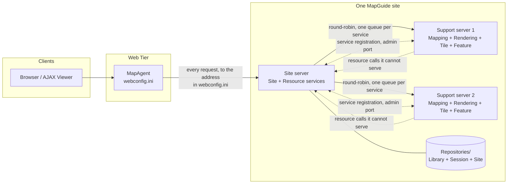
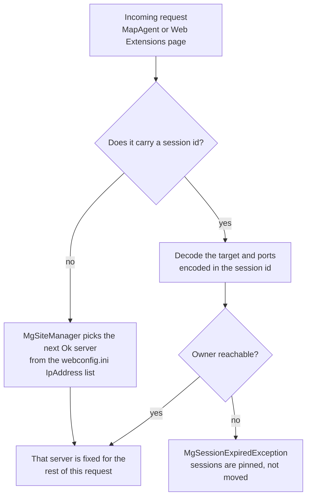
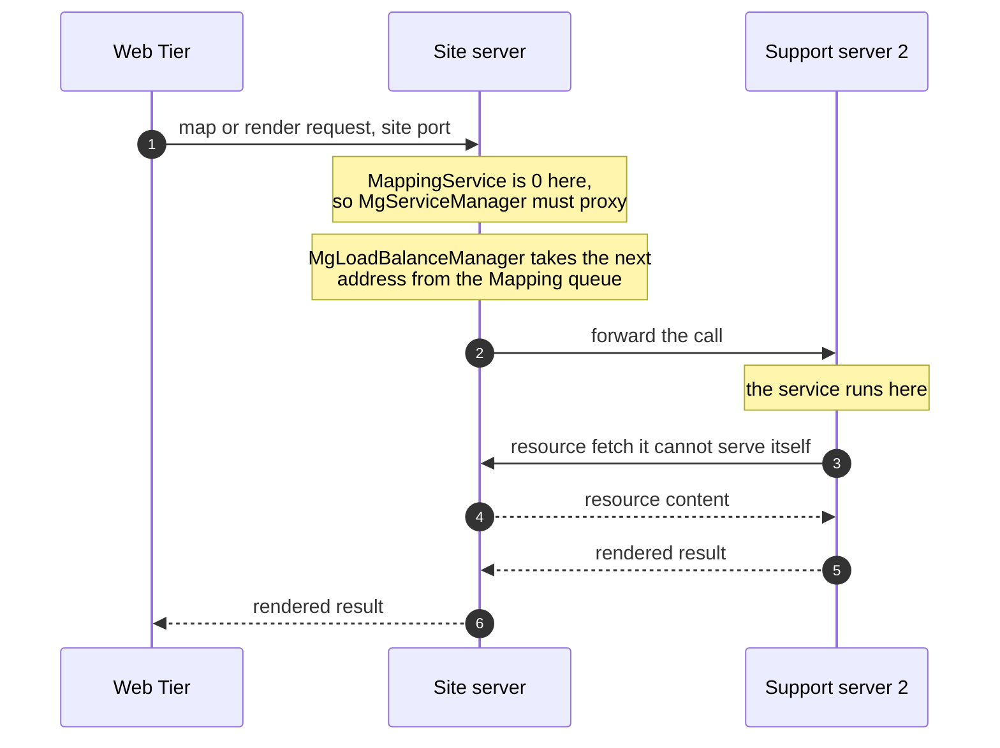
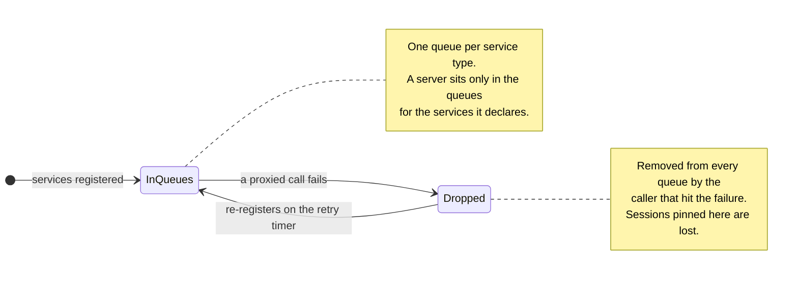
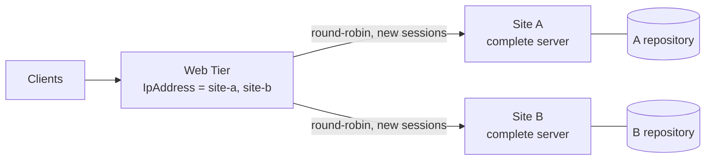
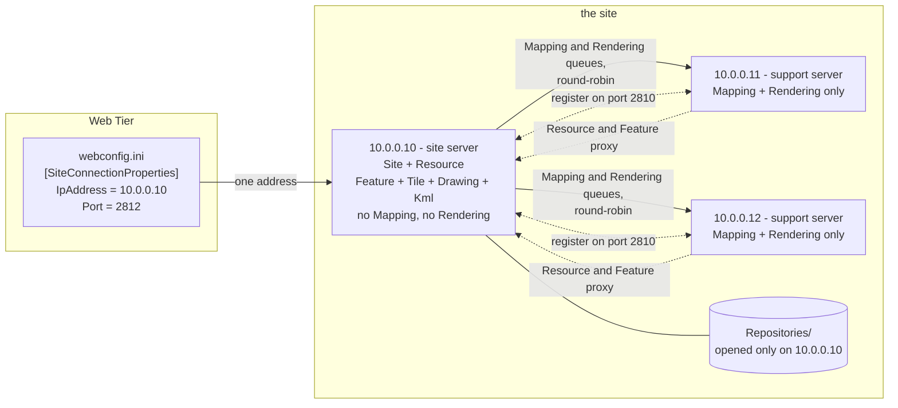
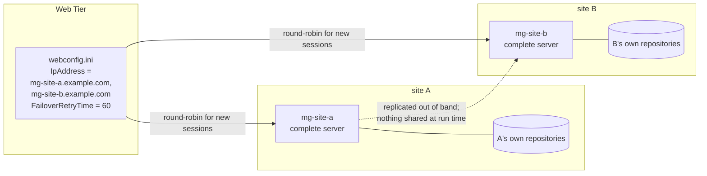

# MapGuide load balancing and horizontal scaling: what is actually implemented

**Question asked:** what load-balancing capability, if any, does MapGuide currently have that
would let a deployment be scaled horizontally by adding more MapGuide server instances?

**Answer:** **Yes — one, and it is real, wired end to end, and shipped.** MapGuide has a *site*
model in which several MapGuide server processes cooperate, plus a `MgLoadBalanceManager` that
round-robins *service requests* between them and a client-side (`MgSiteManager`) round-robin that
spreads *new sessions* across the servers a Web Tier is configured with. Both are round-robin with
failover; neither is load-aware.

It is also **narrower than "run N identical servers behind a load balancer"**, and the difference
matters:

- The **resource repository is a Berkeley DB XML environment** opened by **exactly one** server per
  site — the site server. Every other server reaches it *by proxying Resource requests through the
  site server*, not by sharing storage. The repository cannot be placed on network storage and
  opened by several servers.
- Therefore the horizontal-scaling axis MapGuide actually supports is **splitting the
  processor-intensive services (Mapping, Rendering, Tile, Feature, Drawing) onto additional
  servers, with the site server retaining Site + Resource**. That is exactly what the shipped
  in-product help describes, and exactly what the code does.
- The mechanism the code calls *"deprecated support servers"* is a **client-side** vectoring path
  that was retired in 2008 (r3288, ticket #669) because letting each service call pick its own
  server broke a Web Layout whose API call sequence spanned more than one host. The *server-side*
  support-server machinery stayed, and is what does the work today.

A second, weaker axis also exists and is **undocumented**: the Web Tier honours a
**comma-separated list of MapGuide servers** in `webconfig.ini`, round-robining new sessions
across them with sticky routing. It is only safe when every listed server is a *full* site server
with its own repository, i.e. it is replication of a site, not scaling of a site.

This document records the evidence, the configuration surfaces, the limits, and — because nothing
here was exercised at runtime — a concrete verification plan. It is a static analysis of the trees
at the revisions below. **No source change is proposed or required**, so the API/ABI mode is not
engaged.

| Item | Revision / version |
|------|--------------------|
| `mapguide/MgDev` working copy | `branches/4.0/MgDev` r10218 (clean, no local mods) |
| `fdo` working copy | `branches/4.2` r8410 |
| API/ABI mode at time of writing | `freeze` (see [AGENTS.md](../AGENTS.md#current-cycle)) — nothing here touches the shipped surface |
| Resource repository engine | vendored `Oem/dbxml` (Berkeley DB 4.8.26 + Berkeley DB XML); see the [README](../README.md) MapGuide thirdparty matrix |

---

## 1. The 10,000 ft view

### 1.1 The shape of a deployment: one repository, many workers



The essential asymmetry: **the whole site has one repository, one Site service and one Resource
service, but as many compute servers as you care to add.** The Web Tier's job is trivial (it talks
to the site server); all the interesting routing happens inside the server tier.

### 1.2 Two round-robins, one table

There are **two independent balancers**, at different layers, that do not know about each other.

| | Client side — `MgSiteManager` | Server side — `MgLoadBalanceManager` |
|---|---|---|
| Lives in | `MgInitializeWebTier` / any client process (`Common/MapGuideCommon/Services/SiteManager.cpp`) | the MapGuide server process (`Server/src/Common/Manager/LoadBalanceManager.cpp`) |
| Balances | **whole requests** — which MapGuide server a Web Tier connects to | **service calls** — which server executes a service the caller does not host |
| Granularity | per new session / per unauthenticated-then-authenticated request | per service *type*, one queue each |
| Configured by | `[SiteConnectionProperties] IpAddress` in **webconfig.ini**, comma-separated | `[SupportServers]` + `[SupportServer_<id>]` in **serverconfig.ini** on the site server |
| Managed at runtime by | nothing (config file only) | `MgSite::AddServer / UpdateServer / RemoveServer / EnumerateServers` (the Site Administrator UI can only delete, hence §5.3) |
| Selection | round-robin over "Ok" sites, **sticky per session id** | round-robin (`pop_front`/`push_back`) over the per-service queue |
| Failover | `MgCommand` marks a server `UnableToConnect`; a background thread re-probes it | the caller removes the failed server from every service queue |
| Observability | MapAgent `GETSITEINFO`, `GETSITESTATUS` | MapAgent `GETSITEINFO`, Site Administrator "Manage Servers" |

### 1.3 How one request picks its server (client side)



### 1.4 Where a service call actually executes (server side)



The return trip is the part people miss: the site server is on the critical path for **every** call,
because the support servers' Resource traffic converges back on it. A new worker adds compute; it
does not remove load from the site server.

### 1.5 When a worker goes away



### 1.6 The other, undocumented axis: a list of complete sites



Nothing is shared here — each entry is a whole site with its own repository, and a session stays on
the site that created it. This buys capacity and request-level failover for *new* sessions; it is
replication, not scaling of one site.

Everything below is evidence for these diagrams and that table.

---

## 2. The site: one authority, N workers

### 2.1 What a "site" is, in the shipped documentation

The authoritative description is shipped *inside* the product, in the Site Administrator help pages
(`mapguide/MgDev/Web/src/mapadmin/HelpDocs/`):

> "the collection of servers that processes requests from the client applications is called a
> **site**. You can divide the processing load between two or more servers within the site. Each
> site shares a single resource repository among its servers. The resource repository stores the
> resources that map authors use to create maps … **The site server contains the resource
> repository.**"
> — `about_sites_and_servers.htm`

> "There are seven services: Site, Resource, Drawing, Feature, Mapping, Rendering, and Tile. If you
> are using a single server, that server performs all of these services. In any case, **the site
> server always handles the first two services** [Site and Resource], because they handle data
> access and manage the resources for the site. However, if you have two or more servers, you can
> **split off the other services and allocate them to another server or servers**. For example, the
> **Mapping and Rendering services are the most processor-intensive** operations and can benefit
> from having a dedicated server to handle them."
> — `about_services.htm`

> "**The first time you view this page, the table of servers will contain only the site server name
> and IP address** specified during installation of the software. The workflow to set up your
> servers is as follows: 1. **Add all the servers to the list.** 2. Add users and groups … 3. Set up
> the log files."
> — `managing_servers.htm`

So the feature is not merely latent in the code: it is a documented, administrator-facing workflow.
What follows is how that workflow is implemented.

One caveat on reading that workflow: the *shipped* Site Administrator can delete a server and take
one online or offline, but it can **neither add a server nor change a server's service assignment**
— both writes were removed from the web application (§5.3). Treat "add all the servers to the list"
as describing the *model* to build; realising it is done through the `MgSite` API or
`serverconfig.ini`.

### 2.2 The service set is per server, and enumerated identically everywhere

A server declares which services it hosts in `[HostProperties]` of `serverconfig.ini`
([serverconfig.ini:198](../mapguide/MgDev/Server/src/Core/serverconfig.ini#L198)):

```
DrawingService                     = 1
FeatureService                     = 1
KmlService                         = 1
MappingService                     = 1
RenderingService                   = 1
ResourceService                    = 1
SiteService                        = 1
TileService                        = 1
```

Those names are matched, one for one, against a table that also fixes the *queue index* used by the
balancer. `MgServerInformation::sm_serviceInfoMap` lists all 11 entries
([ServerInformation.cpp:34](../mapguide/MgDev/Common/MapGuideCommon/Services/ServerInformation.cpp#L34))
and `sm_knMaxNumberServices = 11`
([ServerInformation.h:409](../mapguide/MgDev/Common/MapGuideCommon/Services/ServerInformation.h#L409)):

| idx | service | idx | service |
|-----|---------|-----|---------|
| 0 | `ResourceService` | 6 | `KmlService` |
| 1 | `DrawingService` | 7 | `ServerAdminService` |
| 2 | `FeatureService` | 8 | `SiteService` |
| 3 | `MappingService` | 9 | `PrintLayoutService` |
| 4 | `RenderingService` | 10 | `ProfilingService` |
| 5 | `TileService` | | |

Two consequences worth knowing before reading the rest:

- `KmlService`, `PrintLayoutService` and `ProfilingService` are in the model but are **not** offered
  by the Site Administrator service matrix (see §5.3), so KML is not routinely distributed.
- `ServerAdminService` is deliberately **excluded from the queues** — "Every server must host the
  Server Admin service internally, so exclude it from the server queue"
  ([LoadBalanceManager.cpp:509](../mapguide/MgDev/Server/src/Common/Manager/LoadBalanceManager.cpp#L509)).
  Admin operations are therefore never round-robined away; they always run against the server you
  addressed.

### 2.3 Site server vs. support server is decided by one property

`MgServerManager::Initialize` reads the Site service property straight out of `[HostProperties]`:

```c++
pConfiguration->GetBoolValue(
    MgConfigProperties::HostPropertiesSection,
    MgConfigProperties::HostPropertySiteService,
    m_isSiteServer,
    MgConfigProperties::DefaultHostPropertySiteService);
```
— [ServerManager.cpp:149](../mapguide/MgDev/Server/src/Common/Manager/ServerManager.cpp#L149)

and `MgServerInformation::IsSiteServer()` is the same bit, expressed as a service flag:

```c++
bool MgServerInformation::IsSiteServer() const
{
    return IsServiceEnabled(MgServiceType::SiteService);
}
```
— [ServerInformation.cpp:597](../mapguide/MgDev/Common/MapGuideCommon/Services/ServerInformation.cpp#L597)

`MgLoadBalanceManager::Initialize` asserts the two agree and throws `MgLogicException` if they do
not ([LoadBalanceManager.cpp:145](../mapguide/MgDev/Server/src/Common/Manager/LoadBalanceManager.cpp#L145)).
So **`[HostProperties] SiteService = 0` is the whole of "this is a support server"**.

Three configuration traps follow from this, all silent:

1. `DefaultHostPropertySiteService` is **`false`**
   ([ConfigProperties.cpp:239](../mapguide/MgDev/Common/MapGuideCommon/System/ConfigProperties.cpp#L239)).
   If `[HostProperties]` (or the whole file section) is missing, the server becomes a *support*
   server, not a site server.
2. A **support** server must have `[SiteConnectionProperties] IpAddress` set to the site server and
   **must not** be a loopback or its own `MachineIp`; a **site** server's `IpAddress` must equal its
   own `MachineIp`. Both are enforced at startup with dedicated messages
   ([ServerManager.cpp:185](../mapguide/MgDev/Server/src/Common/Manager/ServerManager.cpp#L185),
   [ServerManager.cpp:210](../mapguide/MgDev/Server/src/Common/Manager/ServerManager.cpp#L210)).
3. There can be **exactly one** site server per site. A second server claiming the Site service is
   rejected outright: *"There are more than one Site servers within a site?"*
   ([LoadBalanceManager.cpp:839](../mapguide/MgDev/Server/src/Common/Manager/LoadBalanceManager.cpp#L839)).

### 2.4 Only the site server opens the repositories

```c++
// Open the repositories on the Site server.
if (m_serverManager->IsSiteServer())
{
    ...
    m_resourceService = dynamic_cast<MgServerResourceService*>(
        RequestLocalService(MgServiceType::ResourceService));
    m_resourceService->OpenRepositories();
    ...
}
```
— [ServiceManager.cpp:128](../mapguide/MgDev/Server/src/Common/Manager/ServiceManager.cpp#L128)

This is the single most important fact in this document. A support server never calls
`OpenRepositories()`; it gets resource content by **proxying** Resource service calls to whoever
does host them (§3.3). Everything in §2 and §3 therefore establishes that the "shares a single
resource repository" wording above means *"reaches it through the site server"*, not *"mounts it"*,
and §6.1 is the mechanical reason that has to be so.

---

## 3. Server-side load balancing (`MgLoadBalanceManager`)

### 3.1 One queue per service

`MgLoadBalanceManager` owns one deque per service type and one map of known servers
([LoadBalanceManager.h:136](../mapguide/MgDev/Server/src/Common/Manager/LoadBalanceManager.h#L136)):

```c++
MgServerMap   m_supportServerMap;  // Support servers within this site.
MgServerMap   m_externalServerMap; // Other servers at different sites.
MgServerQueue m_serverQueues[MgServerInformation::sm_knMaxNumberServices];
```

Adding a server to a queue is idempotent; removing one splices it out of a specific service's queue
([LoadBalanceManager.cpp:503](../mapguide/MgDev/Server/src/Common/Manager/LoadBalanceManager.cpp#L503),
[LoadBalanceManager.cpp:560](../mapguide/MgDev/Server/src/Common/Manager/LoadBalanceManager.cpp#L560)).
`UpdateServerQueues` re-derives all 11 queues from a server's current service flags — so flipping a
service on or off is a queue-membership change, not a restart
([LoadBalanceManager.cpp:586](../mapguide/MgDev/Server/src/Common/Manager/LoadBalanceManager.cpp#L586)).

### 3.2 Selection is plain round-robin, and it has no feedback signal

```c++
MgServerQueue& serverQueue = m_serverQueues[serviceType];
size_t numServers = serverQueue.size();

if (numServers == 1)      { return serverQueue[0]; }
else if (numServers == 0) { throw ...MgServiceNotAvailableException...; }

serverAddress = serverQueue[0];
serverQueue.pop_front();
serverQueue.push_back(serverAddress);
```
— [LoadBalanceManager.cpp:989](../mapguide/MgDev/Server/src/Common/Manager/LoadBalanceManager.cpp#L989)

There is no weighting, no least-connections, no CPU term. `MgServerManager::GetInformationProperties`
*does* compute `CpuUtilization`, the three operation-queue depths, uptime, memory and operation-time
statistics ([ServerManager.cpp:406](../mapguide/MgDev/Server/src/Common/Manager/ServerManager.cpp#L406))
and surfaces them through `GETSITEINFO`, but **nothing in the balancer reads them**. They are
monitoring data.

### 3.3 A service the local server does not host is proxied to a peer

`MgServiceManager` is the only consumer of `RequestServer`:

```c++
MgService* MgServiceManager::RequestService(INT32 serviceType)
{
    ...
    if (m_loadBalanceManager->m_localServerInfo->IsServiceEnabled(serviceType))
    {
        service = RequestLocalService(serviceType);
    }
    else
    {
        do { service = RequestProxyService(serviceType); }
        while (NULL == service); // or until an exception is thrown
    }
}
```
— [ServiceManager.cpp:358](../mapguide/MgDev/Server/src/Common/Manager/ServiceManager.cpp#L358)

`RequestProxyService` asks the balancer for an address and opens a site-port connection to it:

```c++
serverAddress = m_loadBalanceManager->RequestServer(serviceType);

// Use the site port for Site/Support Server communications.
Ptr<MgConnectionProperties> connProp = new MgConnectionProperties(
    currUserInfo, serverAddress, m_serverManager->GetSitePort());

proxyService = MgSiteConnection::CreateService(serviceType, connProp);
```
— [ServiceManager.cpp:180](../mapguide/MgDev/Server/src/Common/Manager/ServiceManager.cpp#L180)

This governs **inbound** traffic as well as internal calls: every service's operation handler
acquires its service through the same call, so a request that arrives at a server which does not
host that service is proxied before it is executed —
[MappingOperation.cpp:61](../mapguide/MgDev/Server/src/Services/Mapping/MappingOperation.cpp#L61),
[RenderingOperation.cpp:63](../mapguide/MgDev/Server/src/Services/Rendering/RenderingOperation.cpp#L63),
[ResourceOperation.cpp:63](../mapguide/MgDev/Server/src/Services/Resource/ResourceOperation.cpp#L63),
[SiteOperation.cpp:61](../mapguide/MgDev/Server/src/Services/Site/SiteOperation.cpp#L61). That is
what makes the Web Tier's "bind all service requests to the machine initially connected to"
behaviour in §4.4 work at all — the server it landed on silently forwards what it cannot run.
It also means a Site op (a session creation, say) sent to a support server executes on the site
server, so the session is stamped with the site server regardless of which server the Web Tier
picked; see §4.3.

This is why a support server with `ResourceService = 0` still works: every
`RequestService(MgServiceType::ResourceService)` across the codebase — `MgCacheManager`,
`MgPackageManager`, `MgFdoConnectionManager`, `MgServiceOperation`, `LoadPackageCommand`,
`Server.cpp` — transparently becomes a proxy call to the site server. A support server's own
per-process caches are still its own, which is what §3.6 is about.

### 3.4 Registration is asymmetric — the site server's list is authoritative

The protocol is: every server registers its own service set *with* a peer, using the peer's
**Server Admin** port and system credentials
([LoadBalanceManager.cpp:772](../mapguide/MgDev/Server/src/Common/Manager/LoadBalanceManager.cpp#L772)):

```c++
MgServerAdmin serverAdmin;
serverAdmin.Open(ipAddress, userInformation);
feedbackList = serverAdmin.RegisterServicesOnServers(serverInfoList);
```

The receiving side then merges that list into its own view
([LoadBalanceManager.cpp:822](../mapguide/MgDev/Server/src/Common/Manager/LoadBalanceManager.cpp#L822)).
The branch taken depends on *who is receiving*:

```c++
bool sourceFromSiteServer = !m_serverManager->IsSiteServer();
...
else if (sourceFromSiteServer && !strict)
{
    // The server does not exist, add it to the server map and update
    // the server queue.
    ...
}
else
{
    // The Support server has not been added to the site?
    ... throw MgServerNotFoundException ...
}
```
— [LoadBalanceManager.cpp:829](../mapguide/MgDev/Server/src/Common/Manager/LoadBalanceManager.cpp#L829),
[LoadBalanceManager.cpp:883](../mapguide/MgDev/Server/src/Common/Manager/LoadBalanceManager.cpp#L883)

Read that as:

- **On the site server** (`sourceFromSiteServer == false`) an *unknown* server is **rejected**:
  `MgServerNotFoundException`. The site server will only accept a registration from a support
  server it already knows about (added via the admin API/UI, or present in `[SupportServers]`).
- **On a support server** (`sourceFromSiteServer == true`) the feedback list it gets back *is* the
  site server's full server list, so it **auto-learns that list** and populates its own queues.

So support servers **cannot self-enrol**. If you point a new support server at a site server and
never add it to the site, its registration attempt fails every retry interval and it stays inert —
it will not receive a single proxied call.

### 3.5 Startup, retry and failover

- A **site server** registers synchronously at startup and then terminates the registration timer:
  *"On startup, perform the service registration for the Site server. Note that this event will be
  performed by a timer for the Support server."*
  ([Server.cpp:944](../mapguide/MgDev/Server/src/Core/Server.cpp#L944))
- A **support server** instead arms `MgServiceRegistrationEventHandler`, which re-attempts
  registration every `[GeneralProperties] ServiceRegistrationTimerInterval` (default **60 s**) and
  cancels itself once it succeeds
  ([ServiceRegistrationEventHandler.cpp:58](../mapguide/MgDev/Server/src/Core/ServiceRegistrationEventHandler.cpp#L58),
  default at [ConfigProperties.cpp:162](../mapguide/MgDev/Common/MapGuideCommon/System/ConfigProperties.cpp#L162)).
  That interval is the worst-case time for a restarted support server to be usable again.
- Failover on the *proxy* path is immediate and blunt: if the proxied connection throws
  `MgConnectionFailedException`/`MgConnectionNotOpenException`, the caller removes that server from
  **every** service queue, so subsequent calls go elsewhere:

  ```c++
  // Remove the server from the queues. Server is down?
  for (INT32 i = 0; i < MgServerInformation::sm_knMaxNumberServices; ++i)
  {
      m_loadBalanceManager->RemoveServerFromQueue(i, serverAddress);
  }
  ```
  — [ServiceManager.cpp:200](../mapguide/MgDev/Server/src/Common/Manager/ServiceManager.cpp#L200)

  Note the asymmetry with the retry timer: removal is *per callback*, re-admission is *polled*. A
  server is re-admitted when it next registers (or when `EnableServices`/`BringOnline` runs), not
  as soon as it is healthy again.
- `MgServerManager::TakeOffline()` unregisters the server's services and clears its caches;
  `BringOnline()` re-registers
  ([ServerManager.cpp:804](../mapguide/MgDev/Server/src/Common/Manager/ServerManager.cpp#L804)).
  This is what the Site Administrator's **Online/Offline** toggle drives, and it is the supported
  way to drain a server for maintenance.

### 3.6 Resource-change notification: cache invalidation across servers

Because each server caches parsed feature sources and pooled FDO connections locally, a change on the
site server has to be pushed out. A timer (`[ResourceServiceProperties]
ResourceChangeTimerInterval`, default 5 s) calls
[`MgServiceManager::DispatchResourceChangeNotifications`](../mapguide/MgDev/Server/src/Common/Manager/ServiceManager.cpp#L470),
which:

- only does work `if (m_serverManager->IsSiteServer())` — the site server is the only one with a
  changed-resource list to drain;
- notifies its own **Tile** service of affected map/tileset definitions;
- then pushes changed **FeatureSource** resources to every server that hosts Feature or Tile, via
  `MgServerAdmin::NotifyResourcesChanged`
  ([LoadBalanceManager.cpp:926](../mapguide/MgDev/Server/src/Common/Manager/LoadBalanceManager.cpp#L926));
- the receiving side drops the matching FDO connection and cached feature source / layer definition
  ([CacheManager.cpp:173](../mapguide/MgDev/Server/src/Common/Manager/CacheManager.cpp#L173)).

This function is the clearest possible proof of the topology: **there is exactly one writer of the
repository (the site server) and N readers of it (the support servers), and the readers are kept
honest by invalidation, not by replication.**

---

## 4. Client-side round-robin (`MgSiteManager`)

### 4.1 `IpAddress` is a *list*, not an address

`MgSiteManager::Initialize` reads the same key a single-server deployment uses and splits it on
commas:

```c++
// Get the IP address and port for the site server.
STRING targets;
configuration->GetStringValue(
    MgConfigProperties::SiteConnectionPropertiesSection,
    MgConfigProperties::SiteConnectionPropertyIpAddress,
    targets, MgConfigProperties::DefaultSiteConnectionPropertyIpAddress);
...
Ptr<MgStringCollection> targetValues = MgStringCollection::ParseCollection(targets, L",");
```
— [SiteManager.cpp:216](../mapguide/MgDev/Common/MapGuideCommon/Services/SiteManager.cpp#L216),
[SiteManager.cpp:258](../mapguide/MgDev/Common/MapGuideCommon/Services/SiteManager.cpp#L258)

Each entry becomes an `MgSiteInfo` carrying its own site/client/admin port; the port lists are split
the same way and index-matched, falling back to the first value
([SiteManager.cpp:260](../mapguide/MgDev/Common/MapGuideCommon/Services/SiteManager.cpp#L260)).

**This is the "hint" that has been in the codebase all along.** The shipped
`webconfig.ini` describes it in the singular — *"IpAddress — The IP address of the site server"*
([webconfig.ini:117](../mapguide/MgDev/Web/src/webconfig.ini#L117)) — so nothing tells an
administrator that a list is accepted. There is no dedicated key, no count, no plural name.

### 4.2 Selection

`GetNextSite` walks the list from the last-used index and returns the first site whose status is
`Ok`, advancing the cursor:

```c++
for (INT32 siteIndex = 0; siteIndex < numSites; siteIndex++)
{
    INT32 siteToTry = (m_index + siteIndex) % numSites;
    MgSiteInfo* siteInfo = m_sites.at(siteToTry);

    if (MgSiteInfo::Ok == siteInfo->GetStatus())
    {
        nextSite = siteInfo;
        m_index = siteToTry + 1;
        break;
    }
}
```
— [SiteManager.cpp:406](../mapguide/MgDev/Common/MapGuideCommon/Services/SiteManager.cpp#L406)

`m_index` is an instance member of a process-wide singleton
([SiteManager.h:101](../mapguide/MgDev/Common/MapGuideCommon/Services/SiteManager.h#L101)), so the
round-robin cursor is **per process, not per deployment**. With a PHP-worker or ISAPI/Apache-module
Web Tier, each worker keeps its own cursor; the resulting distribution is still even in aggregate
but is not a single global rotation. A single-server deployment is the degenerate case and never
enters this code path in a meaningful way.

The unit test suite states the split between the two sides of this mechanism outright — this is the
clearest single piece of evidence in the tree for the whole document:

```c++
/// Get the number of site servers configured in the INI file. Should always be
/// 1 for serverconfig.ini.
TEST_CASE("GetSiteCount", "[SiteManager]")
{
    ...
    // The number of sites should always be 1 on the server.
    // It can be greater than 1 in the web tier.
    REQUIRE(numSites == 1);
}
```
— [TestSiteManager.cpp:272](../mapguide/MgDev/Server/src/UnitTesting/TestSiteManager.cpp#L272)

**One site entry on a server; more than one is a web-tier configuration.** That is §8's verdict,
written down by the MapGuide developers in a test they can run.

### 4.3 Session affinity is encoded in the session id

This is the part that makes Web-Tier load balancing actually work with a stateful server. When the
Site service creates a session, it appends an encoding of *which server owns the session*:

```c++
MgSiteManager* siteManager = MgSiteManager::GetInstance();
Ptr<MgSiteInfo> siteInfo = siteManager->GetSiteInfo(0);
session = currUserInfo->CreateMgSessionId(siteInfo);
```
— [ServerSiteService.cpp:743](../mapguide/MgDev/Server/src/Services/Site/ServerSiteService.cpp#L743)
and [UserInformation.cpp:324](../mapguide/MgDev/Common/MapGuideCommon/System/UserInformation.cpp#L324)

The session id format is `<uuid>_<locale>_<base64(target)+%4X%4X%4X(site,client,admin ports)>`
([SiteInfo.cpp:156](../mapguide/MgDev/Common/MapGuideCommon/Services/SiteInfo.cpp#L156),
`HexPortsStringLength = 12` at
[SiteInfo.h:86](../mapguide/MgDev/Common/MapGuideCommon/Services/SiteInfo.h#L86)). An example from the
Developer Guide is `Session:70ea89fe-0000-1000-8000-005056c00008_en//layer.LayerDefinition`.

The unit tests carry a fully decoded example, which is the cheapest way to see the format for
yourself — `48cb0286-0000-1000-8001-005056c00008_en_MTExLjEyMi4xMzMuMTQ0045708AE0D05` decomposes as:

| Part | Value |
|---|---|
| uuid | `48cb0286-0000-1000-8001-005056c00008` |
| locale | `en` |
| `MTExLjEyMi4xMzMuMTQ0` | base64 of the target `111.122.133.144` |
| `0457` | site port `0x0457` = 1111 |
| `08AE` | client port `0x08AE` = 2222 |
| `0D05` | admin port `0x0D05` = 3333 |

— constants at
[TestSiteManager.cpp:23](../mapguide/MgDev/Server/src/UnitTesting/TestSiteManager.cpp#L23)

`GetSiteConnectionPropertiesWithSession` then asserts that asking for `Site`, `Client` and `Admin`
connection properties with this session id in play returns exactly those target/ports, overriding
whatever the config file says ([TestSiteManager.cpp:86](../mapguide/MgDev/Server/src/UnitTesting/TestSiteManager.cpp#L86)).
So the affinity mechanism is covered by a runnable test, not only by reading.

The invariant is asserted on the server side too. `MgSessionCache::GetSessionInfo` decodes the same
suffix and checks it against the server's own single site entry — in Debug builds only:

```c++
#ifdef _DEBUG
    // Session Affinity: Check that the session was created by this server
    if(!session.empty())
    {
        STRING hexString = session.substr(session.rfind(L"_") + 1);
        Ptr<MgSiteInfo> sessionSiteInfo = new MgSiteInfo(hexString);
        if(sessionSiteInfo->GetStatus() == MgSiteInfo::Ok)
        {
            MgSiteManager* siteManager = MgSiteManager::GetInstance();
            Ptr<MgSiteInfo> firstSite = siteManager->GetSiteInfo(0);
            assert(sessionSiteInfo->GetTarget().compare(firstSite->GetTarget()) == 0);
            assert(sessionSiteInfo->GetPort(MgSiteInfo::Site) == firstSite->GetPort(MgSiteInfo::Site));
        }
    }
#endif //_DEBUG
```
— [SessionCache.cpp:151](../mapguide/MgDev/Server/src/Common/Manager/SessionCache.cpp#L151)

Two things to take from that: the server *knows* a session belongs to one particular server, and the
check that a wrong-server session never reaches a server's session cache is **a Debug-only
`assert`** — a Release build silently proceeds to the `m_sessionInfoMap.find()` below it, which is
where the eventual `MgSessionExpiredException` comes from.

On the next request `MgSiteManager::GetConnectionProperties(..., useSessionIp = true)` decodes that
suffix and returns connection properties for the owning server instead of advancing the cursor
([SiteManager.cpp:306](../mapguide/MgDev/Common/MapGuideCommon/Services/SiteManager.cpp#L306)).
If the owning server is not currently `Ok`, the session is **not** moved — the caller gets
`MgSessionExpiredException`
([SiteManager.cpp:334](../mapguide/MgDev/Common/MapGuideCommon/Services/SiteManager.cpp#L334)).
Sessions are therefore **pinned**, not shared, and losing the server that owns a session loses that
session.

Note also that a session id naming a server which is *not* in the configured list still resolves:
`MgSiteManager::GetSiteInfo(hexString)` fabricates an `MgSiteInfo` with status `Ok` from the encoded
address ([SiteManager.cpp:542](../mapguide/MgDev/Common/MapGuideCommon/Services/SiteManager.cpp#L542)).
The session id, not the config file, is what pins the request.

### 4.4 Which servers may be listed

A Web Tier does not ask anyone where services live. `MgSiteConnection::Open` round-robins once and
then binds every subsequent call in that request to the same machine:

```c++
else if (m_isWebTier)
{
    MgSiteManager* siteManager = MgSiteManager::GetInstance();
    m_connProp = siteManager->GetConnectionProperties(userInformation, MgSiteInfo::Client, true);
}
```
— [SiteConnection.cpp:119](../mapguide/MgDev/Common/MapGuideCommon/Services/SiteConnection.cpp#L119)

and `GetConnectionPropertiesFromSiteServer` returns the *existing* connection rather than vectoring
per service, with the reason spelled out in a 2008 comment:

```c++
// We have deprecated support servers.  All load balanced servers
// should support all services.  With this change, we do not need to
// contact the site server to determine where to vector service requests.
//
// A site connection has already been established if we are looking for services.
// Just use the target and port from the existing connection.  This will
// bind all service requests to the machine initially connected to in
// the MgSiteConnection.Open call.
```
— [SiteConnection.cpp:500](../mapguide/MgDev/Common/MapGuideCommon/Services/SiteConnection.cpp#L500),
introduced by r3288 ("Ticket #669 WebLayout Load Balancing Fails because of API call sequence",
`svn log -r 3288`).

So: **list only servers that host the services the Web Tier will call.** A support server that hosts
only Mapping/Rendering will still work for map rendering, because it proxies Resource — but the
"all load balanced servers should support all services" guidance is what keeps behaviour uniform, and
that is the shape the deprecation comment endorses.

Ports are thread pools, not service gates: the three acceptors
([Server.cpp:366](../mapguide/MgDev/Server/src/Core/Server.cpp#L366)) feed a common dispatcher that
selects the handler from the **service id in the operation packet**, not from the port
([OperationThread.cpp:389](../mapguide/MgDev/Server/src/Core/OperationThread.cpp#L389)). That is why
`MgSiteManager` can use the Client port for services and the Site port for site operations and both
work against the same server.

### 4.5 Health checking, failover and the `FailoverRetryTime` knob

- Failure detection is client-side and passive: `MgCommand::ExecuteCommand` marks a server
  `UnableToConnect` when a call fails, and drops its pooled connection
  ([Command.cpp:128](../mapguide/MgDev/Common/MapGuideCommon/Services/Command.cpp#L128)).
- Recovery is a background thread started by `MgSiteManager`'s constructor. It probes every site
  whose status is not `Ok` with a `GetSiteStatus` call and flips it back to `Ok` when it answers
  ([SiteManager.cpp:23](../mapguide/MgDev/Common/MapGuideCommon/Services/SiteManager.cpp#L23)). The
  probe needs no credentials, which is exactly why `GetSiteStatus` was chosen.
- The sleep between sweeps is `[GeneralProperties] FailoverRetryTime`, and the shipped
  `webconfig.ini` comment is the only place the multi-server use case is *stated in prose*:

  > "For a single Web Tier and MapGuide server pair use 1. For a load balanced configuration with
  > multiple MapGuide servers use 60. Values other than 1 will cause a delay when re-establishing a
  > connection with the Web Tier after restarting a MapGuide server."
  > — [webconfig.ini:49](../mapguide/MgDev/Web/src/webconfig.ini#L49)

  With a list of one, the thread shortens its own sleep to 1 s to avoid a pointless 60 s outage
  ([SiteManager.cpp:95](../mapguide/MgDev/Common/MapGuideCommon/Services/SiteManager.cpp#L95)).
- A `MgSiteManager` also exists in a MapGuide **server** process — the shutdown path stops its
  check thread ([Server.cpp:430](../mapguide/MgDev/Server/src/Core/Server.cpp#L430)) and the session
  cache uses it (§4.3). There it tracks the one site entry (the site server itself, on a support
  server). Its *status* tracking, however, is not consulted by server-side routing, which goes
  through `MgLoadBalanceManager`: do not read a `MgSiteInfo` status from a server-side log as the
  site's health.
- Uneven balancing caused by unauthenticated traffic is a *known* problem with a workaround in the
  HTTP handler. The cursor is advanced per site connection, so a request that opens one and then
  fails authentication burns a slot; the handler therefore refuses an unauthenticated request
  *before* opening a connection:

  > "Short circuit the authentication check if no username or session is supplied. This will ensure
  > that load balancing works correctly if browsers send an unauthenticated then an authenticated
  > request. The check increments the load balanced servers so the unauthenticated HTTP request
  > will eat up one of the servers and give uneven load balancing."
  > — [HttpRequestResponseHandler.cpp:193](../mapguide/MgDev/Web/src/HttpHandler/HttpRequestResponseHandler.cpp#L193)

### 4.6 Observability: three MapAgent operations exist for this

All three are registered in the MapAgent operation table
([HttpRequest.cpp:396](../mapguide/MgDev/Web/src/HttpHandler/HttpRequest.cpp#L396)) and documented in
[openapi.yaml](./openapi.yaml) (lines 324, 361 and 396). Each returns a `<SiteInformation>` document
containing one `<Server>` child per entry in the *configured list*, not one for the selected server:

| Operation | Handler | Per-`<Server>` content |
|---|---|---|
| `GETSITEVERSION` | [HttpGetSiteVersion.cpp:45](../mapguide/MgDev/Web/src/HttpHandler/HttpGetSiteVersion.cpp#L45) | `Version` |
| `GETSITEINFO` | [HttpGetSiteInfo.cpp:46](../mapguide/MgDev/Web/src/HttpHandler/HttpGetSiteInfo.cpp#L46) | `IpAddress`, `DisplayName`, `Status`, `Version`, `OperatingSystem`, `Statistics` |
| `GETSITESTATUS` | [HttpGetSiteStatus.cpp:45](../mapguide/MgDev/Web/src/HttpHandler/HttpGetSiteStatus.cpp#L45) | `DisplayName`, `Status`, `ApiVersion` |

Each iterates `siteManager->GetSites()` — the parsed list — and emits a placeholder `<Server>` block
carrying the exception message for any entry that does not answer. **A `GETSITEINFO` response with
more than one `<Server>` block is direct proof that a Web Tier is configured for more than one
server**, which makes it the fastest way to observe the list from outside the process, and the
natural first check in the verification plan below. (Before API version 2.2.0, all three fall back
to querying the single selected server.)

---

## 5. Administering a site

### 5.1 The management API

The server list belongs to the **Site** service, on the site server
([Site.h:792](../mapguide/MgDev/Common/MapGuideCommon/Services/Site.h#L792)):

```
MgByteReader* EnumerateServers();
void          AddServer(CREFSTRING name, CREFSTRING description, CREFSTRING address);
void          UpdateServer(CREFSTRING oldName, CREFSTRING newName,
                           CREFSTRING newDescription, CREFSTRING newAddress);
void          RemoveServer(CREFSTRING name);
```

`EnumerateServers` emits `ServerList-1.0.0` XML
([LoadBalanceManager.cpp:1051](../mapguide/MgDev/Server/src/Common/Manager/LoadBalanceManager.cpp#L1051),
schema at `mapguide/MgDev/Common/Schema/ServerList-1.0.0.xsd`). `AddServer` rejects a duplicate name,
a duplicate address and the site server's own address, then — if the server is reachable —
registers services and seeds the queues before persisting
([LoadBalanceManager.cpp:1083](../mapguide/MgDev/Server/src/Common/Manager/LoadBalanceManager.cpp#L1083)).
`RemoveServer` unregisters, drains all queues, and deletes the config entry
([LoadBalanceManager.cpp:1361](../mapguide/MgDev/Server/src/Common/Manager/LoadBalanceManager.cpp#L1361)).

`MgSite::RequestServer(serviceType)` also exists on the wire (`MgOpRequestServer`), but it is
`INTERNAL_API`, is not used by any current client — the Web Tier path that used it was removed in
r3288 — and remains only as the server-side primitive behind `MgLoadBalanceManager::RequestServer`.

### 5.2 Where the list is persisted

The section is **not present** in the shipped `serverconfig.ini`:

```console
$ grep -n "SupportServers\|SupportServer_" mapguide/MgDev/Server/src/Core/serverconfig.ini
```
(no output)

It is created on first `AddServer`
([ConfigProperties.cpp:524](../mapguide/MgDev/Common/MapGuideCommon/System/ConfigProperties.cpp#L524)):

```
[SupportServers]
Identifiers = <uuid>,<uuid>,...

[SupportServer_<uuid>]
Name        = ...
Description = ...
IpAddress   = ...
```

This is why a hand-written site-server config that omits `[SupportServers]` behaves as if it has no
support servers at all, and why a support server configured against it is rejected in §3.4. The
identifier is any unique token used as the section suffix — `AddServer` generates a UUID when you do
not supply one, but nothing requires it to be one (§9.3.3 uses readable names).

### 5.3 The Site Administrator web application — and what it no longer does

`mapguide/MgDev/Web/src/mapadmin/` is the PHP Site Administrator. Its home page *is* the Manage
Servers page ([servermanagement.php](../mapguide/MgDev/Web/src/mapadmin/servermanagement.php)), and
of the actions you would expect there, **delete and online/offline work while add and
service-assignment do not**. That distinction matters because the shipped help text (§2.1) describes
the full workflow and the shipped UI cannot perform all of it.

Working:

- **Delete** a server — `DeleteServer` calls `MgSite::RemoveServer`
  ([serverdatafunctions.php:729](../mapguide/MgDev/Web/src/mapadmin/serverdatafunctions.php#L729)).
- **Online / Offline** — `MgServerAdmin::BringOnline` / `TakeOffline`
  ([serverdatafunctions.php:870](../mapguide/MgDev/Web/src/mapadmin/serverdatafunctions.php#L870)).
- Configuring a server's *properties*: `[GeneralProperties]`, the connection sections, and the
  per-service property sections (repository paths, connection pools, tile cache path) all still
  write.

Not working:

- **Add Server.** `ADD_SERVER_MENU_ITEM` is defined but never registered in a menu group, and there
  is no `addserver.php`; `Web/src` contains no call to `MgSite::AddServer` at all
  ([resizablepagecomponents.php:25](../mapguide/MgDev/Web/src/mapadmin/resizablepagecomponents.php#L25)
  has the only two references, both dead constants). The site's server list must be populated by the
  API or by hand (§9.1).
- **Assigning services.** The matrix renders, but its write is commented out:

  ```php
  function SetOptionalServerServices( $serverAdmin, $services )
  {
      ...builds drawing/feature/mapping/rendering/tile properties...
      // Disable Service manipulation from Site Admin
      // $serverAdmin->SetConfigurationProperties( MgConfigProperties::HostPropertiesSection, $props );
  }
  ```
  — [serverdatafunctions.php:862](../mapguide/MgDev/Web/src/mapadmin/serverdatafunctions.php#L862)

  Three callers still invoke `SetOptionalServerServices` — `servermanagement.php:149`,
  `serverproperties.php:160`, `servicesproperties.php:130` — so saving a server or its services from
  the UI silently succeeds and changes nothing about which services that server advertises. The line
  was disabled in **r2707** ("Ticket #389 Updating Site Name disables services and locks out settings
  in Web Admin", 2008-01-11, `svn log -r 2707`) and never restored.

The matrix is still worth reading, because it hard-codes the topology rule from §2.1:

```php
if ( $serviceSelector->serverAddress == $siteServerAddress )
{
    echo '<input type="checkbox" checked disabled>Site<br>', "\n";
    echo '<input type="checkbox" checked disabled><a href="servicesproperties.php?...">Resource</a><br>', "\n";
}
```
— [resizablepagecomponents.php:845](../mapguide/MgDev/Web/src/mapadmin/resizablepagecomponents.php#L845)

For the site server, **Site and Resource are rendered checked and `disabled`** — the UI shows that
neither can be moved. Other servers get Drawing / Feature / Mapping / Rendering / Tile checkboxes,
which now communicate intent rather than setting it. `KmlService` is absent from this matrix
altogether even though it is a first-class queue in the balancer, so KML distribution was already a
config-file-only exercise.

**Practical consequence:** in a MapGuide 4.0 deployment, adding a support server and choosing its
services are done with `MgSite::AddServer` / `MgServerAdmin::SetConfigurationProperties` (live) or by
editing `serverconfig.ini` and restarting — not through the Site Administrator. The UI remains
useful for taking a server offline, for deleting one, and for reading the site's server list and
service layout.

The Site Administrator itself runs on the PHP web tier; the `mapguide_image_install.sh` / `mapagent`
flow described in [README.md](../README.md) installs the MapAgent web tier, not the site
administrator, so it is not available out of the box from this repo's installer path.

### 5.4 Bringing services up and down without a restart

Writing the `[HostProperties]` section — through `MgServerAdmin::SetConfigurationProperties` or
`RemoveConfigurationProperties` — is treated specially by the server: `MgServerManager` intercepts
that section and calls `MgServiceManager::EnableServices`
([ServerManager.cpp:298](../mapguide/MgDev/Server/src/Common/Manager/ServerManager.cpp#L298),
[ServerManager.cpp:343](../mapguide/MgDev/Server/src/Common/Manager/ServerManager.cpp#L343)), which
turns the property collection into a service-flags mask and hands it to
`MgLoadBalanceManager::EnableServices`
([ServiceManager.cpp:303](../mapguide/MgDev/Server/src/Common/Manager/ServiceManager.cpp#L303)).
That rewrites the local flags, re-derives the local queues, and pushes the new flags to every peer it
can reach, swallowing unreachable ones
([LoadBalanceManager.cpp:1780](../mapguide/MgDev/Server/src/Common/Manager/LoadBalanceManager.cpp#L1780)).
Offline servers are advertised with zero service flags so peers stop selecting them
(`if (!m_serverManager->IsOnline())` in the same function). This is the mechanism behind the
"take a server offline before configuring it" instruction in
[`configuring_servers.htm`](../mapguide/MgDev/Web/src/mapadmin/HelpDocs/configuring_servers.htm).

The important qualifier is that the *only* client that reaches this path is the API: the Site
Administrator's service checkboxes no longer write `[HostProperties]` (§5.3), and **hand-editing
`serverconfig.ini` while the server runs does not go through here either** — the file is read at
startup, so a hand edit needs a restart while `SetConfigurationProperties` does not. Online/Offline
from the Site Administrator does work, and is the supported way to drain a server without editing
anything.

---

## 6. What is *not* balanced and *not* shared

This section is the reason a naive "put two MapGuide servers behind a load balancer" plan fails.

### 6.1 The resource repository cannot be shared between processes on different hosts

The repository is a **Berkeley DB XML environment**, opened at a filesystem path with a local,
transactional, exclusive configuration
([DbEnvironment.cpp:160](../mapguide/MgDev/Server/src/Services/Resource/DbEnvironment.cpp#L160)):

```c++
u_int32_t environmentFlags = DB_CREATE|DB_THREAD|DB_INIT_MPOOL;
...
environmentFlags |= DB_INIT_TXN|DB_INIT_LOCK|DB_INIT_LOG;
...
m_dbEnv.open(home.c_str(), environmentFlags, 0);
```
— [DbEnvironment.cpp:197](../mapguide/MgDev/Server/src/Services/Resource/DbEnvironment.cpp#L197)

`DbEnv`/`XmlManager` are used in-process (no `DB_RPC`/`DB_SERVER`), the environment is created with
`DB_RECOVER`, and the paths are ordinary local directories
(`[ResourceServiceProperties] LibraryRepositoryPath = Repositories/Library/`, …,
[serverconfig.ini:383](../mapguide/MgDev/Server/src/Core/serverconfig.ini#L383)). Berkeley DB's own
locking and shared-memory model does not support this over a network filesystem, so **pointing two
MapGuide servers at one repository directory is not a supported configuration** — which is precisely
why §2.4 only ever has one process call `OpenRepositories()`.

Consequence: you scale *services*, not *repository access*. Every new support server adds compute and
adds load to the site server, because its Resource calls converge there.

### 6.2 Sessions are owned and pinned

The session repository is opened by the same site-server-only call as the library repository
([ServerResourceService.cpp:201](../mapguide/MgDev/Server/src/Services/Resource/ServerResourceService.cpp#L201)),
`MgServerResourceService` keeps the per-session repositories in a process-local
`std::map<STRING, MgSessionRepository*>` (`FilePerSession` mode,
`[ResourceServiceProperties] SessionRepositoriesConfig`, default in
[serverconfig.ini:383](../mapguide/MgDev/Server/src/Core/serverconfig.ini#L383)), the session cache
that resolves session ids to users is a process-wide static
([SessionManager.cpp:22](../mapguide/MgDev/Server/src/Common/Manager/SessionManager.cpp#L22)), and
the session id encoding (§4.3) records the server that created the session. There is no session
replication and no shared session store. Failover of a session is therefore an *exception*, not a
redirect — `MgSessionExpiredException`.

### 6.3 The tile cache is per server

`[TileServiceProperties] TileCachePath` (default `Repositories/TileCache/`,
[serverconfig.ini:447](../mapguide/MgDev/Server/src/Core/serverconfig.ini#L447)) is a local path in
the server's own service properties, editable per server in the Site Administrator. Two servers
serving the same tile set will each build their own cache; there is no shared tile cache and no
invalidation of one server's cache by another's writes beyond the resource-change push in §3.6,
which drops *definitions*, not tile images.

### 6.4 Caches and pools are per process

`MgCacheManager` (FDO connection pool, feature-source cache, resource-service cache),
`MgServerFeatureTransactionPool`, `MgSecurityManager`/permission caches and `MgSessionManager`'s
session cache are all process-local singletons. §3.6 exists because that fact is a real
correctness hazard, not a theoretical one.

### 6.5 There is no load-aware balancing anywhere

No component reads a peer's CPU, queue depth, or latency before choosing it. `GETSITEINFO` publishes
those numbers, and both balancers ignore them. Adding servers raises ceiling throughput; it does not
smooth a hot spot.

### 6.6 Nothing makes a repository read-only, and the one switch that tried is inert

The resource service exposes the full write surface — `CreateRepository`, `UpdateRepository`,
`SetResource`, `DeleteResource`, `MoveResource`, `CopyResource` — and no read-only mode
([ResourceService.h:98](../mapguide/MgDev/Common/PlatformBase/Services/ResourceService.h#L98),
[:210](../mapguide/MgDev/Common/PlatformBase/Services/ResourceService.h#L210),
[:650](../mapguide/MgDev/Common/PlatformBase/Services/ResourceService.h#L650),
[:707](../mapguide/MgDev/Common/PlatformBase/Services/ResourceService.h#L707)). The only `ReadOnly`
anywhere in the resource code is a debug dump of a dbxml container flag, not a control
([ResourceContainer.cpp:120](../mapguide/MgDev/Server/src/Services/Resource/ResourceContainer.cpp#L120)).

The Web Tier looks like it has one. `[AgentProperties] DisableAuthoring`, `DisableWms` and
`DisableWfs` in `webconfig.ini` are documented as *"Disables Authoring HTTP requests"* and similar,
and `HttpRequestResponseHandler` does look them up and read them — then constructs an exception
without throwing it:

```c++
if (bDisable)
{
    new MgException(MgExceptionCodes::MgInvalidOperationException, L"HttpRequestResponseHandler.InitializeCommonParamters", __LINE__, __WFILE__, NULL, L"", NULL);
}
```
— [HttpRequestResponseHandler.cpp:70](../mapguide/MgDev/Web/src/HttpHandler/HttpRequestResponseHandler.cpp#L70)

`bDisable` is not read again, and every other guard in the same function throws properly
([line 201](../mapguide/MgDev/Web/src/HttpHandler/HttpRequestResponseHandler.cpp#L201)). So the
three flags are inert — and setting one leaks an `MgException` on every classified request into the
bargain. **There is no supported way to put a MapGuide repository into a read-only state**; §9.2's
immutability is a deployment discipline, not a property of the software.

This construct-instead-of-throw pattern turns out to appear four times in the Web tier, two of them
falling through to a null dereference. The other three, with impact and reproduction steps, are
written up for separate action in
[mapguide-web-tier-dead-guards-handoff.md](./mapguide-web-tier-dead-guards-handoff.md); nothing has
been changed in the source tree.

---

## 7. Documented capability vs. code: the four drifts

Worth recording so the next reader does not have to re-derive them.

1. **"Shares a single resource repository"** (`about_sites_and_servers.htm`) is implemented as
   *proxy-through-the-site-server*, not as shared storage or replication. Anyone reading the help
   text literally and mounting one repository directory on several hosts will corrupt it (§6.1).
2. **"We have deprecated support servers"** ([SiteConnection.cpp:500](../mapguide/MgDev/Common/MapGuideCommon/Services/SiteConnection.cpp#L500))
   refers only to the **client-side** vectoring path removed in r3288. The **server-side** support
   server model the same message names is fully alive, is what the help text documents, and is what
   `MgLoadBalanceManager` implements. The comment is misleading in isolation.
3. **The Web Tier server list** (§4.1) is real, working, and observable through `GETSITEINFO`, but
   the shipped `webconfig.ini` documents `IpAddress` in the singular and never mentions a list. This
   is the "hint" this document exists to settle.
4. **The documented administration workflow is not the shipped administration UI.** `managing_servers.htm`
   says to "add all the servers to the list" and `about_services.htm` says to allocate services to
   servers; the shipped Site Administrator can do neither (add is a dead menu constant, service
   assignment's write is commented out — §5.3, r2707/#389). The workflow is real, but its front end
   is the API or the config file.

Additionally, staleness in the in-product help: it says "seven services" and omits KML from the
Admin UI matrix, while the balancer carries 11 queues and `KmlService` is a first-class flag. The
2021-and-later service additions (`KmlService`, `PrintLayoutService`, `ProfilingService`) were not
reflected back into the help pages.

Additionally, staleness in the in-product help: it says "seven services" and omits KML from the
Admin UI matrix, while the balancer carries 11 queues and `KmlService` is a first-class flag. The
2021-and-later service additions (`KmlService`, `PrintLayoutService`, `ProfilingService`) were not
reflected back into the help pages.

---

## 8. Verdict: what can and cannot be scaled

| Goal | Supported today? | How |
|---|---|---|
| Add servers to raise **map rendering / mapping** throughput | **Yes**, this is the designed use case | site server + N support servers each with `RenderingService`/`MappingService`; site server round-robins per call |
| Distribute **tile generation** | **Yes** | same, `TileService = 1` on support servers; accept per-server tile caches |
| Distribute **feature queries** | **Yes**, with the Resource proxy cost | `FeatureService = 1` on support servers |
| Redistribute services without a restart | **Yes** | `EnableServices` / Online-Offline (§5.4) |
| Survive the loss of a **support server** | **Partly** | its queues drain on first failed call; sessions pinned to it die; it rejoins after re-registration |
| Survive the loss of the **site server** | **No** | it owns the repositories and the only Site/Resource service; there is no failover and no second site server permitted (§2.3) |
| Spread **requests/sessions across several full servers** | **Yes, but only as replication** | comma-separated `webconfig.ini` list; each entry must be a complete site with its own repository |
| Share **one resource repository** across hosts | **No** | Berkeley DB XML, single-opener (§6.1) |
| **Mutate `Library://` content** in a one-site deployment | **Yes, freely** | one repository, reached through the site server (§9.1) |
| **Mutate `Library://` content** across a Web-Tier list of several sites | **Not safely** | a write lands in only one site's repository and nothing propagates it; treat content as a build artifact (§6.6, §9.2) |
| Make a repository **read-only** | **No mechanism** | no read-only mode; the `DisableAuthoring` switch is inert (§6.6) |
| Share **sessions** across servers | **No** | sessions are pinned via the session id (§4.3) |
| Share a **tile cache** | **No** | per-server path (§6.3) |
| Load-aware / weighted balancing | **No** | pure round-robin (§3.2, §6.5) |
| Put MapGuide behind an **external** HTTP load balancer | **Only with external session affinity** | the session id must land back on its owner, or every request after the first fails with `MgSessionExpiredException` (§4.3) |

The honest one-line summary: **MapGuide scales by fanning computation out from a single
repository-owning site server, not by running interchangeable server replicas.** If that is what a
deployment needs, it works today. If it needs interchangeable replicas sharing one library, that
would be a new feature, and §6.1 is the reason it is not a configuration change.

---

## 9. Configuration recipes

Sections 9.1 and 9.2 are written in terms of addresses and ports, because that is what the code
validates. Sections 9.3 onwards express the same two topologies as containers, which changes *how*
you satisfy those rules and adds three failure modes that do not exist on bare metal.

### 9.1 Site server + two rendering/mapping servers (the supported topology)

The shape this configuration produces:



On the **site server** (`serverconfig.ini`). Every key is listed, because a key you leave out is
*enabled*, not disabled — the shipped `[HostProperties]` sets all eight services to `1`
([serverconfig.ini:198](../mapguide/MgDev/Server/src/Core/serverconfig.ini#L198)):

```
[GeneralProperties]
MachineIp                          = 10.0.0.10

[SiteConnectionProperties]
IpAddress                          = 10.0.0.10        # must equal MachineIp

[HostProperties]
SiteService                        = 1                # this is the site server
ResourceService                    = 1                # always, and only, here
FeatureService                     = 1                # reads resources locally, no proxy hop
TileService                        = 1                # keep if it also serves tiles
DrawingService                     = 1
KmlService                         = 1
MappingService                     = 0                # move the CPU-bound services off
RenderingService                   = 0
```

On each **support server** (`serverconfig.ini` on both `10.0.0.11` and `10.0.0.12`; only `MachineIp`
differs between them):

```
[GeneralProperties]
MachineIp                          = 10.0.0.11        # its own address: .12 on the second box

[SiteConnectionProperties]
IpAddress                          = 10.0.0.10        # must be the site server, not loopback

[HostProperties]
SiteService                        = 0                # makes it a support server
ResourceService                    = 0                # must be 0: see note below
MappingService                     = 1
RenderingService                   = 1
FeatureService                     = 0                # served by the site server, next to the repo
TileService                        = 0
DrawingService                     = 0
KmlService                         = 0
```

Every service has to be reachable on *someone*: the split above puts the CPU-bound pair on the
workers and leaves everything that is dominated by repository or file I/O on the site server.
`FeatureService` is the debatable one — leaving it on the workers (the shipped default) spreads query
processing too, at the cost of an uncached feature source being fetched from the site server over the
wire; §6.1 is the reason that cost exists at all.

Register the workers with the site in one of two ways, **not** through the Site Administrator, which
cannot add servers (§5.3):

- `MgSite::AddServer(name, description, address)` from any Web API client. This is the live path: it
  seeds the service queues and persists `[SupportServers]` / `[SupportServer_<uuid>]` into the site
  server's `serverconfig.ini`.
- Or write those sections by hand and restart the site server. Until a worker is in the site's list,
  its registration attempt is rejected (§3.4) and it stays inert.

> `[GeneralProperties] ServiceRegistrationTimerInterval` (default 60 s, §3.5) is honoured but is not
> present in the shipped `serverconfig.ini`, so add it only if you want to change the re-registration
> period; the default is fine.

> On `ResourceService` for a support server: the shipped default is `1` and **you must change it to
> `0`**. Leaving it at `1` advertises a resource service the server cannot run. The repositories are
> opened only on the site server (§2.4), and the resource service resolves them through process-wide
> statics that stay `NULL` until `OpenRepositories()` runs —
> `sm_siteRepository` / `sm_sessionRepository` / `sm_libraryRepository` at
> [ServerResourceService.cpp:35](../mapguide/MgDev/Server/src/Services/Resource/ServerResourceService.cpp#L35),
> consumed unconditionally as `new MgLibraryRepositoryManager(*sm_libraryRepository)` at
> [ServerResourceService.cpp:1909](../mapguide/MgDev/Server/src/Services/Resource/ServerResourceService.cpp#L1909).
> The Site Administrator does not offer Resource on non-site servers for this reason. Hand-editing
> the key is the only option now that service assignment no longer writes from the UI (§5.3).

`GETSITEINFO` should then list the site server plus both workers, and losing one worker should move
its calls to the other after the first failure.

### 9.2 Several complete sites behind one Web Tier (replication, not scaling)



In the Web Tier's `webconfig.ini`:

```
[GeneralProperties]
FailoverRetryTime                  = 60               # multi-server value, per §4.5

[SiteConnectionProperties]
IpAddress                          = mg-site-a.example.com,mg-site-b.example.com
Port                               = 2812
```

Each named host must be a complete site server with its own repository, and the two repositories
must be kept in step out of band (the shipped Repository Admin scripts under
`mapguide/MgDev/Server/RepositoryAdmin/` are only partly shipped — see that directory's
`README.txt`, which points at trac ticket 2879 and defers backup/restore to the resource package
feature). Sessions remain pinned to whichever host created them, so this buys capacity and
request-level failover for *new* sessions, not for existing ones.

**Repository content is therefore effectively immutable once you list more than one site.** Not
because anything enforces it — nothing does (§6.6) — but because a mutation cannot reach the other
sites:

- a write is executed by the site the **session is pinned to** (§4.3), and the repository it changes
  is that site's local one;
- nothing tells the other sites. `MgLoadBalanceManager` even carries the data member for it —
  `m_externalServerMap`, commented *"Other servers at different sites"* — and it is **declared,
  cleaned up in the destructor, and never populated**
  ([LoadBalanceManager.h:134](../mapguide/MgDev/Server/src/Common/Manager/LoadBalanceManager.h#L134),
  [LoadBalanceManager.cpp:64](../mapguide/MgDev/Server/src/Common/Manager/LoadBalanceManager.cpp#L64));
- even the cache-invalidation broadcast of §3.6 is *site-local*: the site server fans out to
  `m_supportServerMap`, so other **sites** are not merely left with stale resource files, they are
  never told to drop their cached feature sources either;
- and it is not just `Library://`. Users, groups and roles live in the **Site** repository
  ([SiteResourceContentManager.cpp:485](../mapguide/MgDev/Server/src/Services/Resource/SiteResourceContentManager.cpp#L485),
  [:968](../mapguide/MgDev/Server/src/Services/Resource/SiteResourceContentManager.cpp#L968)),
  which is opened by the same site-server-only call as the library repository (§2.4), so the
  security model diverges between sites the same way the content does.

The workable discipline is to treat repository content as a **deployment artifact**: author it
against one site, then publish with `MgResourceService::ApplyResourcePackage`, which is atomic and
*"only affects the library repository"*
([ResourceService.h:265](../mapguide/MgDev/Common/PlatformBase/Services/ResourceService.h#L265)),
applying the same package to every site. That is also the substitute for the repository admin tooling
the release does not ship.

The alternative is to not use this topology for anything you author. **Scale-out of the site model
(§9.1) does not have this problem at all** — it has one repository and mutates it freely; its
constraint is the opposite one, that all repository load converges on the site server (§6.1). So:
authoring belongs on a single-site deployment, and a Web-Tier list of sites is a read/serve
topology.

---

### 9.3 The same topology in containers

Nothing in MapGuide knows it is containerised: the server binds all three ports to `0.0.0.0` (or
`::`) regardless of `MachineIp` — *"For IPv4, always listen to 0.0.0.0 so that the server could be
connected through any valid v4 addresess"*
([Server.cpp:361](../mapguide/MgDev/Server/src/Core/Server.cpp#L361)) — and it reaches peers by the
address they advertise. That is compatible with containers, but it moves the problem from
"configure a host" to "make an address resolvable", and MapGuide is stricter about that than most
software.

#### 9.3.1 Three container traps that do not exist on bare metal

**1. The advertised address must resolve forwards *and* backwards.** `MgServerManager::Initialize`
puts `[GeneralProperties] MachineIp` and `[SiteConnectionProperties] IpAddress` through
`MgIpUtil::HostNameToAddress`
([ServerManager.cpp:182](../mapguide/MgDev/Server/src/Common/Manager/ServerManager.cpp#L182)). For
any address that is not loopback, that ends in `ValidateAddress(address, true)`, which fails unless
`ACE_INET_Addr::get_host_name()` — a **reverse** lookup — succeeds
([IpUtil.cpp:446](../mapguide/MgDev/Common/MapGuideCommon/Util/IpUtil.cpp#L446)). The function also
round-trips name → address → name → address, so the value finally advertised is a numeric IP derived
from both directions. `127.0.0.1` is exempt, because `IsLocalHost` short-circuits the check
([IpUtil.cpp:263](../mapguide/MgDev/Common/MapGuideCommon/Util/IpUtil.cpp#L263)) — which is exactly
why a bare-metal default install needs no DNS at all, and why a container that just swaps in an IP
silently acquires a dependency on the resolver that was never there before. Failing it surfaces as
`MgInvalidIpAddressException` from `MgIpUtil.HostNameToAddress` before any MapGuide log line.

> **The fix is to make the reverse lookup local, not to make DNS work.** Give every container a fixed
> IP *and* add that IP to **every** container's `/etc/hosts` (`extra_hosts` in compose). glibc's
> `files` NSS module answers reverse lookups out of `/etc/hosts`, so both directions resolve
> deterministically without depending on whether the engine's embedded DNS serves PTR records, or on
> which engine it is.

**2. The internal ports must be identical in every container.** The port used to reach a peer is not
read from the peer's configuration — `MgSiteManager::GetSupportServerConnectionProperties` builds the
peer's connection properties from **the site's own** `MgSiteInfo` admin port
([SiteManager.cpp:395](../mapguide/MgDev/Common/MapGuideCommon/Services/SiteManager.cpp#L395)). So a
container reaches every peer on the port *it* believes the site uses; per-container internal ports
are not a supported arrangement. Vary only the host-side published port, which container-to-container
traffic never uses. (The installer bakes these numbers into `serverconfig.ini`; this repo's own smoke
test deliberately installs with `--admin-port 2000 --client-port 2001 --site-port 2002` to prove it.)

**3. Server-to-server traffic uses a port you probably did not plan to open.** Registration and the
server-list push go over the **admin** port, and service proxying over the **site** port:

| Direction | Port | Why |
|---|---|---|
| worker → site server | **2810** admin | registration (`MgServerAdmin::Open` → `MgSiteInfo::Admin`) |
| site server → worker | **2810** admin | pushing the server list and service flags |
| site server → worker | **2812** site | proxying a service call (`RequestProxyService`) |
| Web Tier → any server | **2811** client, **2812** site | service calls, and site operations such as `CreateSession` |

All three must be reachable **within** the stack. Only the Web Tier's need publishing to the host.

**One consequence of §9.1 to carry over:** the installer can only produce a *site* server, because
`--server-ip` writes the same value to `MachineIp` and `SiteConnectionProperties.IpAddress`
([install.sh:681](../templates/distros/ubuntu/install.sh#L681) — two `sed` lines, one per key). That
happens to be exactly the site-server rule from §2.3, so a support-server image needs a post-install
override of `SiteService` and the site address. §9.3.3 does that in the entrypoint.

#### 9.3.2 What this repo does and does not give you today

`mapguide_image_install.sh` installs MapGuide into a container and runs the integration suite against
it (`templates/scripts/container/mapguide_smoke_test.sh`), but **there is no deployable server
image**: the `mapguide_ubuntu22_run_x64` run image is `FROM ubuntu:22.04` plus an `apt-get update`
([docker/x64/mapguide/ubuntu22/run/Dockerfile](../docker/x64/mapguide/ubuntu22/run/Dockerfile)), and
the install happens at run time from `artifacts/Release/mapguideopensource-<ver>-<distro>-<arch>-install.run`.
So a stack starts by baking one, which is a new file rather than a change to an existing template:

```dockerfile
# Dockerfile.mgserver — the installer must be in the build context
# (artifacts/ is gitignored, so copy it in or build with a suitable context)
FROM ubuntu:22.04

# The installer is a self-extracting shell archive; `file` is needed by its pre-flight checks.
RUN apt-get update && apt-get install -y file && rm -rf /var/lib/apt/lists/*

ARG MG_INSTALLER
COPY ${MG_INSTALLER} /tmp/mg-installer.run

# --headless is required for the --no-*-start switches to take effect (install.sh:738-763).
# --with-tomcat is deliberately omitted: the server does not need it, or the JDK it pulls in.
RUN chmod +x /tmp/mg-installer.run \
 && /tmp/mg-installer.run -- --headless --no-service-install \
        --no-mgserver-start --no-httpd-start --no-tomcat-start \
        --admin-port 2810 --client-port 2811 --site-port 2812 \
        --with-sdf --with-shp --with-sqlite --with-gdal --with-ogr --with-wfs --with-wms \
 && rm -f /tmp/mg-installer.run

COPY mgserver-entrypoint.sh /usr/local/bin/mgserver-entrypoint.sh
ENTRYPOINT ["/usr/local/bin/mgserver-entrypoint.sh"]
```

Build it with the installer as a build arg:

```sh
docker build -f Dockerfile.mgserver \
  --build-arg MG_INSTALLER=$(basename artifacts/Release/mapguideopensource-*-install.run) \
  -t localhost/mapguide-server:4.0.0 .
```

#### 9.3.3 The site topology as a compose stack (§9.1 in containers)

The entrypoint renders the per-container identity, then hands over to the server. It patches the
installer's own `serverconfig.ini` rather than replacing it, so the baseline stays whatever the
installer produced:

```sh
#!/bin/bash
# mgserver-entrypoint.sh — per-container identity for a MapGuide site member
set -euo pipefail

PREFIX=/usr/local/mapguideopensource-4.0.0
CFG="$PREFIX/server/bin/serverconfig.ini"

: "${MG_MACHINE_IP:?set MG_MACHINE_IP to this container's own (fixed) IP}"
: "${MG_SITE_IP:?set MG_SITE_IP to the site server's (fixed) IP}"
: "${MG_IS_SITE_SERVER:=1}"

sed -i \
  -e "s|^MachineIp[[:space:]]*=.*|MachineIp                          = ${MG_MACHINE_IP}|" \
  -e "s|^IpAddress[[:space:]]*=.*|IpAddress                          = ${MG_SITE_IP}|" \
  -e "s|^SiteService[[:space:]]*=.*|SiteService                        = ${MG_IS_SITE_SERVER}|" \
  "$CFG"

# LogsPath / TempPath / Repository paths in the shipped config are relative and resolve against
# the working directory mgserver.sh sets, so point them at the mounted volume explicitly.
for kv in "LogsPath=/srv/mg/Logs" "TempPath=/srv/mg/Temp"; do
  k=${kv%%=*}; v=${kv#*=}
  sed -i "s|^${k}[[:space:]]*=.*|${k}                          = ${v}|" "$CFG"
done

cd "$PREFIX/server/bin"
exec ./mgserver.sh
```

`mgserver.sh` is generated by the build and does the work an entrypoint would otherwise have to
duplicate — `LD_LIBRARY_PATH`/`NLSPATH`, `mkdir -p /var/lock/mgserver`, then `./mgserver run` in the
install's `server/bin` directory
([mgserver.sh.in](../mapguide/MgDev/cmake/configs/mgserver.sh.in)). Two notes: `/var/lock` must be
writable (relevant if you use a read-only root filesystem), and the server's working directory is
`<prefix>/server/bin`, which is why the paths in the config are worth making absolute.

The stack itself:

```yaml
version: "3"

x-mg-common: &mg-common
  image: localhost/mapguide-server:4.0.0
  restart: unless-stopped
  extra_hosts:                 # makes the reverse lookup of every site address local, see 9.3.1
    - "mg-site:172.28.0.10"
    - "mg-worker-1:172.28.0.11"
    - "mg-worker-2:172.28.0.12"

services:
  mg-site:                     # the site server: Site + Resource, owns the repository
    <<: *mg-common
    hostname: mg-site
    environment:
      MG_MACHINE_IP: "172.28.0.10"
      MG_SITE_IP: "172.28.0.10"          # equals MachineIp, so this is the site server
      MG_IS_SITE_SERVER: "1"
    volumes:
      - mg-site-repositories:/srv/mg/Repositories
      - mg-site-logs:/srv/mg/Logs
      - mg-site-temp:/srv/mg/Temp
    networks:
      mg:
        ipv4_address: 172.28.0.10

  mg-worker-1:                 # a support server: Mapping + Rendering only
    <<: *mg-common
    hostname: mg-worker-1
    environment:
      MG_MACHINE_IP: "172.28.0.11"
      MG_SITE_IP: "172.28.0.10"          # the site server, never localhost
      MG_IS_SITE_SERVER: "0"
    volumes:
      - mg-worker-1-logs:/srv/mg/Logs
      - mg-worker-1-temp:/srv/mg/Temp
    networks:
      mg:
        ipv4_address: 172.28.0.11

  mg-worker-2:
    <<: *mg-common
    hostname: mg-worker-2
    environment:
      MG_MACHINE_IP: "172.28.0.12"
      MG_SITE_IP: "172.28.0.10"
      MG_IS_SITE_SERVER: "0"
    volumes:
      - mg-worker-2-logs:/srv/mg/Logs
      - mg-worker-2-temp:/srv/mg/Temp
    networks:
      mg:
        ipv4_address: 172.28.0.12

networks:
  mg:
    ipam:
      config:
        - subnet: 172.28.0.0/24

volumes:
  mg-site-repositories:
  mg-site-logs:
  mg-site-temp:
  mg-worker-1-logs:
  mg-worker-1-temp:
  mg-worker-2-logs:
  mg-worker-2-temp:
```

Three things this stack deliberately does *not* do:

- **The workers are not in the site yet.** The site server's list is authoritative and it rejects a
  registration from a server it does not know (§3.4), so a worker will retry every 60 s forever and
  serve nothing until the site knows it. Add it, either by pre-seeding the site server's config —

  ```
  [SupportServers]
  Identifiers = worker-1,worker-2

  [SupportServer_worker-1]
  Name        = worker-1
  Description = rendering worker 1
  IpAddress   = 172.28.0.11
  ```

  — or by calling `MgSite::AddServer` once from a client. The identifier is any unique token used as
  the section suffix; `AddServer` generates a UUID when you do not supply one (§5.2). This is also
  why `docker compose up --scale mg-worker=3` does not scale the site — a new container is not a new
  site member, and its address is not stable enough to have been pre-registered.
- **The repository is not shared.** `mg-site-repositories` is a named volume attached to one
  container. Do not reach for a shared bind mount to "make scaling easier": that is the corruption
  case from §6.1.
- **Nothing rebalances.** The balancers are in-process (§3.2, §4.2); the orchestrator's notion of
  health is invisible to them.

#### 9.3.4 The multi-site list and the Web Tier in containers (§9.2 in containers)

Two site stacks, each §9.3.3 with its own `mg-site` and its own `mg-site-repositories` volume — but
on **one shared network with distinct fixed IPs**, because a Web Tier has to reach both:

```sh
# created once, outside either project
docker network create --subnet 172.28.0.0/24 mg-shared
```

Both site projects change their `networks:` block to reference it, and pick a distinct
`ipv4_address` per site (`172.28.0.10` and `172.28.0.11`):

```yaml
networks:
  mg:
    external: true
    name: mg-shared
```

The Web Tier is then a third compose project using the same installer — which always installs *both*
tiers into one prefix — but started with `--no-mgserver-start` so that only httpd (or tomcat, if you
pass `--with-tomcat` and bring a JDK) is running:

```yaml
version: "3"

services:
  mg-web:
    image: localhost/mapguide-webtier:4.0.0
    hostname: mg-web
    restart: unless-stopped
    ports:
      - "8018:8008"                            # httpd; 8009 if you enabled tomcat
    extra_hosts:
      - "mg-site-a:172.28.0.10"
      - "mg-site-b:172.28.0.11"
    networks:
      mg:
        ipv4_address: 172.28.0.20

networks:
  mg:
    external: true
    name: mg-shared
```

The Web Tier's `IPAddress` list lives in its own `webconfig.ini`
(`<prefix>/webserverextensions/www/webconfig.ini` on install —
[install.sh:687](../templates/distros/ubuntu/install.sh#L687)) and is where §4.1's undocumented
comma-separated list goes:

```
[GeneralProperties]
FailoverRetryTime                  = 60

[SiteConnectionProperties]
IpAddress                          = 172.28.0.10,172.28.0.11
```

Because each site has its own repository and its own users (§9.2, §6.2), **this stack can serve but
not author.** Publishing content means applying the same `ApplyResourcePackage` to the `mg-site` of
each site, and creating users in each — the container expression of §9.2's "treat the repository as a
deployment artifact".

#### 9.3.5 Volumes, ownership and engine differences

- **Only the site server needs a repository volume.** Support servers proxy their resource calls
  (§3.3); they need `Logs`/`Temp`, and their own tile cache volume if they host `TileService`
  (§6.3). Their repositories are never opened, which is why `ResourceService = 0` on a worker is
  mandatory rather than optional (§9.1).
- **Named volumes, not shared bind mounts**, for anything under `Repositories/`.
- **SELinux and rootless podman.** Every script in this repo resolves the engine through
  `container_engine.sh` and appends `$DOCKER_VOLUME_OPT` (`:z`) to host-path mounts, because the same
  tree is mounted by several containers — see
  [AGENTS.md § Code style guidelines (shell)](../AGENTS.md#code-style-guidelines-shell). Under
  compose the equivalents are `userns_mode: keep-id` for podman and an explicit `:z` on any bind
  mount; the named volumes above avoid the question entirely.
- **Same image for every site member.** Registration serialises `MgServerInformation` between
  servers (§3.4), so mixing builds inside one site is not a supported arrangement. Pin a digest.
- **Startup order does not matter much.** A worker that comes up before the site server just retries
  registration every 60 s (§3.5), so `depends_on` is a convenience rather than a requirement.

#### 9.3.6 What containers do not change

The site server is still a single point of failure with no failover (§8). Losing a worker still
drains its queues only after the first failed call, and re-admission is still polled rather than
event-driven (§3.5). Sessions are still pinned by the session id, so a session whose owner container
is replaced — even with the same IP — is gone unless the session repository survived on a volume
(§4.3, §6.2). And the balancers still see none of the orchestrator's health or load data (§6.5).

---

## 10. Verification plan

Nothing above was exercised at runtime; every claim is a code or config citation. To convert it into
measured fact on this repo's build, in increasing cost:

1. **Static, no container.** Re-derive the service/queue table and confirm the counts:

   ```console
   $ sed -n '/sm_serviceInfoMap\[\] =/,/^};/p' \
       mapguide/MgDev/Common/MapGuideCommon/Services/ServerInformation.cpp | grep -c "MgServiceType::"
   11
   $ grep -n "sm_knMaxNumberServices = " \
       mapguide/MgDev/Common/MapGuideCommon/Services/ServerInformation.h
   409:    static const INT32 sm_knMaxNumberServices = 11;
   ```

   A whole-file `grep -c "MgServiceType::"` returns 12, because `IsSiteServer()` references
   `MgServiceType::SiteService` separately — the delimited form above is the one that counts map
   rows.
2. **The `SiteManager` unit suite — no second server needed.**
   `templates/scripts/container/run_mapguide_tests.sh` already runs a `SiteManager` component, and
   the suite covers §4.2 and §4.3 directly: `GetSiteCount` asserts a server sees exactly one site,
   and `GetSiteConnectionPropertiesWithSession` asserts the session-id decode. Run it in the
   baseline Debug container (`./build_thin.sh --target mapguide --distro ubuntu --tag 22 --debug`,
   then `./mgserver test SiteManager` from the server's `Core` directory, or
   `./env_test_thin.sh --target mapguide --distro ubuntu22 --cpu x64`). This is the cheapest way to
   turn §4.2/§4.3 from read-code into observed behaviour, and it needs no second MapGuide server.
3. **Single-server baseline, no code change.** Install the built `.run` package
   (`./mapguide_image_install.sh`) and call MapAgent `GETSITEINFO`/`GETSITESTATUS`; expect **one**
   `<Server>` block. This is the control and it exercises the whole `MgSiteManager` path.
4. **Add a second entry to the Web Tier list and nothing else.** Point `webconfig.ini`
   `[SiteConnectionProperties] IpAddress` at the same server twice
   (`127.0.0.1,127.0.0.1`). `GETSITEINFO` should now report two blocks — proving the list is parsed
   and that the feature is reachable from the shipped installer, with no second server required.
   The `httpyac` suite in `test/` can carry this as a new request file; the two operations are
   already in [openapi.yaml](./openapi.yaml).
5. **Two real servers in one site.** Two containers from the same image, mutually reachable on
   2810–2812, one with `SiteService = 1` and both with `MachineIp`/`SiteConnectionProperties`
   matching §9.1. Verify, in order: the support server appears in the site server's
   `EnumerateServers`; `GETSITEINFO` reports both; change `RenderingService` on the site server to
   `0` **through `MgServerAdmin::SetConfigurationProperties`** and confirm a rendering request is
   proxied while the site server stays up (site server log, and
   `MgLoadBalanceManager`/`ServiceManager` trace at `[GeneralProperties] LogsDetail = SiteService:3`);
   kill the support server and confirm the next rendering call still succeeds.
6. **Confirm the administration drift (§5.3), which needs no second server.** In the Site
   Administrator, toggle a service checkbox for a server, save, and then read `[HostProperties]` back
   — with `MgServerAdmin::GetConfigurationProperties` or by restarting and reading
   `serverconfig.ini`. It should be unchanged, because the write is commented out
   ([serverdatafunctions.php:862](../mapguide/MgDev/Web/src/mapadmin/serverdatafunctions.php#L862)).
   Likewise, confirm no page offers to add a server. This converts drift 4 in §7 from a code reading
   into an observed behaviour, and it is the cheapest of the runtime checks.
7. **Confirm the repository claim empirically.** With the site server stopped, start a support
   server configured with `ResourceService = 0` and issue a Resource service call; it must fail with
   a connection error, not serve from a local repository. That is the §6.1 claim, measured.
8. **Confirm session pinning end to end.** `CreateSession`, note the suffix of the session id, and
   confirm it encodes the server that answered (§4.3); stop that server and confirm the next request
   with that session throws `MgSessionExpiredException` rather than being routed to a survivor
   (§4.3, §8).

Any of 5–8 that begins to fail is a finding about MapGuide, not about this document, and belongs in
a follow-up rather than in an edit to the description above.

Steps 5–8 each need two or more MapGuide servers. **§9.3 is the practical way to build that
environment** — a compose stack with fixed IPs and `extra_hosts` gives you the mutually-reachable
servers steps 5, 7 and 8 need, and it makes the step-5 service-flag change a `docker compose exec`
rather than a second host. Step 6 is the only one of these that needs no second server, and steps 2
and 6 need no MapGuide deployment at all beyond the built package.

---

## 11. Index — where each fact lives

| Concern | File |
|---|---|
| Per-service round-robin queues, server list, registration, failover | [LoadBalanceManager.cpp](../mapguide/MgDev/Server/src/Common/Manager/LoadBalanceManager.cpp) / [.h](../mapguide/MgDev/Server/src/Common/Manager/LoadBalanceManager.h) |
| Local-vs-proxy service selection, repository ownership, change dispatch | [ServiceManager.cpp](../mapguide/MgDev/Server/src/Common/Manager/ServiceManager.cpp) |
| Site/support determination, `MachineIp` validation, Online/Offline | [ServerManager.cpp](../mapguide/MgDev/Server/src/Common/Manager/ServerManager.cpp) |
| Registration retry timer | [ServiceRegistrationEventHandler.cpp](../mapguide/MgDev/Server/src/Core/ServiceRegistrationEventHandler.cpp) |
| `Site` service ops (`AddServer` etc.), `OpRequestServer` | [ServerSiteService.cpp](../mapguide/MgDev/Server/src/Services/Site/ServerSiteService.cpp), `Server/src/Services/Site/Op*.cpp` |
| Service identity table and flags | [ServerInformation.cpp](../mapguide/MgDev/Common/MapGuideCommon/Services/ServerInformation.cpp) / [.h](../mapguide/MgDev/Common/MapGuideCommon/Services/ServerInformation.h) |
| Client-side list parsing, round-robin, sticky sessions, health thread | [SiteManager.cpp](../mapguide/MgDev/Common/MapGuideCommon/Services/SiteManager.cpp) / [.h](../mapguide/MgDev/Common/MapGuideCommon/Services/SiteManager.h) |
| Session-id encoding of the owning server | [UserInformation.cpp](../mapguide/MgDev/Common/MapGuideCommon/System/UserInformation.cpp), [SiteInfo.cpp](../mapguide/MgDev/Common/MapGuideCommon/Services/SiteInfo.cpp) |
| Client connection binding, the r3288 deprecation comment | [SiteConnection.cpp](../mapguide/MgDev/Common/MapGuideCommon/Services/SiteConnection.cpp) |
| Existing tests of the list/session-affinity behaviour | [TestSiteManager.cpp](../mapguide/MgDev/Server/src/UnitTesting/TestSiteManager.cpp) (`GetSiteCount`, `GetSiteConnectionPropertiesWithSession`) |
| Failure marking | [Command.cpp](../mapguide/MgDev/Common/MapGuideCommon/Services/Command.cpp) |
| Session ownership invariant (Debug assert) | [SessionCache.cpp](../mapguide/MgDev/Server/src/Common/Manager/SessionCache.cpp) |
| `GETSITEINFO` / `GETSITESTATUS` | [HttpGetSiteInfo.cpp](../mapguide/MgDev/Web/src/HttpHandler/HttpGetSiteInfo.cpp), [HttpGetSiteStatus.cpp](../mapguide/MgDev/Web/src/HttpHandler/HttpGetSiteStatus.cpp) |
| Site Administrator UI (Manage Servers, service matrix, Online/Offline) | [mapadmin/](../mapguide/MgDev/Web/src/mapadmin/) — server list and deletes in [serverdatafunctions.php](../mapguide/MgDev/Web/src/mapadmin/serverdatafunctions.php), matrix in [resizablepagecomponents.php](../mapguide/MgDev/Web/src/mapadmin/resizablepagecomponents.php) |
| Shipped narrative documentation | `mapguide/MgDev/Web/src/mapadmin/HelpDocs/{about_sites_and_servers,managing_servers,about_services,configuring_servers,configuring_services,monitor_server_status}.htm` |
| Repository engine and paths | [DbEnvironment.cpp](../mapguide/MgDev/Server/src/Services/Resource/DbEnvironment.cpp), `[ResourceServiceProperties]` in [serverconfig.ini](../mapguide/MgDev/Server/src/Core/serverconfig.ini#L383) |
| Repository write surface, package publish, and the inert read-only switch | [ResourceService.h](../mapguide/MgDev/Common/PlatformBase/Services/ResourceService.h), [HttpRequestResponseHandler.cpp](../mapguide/MgDev/Web/src/HttpHandler/HttpRequestResponseHandler.cpp) |
| Users/groups/roles live in the Site repository | [SiteResourceContentManager.cpp](../mapguide/MgDev/Server/src/Services/Resource/SiteResourceContentManager.cpp) |
| Server listen address, and the installer's `--server-ip` behaviour | [Server.cpp](../mapguide/MgDev/Server/src/Core/Server.cpp), [install.sh](../templates/distros/ubuntu/install.sh) |
| Address resolution / validation rules the container recipes depend on | [IpUtil.cpp](../mapguide/MgDev/Common/MapGuideCommon/Util/IpUtil.cpp) |
| The server's generated launcher (env, `/var/lock`, working directory) | [mgserver.sh.in](../mapguide/MgDev/cmake/configs/mgserver.sh.in) |
| Existing container tooling (no deployable image; installs at run time) | [mapguide_image_install.sh](../mapguide_image_install.sh), [mapguide_smoke_test.sh](../templates/scripts/container/mapguide_smoke_test.sh), [docker/x64/mapguide/ubuntu22/run/Dockerfile](../docker/x64/mapguide/ubuntu22/run/Dockerfile) |
| Config keys and defaults | [ConfigProperties.cpp](../mapguide/MgDev/Common/MapGuideCommon/System/ConfigProperties.cpp), [webconfig.ini](../mapguide/MgDev/Web/src/webconfig.ini), [serverconfig.ini](../mapguide/MgDev/Server/src/Core/serverconfig.ini) |
| Server-list XML schema | `mapguide/MgDev/Common/Schema/ServerList-1.0.0.xsd` |

### Reproducing the history claims

Ticket #669 is the reason the client-side vectoring path is gone — `svn log -r 3288`:

```
r3288 | trevorwekel | 2008-08-26 04:45:38 +1000 (Tue, 26 Aug 2008) | 1 line

Ticket #669 WebLayout Load Balancing Fails because of API call sequence
```

Ticket #1131 is the failover algorithm as it exists today — `svn log -r 4403`:

```
r4403 | brucedechant | 2009-12-10 08:13:53 +1100 (Thu, 10 Dec 2009) | 5 lines

Fix for trac ticket 1131 - Load balancing doesn't support fail over
http://trac.osgeo.org/mapguide/ticket/1131

Notes:
- Updated load balancing algorithm to remove failed servers and periodically add them back in
  when they are up and running again
```

Both revisions belong to the MapGuide SVN history (run them from `mapguide/MgDev`). The related
`svn blame` on the deprecation comment in `SiteConnection.cpp` also reports r3288, confirming the
comment and the removal of the vectoring path are the same change.
