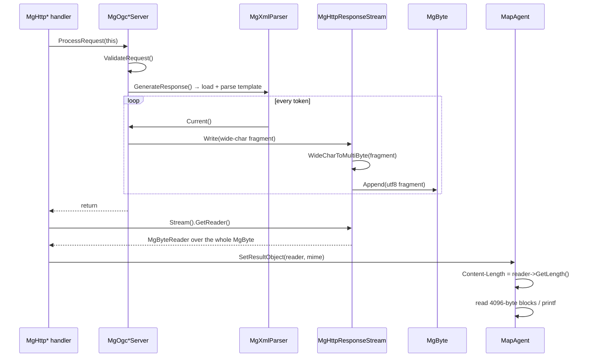

# MapGuide's OGC (WMS/WFS) request pipeline and its in-house text template engine

**Question asked:** how does the Web Tier's `MgOgcServer` / `MgOgcWmsServer` / `MgOgcWfsServer`
pipeline work, what is the template engine that drives almost every WMS/WFS response, what can that
engine actually do — and **can a template-driven OGC response be streamed to the client without
buffering the whole body in memory?**

**Answer in one paragraph:** the pipeline is a two-phase server-let per request (validate, then
respond) around a **one-pass, push-style XML token walker over an in-memory template document**. The
"template language" is a dictionary of `<Define>` values plus expansions (`&Name;`) and a fixed set of
processing instructions (`<?Enum?>`, `<?EnumDelim?>`, `<?If?>`, `<?Translate?>`, `<?EnumXml?>`, …).
Definitions can themselves contain markup and PIs, so values are re-parsed and executed as templates.
**In the shipped Web Tier the engine never streams: every write lands in an `MgByte` memory
buffer.** Every
template-driven OGC operation (WMS GetCapabilities, WMS GetFeatureInfo, WFS GetCapabilities, WFS
DescribeFeatureType, all OGC exception reports, the OpenLayers viewer page) therefore buffers its
entire response before the HTTP handler ever hands a reader to the agent. The one OGC operation that
does stream is **WFS GetFeature**, and it streams precisely because it *bypasses the template engine
altogether*: the feature collection is produced server-side (a temp file for GML, a lazy reader for
GeoJSON), passed through as an `MgByteReader`, and the agent emits it with
`Transfer-Encoding: chunked`. WMS GetMap likewise
bypasses templates for the image itself and passes the rendering service's reader straight through.
So: **no template output is streamed. The web tier has exactly two paths that avoid buffering the
response body — WFS GetFeature and WMS GetMap — and neither is template-driven.**

| Item | Revision / version |
|------|--------------------|
| `mapguide/MgDev` working copy | `branches/4.0/MgDev` r10218 |
| Code analysed | `Web/src/HttpHandler/{Ogc*,Xml*,ResponseStream,HttpReaderStreamer}`, `Web/src/{CgiAgent,IsapiAgent,ApacheAgent}`, `Server/src/{Wms,Wfs}`, `Server/src/Services/Feature/ServerFeatureService.cpp` |
| Templates analysed | `Server/src/Wms/{OgcWmsService.config,1.0.0,1.1.0,1.1.1,1.3.0,REGRESS}.xml.awd`, `Server/src/Wfs/{OgcWfsService.config,1.0.0,1.1.0}.xml.awd` |
| API/ABI mode at time of writing | `freeze` — this is a read-only analysis; nothing here changes a shipped header |
| Runtime check | none performed: no MapGuide build container was running, so all findings are static. The verification plan is in §11. |

---

## Contents

1. [The 10,000 ft view](#1-the-10000-ft-view)
2. [The request pipeline, step by step](#2-the-request-pipeline-step-by-step)
3. [Template identity, resolution and loading](#3-template-identity-resolution-and-loading)
4. [The template engine](#4-the-template-engine)
5. [Processing-instruction reference](#5-processing-instruction-reference)
6. [Derived (WMS/WFS-specific) processing instructions](#6-derived-wmswfs-specific-processing-instructions)
7. [The dictionary and definition namespace](#7-the-dictionary-and-definition-namespace)
8. [Streaming and buffering: the answer](#8-streaming-and-buffering-the-answer)
9. [Performance and memory characteristics](#9-performance-and-memory-characteristics)
10. [Quirks, latent defects and sharp edges](#10-quirks-latent-defects-and-sharp-edges)
11. [Verification plan](#11-verification-plan)
12. [Where to change what](#12-where-to-change-what)
- [Appendix A — operation/template matrix](#appendix-a--operationtemplate-matrix)
- [Appendix B — quick language card](#appendix-b--quick-language-card)

---

## 1. The 10,000 ft view

```mermaid
flowchart LR
    C["Client<br/>WMS/WFS GET or POST"] --> A["MapAgent<br/>CGI / ISAPI / Apache"]
    A --> R["MgHttpRequest::Execute<br/>routing by SERVICE.REQUEST"]
    R --> H["MgHttp{Wms,Wfs}* handler<br/>(MgHttpRequestResponseHandler)"]
    H -->|"MgHttpRequestParameters<br/>(case-insensitive wrapper)"| S["MgOgc{Wms,Wfs}Server<br/>(MgOgcServer)"]
    S -->|"ValidateRequest()"| V{"valid?"}
    V -->|"no"| E["ServiceExceptionReportResponse<br/>(template)"]
    V -->|"yes"| D["handler AcquireResponseData()<br/>fills layer / feature / map data"]
    D --> P["RespondToRequest()"]
    P --> T["GenerateResponse()<br/>load template + negotiate version"]
    T --> X["MgXmlParser<br/>one-pass token walker"]
    X -->|"Write()"| O["CStream<br/>MgHttpResponseStream"]
    O -->|"MgByte (memory)"| BR["MgByteReader"]
    E --> O
    BR --> HR["hResult->SetResultObject()"]
    HR --> A
    A -->|"Content-Length or chunked"| C
```



Three observations that explain almost everything else:

1. **The server-let is not an HTTP server.** `MgOgcServer` is a per-request object that owns a
   dictionary stack and writes to an abstract `CStream`. It knows nothing about HTTP status codes,
   headers, chunking or the agent. The HTTP handler owns those.
2. **Templates are XML-shaped, but not XML.** The parser is a deliberately small, forgiving tokenizer
   (`XmlParser.h` says so: *"not anal or paranoid"*, no schema validation, no entity resolution). The
   document is loaded whole, tokenized in place, and never materialized as a DOM.
3. **Output is push-only.** `ProcessXmlStream()` walks tokens and calls `Write()` immediately, but the
   only production `CStream` used by these handlers (`MgHttpResponseStream`) appends to an in-memory
   `MgByte`. "Streaming" therefore ends at the `CStream`, not at the socket. See §8.

---

## 2. The request pipeline, step by step

### 2.1 Routing: `SERVICE` + `REQUEST` becomes an operation name

The mapagent does not dispatch on URL path; it dispatches on parameters. `MgHttpRequest::Execute()`
([HttpRequest.cpp:208](../mapguide/MgDev/Web/src/HttpHandler/HttpRequest.cpp#L208)) reads `OPERATION`
first, and failing that composes `SERVICE.REQUEST` from the OGC parameters:

```cpp
STRING sRequestValue = m_requestParam->GetParameterValue(MgHttpResourceStrings::reqWmsRequest);
...
STRING sServiceValue = m_requestParam->GetParameterValue(MgHttpResourceStrings::reqWmsService);
if(sServiceValue.length() != 0 && (L"WFS" == MgUtil::ToUpper(sServiceValue) || L"WMS" == MgUtil::ToUpper(sServiceValue)))
    sParamValue = sServiceValue;
...
sParamValue.append(L".");
sParamValue.append(sRequestValue);
```

The composed name is upper-cased and matched against the static registry
([HttpRequest.cpp:414](../mapguide/MgDev/Web/src/HttpHandler/HttpRequest.cpp#L414)):

| Operation name | Handler |
|---|---|
| `WMS.GETCAPABILITIES`, `WMS.CAPABILITIES` | `MgHttpWmsGetCapabilities` |
| `WMS.GETMAP`, `WMS.MAP` | `MgHttpWmsGetMap` |
| `WMS.GETFEATUREINFO` | `MgHttpWmsGetFeatureInfo` |
| `WFS.GETCAPABILITIES` | `MgHttpWfsGetCapabilities` |
| `WFS.GETFEATURE` | `MgHttpWfsGetFeature` |
| `WFS.DESCRIBEFEATURETYPE` | `MgHttpWfsDescribeFeatureType` |

Notes:

- `SERVICE` / `REQUEST` are matched case-insensitively here (`ToUpper`), which is why clients may send
  `service=wms&request=getmap`.
- If `REQUEST` is missing and CITE mode is enabled, the dispatcher fabricates
  `WFS.GETCAPABILITIES` / `WMS.GETCAPABILITIES` to produce a spec-shaped exception rather than a
  generic agent error (comment at [HttpRequest.cpp:254](../mapguide/MgDev/Web/src/HttpHandler/HttpRequest.cpp#L254)).
- If there is no `OPERATION` and no OGC `REQUEST`, the POST-only handlers are tried in turn
  (`MgHttpWfsGetCapabilities`, `MgHttpWfsDescribeFeatureType`, `MgHttpWfsGetFeature`).

`GetRequestClassification()` on the handler (`mrcWfs` / `mrcWms`) is what `webconfig.ini`'s
`AgentDisableWfs` / `AgentDisableWms` switches gate at construction time
([HttpRequestResponseHandler.cpp:58](../mapguide/MgDev/Web/src/HttpHandler/HttpRequestResponseHandler.cpp#L58)).

### 2.2 The two-phase server-let (`IMgOgcDataAccessor`)

`MgOgcServer::ProcessRequest()` is small and is the whole contract
([OgcServer.cpp:233](../mapguide/MgDev/Web/src/HttpHandler/OgcServer.cpp#L233)):

```cpp
bool MgOgcServer::ProcessRequest(IMgOgcDataAccessor* dataAccessor)
{
    if(dataAccessor != NULL)
        dataAccessor->AcquireValidationData(this);
    bool bValid = ValidateRequest();
    if(bValid)
    {
        if(dataAccessor != NULL)
            dataAccessor->AcquireResponseData(this);
        RespondToRequest();
    }
    return bValid;
}
```

`IMgOgcDataAccessor` ([OgcDataAccessor.h](../mapguide/MgDev/Web/src/HttpHandler/OgcDataAccessor.h))
is implemented by the HTTP handler itself (e.g. `MgHttpWfsGetCapabilities::Execute` passes `this`).
The split matters:

- **`AcquireValidationData`** lets the handler resolve things the server needs *before* it can validate
  — e.g. a WMS `LAYERS=` list is turned into `LayerDefinition` resources and their metadata, and
  `SECTIONS=` / `typename=` are pushed into the dictionary — before `ValidateRequest()` walks the
  parameters ([HttpWfsGetCapabilities.cpp:124](../mapguide/MgDev/Web/src/HttpHandler/HttpWfsGetCapabilities.cpp#L124),
  [HttpWmsGetMap.cpp:262](../mapguide/MgDev/Web/src/HttpHandler/HttpWmsGetMap.cpp#L262)).
- **`AcquireResponseData`** only runs if validation passed, and fetches the expensive data: layer
  metadata for WMS, feature-type metadata for WFS, queried feature properties for GetFeatureInfo, and
  the WFS feature collection for GetFeature.
- **`RespondToRequest`** is the service-specific switch: `GetCapabilitiesResponse()`,
  `GetMapResponse()`, `GetFeatureInfoResponse()`, `DescribeFeatureTypeResponse()`,
  `GetFeatureResponse()`.
- Validation failures do not throw: they call `ServiceExceptionReportResponse(...)` directly, which
  writes an exception document into the same response stream, and `ProcessRequest` returns `false`.
  The handler then publishes whatever is in the stream.

This means **exceptions and successes share one output channel**, and the handler's "if invalid, take
the stream contents" branch is identical to the success branch for every template-driven operation.

### 2.3 Server-let construction and process-wide state

`MgOgcServer`'s constructor ([OgcServer.cpp:344](../mapguide/MgDev/Web/src/HttpHandler/OgcServer.cpp#L344)):

1. takes a reference to the service's **static global dictionary**;
2. pushes a *per-instance* dictionary frame on top of it;
3. copies every request parameter into the frame as `Request.<original name>`.

The WMS and WFS servers each own a static dictionary and static exception template:

```cpp
MgUtilDictionary MgOgcWmsServer::ms_GlobalDefinitions(NULL);
STRING           MgOgcWmsServer::ms_sExceptionTemplate;
STRING           MgOgcWmsServer::ms_sExceptionMimeType;
```

`InitServer()` ([OgcServer.cpp:283](../mapguide/MgDev/Web/src/HttpHandler/OgcServer.cpp#L283)) loads
`OgcWmsService.config` / `OgcWfsService.config` **on first use only** (`if(GlobalDefinitions.Count() == 0)`),
parses its `<Define>`s into the static dictionary, and captures the `<Exception content-type=...>`
body as the last-resort exception template. It returns `false` on subsequent calls, and
`InitWmsServer()` uses that to add the default `RenderingService.SupportedFormats` value map exactly
once ([OgcWmsServer.cpp:126](../mapguide/MgDev/Web/src/HttpHandler/OgcWmsServer.cpp#L126)).

Two process-wide mutable pieces are worth flagging for any concurrency work:

- `MgOgcServer::ms_fnDocLoader` is a **static function pointer set by every request**
  (`SetLoader`), e.g. [HttpWmsGetCapabilities.cpp:83](../mapguide/MgDev/Web/src/HttpHandler/HttpWmsGetCapabilities.cpp#L83).
  In practice every loader ultimately calls `MgServerAdmin::GetDocument`, so cross-service races are
  benign today, but it is shared mutable state driven by request handling.
- `ms_GlobalDefinitions` is initialized with no lock. Two simultaneous first requests can both observe
  `Count() == 0` and both parse the config. `AddDefinition` appends/replaces within one dictionary, so
  the damage is bounded, but the initialization is not thread-safe by construction.

The handler also sets thread-local user info (`MgUserInformation::SetCurrentUserInfo`) because the
document loader re-opens a `MgServerAdmin` connection with no user parameter
([HttpWmsGetCapabilities.cpp:46](../mapguide/MgDev/Web/src/HttpHandler/HttpWmsGetCapabilities.cpp#L46)).

### 2.4 Parameter semantics: `Request.*`, name mapping and value mapping

`MgHttpRequestParameters` wraps `MgHttpRequestParam` specifically to make parameter *names*
case-insensitive ([HttpRequestParameters.cpp:28](../mapguide/MgDev/Web/src/HttpHandler/HttpRequestParameters.cpp#L28)).
The base collection's `FindName` uses `szicmp` (case-insensitive) — and because the dictionary derives
from the same class, **definition names are case-insensitive too**
([NameStringValueCollection.cpp:26](../mapguide/MgDev/Web/src/HttpHandler/NameStringValueCollection.cpp#L26)).

`MgOgcServer::RequestParameter()` ([OgcServer.cpp:1846](../mapguide/MgDev/Web/src/HttpHandler/OgcServer.cpp#L1846))
applies two template-driven rewrites:

1. **Name mapping** — if `Parameter.<name>` exists in the dictionary, its value is used as the real
   parameter name. None of the shipped configs use this today, but it is the extension point for
   renaming, e.g. `SRS` ↔ `CRS`.
2. **Value mapping** — `Parameter.<name>.ValueMap` is an XML fragment of `<translate from=...>`
   elements, applied via `MapValue()`. This is how `FORMAT=PNG`, `FORMAT=png`, `FORMAT=image/PNG`
   all normalize to `image/png` ([OgcWmsService.config.awd:152](../mapguide/MgDev/Server/src/Wms/OgcWmsService.config.awd#L152)),
   and how `SRS=LL84` becomes `EPSG:4326`.

`MapValue()` ([OgcServer.cpp:1788](../mapguide/MgDev/Web/src/HttpHandler/OgcServer.cpp#L1788)) walks a
parsed XML fragment for `<translate from="...">`; an empty/missing `from` is a catch-all; the first
matching element in document order wins; no match returns the input unchanged.

### 2.5 Validation and response dispatch per service

| Server | `ValidateRequest()` | `RespondToRequest()` |
|---|---|---|
| WMS | `ValidateGetCapabilitiesParameters`, `ValidateMapParameters`, `ValidateGetFeatureInfoParameters` ([OgcWmsServer.cpp:150](../mapguide/MgDev/Web/src/HttpHandler/OgcWmsServer.cpp#L150)) | `GetCapabilitiesResponse` (template), `GetMapResponse` (empty stub), `GetFeatureInfoResponse` (template) ([OgcWmsServer.cpp:257](../mapguide/MgDev/Web/src/HttpHandler/OgcWmsServer.cpp#L257)) |
| WFS | service/request/version checks plus `typeName` / max-features checks ([OgcWfsServer.cpp:129](../mapguide/MgDev/Web/src/HttpHandler/OgcWfsServer.cpp#L129)) | `GetCapabilitiesResponse`, `DescribeFeatureTypeResponse` (templates), `GetFeatureResponse` (reader passthrough) ([OgcWfsServer.cpp:391](../mapguide/MgDev/Web/src/HttpHandler/OgcWfsServer.cpp#L391)) |

`MgOgcWmsServer::GetMapResponse()` is literally empty
([OgcWmsServer.cpp:293](../mapguide/MgDev/Web/src/HttpHandler/OgcWmsServer.cpp#L293)); the handler does
the rendering after `ProcessRequest` returns. So the WMS GetMap "pipeline" is: validate through the
OGC server, render through `MgRenderingService`, and only use templates for `application/openlayers`
and for errors.

The WMS GetFeatureInfo response is template-driven, but its content comes from
`MgRenderingService::QueryFeatureProperties` results wrapped in `MgWmsFeatureInfo` /
`MgWmsFeatureProperties` / `MgWmsFeatureGeometry`
([HttpWmsGetFeatureInfo.cpp:202](../mapguide/MgDev/Web/src/HttpHandler/HttpWmsGetFeatureInfo.cpp#L202)).
Those objects are `IOgcResourceEnumerator`s and expose `FeatureInfo.*`, `FeatureProperty.*`,
`FeatureGeometry.*` definitions to the `<?EnumFeatureInfo?>` family (§6).

### 2.6 Exceptions

There are two exception generators:

- `MgOgcWfsException` / `MgOgcWmsException` — spec-shaped `ServiceException` elements with a code
  (`InvalidFormat`, `LayerNotDefined`, `OperationNotSupported`, …). `WriteTo` emits raw XML through
  `MgXmlElementEmitter` ([OgcWmsException.cpp:44](../mapguide/MgDev/Web/src/HttpHandler/OgcWmsException.cpp#L44)).
- `MgOgcInternalException` — used by `InternalError()` for failures with no service-specific code
  ([OgcServer.cpp:260](../mapguide/MgDev/Web/src/HttpHandler/OgcServer.cpp#L260)).

`ServiceExceptionReportResponse()` ([OgcServer.cpp:1728](../mapguide/MgDev/Web/src/HttpHandler/OgcServer.cpp#L1728))
pushes a dictionary frame, defines `Exception.Type`, `Exception.Message`, `Exception.Element`,
`Exception.Locator` and `Exception.Contents`, then:

1. `GenerateResponse("Exception", NULL)` — negotiate a version, load the version template, find the
   first `<Response request="Exception">`, and render it; if that fails,
2. `DefaultExceptionResponse()` — render the global config's `<Exception content-type=...>` body; if
   *that* is missing, a hard-coded HTML fallback containing `<?EnumDictionary?>`.

`ExceptionResponse(MgXmlParser&, ...)` and the declared `ExceptionResponse(const MgOgcException&)`
are dead code — no call sites.

Exception templates matter for behaviour, not just formatting: the WMS 1.3.0 template renders
`<ServiceExceptionReport>` for `text/xml`, while WFS 1.1.0 renders `<ows:ExceptionReport>` with
`exceptionCode`/`locator`. Both use `&Exception.message;` in lowercase; that works only because
definition lookup is case-insensitive.

---

## 3. Template identity, resolution and loading

### 3.1 The two kinds of document

| Document | Identifier | Role |
|---|---|---|
| `OgcWmsService.config.awd` | `Wms:OgcWmsService.config` | Process-wide definitions (`SupportedVersions`, `Service.*`, `Url.*`, `Formats.*`, `Parameter.*`, `ReferenceSystems`, …) and the fallback `<Exception>` |
| `Wms:<version>.xml` | `Wms:1.3.0` | `<Template service="WMS" version="1.3.0">` with per-version `<Define>`s and `<Response>` bodies |
| `OgcWfsService.config.awd` | `Wfs:OgcWfsService.config` | Same, for WFS |
| `Wfs:<version>.xml` | `Wfs:1.1.0` | Same, for WFS |

`GenerateResponse()` builds the template name as `GetTemplatePrefix() + negotiatedVersion + ".xml"`
([OgcServer.cpp:1474](../mapguide/MgDev/Web/src/HttpHandler/OgcServer.cpp#L1474)):

```cpp
STRING sFileName(GetTemplatePrefix());
sFileName += pszVersion;
sFileName += kpszFilenameTemplateSuffix;   // ".xml"
VPSZ pszTemplate = LoadFile(sFileName.c_str());
```

### 3.2 Resolution: `MgServerAdmin::GetDocument`

`LoadFile()` calls the static `ms_fnDocLoader`; the shipped loader
([HttpWmsGetCapabilities.cpp:46](../mapguide/MgDev/Web/src/HttpHandler/HttpWmsGetCapabilities.cpp#L46)) is:

```cpp
Ptr<MgServerAdmin> serverAdmin = new MgServerAdmin();
serverAdmin->Open(userInfo);
Ptr<MgByteReader> brDoc = serverAdmin->GetDocument(pszDoc);
sRet = brDoc->ToString();
```

`MgServerAdminService::GetDocument` → `MgServerManager::GetDocument`
([ServerManager.cpp:655](../mapguide/MgDev/Server/src/Common/Manager/ServerManager.cpp#L655)):

- splits the identifier on `:` into a *path tag* and a *file tag*;
- accepts only file tags matching `A-Za-z0-9_.-+[]` and rejects `..`
  ([ServerManager.cpp:1572](../mapguide/MgDev/Server/src/Common/Manager/ServerManager.cpp#L1572));
- looks up `<pathTag>DocumentPath` in `[GeneralProperties]` (`WmsDocumentPath = Wms/`,
  `WfsDocumentPath = Wfs/` in `serverconfig.ini`
  ([serverconfig.ini:109](../mapguide/MgDev/Server/src/Core/serverconfig.ini#L109)));
- appends the fixed extension `.awd` (`DocumentExtension`,
  [ServerManager.cpp:34](../mapguide/MgDev/Server/src/Common/Manager/ServerManager.cpp#L34));
- reads the file into a file-backed `MgByteSource`/`MgByteReader`.

So `Wms:1.3.0` means `<server prefix>/Wms/1.3.0.xml.awd`. The `.awd` suffix is why the checked-in
template files are named `.xml.awd`; it is not a template-language extension, just the document-store
extension.

**There is no template cache.** Every `GenerateResponse` call re-reads the file (through the server
API), converts it to a wide string (`ToString()`), and `LoadFile` copies it again into a `malloc`ed
buffer that the parser takes ownership of ([OgcServer.cpp:1602](../mapguide/MgDev/Web/src/HttpHandler/OgcServer.cpp#L1602)):

```cpp
STRING::size_type iSizeInBytes = sRet.length() * sizeof(CHARTYPE);
VPSZ pSlurp = (VPSZ)malloc(iSizeInBytes+sizeof(CHARTYPE));
memcpy(pSlurp,sRet.c_str(),iSizeInBytes+sizeof(CHARTYPE));
if(pSlurp[0] == 0xfeff) memcpy(pSlurp,pSlurp+1,iSizeInBytes); // strip BOM
```

The only thing cached across requests is the global config's `<Define>` set (once per process per
service).

`LoadFile` also ignores the loader's `bool` result and does not check `ms_fnDocLoader` for `NULL`; an
unset loader is a null-pointer call, and an empty document flows on to "no `<Template>`" and an
internal error.

### 3.3 Version negotiation

`NegotiatedVersion()` ([OgcServer.cpp:1629](../mapguide/MgDev/Web/src/HttpHandler/OgcServer.cpp#L1629)):

1. reads `VERSION` (or legacy `WMTVER`); if absent, requests the absurd `9999.9.9` so that the highest
   supported version is selected;
2. finds the `SupportedVersions` definition in the global dictionary (a `<Version number="..."/>` list,
   which must be in increasing order);
3. applies OGC negotiation using **lexical** string comparison: if the request is below the lowest
   supported version, use the lowest; otherwise use the highest supported version ≤ the request;
4. stores the result as the `TemplateVersion` definition.

Consequences:

- No `SupportedVersions` definition → `GenerateResponse` raises `InitServer.Error` and emits a default
  exception.
- Comparison is lexical, so `1.10.0` would sort below `1.2.0`. The code comments acknowledge this.
- A Debug build additionally accepts `VERSION=REGRESS`, which is how `Wms:REGRESS.xml` is exercised;
  the negotiation is bypassed and `TemplateVersion=REGRESS` is defined
  ([OgcServer.cpp:1665](../mapguide/MgDev/Web/src/HttpHandler/OgcServer.cpp#L1665)).

### 3.4 Template document shape and response selection

A version template must start with (whitespace/comments/PIs skipped while searching):

```xml
<Template service="WMS" version="1.3.0">
  <Definitions>
    <Define item="Name">...</Define>
    ...
  </Definitions>
  <Response request="GetCapabilities" content-type="text/xml"> ... </Response>
  ...
</Template>
```

`ProcessTemplateElement()` ([OgcServer.cpp:1509](../mapguide/MgDev/Web/src/HttpHandler/OgcServer.cpp#L1509))
is strict about the envelope:

- `service=` must exactly equal `GetServiceType()` (`"WMS"` / `"WFS"`) — comparison is case-sensitive;
- `version=` must exactly equal the negotiated version;
- otherwise it calls `InternalError()` and stops.

`<Definitions>` are loaded into the per-instance frame, then each `<Response>` is tested in file order
by `ProcessResponseElement()` ([OgcServer.cpp:1547](../mapguide/MgDev/Web/src/HttpHandler/OgcServer.cpp#L1547)):

- `request=` must exactly equal the requested operation string (`"GetCapabilities"`,
  `"GetFeatureInfo"`, `"DescribeFeatureType"`, `"Exception"`, …);
- if `content-type=` is present it must equal the caller's requested MIME type (or the caller passed
  `NULL`); if absent, the response is only eligible for `text/xml`;
- the first match wins, and its body is rendered. Non-matching `<Response>` elements are skipped
  wholesale by `MgXmlSynchronizeOnElement`.

Because content types are exact strings, the WMS 1.1.x default is `application/vnd.ogc.wms_xml`, while
1.0.0/1.3.0 default to `text/xml` ([OgcWmsServer.cpp:257](../mapguide/MgDev/Web/src/HttpHandler/OgcWmsServer.cpp#L257)).
The `Formats.*` definitions only *advertise* what a template may implement; the actual offer is the
set of `<Response>` elements. (For example the config advertises `text/plain` for GetCapabilities, but
the 1.3.0 template has no such response, so a `FORMAT=text/plain` request falls back to XML.)

`SetContentType()` ([OgcServer.cpp:382](../mapguide/MgDev/Web/src/HttpHandler/OgcServer.cpp#L382))
also emits the XML declaration, but it does so with a **prefix compare**:

```cpp
if(SZ_EQN(pszMimeType,kpszMimeTypeXml,szlen(kpszMimeTypeXml)))   // first 8 chars
    Write(kpszXmlProcessingInstruction);
```

so `text/xml; subtype=gml/3.1.1` also gets the declaration. Non-XML types get none.

---

## 4. The template engine

### 4.1 Parsing model: one-pass, in-memory, no DOM

`MgXmlParser` ([XmlParser.h:291](../mapguide/MgDev/Web/src/HttpHandler/XmlParser.h#L291)) is an
enumerator over an in-memory wide string:

```cpp
MgXmlParser(CPSZ pszString); // TODO: rewrite to be stream-based?
```

The `TODO` is the short answer to the streaming question. The parser:

- owns (or duplicates) the whole document;
- scans forward from the current position on `Next()`, creating a small node object
  (`MgXmlBeginElement`, `MgXmlEndElement`, `MgXmlTextElement`, `MgXmlProcessingInstruction`,
  `MgXmlComment`, `MgXmlDoctypeNode`, `MgXmlCdataNode`) that stores a **pointer and a length into the
  original buffer**;
- has no lookahead beyond a tag boundary, no entity expansion, no validation, no namespace resolution
  except what `MgXmlNamespaceManager` does for `EnumXml`;
- can be told to skip whitespace, comments and PIs (`keSkipWhitespace|keSkipComments|keSkipProcessingInstructions`),
  which is how the envelope search ignores the `<?xml?>` declaration and layout;
- makes `Contents()` return a **copy** (`STRING(m_pszStart, m_iLen)`), so every token rendered costs a
  heap allocation.

`MgXmlSynchronizeOnElement` is the workhorse for "find `<X>` and leave me just past `</X>`". Its
destructor advances past the element, which is why parsing methods can return early without corrupting
the token position. Its skipping logic is explicitly "poor-man's" and does not handle recursive
elements of the same name ([XmlParser.h:459](../mapguide/MgDev/Web/src/HttpHandler/XmlParser.h#L459)).

The tokenizer's node boundaries are `\0`, `<` and `>`, and element names end at `>`, `=`, `/`, `?` or
whitespace ([XmlParser.cpp:28](../mapguide/MgDev/Web/src/HttpHandler/XmlParser.cpp#L28)). It is
forgiving in the same ways the header advertises: unquoted attribute values, stray `>` etc. will not
be diagnosed.

### 4.2 Rendering: `ProcessXmlStream` is a recursive push walk

`ProcessXmlStream()` ([OgcServer.cpp:535](../mapguide/MgDev/Web/src/HttpHandler/OgcServer.cpp#L535)):

```cpp
while(Xml.Next()) {
    switch(Xml.Current().Type()) {
    case keBeginElement:
        ProcessExpandableText(Begin.Contents());        // tag + attributes
        if(!Begin.IsEmpty()) {
            ProcessXmlStream(Xml);                      // recurse into children
            ProcessExpandableText(Xml.Current().Contents()); // emit </end>
        }
        break;
    case keProcessingInstruction: ProcessInstruction(...); break;
    case keText:     ProcessExpandableText(Xml.Current().Contents()); break;
    case keComment:  ProcessExpandableText(Xml.Current().Contents()); break; // yes, comments expand
    default:         Write(Xml.Current().Contents()); break;
    case keEndElement: return;                          // outer frame emits it
    }
}
```

Important consequences:

- **Traversal order is document order**, and every token is emitted as soon as it is visited. In
  principle this is exactly the shape a streaming writer wants; the buffering is below this function,
  not in it (§8).
- Element depth uses **C++ recursion** with no depth limit. Only *expansion* recursion is bounded
  (32 levels, §4.3).
- Comments are rendered, with expansions executed, because comments are only skipped while searching
  the envelope; inside `<Response>` the parser runs with `keNone`. This is useful for template
  debugging comments but also means a `&...;` in a comment can emit content or fail an expansion.
- CDATA and DOCTYPE nodes fall into `default:` and are written verbatim, without expansion.
- The end tag is emitted by the *outer* frame after the recursive call returns; this is why the
  `keEndElement` case must not write it.

### 4.3 Expansions: `&Name;` and the apostrophe escape

`ProcessExpandableText()` ([OgcServer.cpp:1317](../mapguide/MgDev/Web/src/HttpHandler/OgcServer.cpp#L1317))
scans for `&`, writes the preceding literal text, then calls `ProcessExpansion()`, which scans to `;`
and calls `Expansion()` ([OgcServer.cpp:1395](../mapguide/MgDev/Web/src/HttpHandler/OgcServer.cpp#L1395)):

```cpp
bool bDontExpand = pszName[0] == '\'';
CPSZ pszValue = Definition(pszName + (bDontExpand? 1 : 0));
--m_iExpansionRecursionDepth;
if(pszValue != NULL && m_iExpansionRecursionDepth >= 0) {
    if(bDontExpand)
        Write(pszValue);                    // raw paste, no XML parsing
    else {
        MgXmlParser AvoidInlineReference(pszValue);
        ProcessXmlStream(AvoidInlineReference);   // value is itself a template!
    }
}
else {
    Write("&"); Write(name); Write(";");    // unknown entity: leave it alone
}
m_iExpansionRecursionDepth++;
```

The rules that follow are the ones an author must internalize:

1. **Lookup is case-insensitive** (`szicmp`), so `&Exception.message;` resolves
   `Exception.Message`. The shipped templates rely on this.
2. **A definition value is re-parsed as markup and executed.** If `<Define item="X"><b>&Y;</b></Define>`,
   then `&X;` emits `<b>` + value + `</b>` and *runs any PIs inside it*. This is how composition works
   (e.g. WMS `Layer.xml` calls `<?Enum ... using="&CRS.xml;"?>`), and it is why values containing
   literal `<` or `&` must be escaped or pasted with the apostrophe form.
3. **`&'Name;` pastes the value byte-for-byte with no expansion and no XML processing.** This is the
   "apostrophe escape notation" used where a value is markup that must not be re-interpreted, e.g.
   `&'Enum.item;` in `EnumXml`, and `&'EnumDictionary.Value;` in the default dictionary dump.
4. **The five XML entities are protected.** `lt`, `gt`, `amp`, `quot`, `apos` are written back
   verbatim, so a template's `&amp;` in a URL survives. Under `<?Unescape?>` this protection is
   disabled and they resolve from a temporary dictionary.
5. **Unknown names are left as `&Name;`.** This is what lets ordinary XML entities pass through, and
   what makes typos render literally instead of erroring.
6. **An `&` with no `;` is a trap.** `ProcessExpansion` runs to the end of the fragment, treats the
   rest as the name, and on failure re-emits `&` + rest + `;`. So a URL fragment like `?a=1&b=2`
   becomes `?a=1&b=2;` unless it is written `&amp;`.
7. **Expansion recursion is capped at 32** by the shared `m_iExpansionRecursionDepth` (initialised to
   32 in the constructor). At exhaustion the literal `&Name;` is emitted. This is what defuses the
   self-referential `Layer.Title` definition in the WMS config (§10).
8. **`&'...;` only skips parsing of the *value*.** The outer string is still scanned for further
   expansions.

### 4.4 Conditional output is a single global flag

`<?If?>`, `<?Ifdef?>`, `<?Else?>`, `<?Endif?>` all mutate one member, `m_bWriteEnabled`. `Write()` is a
no-op when it is false, but **everything else still runs**:

- `ProcessInstruction()` is not gated by `m_bWriteEnabled`;
- `<?Enum?>` still parses the list, pushes frames and defines `Enum.item`/`Enum.iteration`;
- `<?Translate?>` still evaluates and maps;
- expansions are still looked up and (if they contain PIs) executed.

This has a subtle and important consequence: **a disabled branch is not inert**. A nested `<?If?>`
inside a false branch can set `m_bWriteEnabled = true` and "resurrect" the remainder of the outer
branch; a stray `<?Else?>` toggles it. That is exactly why the templates contain comments such as
*"<?If...?><?Endif?> cannot be nested"* ([1.3.0.xml.awd:59](../mapguide/MgDev/Server/src/Wms/1.3.0.xml.awd#L59)),
and why the WMS template works around a nested condition by moving the inner decision into a
`<?Translate?>` table (`EX_GeographicBoundingBox.xml`, §4.7).

`<?Endif?>` unconditionally restores `true`; there is no condition-depth stack to restore to. So an
unbalanced or nested conditional leaves the rest of the response either suppressed or emitted with no
diagnostic.

`CSubstituteStream` (used by `ProcessExpandableTextIntoString` and `ProcessXmlIntoString`) saves and
restores `m_bWriteEnabled` and `m_eEscapeState` and forces both to "on"/normal for the duration, which
is why PI attributes are evaluated even inside a disabled branch.

### 4.5 Escaping

`m_eEscapeState` is a tri-state (`keNormal`, `keEscaping`, `keUnescaping`) and is checked inside
`ProcessExpandableText`:

- `<?Escape text="..."?>` sets `keEscaping` while rendering the expanded text, replacing `<` with
  `&lt;` and `>` with `&gt;`. It does **not** escape `&`, quotes or apostrophes.
- `<?Unescape text="..."?>` sets `keUnescaping`, temporarily defines `lt`/`gt`/`amp`/`quot`/`apos` in a
  scoped frame, and then expands the text; because entity protection is off, `&lt;` resolves to `<`.
  The text is actually expanded twice (once into a discarded debug string), which is wasted work but
  otherwise harmless ([OgcServer.cpp:732](../mapguide/MgDev/Web/src/HttpHandler/OgcServer.cpp#L732)).
- Both restore the previous state on exit.

There is **no general output encoding**. Definition values (metadata titles, feature property values,
request parameters) are injected raw. Some producers pre-escape (`MgWmsFeatureProperties` calls
`MgUtil::ReplaceEscapeCharInXml`), but the language itself gives you only `<?Escape?>`.

### 4.6 Dictionary scoping

`MgUtilDictionary` is a linked list of frames ([Dictionary.cpp](../mapguide/MgDev/Web/src/HttpHandler/Dictionary.cpp)):

- `AddDefinition` always writes to the **top frame**, replacing a same-named entry there;
- `operator[]` searches the top frame, then each enclosing frame, ending at the static global
  dictionary;
- `CDictionaryStackFrame` is the RAII push/pop used by every enumeration iteration, every `EnumXml`
  node and every exception (the constructor pushes its frame directly).

Scopes in practice:

```text
static global dictionary (config <Define>s, process lifetime)
└── per-instance frame (constructor; also receives the version template's <Define>s)
    ├── Request.* (copied at construction)
    ├── AcquireValidationData / AcquireResponseData definitions
    ├── per-iteration frame (Enum, EnumDelim, EnumDictionary, EnumXml, derived PIs)
    └── temporary frames for Unescape entities and Exception.*
```

Because version-template `<Define>`s are loaded into the *instance* frame, a version template can
override any global definition for that request only, without touching other requests. That is the
documented purpose of the config vs template split.

### 4.7 Worked examples from the shipped templates

**Composition + enumeration (WMS layer)** — `Layer.xml` defines a whole layer element and uses
`EnumDelim` for keywords and `Enum` for bounding boxes, with a fallback when `Layer.Bounds` is absent
([1.3.0.xml.awd:30](../mapguide/MgDev/Server/src/Wms/1.3.0.xml.awd#L30)):

```xml
<Define item="Layer.xml">
  <Layer queryable="&Layer.Queryable;" ... >
   <Name>&Layer.Name;</Name>
   <Title>&Layer.Title;</Title>
   <?Ifdef item="Layer.Abstract"?><Abstract>&Layer.Abstract;</Abstract><?Endif?>
   ...
   <?Enum list="&Layer.Bounds;" item="Bounds" using="&CRS.xml;"?>
   <?Enum list="&Layer.Bounds;" item="Bounds" using="&EX_GeographicBoundingBox.xml;"?>
```

**The nesting workaround** — `EX_GeographicBoundingBox.xml` needs "emit only if CRS is 4326", but
`<?If?>` cannot be nested inside the `<?Ifdef?>` above, so the condition becomes a `<?Translate?>` table
with a catch-all empty translation ([1.3.0.xml.awd:60](../mapguide/MgDev/Server/src/Wms/1.3.0.xml.awd#L60)):

```xml
<Define item="EX_GeographicBoundingBox.xml">
  <?Translate text="&Enum.item.SRS;" with="&EX_GeographicBoundingBox.translate.xml;"?>
</Define>
<Define item="EX_GeographicBoundingBox.translate.xml">
  <translate from="EPSG:4326"><EX_GeographicBoundingBox>...</EX_GeographicBoundingBox></translate>
  <translate></translate>
</Define>
```

**JSON comma handling without a nesting-capable `If`** — the feature format appends a comma only when
the property is not the last, using an `If` whose `l`/`r` are expansions
([1.3.0.xml.awd:132](../mapguide/MgDev/Server/src/Wms/1.3.0.xml.awd#L132)):

```xml
<Define item="FeatureProperty.json">"&FeatureProperty.Name;": "&FeatureProperty.Value;"<?If l="&FeatureProperty.IsLast" op="eq" r="0"?>,<?Endif?></Define>
```

**Argument-list composition (WFS)** — `<?Translate?>` is used because the bounding-box fallback needs a
map lookup *inside* an `Enum` argument, which cannot be written inline
([1.1.0.xml.awd:51](../mapguide/MgDev/Server/src/Wfs/1.1.0.xml.awd#L51)):

```xml
<Define item="Feature.name.to.Bounds"><?Translate text="&Feature.name;" with="&Bounds.translate;"?></Define>
<Define item="Feature.name.to.BoundingBox"><?Enum list="&Feature.name.to.Bounds;" using="&BoundingBox.xml;" item="Bounds"?></Define>
```

### 4.8 What the language does *not* have

This is the part that is easy to over-estimate, because the templates look like a general-purpose
templating language. They are not. The complete capability set is: definitions, expansions, the PIs in
§5 and §6, and string equality/ordering. There is no:

- **arithmetic or numeric comparison** (`10 < 9` lexically);
- **assignment or mutable variables** other than dictionary definitions (created by `<Define>`, by a
  few PIs such as `<?Enum?>`/`<?Translate?>`/`<?Unescape?>`, and by host code);
- **string functions** — no length, substring, replace, case conversion or formatting. `<?EnumDelim?>`
  can split on a fixed separator and `<?Translate?>` can do an exact lookup, and that is the whole
  string-processing repertoire;
- **user-defined functions or macros** — a `<Define>` is a value, not a callable, and there are no
  parameters (the "arguments" are whatever definitions happen to be in scope when it expands);
- **conditional nesting** (§4.4), **loops other than enumeration**, or **recursion control** beyond
  the 32-level expansion budget;
- **includes** — a template cannot pull in another document; everything it can reference must already
  be in the global config, the version template, or a definition generated by the host;
- **automatic escaping** or any notion of typed values — everything is a string spliced into a string;
- **error reporting** — an unknown PI becomes an HTML comment, an unknown expansion is emitted
  literally, and a missing PI attribute is a silent no-op;
- **whitespace control** — the template's own layout is emitted verbatim (inside `<Response>`), so
  formatting the template is formatting the response.

---

## 5. Processing-instruction reference

All core PIs are dispatched by exact, **case-sensitive** name in `ProcessInstruction()`
([OgcServer.cpp:582](../mapguide/MgDev/Web/src/HttpHandler/OgcServer.cpp#L582)). An unrecognised PI is
replaced by an HTML comment `<!-- Unknown Processing Instruction ... -->`; it is not an error.
Attribute names are looked up case-insensitively by `MgXmlAttributedNode::GetAttribute`.

### 5.1 `<?Enum?>`

```
<?Enum list="XML-fragment"
        [item="element-name"]      (default "item")
        [using="format"]           (default "&Enum.item;\n")
        [between="separator"]      (default "")
        [subset="1,3,5"]?>
```

- `list` is expanded, then parsed as XML. Every **begin element** whose name equals `item` is an
  iteration.
- Each iteration pushes a dictionary frame, so definitions do not leak between items.
- If the element has attributes, each becomes `Enum.item.<attribute>` (e.g. `Enum.item.west`).
- The element's raw contents become `Enum.item` (empty string if empty).
- `Enum.iteration` is a 1-based counter, set by `IsIterationInSubset()` only when the item is in
  `subset`.
- `subset` is a comma-separated list, matched with surrounding commas, so `subset="1,3"` works and
  ranges are not supported ([OgcServer.cpp:852](../mapguide/MgDev/Web/src/HttpHandler/OgcServer.cpp#L852)).
- `using` is rendered with `ProcessExpandableText`, so it may contain expansions and PIs. The default
  emits `Enum.item` plus a newline.
- **`between` is written before the subset test**, so with a subset the separator can be emitted for
  items that are skipped. This is visible with formats that put a comma *before* each item.
- The list itself must be materialized as a string (it is the expanded `list` attribute), so an
  `Enum` over a huge collection is inherently a big-string operation.

### 5.2 `<?EnumDelim?>`

```
<?EnumDelim list="string"
            [sep=","]              (default ",")
            [using="format"]       (default "&Enum.item;\n")
            [between="separator"]  (default "")
            [subset="..."]?>
```

- Splits the expanded `list` on the exact `sep` string (no trimming, no escaping), renders the format
  per piece, and always renders a final piece after the last separator (so an empty list still yields
  one empty item, and a trailing separator yields an empty final item).
- Same `between`/`subset` semantics as `Enum`; `Enum.item` and `Enum.iteration`.

### 5.3 `<?EnumDictionary?>`

```
<?EnumDictionary [using="format"]              (default "&EnumDictionary.Name;=&'EnumDictionary.Value;\n")
                 [between="..."]
                 [betweenframes="..."]
                 [depth="N"]?>                 (default -1 = all frames)
```

- Walks the dictionary stack from the top; for each entry defines
  `EnumDictionary.Name`, `EnumDictionary.Value`, `EnumDictionary.iteration` (global count),
  `EnumDictionary.frameiteration` (index within the frame) and `EnumDictionary.depth`.
- `depth` limits how many frames are visited; non-positive means all.
- The loop protects itself from self-reference by pushing an empty frame first and capturing each
  frame's count before adding anything, so its own bookkeeping definitions are never dumped.
- `Request.PASSWORD` is replaced with `(omitted)`.
- A re-entrancy guard (`m_bBusyEnumeratingDictionary`) writes the raw PI text if the format itself
  triggers another dictionary enumeration, and temporarily reduces the expansion budget to 2.
- This is primarily a diagnostic tool (default exception page, debug templates), but it is the only
  way a template can introspect the whole scope chain.

### 5.4 `<?If?>` / `<?Ifdef?>` / `<?Else?>` / `<?Endif?>`

```
<?If l="left" op="eq" r="right"?>
<?Ifdef item="Definition.Name"?>
<?Else?>
<?Endif?>
```

- `l` and `r` are expanded with `ProcessExpandableTextIntoString` before comparison, so they can be
  definition references.
- Operators: `eq`, `ne`, `lt`, `gt`, `le`, `ge` (case-sensitive `STRING` comparison) and
  `eqi`, `nei`, `lti`, `gti`, `lei`, `gei` (case-insensitive via `szicmp`). The comparison is lexical,
  not numeric — `"10" < "9"`. There is no numeric comparison: the final `else` comments `// sOp ==
  "eq#" -- numerical comparison?` but only returns without changing the flag.
- Missing `l`, `op` or `r` leaves the flag unchanged (silent no-op, not an error); an unknown operator
  also leaves it unchanged.
- `<?Ifdef?>` is true iff the definition exists and is non-empty.
- `<?Else?>` toggles; `<?Endif?>` sets `true`.
- **Not nestable** (single boolean). See §4.4 and §10.

### 5.5 `<?Escape?>` / `<?Unescape?>`

Covered in §4.5. Both take `text=`; the attribute is expanded first, then rendered with the escape
state applied.

### 5.6 `<?Translate?>`

```
<?Translate text="value" with="translation-table"?>
```

- Expands `text` and `with`.
- Parses `with` as XML and walks `<translate from="...">` elements in order.
- The first element whose `from` equals the input wins; a `<translate>` with no `from` is a catch-all.
- The winning element's content is captured raw and then processed as a **template** into a temporary
  string (`ProcessXmlIntoString`), so it can contain markup, expansions and PIs; `Translate.From` is
  defined for the duration.
- No match → the input string passes through unchanged.

The order-dependence of the catch-all is easy to get wrong: `<translate></translate>` must come **last**
in the table, otherwise it swallows every input.

### 5.7 `<?EnumXml?>`

```
<?EnumXml list="XML-fragment"
          [using="format"]     (default "&'Enum.item;")
          [subset="..."]?>
```

- Expands and parses `list` as XML, then walks **every node**, including text, whitespace, comments,
  PIs, DOCTYPE and CDATA.
- Per node it defines `Enum.item` (raw contents), `Enum.iteration`, `Enum.depth`, and:
  `XmlNode.Type` (`text`, `space`, `begin`, `end`, `pi`, `comment`, `doctype`, `cdata`, `unknown`),
  `XmlNode.Name`, `XmlNode.Prefix`, `XmlNode.Base`, `XmlNode.Namespace`, `XmlNode.Fullname`,
  `XmlNode.EmptyBegin`, `XmlNode.Endnode`, `XmlNode.Attributes`, `XmlNode.AttributeList`.
- Begin elements are recursed into (unless empty); an end element returns to the caller. Depth is the
  C++ call depth, not a guarded counter.
- Namespace declarations are exposed as `Enum.xmlns.<prefix>` (or `Enum.xmlns.` for the default
  namespace), and each node's namespace/prefix is resolved through `MgXmlNamespaceManager`.
- For end elements, use the apostrophe form (`&'Enum.item;`) or the end tag will be re-parsed out of
  existence.
- The default format is apostrophe-escaped, so `<?EnumXml?>` with no `using=` is a faithful node dump.

### 5.8 `<?Diagnostic?>` (Debug builds only)

`test="version" param="x"` renders `NegotiatedVersion(param)`. Nothing else is implemented. It is the
only runtime hook into negotiation and is compiled only under `_DEBUG`
([OgcServer.cpp:623](../mapguide/MgDev/Web/src/HttpHandler/OgcServer.cpp#L623)).

---

## 6. Derived (WMS/WFS-specific) processing instructions

`MgOgcServer::ProcessOtherInstruction` is the extension point
([OgcServer.cpp:643](../mapguide/MgDev/Web/src/HttpHandler/OgcServer.cpp#L643)). The derived servers
consume their data through `IOgcResourceEnumerator`
([OgcServer.h:45](../mapguide/MgDev/Web/src/HttpHandler/OgcServer.h#L45)), which is a
"`Next()` + `GenerateDefinitions(dictionary)`" pull interface. The enumerators are themselves thin
parsers over a pre-fetched XML string, not live service iterators:

- `MgWmsLayerDefinitions` parses the `EnumerateResourceDocuments` result, turns the decorated
  `ResourceId` into `Layer.Name`/`Layer.Title`, and maps metadata `Property` name/value pairs into
  `Layer.*` definitions (`_Bounds` → `Layer.Bounds`, user keys → `Layer.user.<key>`), including
  unescaping `&lt;...&gt;` metadata that Studio publishes as text
  ([WmsLayerDefinitions.cpp:115](../mapguide/MgDev/Web/src/HttpHandler/WmsLayerDefinitions.cpp#L115)).
- `MgWfsFeatureDefinitions` parses feature-type metadata into `Feature.*` definitions and filters on
  `Feature.IsPublished == 1`
  ([WfsFeatureDefinitions.cpp:201](../mapguide/MgDev/Web/src/HttpHandler/WfsFeatureDefinitions.cpp#L201)).

### 6.1 WMS instructions

| PI | Key attributes | Behaviour |
|---|---|---|
| `<?EnumLayers?>` | `using` (default `&Layer.Name;\n`), `subset` | Iterates each layer, pushes a frame, `GenerateDefinitions`, and renders only if `Layer.IsPublished == "1"`. Defines `Layer.iteration`. ([OgcWmsServer.cpp:810](../mapguide/MgDev/Web/src/HttpHandler/OgcWmsServer.cpp#L810)) |
| `<?EnumFeatureInfo?>` | `using` (default `&FeatureInfo.xml;`) | Iterates `MgWmsFeatureInfo` (one item per queried feature). Each item defines `FeatureInfo.LayerName` and `FeatureInfo.IsLast`. No subset support. ([OgcWmsServer.cpp:838](../mapguide/MgDev/Web/src/HttpHandler/OgcWmsServer.cpp#L838)) |
| `<?EnumFeatureProperties?>` | `using` (default `&FeatureProperty.xml;`) | Iterates the non-special properties of the **current** feature, defining `FeatureProperty.Name`, `FeatureProperty.Value`, `FeatureProperty.IsLast`. ([OgcWmsServer.cpp:855](../mapguide/MgDev/Web/src/HttpHandler/OgcWmsServer.cpp#L855)) |
| `<?EnumFeatureGeometries?>` | `using` (default is *`&FeatureProperty.xml;`* — a bug) | Requires both `m_pFeatureInfo` and `m_pLayers`; emits the geometry only if the **current layer's** `Layer.EnableGeometry == "1"`; defines `FeatureGeometry.Value`. ([OgcWmsServer.cpp:879](../mapguide/MgDev/Web/src/HttpHandler/OgcWmsServer.cpp#L879)) |

The nested enumeration is the point: `<?EnumFeatureInfo using="&FeatureInfo.xml;"?>` re-enters the
template engine on a `Define` that itself contains `<?EnumFeatureProperties?>` and
`<?EnumFeatureGeometries?>`. Each `EnumFeatureInfo` iteration pushes a frame, so
`FeatureInfo.*` is scoped to that feature, and the property/geometry enumerators read the current
feature from `m_pFeatureInfo`.

### 6.2 WFS instructions

| PI | Key attributes | Behaviour |
|---|---|---|
| `<?EnumFeatureTypes?>` | `using` (default `&Feature.Name;\n`), `subset` | Iterates `MgWfsFeatureDefinitions`, pushes a frame per feature, defines `Feature.*`, filters `Feature.IsPublished == 1`, sets `Feature.iteration`. ([OgcWfsServer.cpp:456](../mapguide/MgDev/Web/src/HttpHandler/OgcWfsServer.cpp#L456)) |

`kpszPiEnumFeatures` (`EnumFeatures`) is defined but never dispatched; `ProcedureEnumFeatureTypes` is
the implementation.

### 6.3 Why the WMS designed its PIs around `using` strings

Every derived PI takes a `using` template and calls `ProcessExpandableText(sFormat)`. Because
`ProcessExpandableText` re-enters `ProcessXmlStream` on any expanded definition, the format string is
a complete sub-template. That is what allows the shipped `FeatureInfo.xml`/`.html`/`.text`/`.json`
definitions to share the same enumerators while producing four different representations from one
data model.

---

## 7. The dictionary and definition namespace

Definitions are the engine's only data model. A definition is a name plus a string value; lookup is
case-insensitive; values are templates. The names in use fall into these families:

| Family | Producer | Examples |
|---|---|---|
| `Request.*` | `MgOgcServer` constructor | `Request.request`, `Request.service`, `Request.version`, `Request.format`, `Request.layers`, `Request.typename`, `Request.PASSWORD` |
| `Parameter.*` | config/templates | `Parameter.Format.ValueMap`, `Parameter.SRS.ValueMap`, `Parameter.OutputFormat.ValueMap` |
| `SupportedVersions`, `TemplateVersion` | config + negotiation | `<Version number="1.3.0"/>` list; negotiated string |
| `Service.*` | config | `Service.Name`, `Service.Title`, `Service.Abstract`, `Service.Keywords`, `Service.Contact.*`, `Service.Fees`, `Service.AccessConstraints` |
| `Url.*` / `URL.*` | config | `Url.GetCapabilities`, `Url.GetMap`, `Url.GetFeatureInfo`, `Url.DescribeFeatureType`, `Url.OnlineResource` |
| `Formats.*` | config + template overrides | `Formats.GetCapabilities`, `Formats.GetMap`, `Formats.GetFeatureInfo`, `Formats.GetFeature`, `Formats.DescribeFeatureType`, `Formats.Exception`, and per-version defaults |
| `Layer.*` | WMS layer enumerator | `Layer.Name`, `Layer.Title`, `Layer.Abstract`, `Layer.Keywords`, `Layer.Bounds`, `Layer.EnableGeometry`, `Layer.user.*`, `Layer.iteration` |
| `Feature.*` | WFS feature enumerator | `Feature.Name`, `Feature.FullName`, `Feature.Prefix`, `Feature.Resource`, `Feature.Title`, `Feature.Abstract`, `Feature.DefaultSRS`, `Feature.Bounds`, `Feature.IsPublished`, `Feature.iteration` |
| `FeatureInfo.*` | WMS feature info | `FeatureInfo.LayerName`, `FeatureInfo.IsLast`, `FeatureInfo.CRS` |
| `FeatureProperty.*` | WMS feature properties | `FeatureProperty.Name`, `FeatureProperty.Value`, `FeatureProperty.IsLast` |
| `FeatureGeometry.*` | WMS feature geometry | `FeatureGeometry.Value` |
| `Enum.*` | core PIs | `Enum.item`, `Enum.item.<attr>`, `Enum.iteration`, `Enum.depth`, `Enum.xmlns.<prefix>` |
| `XmlNode.*` | `EnumXml` | `XmlNode.Type/Name/Prefix/Base/Namespace/Fullname/EmptyBegin/Endnode/Attributes/AttributeList` |
| `EnumDictionary.*` | `EnumDictionary` | `EnumDictionary.Name/Value/iteration/frameiteration/depth` |
| `Exception.*` | exception path | `Exception.Type`, `Exception.Message`, `Exception.Element`, `Exception.Locator`, `Exception.Contents` |
| `Translate.From` | `Translate` | input value inside the table |
| `InitServer.*` | `InitServer` | `InitServer.Error`, `InitServer.File` |
| `Viewer.*` | `GenerateViewerResponse` | `Viewer.SelfUrl`, `Viewer.LayersParam`, `Viewer.SRS`, `Viewer.BBOX`, `Viewer.ServiceVersion` |
| `Section.*` | WFS `SECTIONS=` | `Section.ServiceIdentification`, `Section.ServiceProvider`, `Section.OperationsMetadata`, `Section.FeatureTypeList` |

`<Define>` values are captured raw: whitespace, comments and nested markup are all preserved, because
`ProcessDefinitions` switches the parser to `keNone` while reading them
([OgcServer.cpp:501](../mapguide/MgDev/Web/src/HttpHandler/OgcServer.cpp#L501)). Nothing is expanded
at definition time; everything happens at reference time.

---

## 8. Streaming and buffering: the answer

### 8.1 Verdict

**No, not as shipped. The template engine does not stream a response, and no template-driven OGC
operation streams.**
Every byte it produces is appended to an in-memory `MgByte` and only becomes an `MgByteReader` after
the whole response has been generated. The pipeline *does* have streaming paths, but they are
**non-template** paths: WFS GetFeature (the feature collection) and WMS GetMap (the rendered image).

### 8.2 The call chain that forces buffering



The decisive code is `MgHttpResponseStream`, the base implementation behind every `CStream` the OGC
handlers use — including `MgGetWfsFeaturesResponseStream`, whose whole purpose is to carry a reader
*outside* this buffer ([ResponseStream.h:55](../mapguide/MgDev/Web/src/HttpHandler/ResponseStream.h#L55)):

```cpp
MgHttpResponseStream()
{
    m_pStore  = new MgByte();
    m_pStream = new MgByteSource(m_pStore);
}

long Write(CPSZ pszBuffer,size_t uBytesToWrite,size_t* puBytesWritten)
{
    STRING sWide(pszBuffer,uBytesToWrite/sizeof(CHARTYPE));
    string sNarrow = MgUtil::WideCharToMultiByte(sWide);
    m_pStore->Append((BYTE_ARRAY_IN) sNarrow.c_str(), (INT32)sNarrow.length());
    ...
}
```

and `MgByte::Append` ([Byte.cpp:89](../mapguide/MgDev/Common/Foundation/Data/Byte.cpp#L89)):

```cpp
if (len+m_len > m_allocLen) {
    if (m_allocLen*2 > (len+m_len)) m_allocLen *= 2;
    else                            m_allocLen = (len+m_len);
    unsigned char* temp = Allocate(m_allocLen);
    if (m_bytes != NULL) { memcpy(temp, m_bytes, m_len); delete [] m_bytes; }
    m_bytes = temp;
}
memcpy(m_bytes+m_len, bytes, len);
m_len += len;
```

`MgByteSource(MgByte*)` wraps a `ByteSourceMemoryImpl`
([ByteSource.cpp:140](../mapguide/MgDev/Common/Foundation/Data/ByteSource.cpp#L140)), so the reader
holds the whole buffer until the agent has finished writing.

The handler then does, in every template-driven operation:

```cpp
MgHttpResponseStream Out;
MgOgcWfsServer Wfs(Parms, Out, Features);
Wfs.ProcessRequest(this);
Ptr<MgByteReader> capabilities = Out.Stream().GetReader();
hResult->SetResultObject(capabilities, capabilities->GetMimeType());
```

([HttpWfsGetCapabilities.cpp:86](../mapguide/MgDev/Web/src/HttpHandler/HttpWfsGetCapabilities.cpp#L86),
and identically [HttpWmsGetCapabilities.cpp:83](../mapguide/MgDev/Web/src/HttpHandler/HttpWmsGetCapabilities.cpp#L83),
[HttpWmsGetFeatureInfo.cpp:130](../mapguide/MgDev/Web/src/HttpHandler/HttpWmsGetFeatureInfo.cpp#L130),
[HttpWfsDescribeFeatureType.cpp:65](../mapguide/MgDev/Web/src/HttpHandler/HttpWfsDescribeFeatureType.cpp#L65)).

Even if a handler wanted to stream, `SetResultObject` takes an `MgByteReader`; the `MgByteReader` API is
pull-based and its `GetLength()` is available because the source is memory. The agent's default
non-chunked path calls `GetLength()` and prints `Content-Length` before writing anything
([CgiResponseHandler.cpp:148](../mapguide/MgDev/Web/src/CgiAgent/CgiResponseHandler.cpp#L148)).

### 8.3 Why the engine cannot stream as written

Five independent blockers, in order of depth:

1. **The template document must be fully in memory.** `LoadFile` returns a `malloc`ed wide string and
   `MgXmlParser` points into it for the whole traversal. `MgXmlParser(CPSZ)` even duplicates it. The
   class-level TODO says "rewrite to be stream-based?" ([XmlParser.h:294](../mapguide/MgDev/Web/src/HttpHandler/XmlParser.h#L294)).
2. **The output sink is a memory sink.** `CStream` is an interface, so a socket sink *could* be
   plugged in, but `MgHttpResponseStream` is the only implementation used by these handlers and it
   appends to `MgByte`. The commented-out `CCgiResponseStream` in the same header shows the original
   CGI-era design used a direct `printf` sink, but it is dead code.
3. **The handler contract is reader-based.** `hResult->SetResultObject(MgByteReader, mime)` is the
   only way an operation returns content. To hand off a live stream you would need a lazy
   `ByteSourceImpl` (the plumbing exists — `ByteSourceSocketStreamImpl`,
   `MgReaderByteSourceImpl` — but not for the OGC servers).
4. **Some template features inherently need a materialized string.** `<?Enum?>` and `<?EnumXml?>`
   parse their expanded `list`/`text` as a second XML document; `<?Translate?>` builds a string;
   `<?EnumDictionary?>` walks a stack. A streaming engine could still emit the *envelope* lazily, but
   each of these PIs is a local full-materialization point.
5. **Error semantics depend on buffering.** Rendering can fail *after* output has been produced — a
   definition expansion, a PI or a data enumerator can throw in the middle of a `<Response>` body —
   and the caller can also fall back from a requested format to `text/xml` when no `<Response>`
   matched. Because the body is buffered, the handler can discard partial output and emit an exception
   document instead. A streaming implementation would have to commit to a content type and status
   before the first byte, and could no longer "change its mind".

### 8.4 The one OGC streaming path: WFS GetFeature

WFS GetFeature is deliberately excluded from the template engine. `MgOgcWfsServer::GetFeatureResponse()`
([OgcWfsServer.cpp:368](../mapguide/MgDev/Web/src/HttpHandler/OgcWfsServer.cpp#L368)) does nothing but
attach a reader to a specialized stream:

```cpp
MgGetWfsFeaturesResponseStream* wfsResponse =
    static_cast<MgGetWfsFeaturesResponseStream*>(m_pResponse);
wfsResponse->SetReader(m_pFeatureSet);
```

The handler chooses chunked transfer explicitly
([HttpWfsGetFeature.cpp:137](../mapguide/MgDev/Web/src/HttpHandler/HttpWfsGetFeature.cpp#L137)):

```cpp
if (responseStream.HasReader())
{
    Ptr<MgByteReader> responseReader = responseStream.GetReader();
    Ptr<MgHttpHeader> respHeader = hResponse.GetHeader();
    //This is the "hint" to chunk the MgByteReader content
    respHeader->AddHeader(MgHttpResourceStrings::hrhnTransfer_Encoding,
                          MgHttpResourceStrings::hrhnChunked);
    hResult->SetResultObject(responseReader, responseReader->GetMimeType());
}
```

The comment at the data-acquisition site is unusually explicit
([HttpWfsGetFeature.cpp:393](../mapguide/MgDev/Web/src/HttpHandler/HttpWfsGetFeature.cpp#L393)):

> `// DO NOT PASS THROUGH OGC XML TEMPLATE PROCESSING CODE!`
> `// DO NOT PASS GO!`
> `// DO NOT COLLECT MEMORY SPIKES NEEDLESSLY BUFFERING XML TEMPLATE CONTENT AS A RESULT!`

Where the bytes actually live:

- **GML output (WFS 1.0.0 / 1.1.0):** the *server* serializes the feature collection with
  `FdoXmlFeatureSerializer` into a temp file (`MgFileUtil::GenerateTempFileName(false, L"wfs", L"xml")`),
  then returns `new MgByteSource(fileName, true)` — a file-backed reader
  ([ServerFeatureService.cpp:2180](../mapguide/MgDev/Server/src/Services/Feature/ServerFeatureService.cpp#L2180)).
  So there is no memory buffer, but there is a full disk serialization: it is *spooled*, not streamed
  from the feature reader to the socket.
- **GeoJSON output:** the handler uses `MgFeatureService::GetWfsReader` and wraps the reader in the
  web tier's `MgReaderByteSourceImpl`, which is a lazy `ByteSourceImpl` over `MgReader` — genuinely
  incremental from the reader's point of view.
- **Hit mode:** a small JSON/XML document is built in memory; there is nothing to stream.

At the agent, the chunked hint selects `MgHttpReaderStreamer::StreamResult()`
([HttpReaderStreamer.cpp:50](../mapguide/MgDev/Web/src/HttpHandler/HttpReaderStreamer.cpp#L50)),
which reads 8192 bytes at a time; `CgiReaderStreamer` writes each chunk as a hex length line
followed by the body via `printf`, and terminates the body with `0\r\n\r\n`
([CgiReaderStreamer.cpp:53](../mapguide/MgDev/Web/src/CgiAgent/CgiReaderStreamer.cpp#L53)). ISAPI uses
`WriteClient` and Apache sets `r->chunked = 1` with `ap_rwrite`; both are length-delimited and safe for
arbitrary bytes.

**So: the feature *body* never touches the template engine, and the web tier never accumulates it.**
The response is not strictly streamed from the feature source either (GML spools to disk first), but it
is not buffered in memory.

### 8.5 WMS GetMap and the OpenLayers viewer

`MgOgcWmsServer::GetMapResponse()` is empty. After validation the handler either:

- calls `MgRenderingService::RenderMap(...)` and passes the returned `MgByteReader` straight to
  `SetResultObject` — no template, no `MgByte` accumulation in the web tier
  ([HttpWmsGetMap.cpp:219](../mapguide/MgDev/Web/src/HttpHandler/HttpWmsGetMap.cpp#L219)); or
- for `FORMAT=application/openlayers`, calls `wms.GenerateViewerResponse(...)`, which *is*
  template-driven (the `<Response request="GetMap" content-type="application/openlayers">` body
  expands `&GetMap.html;`, a definition in `OgcWmsService.config.awd`), and therefore buffers the
  HTML page
  ([HttpWmsGetMap.cpp:181](../mapguide/MgDev/Web/src/HttpHandler/HttpWmsGetMap.cpp#L181),
  [OgcServer.cpp:1902](../mapguide/MgDev/Web/src/HttpHandler/OgcServer.cpp#L1902)).

The map image path happens to be the best-behaved one in the whole OGC surface for memory, because the
image is a reader produced by the rendering service and consumed by the agent. It is still not
"streaming" in the sense of rendering tiles to the socket — the renderer returns a complete image — but
there is no additional full-body buffer in the OGC layer.

### 8.6 One more non-template path, and a wasted template render

`MgHttpWfsDescribeFeatureType` has a second branch that is worth knowing about. It always calls
`Wfs.ProcessRequest(this)` first ([HttpWfsDescribeFeatureType.cpp:103](../mapguide/MgDev/Web/src/HttpHandler/HttpWfsDescribeFeatureType.cpp#L103)),
which validates and **renders the template response into `Out`**. Then, when all requested feature
types resolve to the same namespace (`InSameNamespace()`,
[HttpWfsDescribeFeatureType.cpp:122](../mapguide/MgDev/Web/src/HttpHandler/HttpWfsDescribeFeatureType.cpp#L122)),
it discards that buffered response and instead returns
`MgFeatureService::DescribeWfsFeatureType(...)` (line 181). That server API builds the schema XML in
memory with `SchemaToXml` and wraps it in an `MgByteSource` over a byte array
([ServerFeatureService.cpp:1625](../mapguide/MgDev/Server/src/Services/Feature/ServerFeatureService.cpp#L1625)).

So this path is:

- **not** template-driven in what it returns;
- **still** fully buffered (in the server's memory byte source);
- and it **pays for a complete template render that is thrown away**.

When the types span multiple namespaces, the branch falls through to the buffered template body. Either
way, nothing streams.

### 8.7 Per-operation verdict

| Operation | Template-driven? | Full body buffered? | Where the bytes come from |
|---|---|---|---|
| WMS GetCapabilities | **yes** | **yes** (`MgByte`) | template + `Layer.*` definitions |
| WMS GetFeatureInfo | **yes** | **yes** (`MgByte`) | template + `QueryFeatureProperties` (materialized `MgBatchPropertyCollection`) |
| WMS GetMap (image) | no | no (reader passthrough) | `MgRenderingService::RenderMap` |
| WMS GetMap (openlayers) | **yes** | **yes** (`MgByte`) | template |
| WFS GetCapabilities | **yes** | **yes** (`MgByte`) | template + `Feature.*` definitions |
| WFS DescribeFeatureType (multiple namespaces) | **yes** | **yes** (`MgByte`) | template + `Feature.*` definitions |
| WFS DescribeFeatureType (one namespace) | no (result); the discarded template is still rendered | **yes** | server `SchemaToXml` → memory `MgByteSource` |
| WFS GetFeature (GML) | no | **no** (chunked file reader) | server-side temp file |
| WFS GetFeature (GeoJSON) | no | **no** (chunked lazy reader) | `MgReaderByteSourceImpl` |
| Any OGC exception | **yes** | **yes** (`MgByte`) | version template or global `<Exception>` |

### 8.8 What it would take to stream template output

If streaming is a goal, the change is architecturally possible because `ProcessXmlStream` is already a
push walker and `CStream` is already an abstraction. The options, in ascending order of invasiveness:

1. **Spool to a file instead of memory.** Implement a `CStream` that writes UTF-8 to a temp file and
   return a file-backed `MgByteReader` (`MgByteSource(fileName, true)`). This preserves the entire
   handler contract and error semantics, bounds memory, and would make the largest template responses
   (WMS GetCapabilities over many layers) safe. It does not reduce latency-to-first-byte.
2. **Direct sink + chunked.** Implement a `CStream` that writes straight to the agent's output with
   chunked encoding, and extend the handler result to carry an already-started stream. This is the
   only option that reduces time-to-first-byte, but it changes the `MgHttpResult` contract and the
   agent interface, and it gives up the "discard and emit an exception" behaviour.
3. **Lazy `ByteSourceImpl` pull adapter.** Wrap the template engine in a `ByteSourceImpl` whose
   `Read()` resumes the token walker. This keeps `MgByteReader` and works with the existing chunked
   agent path, but requires the walker to be a coroutine/state machine (it is currently recursive and
   synchronous), and every `Enum`/`EnumXml`/`Translate` still materializes its own input.

A realistic first step is option 1: it is a local change to `MgHttpResponseStream`, keeps every
behaviour, and eliminates the unbounded memory spike that is the actual operational risk.

---

## 9. Performance and memory characteristics

All figures are derived from the code, not measured; §11 gives the experiment.

### 9.1 Per-request template cost

| Cost | Mechanism |
|---|---|
| Document fetch | `MgServerAdmin::GetDocument` reads `Wms/<version>.xml.awd` (or `Wfs/...`) through the server API on **every** request |
| Copies | file bytes → `MgByteReader::ToString` wide string → `LoadFile` `malloc` buffer; expansion values are `szdup`ed again by `MgXmlParser(CPSZ)` |
| Parse | one forward pass, allocation per token object (`new MgXmlBeginElement` etc.) and per `Contents()` copy |
| Definitions | the global config is parsed once per process; the version template's `<Define>`s are parsed and copied into the instance frame on every request |
| Rendering | per token: `Contents()` heap copy, scan for `&`, `WideCharToMultiByte`, `MgByte::Append` |

The template document for WMS 1.3.0 is ~15 KB of source; the generated GetCapabilities document can be
much larger because `EnumLayers` re-renders `Layer.xml` per layer. The layer enumerator itself walks
one pre-fetched XML string, so `EnumLayers` is linear in layers; but `EnumFeatureGeometries`
*rewinds and re-scans that entire string for every feature* to find the current layer's
`Layer.EnableGeometry`. That rewind is an O(features × layers) pattern.

### 9.2 Output memory

- `MgByte::Append` grows geometrically, so the sequence of reallocations is O(n) amortized, but each
  growth copies the entire accumulated buffer. Peak transient memory is roughly
  `current + new ≈ 3 × final size` at the moment of the last doubling.
- The buffer lives until the agent finishes writing; `MgByteReader` holds the `MgByte` through
  `ByteSourceMemoryImpl`.
- Each `Write` converts a UTF-16 (Windows) / UTF-32 (Linux) fragment to UTF-8, allocating a `STRING`
  and a `std::string` per call. Fragment granularity is "text between expansions", so a
  property-heavy GetFeatureInfo response does a very large number of small conversions.
- Nothing in the OGC path compresses the response or sets a size limit. The size is a direct function
  of published-layer count (GetCapabilities) or feature count (GetFeatureInfo).

### 9.3 Where the time goes, in order

1. Service round-trips in `AcquireValidationData`/`AcquireResponseData` (resource metadata, rendering,
   feature queries) — usually dominant.
2. `EnumLayers` / `EnumFeatureTypes` metadata parsing and per-iteration template expansion.
3. Template fetch + parse (small but repeated on every request).
4. UTF-16→UTF-8 conversion and `MgByte` growth (small for typical capabilities, measurable for
   large ones).

---

## 10. Quirks, latent defects and sharp edges

These are behaviours an author or maintainer will hit. None is proposed for a fix here; they are
recorded so the engine is understood rather than guessed at.

| # | Quirk | Evidence | Effect |
|---|---|---|---|
| 1 | Conditionals are a single boolean, not a stack | `m_bWriteEnabled` in [OgcServer.h:517](../mapguide/MgDev/Web/src/HttpHandler/OgcServer.h#L517); `<?Endif?>` sets `true` | Nested `<?If?>`/`<?Ifdef?>` silently corrupt output; the shipped templates work around it with `<?Translate?>` |
| 2 | PIs execute even when output is disabled | `ProcessInstruction` has no `m_bWriteEnabled` check | A conditional inside a skipped branch still mutates the dictionary and the flag |
| 3 | `<?Enum?>` emits `between` before the subset test | [OgcServer.cpp:800](../mapguide/MgDev/Web/src/HttpHandler/OgcServer.cpp#L800) | Subset enumeration can produce leading/trailing separators |
| 4 | A literal `&` without `;` gains a `;` | `ProcessExpansion` + `Expansion` fallback | URLs must use `&amp;`; otherwise the output is malformed |
| 5 | Comments inside `<Response>` are rendered and expanded | `keComment` case calls `ProcessExpandableText` | A comment containing `&` can emit content or alter output |
| 6 | PI names are case-sensitive; definition names are not | `sProc == kpszPi...` vs `szicmp` | `<?enum?>` is an unknown-PI comment; `&enum.item;` works |
| 7 | `&Exception.message;` (lowercase) relies on case-insensitive lookup | [1.3.0.xml.awd:457](../mapguide/MgDev/Server/src/Wms/1.3.0.xml.awd#L457) | Works, but is a trap if the dictionary comparison ever changes |
| 8 | `Layer.Title` in the WMS config is self-referential | `<Define item="Layer.Title">&Layer.Title;</Define>` ([OgcWmsService.config.awd:223](../mapguide/MgDev/Server/src/Wms/OgcWmsService.config.awd#L223)) | Without a layer-local override, expansion recurses 32 levels and emits the literal `&Layer.Title;` |
| 9 | `URl.OnlineResource` typo in both configs | [OgcWmsService.config.awd:43](../mapguide/MgDev/Server/src/Wms/OgcWmsService.config.awd#L43) | Works only because lookup is case-insensitive |
| 10 | `EnumFeatureGeometries` default `using` is `&FeatureProperty.xml;` | [OgcWmsServer.cpp:883](../mapguide/MgDev/Web/src/HttpHandler/OgcWmsServer.cpp#L883) | Wrong output if a template omits `using=` (none of the shipped ones do) |
| 11 | `EnumXml` resolves namespace from `sPrefix` before assigning it | [OgcServer.cpp:1235](../mapguide/MgDev/Web/src/HttpHandler/OgcServer.cpp#L1235) | `XmlNode.Namespace` always resolves through the default prefix, not the element's prefix |
| 12 | `SetContentType` uses a prefix compare | `SZ_EQN(..., 8)` | Any `text/xml...` subtype gets the XML declaration; intentional-looking but undocumented |
| 13 | `<Template service=...>` and `<Response request=...>` are exact, case-sensitive | [OgcServer.cpp:1518](../mapguide/MgDev/Web/src/HttpHandler/OgcServer.cpp#L1518) | A lowercase attribute value produces an internal error |
| 14 | `MgOgcServer::ms_fnDocLoader` is static and set per request | `SetLoader` | Cross-service races are currently benign because all loaders behave the same, but this is fragile |
| 15 | `ms_GlobalDefinitions` initialization is unsynchronized | `if(Count() == 0)` | Two first requests can parse the config concurrently |
| 16 | `LoadFile` ignores the loader result and does not check for a null loader | [OgcServer.cpp:1602](../mapguide/MgDev/Web/src/HttpHandler/OgcServer.cpp#L1602) | Missing document becomes an internal error; missing loader is a crash |
| 17 | `ProcessExpandableText(CPSZ,int)` ignores its length on the final write | `Write(pszStart)` uses `szlen` | Only matters for non-NUL-terminated inputs, which callers do not pass today |
| 18 | `MgXmlSynchronizeOnElement` cannot skip recursive same-name elements | own comment | A template containing nested same-named elements can desynchronize the walker |
| 19 | `ExceptionResponse(MgXmlParser&, ...)` and the declared `ExceptionResponse(const MgOgcException&)` are unused | no call sites | Dead API; the real path is `ServiceExceptionReportResponse` |
| 20 | CGI chunk writer is string-based | `printf("%s")` in [CgiReaderStreamer.cpp:84](../mapguide/MgDev/Web/src/CgiAgent/CgiReaderStreamer.cpp#L84) | Truncates at NUL and can over-read when a read fills all 8192 bytes (no terminator); ISAPI/Apache are length-safe |
| 21 | `MgByte::Read` copies `length`, not the clipped count | [Byte.cpp:139](../mapguide/MgDev/Common/Foundation/Data/Byte.cpp#L139) | Safe for `ByteSourceMemoryImpl` because it clips, but the layer below is not defensive |
| 22 | `DescribeFeatureType` renders a template and discards it for the one-namespace branch | [HttpWfsDescribeFeatureType.cpp:103](../mapguide/MgDev/Web/src/HttpHandler/HttpWfsDescribeFeatureType.cpp#L103) then line 181 | Wasted CPU and a wasted full-body buffer on that path |

Security-relevant observations (not vulnerabilities in themselves, but the boundaries to watch):

- **No output encoding by default.** `&Request.foo;` and metadata values are injected raw into markup
  and attributes. The engine provides `<?Escape?>` but does not apply it automatically. Anything
  user-controlled that reaches a definition must be escaped by its producer.
- **The document loader is path-safe by construction.** Identifiers cannot contain `..` and only accept
  a restricted file-tag character set, and the path comes from `serverconfig.ini`, not the request.
- **`EnumDictionary` deliberately suppresses `Request.PASSWORD`.** That is the only built-in redaction.
- **Debug-only surface.** `VERSION=REGRESS` selects `Wms:REGRESS.xml` and `<?Diagnostic?>` exists, but
  both are compiled out of Release (`_DEBUG`).

---

## 11. Verification plan

No runtime check was performed for this document (no MapGuide build container was running). The
following would turn the static conclusions into measurements, in the order that gives the most
information per unit of effort:

1. **Confirm the buffering layer at runtime.** Start a Release build; run a WFS GetCapabilities and a
   WFS GetFeature against `mapagent.fcgi` with `curl -v`. Expected: GetCapabilities has
   `Content-Length` and no `Transfer-Encoding`; GetFeature has `Transfer-Encoding: chunked` and no
   `Content-Length`.
2. **Confirm the memory peak.** Send a GetCapabilities for a site with many published layers while
   sampling the mapagent process RSS (`/proc/<pid>/status`, `VmRSS`/`VmHWM`). Compare against the
   body size from `curl -o`. The predicted ratio is roughly 2–3× the body size at peak.
3. **Confirm the round trip through files.** `strace -f -e trace=openat,read` the mapagent for one
   request and look for `Wms/1.3.0.xml.awd` being opened on each request (no template cache), and for
   the `wfs*.xml` temp file on GetFeature.
4. **Exercise the language.** Use a Debug build and `VERSION=REGRESS` (which selects
   `Wms:REGRESS.xml`), or add a scratch `<Response>` to a copy of a template, to test:
   `<?Enum subset=...?>` separators; a non-nesting `If`; `&'...;` versus `&...;`; `<?Unescape?>`;
   an `&` without `;`.
5. **Confirm the transport caveat.** Run a GetFeature over CGI (not ISAPI/Apache) with a response that
   is an exact multiple of 8192 bytes and watch for an over-read under ASan/Valgrind. This validates
   quirk 20.
6. **Regression baseline.** Any change to `OgcServer`/`XmlParser`/`ResponseStream` should be checked
   against the `test/*.http` suites for WMS/WFS (the mapagent OpenAPI spec in
   [openapi.yaml](./openapi.yaml) is the wire contract), plus the WMS/WFS FDO provider suites, which
   exercise the same services from the other side.

---

## 12. Where to change what

| Concern | File |
|---|---|
| Core engine, PIs, expansion, conditionals, dictionary | [Web/src/HttpHandler/OgcServer.cpp](../mapguide/MgDev/Web/src/HttpHandler/OgcServer.cpp), [OgcServer.h](../mapguide/MgDev/Web/src/HttpHandler/OgcServer.h) |
| Tokenizer, namespace manager | [Web/src/HttpHandler/XmlParser.cpp](../mapguide/MgDev/Web/src/HttpHandler/XmlParser.cpp), [XmlParser.h](../mapguide/MgDev/Web/src/HttpHandler/XmlParser.h) |
| Output stream / buffering | [Web/src/HttpHandler/ResponseStream.h](../mapguide/MgDev/Web/src/HttpHandler/ResponseStream.h), [Common/Foundation/Data/Byte.cpp](../mapguide/MgDev/Common/Foundation/Data/Byte.cpp) |
| Chunked transport | [Web/src/HttpHandler/HttpReaderStreamer.cpp](../mapguide/MgDev/Web/src/HttpHandler/HttpReaderStreamer.cpp), [CgiReaderStreamer.cpp](../mapguide/MgDev/Web/src/CgiAgent/CgiReaderStreamer.cpp), [IsapiReaderStreamer.cpp](../mapguide/MgDev/Web/src/IsapiAgent/IsapiReaderStreamer.cpp), [ApacheReaderStreamer.cpp](../mapguide/MgDev/Web/src/ApacheAgent/ApacheReaderStreamer.cpp) |
| WMS behaviour | [Web/src/HttpHandler/OgcWmsServer.cpp](../mapguide/MgDev/Web/src/HttpHandler/OgcWmsServer.cpp), [HttpWmsGetMap.cpp](../mapguide/MgDev/Web/src/HttpHandler/HttpWmsGetMap.cpp), [HttpWmsGetFeatureInfo.cpp](../mapguide/MgDev/Web/src/HttpHandler/HttpWmsGetFeatureInfo.cpp), [HttpWmsGetCapabilities.cpp](../mapguide/MgDev/Web/src/HttpHandler/HttpWmsGetCapabilities.cpp) |
| WFS behaviour | [Web/src/HttpHandler/OgcWfsServer.cpp](../mapguide/MgDev/Web/src/HttpHandler/OgcWfsServer.cpp), [HttpWfsGetFeature.cpp](../mapguide/MgDev/Web/src/HttpHandler/HttpWfsGetFeature.cpp), [HttpWfsDescribeFeatureType.cpp](../mapguide/MgDev/Web/src/HttpHandler/HttpWfsDescribeFeatureType.cpp), [HttpWfsGetCapabilities.cpp](../mapguide/MgDev/Web/src/HttpHandler/HttpWfsGetCapabilities.cpp) |
| WFS serialization | [Server/src/Services/Feature/ServerFeatureService.cpp](../mapguide/MgDev/Server/src/Services/Feature/ServerFeatureService.cpp) (`GetWfsFeature`) |
| Global definitions / fallback exception | [Server/src/Wms/OgcWmsService.config.awd](../mapguide/MgDev/Server/src/Wms/OgcWmsService.config.awd), [Server/src/Wfs/OgcWfsService.config.awd](../mapguide/MgDev/Server/src/Wfs/OgcWfsService.config.awd) |
| Version templates | [Server/src/Wms/](../mapguide/MgDev/Server/src/Wms/), [Server/src/Wfs/](../mapguide/MgDev/Server/src/Wfs/) |
| Document store | [Server/src/Common/Manager/ServerManager.cpp](../mapguide/MgDev/Server/src/Common/Manager/ServerManager.cpp), [Server/src/Core/serverconfig.ini](../mapguide/MgDev/Server/src/Core/serverconfig.ini) |

When editing templates, remember that `.awd` is the deployed extension and the runtime name is
`Wms:<version>` / `Wfs:<version>`; when editing engine code, the source trees are SVN working copies
and are never committed upstream from this repository.

---

## Appendix A — operation/template matrix

| Operation | Response `request=` | Content types in the shipped 1.3.0 / 1.1.0 templates |
|---|---|---|
| WMS GetCapabilities | `GetCapabilities` | `text/xml`, `application/vnd.ogc.wms_xml`, `text/html` |
| WMS GetMap (openlayers) | `GetMap` | `application/openlayers` |
| WMS GetFeatureInfo | `GetFeatureInfo` | `text/xml`, `text/html`, `text/plain`, `application/json` |
| WMS Exception | `Exception` | `text/xml` (version template), `text/html` (global fallback) |
| WFS GetCapabilities | `GetCapabilities` | `text/xml` |
| WFS DescribeFeatureType | `DescribeFeatureType` | `text/xml; subtype=gml/2.1.2`, `text/xml; subtype=gml/3.1.1` (multi-namespace); single-namespace requests return the server's `DescribeWfsFeatureType` XML instead |
| WFS GetFeature | *(none — reader passthrough)* | GML 2.1.2 / 3.1.1, GeoJSON |
| WFS Exception | `Exception` | `text/xml` (version template), `text/html` (global fallback) |

For WMS 1.1.0/1.1.1 the capabilities default content type is `application/vnd.ogc.wms_xml`; for 1.0.0
and 1.3.0 it is `text/xml` ([OgcWmsServer.cpp:275](../mapguide/MgDev/Web/src/HttpHandler/OgcWmsServer.cpp#L275)).

## Appendix B — quick language card

```text
Envelope (config):   <Configuration><Definitions>…</Definitions><Exception content-type="…">…</Exception></Configuration>
Envelope (version):  <Template service="WMS|WFS" version="x.y.z"><Definitions>…</Definitions><Response request="…" content-type="…">…</Response>*</Template>

Definition:          <Define item="Name">raw value, may contain markup and PIs</Define>
Reference:           &Name;          expands, re-parses the value as a template
                     &'Name;         pastes the value literally (no expansion, no XML parsing)
Unknown reference:   left as &Name;   (so XML entities pass through)
XML entities:        lt gt amp quot apos are never expanded, except inside <?Unescape?>

<?Enum list="xml" item="item" using="…" between="…" subset="1,3"?>
<?EnumDelim list="a,b,c" sep="," using="…" between="…" subset="…"?>
<?EnumDictionary using="…" between="…" betweenframes="…" depth="N"?>
<?EnumXml list="xml" using="…" subset="…"?>
<?If l="…" op="eq|ne|lt|gt|le|ge|eqi|nei|lti|gti|lei|gei" r="…"?>
<?Ifdef item="Name"?>  <?Else?>  <?Endif?>
<?Escape text="…"?>  <?Unescape text="…"?>
<?Translate text="…" with="table-definition"?>
<?Diagnostic test="version" param="…"?>      (Debug only)

Conditionals do not nest. Values are not escaped automatically.
Subset indices are 1-based; comparison is lexical; names are case-insensitive.
```
