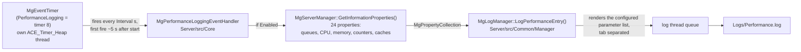

# The MapGuide performance log: what is actually written, what can be configured, and what it is for

**Question asked:** MapGuide apparently manages a "performance log" file. What is actually written to
it, what can be configured, and what are the use cases?

**Answer, in one paragraph:** it is a **periodic server-statistics sampler**. When enabled, a timer
inside the MapGuide **Server** (there is no Web Tier equivalent) wakes every `Interval` seconds
(default 300) and appends **one tab-separated line of 15 selectable server statistics** to
`<LogsPath>/Performance.log`, plus untabulated `Server started.` / `Server stopped.` lifecycle lines.
It is **disabled by default** (`Enabled = 0`), it is **not exposed anywhere in the Site
Administrator** and is **not described in the shipped product help**, and it is readable through the
Admin API only as a raw file (`MgServerAdmin::GetLogFile`), never through the typed log operations.
Its natural use is exactly what a sampled file can do and a per-request log cannot: a **cheap
long-run trend of one server's memory, CPU, queue depth, cache behaviour and cumulative operation
throughput**, taken after the fact on a production box where no profiler was attached. The catch —
and this is the finding that makes the file dangerous to read casually — is that **three of the
fifteen columns do not report the value their name promises** (`AVGOPTIME`, `TOTALOPTIME`, `UPTIME`);
this was reproduced on a running server and traced to an out-of-type property cast (§ 6.1).

Nothing in this document changes any source file, with one exception: the `CPU`-column defect
recorded in § 6.2 is fixed in the working copy — an internal `Server/` change that touches no shipped
header or symbol. The rest is a static analysis of the trees plus a runtime exercise of a released
build (details in § 5), so the API/ABI mode is not engaged.

| Item | Revision / version |
|------|--------------------|
| `mapguide/MgDev` working copy | `branches/4.0/MgDev` r10218, plus the § 6.2 fix in `Server/src/Common/Manager/ServerManager.cpp` (uncommitted) |
| `fdo` working copy | `branches/4.2` r8411 |
| API/ABI mode at time of writing | `freeze` (see [AGENTS.md](../AGENTS.md#current-cycle)) — no shipped header or symbol is touched by anything described here |
| Build exercised at runtime | `mapguideopensource-4.0.0.10202` (Ubuntu 22.04), the released 4.0.0 Final installer, pre-installed in a throwaway dev container |
| Relevance of that build to this tree | every file this document relies on is unchanged between r10202 and r10218 (`svn log -q -r 10202:10218` returns no revisions for `LogManager.cpp`, `ServerManager.cpp`, `ConfigProperties.*`, `ServerAdminDefs.h`, `EventTimer*`/`PerformanceLoggingEventHandler`/`TimedEventHandler`, `Int32Property.h`/`Int64Property.h` and `serverconfig.ini`), so the released binary's code *is* the code in this working copy |

---

## 1. What writes the file

The file is produced entirely by the **server tier**:



- **Trigger** — `MgEventTimer::PerformanceLogging`, timer index 8 of the `MG_MAX_EVENT_TIMERS` (= 9)
  array, so it is one of the nine timers initialised and activated together by
  `MgEventTimerManager::{Initialize,Activate}()` at server startup with a
  `now + 5 s` first fire (`Server/src/Core/{EventTimer,EventTimerManager}.{h,cpp}`).
  `MgPerformanceLoggingEventHandler`'s constructor reads `Enabled` and
  `Interval` from `serverconfig.ini` and calls `m_timer.SetInterval(interval)`. **All timers are
  activated regardless of whether the log is enabled** — disabling the log stops the *writing*, not
  the ticking.
- **Sampling** — `MgServerManager::GetInformationProperties()` is called on every tick (the handler
  guards it with the `Enabled` flag precisely because it is "expensive"). It builds 24 properties,
  including every one the performance log can print.
- **Formatting and writing** — `MgLogManager::LogPerformanceEntry(MgPropertyCollection*)` walks the
  configured parameter list and appends the matching values in that order, separated by
  `LogsDelimiter`; the entry is queued and written asynchronously by `MgLogThread`.
- **Nothing else writes the timer's entries**, but two other events do write to the same file:
  `MG_LOG_PERFORMANCE_STRING_ENTRY(message)` in `Server.cpp` at reactor start and at `fini()`, i.e.
  the localised `Server started.` / `Server stopped.` messages. Both were observed in a real file
  (§ 2). These are the only fixed content the file ever gets; everything else is the sampled line.

## 2. What is actually in the file

Verbatim capture from a running server (`cat -A`, so `^I` is a TAB and `$` is the line end). The
server had been started 6 s before the first metric line; the second metric line is from the same run
~2 minutes later (intermediate ticks elided):

```
# Log Type: Performance Log$
# Log Parameters: ADMINOPQCOUNT,CLIENTOPQCOUNT,SITEOPQCOUNT,AVGOPTIME,CPU,WORKINGSET,VIRTUALMEMORY,TOTALOPTIME,TOTALACTIVECONNECTIONS,TOTALCONNECTIONS,TOTALPROCESSEDOP,TOTALRECEIVEDOP,UPTIME, CACHESIZE, CACHEDROPPEDENTRIES$
<2026-10-16T09:38:02> Server started.$
<2026-10-16T09:38:08> ^I0^I0^I0^I0^I15^I59660000^I3945852000^I116^I0^I0^I0^I0^I116^I0^I0$
<2026-10-16T09:40:03> ^I0^I0^I0^I32623^I17^I59132000^I3945852000^I116^I0^I0^I0^I0^I116^I0^I0$
```

Decomposed:

| Part | Format |
|------|--------|
| Header, line 1 | `# Log Type: ` + the log's display name (`Performance Log`) |
| Header, line 2 | `# Log Parameters: ` + the **raw, unparsed** value of `Parameters` from the config |
| Entry prefix | `<YYYY-MM-DDThh:mm:ss> ` — local time, second resolution, **no `Z`**, syntactically XML `dateTime` |
| Metric line | the prefix, then for **every** parameter one delimiter **followed by** its value — so the message starts with a delimiter: `\t0\t0\t0…` |
| Lifecycle line | the prefix, then free text: `Server started.` / `Server stopped.` (localised resource strings) |
| Separator | `LogsDelimiter`, `\t` by default (`\t`, space, `,` or none) |
| Line end | `\n` on Linux, `\r\n` on Windows |
| Header emission | written lazily by the first entry into an empty file; a parameters change archives the file instead of continuing it (§ 4.3) |

Metric values are **positional only** — the line carries no parameter names, so the second header
line is the only thing that tells you which column is which, and it is preserved in archived files.

### 2.1 The fifteen selectable parameters

| `Parameters` token | Server property it reads | Where the number comes from | Observed value vs. reality |
|--------------------|---------------------------|------------------------------|-----------------------------|
| `ADMINOPQCOUNT` | `AdminOperationsQueueCount` | length of the admin operation queue (`int32`) | `0` on an idle server |
| `CLIENTOPQCOUNT` | `ClientOperationsQueueCount` | client queue (`int32`) | `0` |
| `SITEOPQCOUNT` | `SiteOperationsQueueCount` | site queue (`int32`) | `0` |
| `AVGOPTIME` | `AverageOperationTime` | `GetTotalOperationTime() / GetTotalProcessedOperations()`, ms | **garbage — see § 6.1** (`0`, `116`, `32623`…) |
| `CPU` | `CpuUtilization` | whole-machine busy % over a **1-second** `/proc/stat` sample (`ComputeLinuxCpuLoad`); on Windows the same shape from a PDH `\Process(Idle)\% Processor Time` counter plus a 1 s sleep | `15`, `17`, `4`, `6` — i.e. the *host*, not the process, on a mostly idle box |
| `WORKINGSET` | `WorkingSet` | process resident set: Linux `VmRSS` kB × **1000**, Windows `WorkingSetSize` | `59132000` = `/proc/<pid>/status` `VmRSS: 59132 kB` × 1000 ✓ |
| `VIRTUALMEMORY` | `VirtualMemory` | process address space: Linux `VmSize` kB × **1000**, Windows `PagefileUsage` | `3945852000` = `VmSize: 3945852 kB` × 1000 ✓ |
| `TOTALOPTIME` | `TotalOperationTime` | cumulative operation time / 1000 ⇒ **seconds** since process start | **garbage — see § 6.1** (stuck at `116`) |
| `TOTALACTIVECONNECTIONS` | `TotalActiveConnections` | current open connections (`int32`) | `0` |
| `TOTALCONNECTIONS` | `TotalConnections` | cumulative connections created (`int32`) | `0` |
| `TOTALPROCESSEDOP` | `TotalProcessedOperations` | cumulative operations processed (`int32`) | `0` |
| `TOTALRECEIVEDOP` | `TotalReceivedOperations` | cumulative operations received (`int32`) | `0` |
| `UPTIME` | `Uptime` | `now − MgServerManager` construction time, **seconds** | **garbage — see § 6.1** (stuck at `116` while the server was 6 s old) |
| `CACHESIZE` | `CacheSize` | feature-service cache entry count (`int32`) | `0` |
| `CACHEDROPPEDENTRIES` | `CacheDroppedEntries` | feature-service cache entries dropped (`int32`) | `0` |

`Parameters` accepts exactly these tokens. An unknown token is **silently ignored** (no warning, no
column, no error), so a typo drops that field from the data lines while the header keeps printing the
list you typed — header and data then disagree, and only the header's *order* of known tokens tells
you which column is which.

Nine more `GetInformationProperties()` properties exist and **cannot** be logged, because no
parameter token maps to them: free/total physical memory, free/total virtual memory, online status,
server version, display name, machine IP and OS version. There is no per-service breakdown, no
per-request timing and no map/render dimension anywhere in this file.

The timer and handler live in the **server** tree only: nothing in `Web/src` references
`MgLogManager` (the Web Tier logs through Apache/Tomcat), and the `Portable/MgPortable` copy of the
log manager carries the same configuration, parameter names and `GetPerformanceLog()`/`Clear`
API but has **no** `LogPerformanceEntry()` and no writer at all, so an mg-desktop/.NET host can read
a performance log that nothing ever fills.

## 3. What can be configured

Everything lives in the server's `serverconfig.ini` (`Server/src/Core/serverconfig.ini`, generated
into `bin/serverconfig.ini`; the same template is `cmake/configs/serverconfig.ini.in`). The relevant
sections are `[PerformanceLogProperties]` and, for the shared settings, `[GeneralProperties]`:

| Setting | Default (code) | Default (shipped ini) | Validation (`MgConfigProperties::sm_cvi*`) | Notes |
|---------|----------------|-----------------------|--------------------------------------------|-------|
| `PerformanceLogProperties`/`Enabled` | `false` | `0` | boolean | Disabled by default |
| `…`/`Filename` | `Performance.log` | `Performance.log` | path-ish, no `\` or `/`, reserved chars rejected | Optional **archive-frequency specifier**: `%d`, `%m`, `%y` (§ 4.3) |
| `…`/`Parameters` | `""` (empty!) | the 15-token list | length limits only | Empty ⇒ timestamped but **empty** metric lines; `Enabled=1` + no `Parameters` is a way to record "the server was alive every N seconds" and little else |
| `…`/`Interval` | `300` | `300` | `0 … 60000` seconds | Read once at server start (§ 4) |
| `GeneralProperties`/`LogsPath` | `Logs/` | `Logs/` | path | Relative to the server's working directory, so the file lands in `<install>/server/Logs/` |
| `GeneralProperties`/`LogsDelimiter` | `\t` | `\t` | a space, `,`, the literal two characters `\t`, or none | Shared by **all** logs, not just this one; `\t` is translated to a real tab at load (`TranslateDelimiter()`) |
| `GeneralProperties`/`MaxLogFileSize` + `MaxLogFileSizeEnabled` | `1024` KB, disabled | same | `1 … 2000000` KB | If enabled, reaching the size archives the file (§ 4.3) |

There is **no** per-log `LogsDetail` equivalent for the performance log; verbosity/detail knobs apply
to other logs.

## 4. Behaviour that is worth knowing before you turn it on

### 4.1 It takes a server restart, and it keeps ticking when disabled

`Enabled`, `Filename` and `Parameters` are loaded once, by `MgLogManager::LoadConfigurationProperties()`
from `MgLogManager::Initialize()` (called once from `Server.cpp` at startup), and `Interval` is read
once, in the `MgPerformanceLoggingEventHandler` constructor (called once from
`MgEventTimerManager::Initialize()`). Nothing re-runs either. So:

- Editing `serverconfig.ini` while the server runs **changes nothing** until the server is restarted
  — including turning it *off*, which is the operational foot-gun (see 4.5).
- The log file does not exist until the first write. With `Enabled = 0` (the default) a freshly
  installed server has **no** `Performance.log` at all; it appears at first tick after you enable it
  and restart.
- Tick timing: **first entry ≈ 5 seconds after startup**, then every `Interval` seconds. A small
  `Interval` is honoured (verified with `Interval = 10`: entries at `:16`, `:26`, `:36` …).
- `Interval = 0` passes validation (`0 … 60000`) and means "re-arm immediately", i.e. a hot loop
  against a call whose own comment calls it expensive. Do not do it.

### 4.2 Reading it

| Route | Works? | Evidence |
|-------|--------|----------|
| `MgServerAdmin::GetLogFile("Performance.log")` | **Yes** — any language binding (`MgServerAdmin` API) | `MgLogManager::GetLogFile` reads the file by name; it closes and reopens the stream when the file is the live one |
| `MgServerAdmin::GetLog(log)` / `ClearLog(log)` | **No** | `MgServerAdminService::GetLog`/`ClearLog` dispatch on `MgLogFileType::{Access,Admin,Authentication,Error,Session,Trace}` and throw `MgInvalidLogType` for anything else; there is **no** `Performance` constant in `MgLogFileType` |
| `MgServerAdmin::EnumerateLogs()` | Yes, and it classifies it correctly | Log type comes from the file header, so an existing `Performance.log` is reported as `Performance Log` |
| `MgServerAdmin::DeleteLog` / `RenameLog` | Yes (by filename) | both close the live stream first via `IsLogFileInUse` |
| Site Administrator "Manage Logs" / "Configure Logs" pages | **No — not visible at all** | `Web/src/mapadmin/logproperties.php` builds tabs for the six logs only, and `GetAllLogFiles()` in `serverdatafunctions.php` drops any enumerated record whose log type is not one of the six mapped strings, so the performance log never reaches the list, the "Current (live)" view or the download link |
| Shipped product help | **Not documented** | no `HelpDocs/*.htm` page mentions the performance log; `about_log_files.htm` describes only the six other logs |
| `Performance.log` on disk | Yes | it is a plain text file in `Logs/`, so `tail`, `awk`, a spreadsheet or a scraper can read it |

Reading it through the Admin API is deliberately not available as a typed operation, and the Site
Administrator that a site operator would naturally reach for cannot show it — plan on file access
(SFTP, a mounted volume, or a scripted `GetLogFile` pull).

### 4.3 It archives instead of rolling into one file

Three triggers, all of which *rename the current file away and start a new one*:

1. **Parameters change.** At startup, `ValidateLogHeaders()` compares the `# Log Parameters:` header
   in the existing file with the current configuration; if they differ the file is archived. Verified:
   changing `Parameters` from the 15-token default to `UPTIME,CPU,WORKINGSET` produced
   `Performance.log` (new header, new columns) plus
   `Performance_2026-10-16_ff55d244-c945-11f1-8000-a23b3f067911.log` (the previous log, old header
   intact). **Consequence: a parameters change silently changes the column count and order of the
   live file**, so never treat a directory of these files as one uniform table.
2. **Archive frequency.** Putting `%d` / `%m` / `%y` in `Filename` (the Site Administrator's
   Day/Month/Year archive setting is exactly this) makes the manager archive at day/month/year
   boundaries. The specifier is stripped to build the **live** name (`Performance%d.log` ⇒ live
   `Performance.log`), so the live file is always the unsuffixed name.
3. **Maximum size**, if `MaxLogFileSizeEnabled` is on.

Archives are named `<base>_<YYYY-M-D>_<uuid>.log` (`%d`-style suffixes come from
`ACE_Date_Time`, so the month and day are **not** zero-padded), and they are indistinguishable from
the live file apart from the name — headers and all.

### 4.4 One file per server process

The statistics are the **receiving server's own**, and the counters are per process, so in a
multi-server site every server writes its own `Performance.log`; if two servers are given the same
`LogsPath` they will interleave into one file and the numbers become unusable (the header even names
neither server nor machine). There is no site-wide aggregation in this file — the Site Administrator
status/report pages aggregate across servers through the Admin API instead.

### 4.5 Deleting or disabling it takes a restart

`GetLogFile`/`DeleteLog`/`RenameLog` close and reopen the stream around the operation, so they are
safe against the live log. `ClearLog` is *not* available for it (§ 4.2), which means the usual
"clear the log" action does not exist: you `DeleteLog` the file (it is immediately recreated empty by
the reopen) or just truncate it on disk. And since `Enabled` is only read at startup, "clear the log
and stop it" needs the restart in § 4.1.

## 5. How the above was established (and how to redo it)

Static claims come from: `Server/src/Core/{EventTimer,EventTimerManager,TimedEventHandler,TimedEvent,PerformanceLoggingEventHandler,Server}.{h,cpp}`, `Server/src/Common/Manager/{LogManager,ServerManager,LogThread}.{h,cpp}`,
`Common/MapGuideCommon/{System/ConfigProperties,Services/ServerAdminDefs}.*`, `Web/src/mapadmin/{logproperties,logmanagement,serverdatafunctions}.php`,
`Web/src/mapadmin/HelpDocs/*.htm`, and `Server/src/Core/serverconfig.ini` +
`cmake/configs/serverconfig.ini.in` (both `[PerformanceLogProperties]` blocks are identical).

Runtime claims come from a released **4.0.0.10202** install (the 4.0.0 Final Ubuntu 22.04
installer) in a throwaway container; no in-repo build was needed because the relevant files are
unchanged between r10202 and r10218 (§ table), so the running binary's code *is* the code in this
tree. Procedure, if it needs repeating:

1. Get a running installed server — in this repo `./image_install.sh --docker-image <image>` (an
   interactive container with the `.run` installer mounted) plus the installer itself, or the
   unattended `./mapguide_image_install.sh --target ubuntu22`; the run recorded here used an
   already-installed 4.0.0 container image, so only `<install>/server/bin/mgserver` was involved.
2. In `<install>/server/bin/serverconfig.ini`, set `[PerformanceLogProperties]` `Enabled = 1`,
   `Interval = 10`, and keep the default `Parameters` list.
3. Restart the server (`mapguidectl`/`mgserverd.sh`; `pgrep -f "mgserver daemon"` then `kill <pid>` is
   what the container watchdog also reacts to).
4. `cat -A <install>/server/Logs/Performance.log` after ~30 s; cross-check the memory columns
   against `/proc/<pid>/status` (`VmRSS`, `VmSize`) and the CPU column against `/proc/stat`.
5. Change `Parameters`, restart, and watch the log archive itself (§ 4.3).

For the ABI-level claim in § 6.1 the installed library was disassembled on the host:

```
nm -DC libMgPlatformBase-4.0.0.so | grep Property::GetValue
objdump -d --demangle --start-address=0x97380 --stop-address=0x974c0 libMgPlatformBase-4.0.0.so
```

## 6. Rough edges, limits and known problems

### 6.1 Three of the fifteen columns are broken (reproduced, root-caused)

`AVGOPTIME`, `TOTALOPTIME` and `UPTIME` are the three parameters whose properties are created as
**64-bit** (`MgInt64Property`) but read back as **32-bit**, in
`MgLogManager::LogPerformanceEntry(MgPropertyCollection*)`:

```cpp
int32Prop = (MgInt32Property*)entry->GetItem(MgServerInformationProperties::Uptime);
MgUtil::Int32ToString(int32Prop->GetValue(), tmpStr);     // reads 4 bytes at 0x64
```

`MgInt64Property` stores its payload at a different offset than `MgInt32Property` does, so the cast
reads the wrong bytes rather than the value (this is an out-of-type cast — undefined behaviour — not
just a truncation):

| | disassembly of the installed `libMgPlatformBase-4.0.0.so` |
|---|---|
| `MgInt32Property::GetValue()` | `mov 0x64(%rbx),%eax` — 4 bytes at 0x64 |
| `MgInt64Property::GetValue()` | `mov 0x68(%rbx),%rax` — 8 bytes at 0x68 |

So the three log columns read 4 bytes of the object **before** its value field. Observed
consequences on the running server:

- `UPTIME` was `116` on every tick, including the tick 6 seconds after the server started, and the
  same `116` again after a restart — a fresh process running the same binary reads the same wrong
  bytes.
- `TOTALOPTIME` was `116` on every tick too — identical to `UPTIME`, which is what a fixed
  wrong-offset read of same-shaped objects looks like.
- `AVGOPTIME` was `0`, then `116`, then `32623`, then `115` across ticks of one run, while
  `TOTALPROCESSEDOP` stayed `0` (with zero processed operations the real average is defined as `0`).

The columns that use the *correct* types are provably right: `WORKINGSET` and `VIRTUALMEMORY` matched
`/proc/<pid>/status` exactly, byte for byte, in the same lines.

**Therefore: do not read those three columns at all.** The intended fix is small and
server-internal (read `Uptime`/`TotalOperationTime`/`AverageOperationTime` as `MgInt64Property` with
`MgUtil::Int64ToString`), it does not touch a shipped header or symbol, and it is *not* made here —
this document is the deliverable. Everything else the file offers is usable.

### 6.2 The `CPU` column could log nonsense after long uptime (fixed in the working copy)

A long-standing 32-bit-only defect in `MgServerManager::ComputeLinuxCpuLoad()` accounts for the
`100` and `-2147483548` values reported against MapGuide 2.2 on 32-bit CentOS:

- the four `/proc/stat` counters were read with `%i` into `int`. On ILP32 `long` is 32 bits, and
  glibc's `vfscanf` converts through `strtol` before casting to `int`, so a value above `INT_MAX`
  **saturates at 2147483647** rather than wrapping;
- `/proc/stat` counts cumulative jiffies since boot (`USER_HZ` = 100) summed over every CPU, so on a
  many-core host `idle` passes 2^31 after a few weeks to a few months of *host* uptime — the reason
  it appeared "after some months of correct operation";
- once `idle` stopped moving the numerator was 0 and the column was pinned at `100`; once the last
  of `user`/`nice`/`sys` saturated as well the denominator was 0, `0.0/0.0` is NaN, and
  `(INT32)NaN` is `INT_MIN` on x86, so `100 - INT_MIN` is exactly `-2147483548`.

On LP64 (`long` is 64 bits) the same conversion truncates mod 2^32 instead of saturating, and the
difference of two truncated values is still the correct delta, so the reported symptom is specific
to 32-bit builds. The working copy (pending SVN commit) now:

- reads the counters as `unsigned long long` (`%llu`) from a 256-byte line, and checks the `fgets` /
  `sscanf` results instead of computing on indeterminate values;
- retries the sample if a signal cuts the 1-second `ACE_OS::sleep()` short;
- treats zero counter movement, or a counter that went backwards (a CPU was hot-unplugged), as "no
  sample" and returns `-1` — the value the Windows path already uses when PDH fails — instead of
  dividing 0 by 0;
- clamps the ratio so the `double` → `INT32` conversion is always defined.

A `-1` in the `CPU` column therefore means "could not be determined", not "0 %".

The sample-to-percentage step is now a pure function, `MgServerManager::ComputeCpuUtilization()`, so
it is covered without needing a live `/proc/stat`: `TestServerManager.cpp`'s `ComputeCpuUtilization`
case in the `[ServerManager]` suite exercises busy / idle / static / backwards / post-2^31 samples
(reverting the guards makes that case fail with `-1 == -2147483548`), and the `[ServerAdminService]`
`GetInformationProperties` case asserts the property stays within `-1 … 100` end to end.

Both are Linux-only, and deliberately so: `CpuSample` models the four counters on `/proc/stat`'s
`cpu` line and `ComputeCpuUtilization()` only ever turns a pair of them into a percentage, whereas
the Windows implementation reads a PDH `\Process(Idle)\% Processor Time` counter that already
returns a percentage, so nothing on Windows builds a sample. The helper, its declaration and the
test are guarded on `_WIN32` to keep Linux-only code out of the Windows build rather than shipping a
public API about a file format Windows never reads.

### 6.3 Units and semantics that mislead

- `WORKINGSET` and `VIRTUALMEMORY` are documented as bytes, and are bytes on Windows, but on Linux
  they are `kB × 1000` — about 2 % low versus counting KiB as 1024 — and nothing in the file says so.
- `CPU` is **whole-machine** CPU, sampled over a **blocking 1-second `/proc/stat` interval** (a
  retried `ACE_OS::sleep(1)` in `ComputeLinuxCpuLoad`), not the server process's share; on a busy or
  containerised host it says more about the neighbours than about MapGuide. It also means the tick
  takes ≥ 1 s and the value is a one-second average of everything else on the box. `-1` means the
  sample could not be taken (§ 6.2).
- `TOTALOPTIME` is seconds (the 64-bit property is built from milliseconds / 1000) whereas
  `AVGOPTIME` is milliseconds — a unit change mid-line in the intended design, and both are the
  broken columns anyway.
- The `TOTAL*` counts are cumulative **since that server process started**; they reset on restart,
  so a restart is visible in the file as a `Server stopped.`/`Server started.` pair with the
  cumulative counters wound back. `ADMINOPQCOUNT`/`CLIENTOPQCOUNT`/`SITEOPQCOUNT` are *instantaneous*
  queue lengths by contrast, and were `0` on an idle server.
- Cache metrics cover the **feature-service cache** only (`MgFeatureServiceCache::GetCacheSize()` /
  `GetDroppedEntriesCount()`); resource/tile caches are not represented.

### 6.4 Small inconsistencies in the surrounding machinery (by inspection, not exercised)

- `IsLogFileInUse()` compares a filename from disk against the **configured** name, while
  `BuildFileName()` strips the `%d`/`%m`/`%y` specifier before opening the live file. So with an
  archive frequency configured, `GetLogFile`/`DeleteLog`/`RenameLog` will not recognise the live file
  as "in use" and will operate on it without closing the stream first.
- A parameter token that is not one of the fifteen is dropped silently, while the header keeps the
  raw text — a typo therefore produces a header that does not describe the columns.
- The empty `Parameters` default (code) versus the populated default in the shipped
  `serverconfig.ini` means "enabled but empty" is easy to reach on a hand-written config and produces
  timestamp-only lines.
- The Admin API cannot clear or set this log (`SetPerformanceLogInfo()` has no caller anywhere — the
  whole `Set*LogInfo` family is exercised only by the Portable unit tests), so the only supported
  changes are file edits plus a restart.

### 6.5 Things this file is *not*

- **Not the "Performance Report".** The Site Administrator's *Performance Report* page
  (`Web/src/mapadmin/performanceReport.php`) drives the **Profiling service**
  (`Server/src/Services/Profiling/ServerProfilingService.cpp`), which renders a map with profiling
  enabled and returns the per-step timings (`ProfileResult`/`ProfileRenderMapResult` XML) to the
  caller. That is a *per-render* profile of one request, on demand, and it never touches
  `Performance.log`. The two features share no code and no vocabulary beyond the word "performance".
- **Not a replacement for the other logs.** Access logs the request/completion pair, Session logs
  per-connection state and its `AVERAGEOPTIME`, Trace logs per-request detail — all per-event, all
  documented in `HelpDocs/about_log_files.htm`. The performance log is the aggregate, sampled view;
  you use it to see *shape over time*, and the others to see *what a request did*.
- **Not a monitoring agent.** It samples one process's own counters on a fixed interval, writes a
  plain text file next to the other logs under the process umask (the one observed was `0666`), and
  has no alerting, no rotation policy beyond the three archive triggers, no remote shipping and no
  aggregation. It is useful *because* it is cheap and survives on a box where nothing else was
  installed; it is not a substitute for real metrics collection.

### 6.6 Suggested use cases (given the above)

1. **Memory trend on a long-lived production server.** `WORKINGSET`/`VIRTUALMEMORY` every 5 minutes
   gives a growth curve that distinguishes a leak from steady-state, after the fact.
2. **Did the maintenance window restart the server?** The `Server stopped.`/`Server started.` pair
   timestamps the restart, and the cumulative `TOTAL*` counters winding back to zero confirms it.
3. **Throughput over a day.** Differences of successive `TOTALRECEIVEDOP`/`TOTALPROCESSEDOP` (not the
   absolute values) give requests/second per interval; a widening gap between received and processed
   is a backlog.
4. **Queue saturation events.** A non-zero `*OPQCOUNT` is the only cheap evidence of operations
   waiting at the sampled instant — cheap, but only as good as the sample rate, so expect it to miss
   short bursts.
5. **Cache thrash.** `CACHESIZE` flat while `CACHEDROPPEDENTRIES` climbs means the working set is
   outgrowing the cache.
6. **Order-of-magnitude resource attribution**, with § 6.3 held firmly in mind — and with the
   `UPTIME`/`TOTALOPTIME`/`AVGOPTIME` columns ignored.

## 7. Open questions / possible follow-ups

- **Fix the three columns** in `MgLogManager::LogPerformanceEntry` (read them as `MgInt64Property`
  and format with `MgUtil::Int64ToString`). Three `if` blocks; server-tier only, so the shipped
  surface is untouched and the `freeze` mode is not engaged. It would be an SVN-side change to be
  reviewed as `svn diff` and committed upstream by the maintainer, not a git change in this
  repository.
- **Expose the log** — add `Performance` to `MgLogFileType` and the Site Administrator's log lists
  (plus a `PerformanceLogProperties` tab in `logproperties.php`), or document it in `HelpDocs/`.
- **Re-cast the Linux memory columns** as honest bytes (× 1024, or rename to KiB) and consider
  reporting the server process's CPU rather than the host's.
- Not investigated: whether a `Parameters` list has a maximum useful length (validation allows a long
  string but only 15 tokens ever match), and whether `Interval` changes could be made to take effect
  without a restart through the existing `MgLogManager::SetPerformanceLogInfo()` (unused) API.
